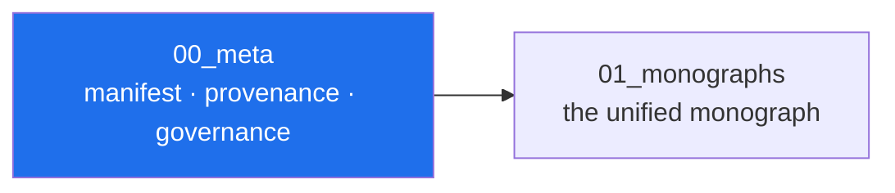

# 00_meta — manifest, provenance and governance

> **🧭 Navigation:** [Package root](../README.md) · [AB_Cloud_Academic_Package/](../../README.md) · [Repo root](../../../README.md)

*Layer map of the unified package — the highlighted node is this layer.*

This folder is the *administrative memory* of the unified package: what it
contains, where every piece came from, which checklists it passes, and how
decisions about it are made.

| File | What it is |
|---|---|
| [`manifest.json`](manifest.json) | the machine-readable package manifest (structure + counts + checksum policy) |
| [`provenance.jsonl`](provenance.jsonl) | one row per consolidation decision: source → destination → transform |
| [`checklist_reproducibility.md`](checklist_reproducibility.md) | reproducibility checklist (seeds, environments, cross-language runs) |
| [`checklist_ethics.md`](checklist_ethics.md) | research-ethics checklist (honesty layer, negative results, no overclaim) |
| [`checklist_fair.md`](checklist_fair.md) | FAIR principles checklist (findable, accessible, interoperable, reusable) |
| [`checklist_open_science.md`](checklist_open_science.md) | open-science checklist (open data, open code, open access) |
| [`dossier.md`](dossier.md) | the reading dossier: the honesty-layer index and the numbers registry |
| [`changelog_release.md`](changelog_release.md) | release editorial history (the versionless changelog of this package) |
| [`roadmap.md`](roadmap.md) | the package-level roadmap (research roadmaps live in the sources) |
| [`risks_register.csv`](risks_register.csv) | risk register (scientific, technical, editorial) |
| [`stakeholders.csv`](stakeholders.csv) | stakeholders (author, readers, replicators, reviewers) |
| [`assumptions.csv`](assumptions.csv) | assumption register (what the programme assumes openly) |
| [`glossary/`](glossary/README.md) | the multilingual glossary (RU / EN / ZH + schema) |
| [`taxonomy/`](taxonomy/README.md) | the concept taxonomy (ontology.ttl + concepts.csv) |
| [`governance/`](governance/README.md) | governance: RACI, decision log, review protocol |

## How the manifest stays honest

`manifest.json` records *what is where*, not *what is true*. Scientific truth
claims live in `02_data/processed/research_registry.json` and the report —
each with campaign attributions. The manifest is regenerated by
`06_code/scripts/update_manifest.py`; hand edits are overwritten.
