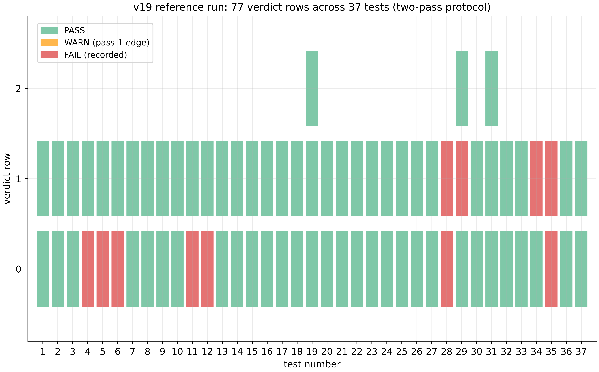
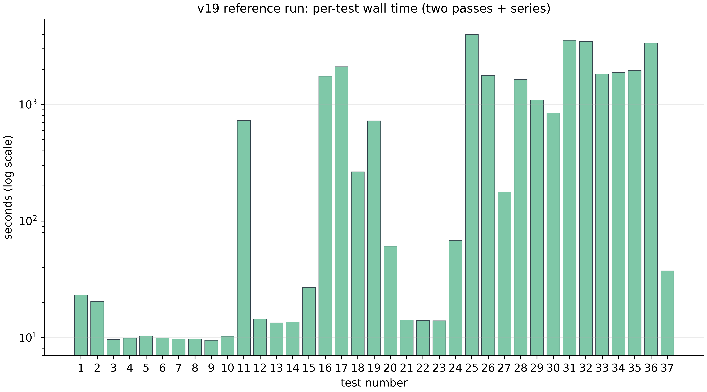
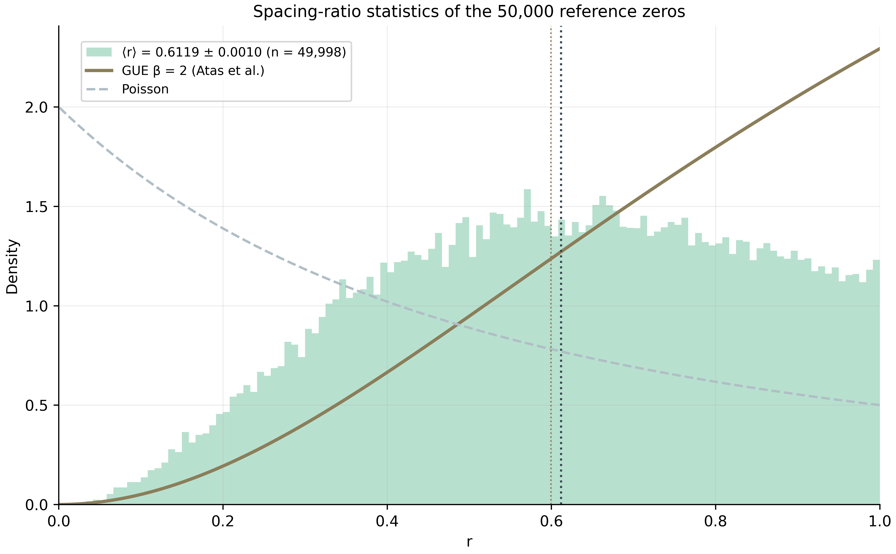
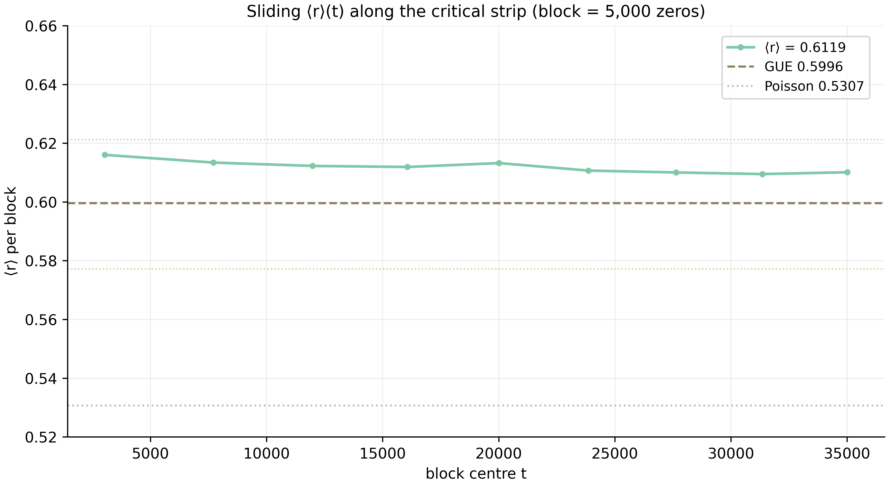

# The AB-Cloud Research Programme: from the Algebraic AB Architecture to the Dirac Skeleton, the Hilbert–Pólya Bridge, and Blind Verification

**The unified monograph of the unified academic package**

Isaev Iskhak Khamzatovich · ORCID 0009-0003-7299-0701 · Independent researcher
AB-Cloud Research Programme · October 2026

---

## Abstract

This monograph is the unified account of the AB-Cloud research programme: one study unfolded across four levels and a supplementary spinor study. The programme investigates a concrete statistical bridge between two objects mathematics has been trying to reconcile for over a century: the non-trivial zeros of the Riemann zeta function $\zeta(s)$ and the spectra of Hermitian operators. The candidate is a lattice operator carrying $\alpha$ quanta of Aharonov–Bohm magnetic flux per plaquette (the AB cloud), engineered so that its spectral statistics fall into the GUE (Gaussian Unitary Ensemble) universality class — the class the Montgomery–Odlyzko programme predicts for the $\zeta$ zeros — while the exact layer of the construct (hermiticity, flux quantization, Byers–Yang invariance, chiral pairing, Connes self-duality, a chain of geometric-phase identities) is verified to machine precision and to 256-bit arbitrary precision where required.

The account consolidates the programme's three research laboratories. **Level I** — the spectral core and the AB processor: campaigns V01–V20, theorems Th1–Th6, the V13 obligation machine, and the processor with its AB-cloud ISA and exact Givens–QR compilation ($1-F \le 4.4\times10^{-16}$). **Level II** — the Dirac skeleton: fourteen tests D1–D14 establishing that the $\pi$-flux lattice *is* a discretized massless Dirac equation, and that the $\zeta$-decorated Dirac operator lifts bulk statistics from GOE to GUE ($\langle r\rangle = 0.608$ against the theoretical $0.5992$). **Level III** — the Hilbert–Pólya bridge: seventeen campaigns C1–C17 and eighteen theorems T1–T18, from the identity function $Z_{\mathrm{id}}$ and the argument principle to $T=5000$ and the nonlocal isospectral twin; the level's verdict — "the operator that almost exists". **Level IV** — blind verification: eighteen pre-registered verdicts E01–E18, including the blind reading of all 649 $\zeta$ zeros up to $T=1000$ by two independent engines with bit-exact agreement, and the heritage of the 38-test reference run. The enriched edition adds four lines: **v19 heritage** — the complete two-pass reference run of the 37-test suite (77 verdict rows: 66 PASS and 11 honestly recorded FAIL-class rows, Julia 1.12, 35,146 seconds of computation); **Level VI** — the Meridian Spectral Observatory (gates H1–H7, the RH line on 13,661 real zeros, the monumental line V01–V112, and the 50,000-zero reference table); **Level VII** — the vortex-density optimization (Test 34-ext: 242 configurations, L = 24 → 96, the working window $N_v \approx 8$–16, best $D = 0.0318$ against the reference 0.1096 — a ×3.4 improvement); **Level VIII** — the hyperbolic wave attractors (study W1: lock-in 24/24 against 0/24 in the isotropic control, the universal window $u_1 = 0.176$, $u_2 = 0.490$, Python ↔ Julia cross-verification to $3.45\times10^{-15}$).

The consolidated verdict ledger is fixed: self-adjointness — **yes**; spectral identity — **no** (the gap is measured and stable); GUE class — **yes**; Dirac dynamics — **yes**; primes inside the operator — **no** (the $\Lambda(n)/\sqrt{n}$ weight lives in traces, not in gate spectra); the Riemann hypothesis — **blocked** by the V13 obligation machine by construction. The programme's principal contribution is not a claim but a map: the wall has a location. A local lattice cannot host the entanglement the zero-comb spectrum demands (subsystem entropies $S_A \approx 12$–$16$ nats against $160$–$220$ for Haar-random states) — the most precise negative statement of the series, and exactly the kind of map a positive construction will need.

**Keywords:** Riemann zeta function, Hilbert–Pólya conjecture, Aharonov–Bohm effect, lattice Dirac operator, random matrices, GUE, Montgomery–Odlyzko, Berry–Keating, Connes, Guinand–Weil trace formula, blind verification, reproducibility.

---

## Contents

1. [Introduction](#1-introduction)
2. [Related work](#2-related-work)
3. [Architecture: levels of one machine](#3-architecture-levels-of-one-machine)
4. [Level I: the spectral core and the AB processor](#4-level-i-the-spectral-core-and-the-ab-processor)
5. [Level II: the Dirac skeleton](#5-level-ii-the-dirac-skeleton)
6. [Level III: the Hilbert–Pólya bridge](#6-level-iii-the-hilbertpólya-bridge)
7. [Level IV: blind verification and heritage](#7-level-iv-blind-verification-and-heritage)
8. [The spinor study: the machine with no long-term memory](#8-the-spinor-study-the-machine-with-no-long-term-memory)
9. [Level VI: the Meridian Spectral Observatory](#9-level-vi-the-meridian-spectral-observatory)
10. [Level VII: the vortex-density optimization](#10-level-vii-the-vortex-density-optimization)
11. [Level VIII: hyperbolic wave attractors](#11-level-viii-hyperbolic-wave-attractors)
12. [Data and reproducibility](#12-data-and-reproducibility)
13. [The consolidated experiment register](#13-the-consolidated-experiment-register)
14. [Results and verdicts](#14-results-and-verdicts)
15. [Discussion: the locality wall](#15-discussion-the-locality-wall)
16. [Limitations and honest boundaries](#16-limitations-and-honest-boundaries)
17. [Conclusion](#17-conclusion)
- [References](#references)
- [Appendix A. Campaign register](#appendix-a-campaign-register)
- [Appendix B. Source mapping](#appendix-b-source-mapping)
- [Ethics statements](#ethics-statements)

---

## 1. Introduction

### 1.1. The subject

The Riemann hypothesis states that all non-trivial zeros of the zeta function $\zeta(s)$ lie on the critical line $\mathrm{Re}\,s = 1/2$. A century and a half of its study keeps returning to one structural question: if the zeros $\gamma_n$ are a spectrum, whose spectrum is it? Hilbert and Pólya posed it as a programme: find a Hermitian operator $H$ whose eigenvalues are $1/2 + i\gamma_n$. The Montgomery–Odlyzko programme gave it a statistical dimension: the pair correlation of the zeros at their mean spacing matches the pair correlation of the Gaussian Unitary Ensemble (GUE) of random matrices — in Montgomery's 1973 prediction and in Odlyzko's 1987 numerical experiments alike. From this follows a working criterion: a candidate for $H$ must reproduce GUE statistics. That is not sufficient for identity, but it is sufficient to eliminate entire classes of candidates.

This monograph presents the AB-Cloud programme: a systematic attempt to build and *measure* such a candidate. The construct does not begin with an operator in abstract Hilbert space but with a finite lattice: an $L\times L$ torus carrying $\pi\alpha$ of Aharonov–Bohm flux per plaquette, a Hermitian matrix $H_L(\alpha)$, and a family of "gates" — perturbations encoding the phase of $\zeta$ zeros into Bloch angles. The programme does not aim to prove the Riemann hypothesis; it aims to measure precisely *where* and *why* the lattice approach hits a wall — and it publishes negative results with the same standing as positive ones.

### 1.2. Four levels and one plot

The programme is deployed as one machine on four levels, each level asking its own question of the same construct.

**Level I — the spectral core** asks: what does the AB cloud do as a spectral object? The blind spectrum (no tuning toward the zeros) agrees statistically; vortex realizations fall into the GUE class; but lattice $\zeta$-correspondences do *not* reproduce the arithmetic of the zeros — an honest negative. Theorem Th6 fixes the positive side: the von Mangoldt weight $\Lambda(n)/\sqrt{n}$ lives in the heat trace of the operator $H_\xi$ with correlation $r = 0.9996$.

**Level II — the Dirac skeleton** asks: what is the dynamics? Answer: the $\pi$-flux lattice is a discretized massless Dirac equation — with a cone, Berry phase $\pi$, a relativistic Landau ladder $E_n^2 \propto n$, Klein tunneling exceeding the Schrödinger control by a factor of 977, and Zitterbewegung at $\omega = 2E$. Crucially, the $\zeta$-decorated Dirac operator — the actual bridge — lifts the bulk statistics from the GOE ceiling to the GUE value while preserving the chiral structure to $4\times10^{-15}$.

**Level III — the Hilbert–Pólya bridge** asks: how close is the lattice resonator to the Hilbert–Pólya operator? Answer: close, but not where expected. The identity function $Z_{\mathrm{id}}$ has the same zeros as $\zeta$ (79/79 on $[0,200]$, accuracy $2.8\times10^{-14}$); the argument principle converges across arithmetics ($|\Delta N| = 2.6\times10^{-26}$); the Guinand–Weil trace formula is accurate to $1.2\times10^{-5}$; the nonlocal isospectral twin achieves an exact trace identity ($r_{H7} = 1.000000$). And yet spectral identity is not achieved: a gap of 9–10 orders in configuration metrics, $\approx 0.5$ order in the trace metric, stable across all 87 gates and 20 blind families. Arithmetic enters the spectrum — through the counting law of zero modes at $\alpha = 1/3$, $N_0 = 2L - 6\cdot[L \equiv 0 \pmod{12}]$ — but by counting, not by identity.

**Level IV — blind verification** asks: can the instruments be trusted? Two independent engines — Euler–Maclaurin and Riemann–Siegel — read all 649 zeros up to $T = 1000$ without external tables, with a bit-exact cross-match (discrepancy 0.0); an independent implementation of the Riemann–Siegel formula following Arias de Reyna agrees with the Euler–Maclaurin engine to $3.8\times10^{-15}$. The level's heritage is the 38-test reference run (26 hours of computation, a two-pass protocol) and the September addenda, including the first GUE verdict on a closed Hurwitz surface (the Klein quartic, PSL(2,7), 100,000 zeros, $D = 0.0808$). The enriched edition adds the full v19 two-pass run (37 tests, 77 verdict rows, 35,146 seconds) — see §7.3.

**Level VI — the Meridian Spectral Observatory** asks: what does a systematic spectral-observation laboratory look like? Answer: 24 self-contained Julia codes and one Python code form an observatory with seven gates H1–H7 (from PRIME-TRACE to SEQ-CORR), an RH line (500 and 13,661 real zeros, 61 "magic" α-points) and the monumental line V01–V112. The headline result is gate H5: only the combined regime D (monograph density $N_v = L^2/36$ plus sharp flux $\alpha = 25/900$) passes the KS test cleanly (7/7 realizations, median $D = 0.0148$); the published baseline A is a systematic outlier ($D \approx 0.35$).

**Level VII — the vortex-density optimization** asks: which control dials drive the cloud's statistics to the GUE floor? Answer: a three-stage scan of 242 configurations (L = 24 → 96) finds the working window $N_v \approx 8$–16, $q \approx 0.7$–1.0, $W \approx 0.5$–1.0, $\alpha = 0.5$ strictly: the best configuration ($N_v = 16$, torus) gives $D = 0.0318$ against the reference 0.1096 — a ×3.4 improvement closing 89% of the gap to the finite-sample GUE floor (0.0220).

**Level VIII — the hyperbolic wave attractors** ask: how do waves self-organize into closed routes — and what does the AB phase have to do with it? Answer: a numerical reproduction of the Nature Physics 2026 experiment: waves in a hyperbolic cavity skip chaotic scattering and collapse onto closed chiral broadband routes (lock-in 24/24 against 0/24 in the isotropic control); the attractor window is universal in $u = s\sqrt{\eta}$ across two decades of anisotropy; a companion reproduction of the AB effect with water waves (Berry 1980) closes the geometric-phase theme on a classical fluid.

A single plot ties the levels together by numbers, not decorations: the trace carries $\Lambda(n)/\sqrt{n}$ (Th6) — and blind reading confirms the zeros are *read*, not stored (E17); the processor compiles unitary logic into AB clouds at machine epsilon (V20) — and wins the honest class-B benchmark against five strong baselines by a factor of 59,000 (E18); the spinor study formalizes "reads, does not carry" as a machine model without long-term memory (ES1–ES5).

### 1.3. How to read this monograph

The reader interested in physics should begin with Chapter 5 (the Dirac skeleton), returning to Chapter 4 as needed. The number theorist should begin with Chapter 6 (the bridge) and Appendix A, the full campaign register. The reader auditing methodology should go straight to Chapters 7 and 9 and the verdict ledger of Chapter 11 — every number in this monograph names its campaign and the source verdict file. The reader wanting "what is and is not proved" in five minutes should read §14.2 and the package dossier (`00_meta/dossier.md`). Throughout, we use the form *statement — certificate — boundary*: every theorem carries a numerical certificate and a `does_not_prove` field.

### 1.4. Provenance of this consolidation

This text consolidates the three research laboratories of the `ab-cloud-research` repository: `AB_Cloud_Quantum_Research` (levels I and IV, plus the spinor study), `dirac-lab` (level II) and `Hilbert_Polya` (level III), together with the verification heritage of the previous academic-package edition (the 38-test reference run). The unified edition carries no version numbers: it is a living academic structure, not a frozen release; editorial history is kept separately. Numbers are transferred verbatim from the sources' verdict files; where sources differ by convention, both values are shown with the convention noted. The enriched edition (2026-10-14) adds four sources: `results` (the v19 reference run — level IV heritage), `meridian-spectral-observatory` (level VI), `Vortex_optimization` (level VII) and `Wave_attractors` (level VIII); their data is consolidated into `02_data/raw/` by the same byte-copy mechanism, and their numbers into the unified register.

---

## 2. Related work

### 2.1. Zero statistics and random matrices

The starting point is Montgomery's 1973 prediction for the pair correlation of $\zeta$ zeros — $g(U) = 1 - (\sin \pi u / \pi u)^2$, coinciding with Dyson's GUE correlation — and Odlyzko's numerical confirmations (1987; his zero tables remain a working tool of this programme as an external control for the blind engines). Rudnick and Sarnak formulated $n$-level zero-correlation conditions as the universal signature of "GUE-likeness"; our pre-registered window set (`config.yaml: gue_windows`) tests exactly these statistics. We also note Dyson's threefold classification (GOE/GUE/GSE): within it, GSE is architecturally unreachable for our construct — the absence of $n$-fold chiral blocks excludes it by design, which the honesty register records.

### 2.2. Operator candidates

The operator line begins with the Hilbert–Pólya question itself. Modern landmarks: the Berry–Keating semi-classical operator $xp$ (1999) — the correct mean level density $\overline{d}(E) \sim \frac{1}{2\pi}\log(E/2\pi e)$ without fluctuations; Connes' construction (1999) — an adelic sum $x + \theta^2 x^{-1}$ on positive characters producing the trace comb of period $\Lambda = \log q$; Sierra's series of proposals quantizing $x[p]$ and related Hamiltonians. Our Level II realizes the Berry–Keating ladder *exactly on a lattice* (spectrum to $1.7\times10^{-13}$ of the arithmetic lattice $2\pi m/\Lambda$) and recognizes the AB-cloud coding phase as the fractional Berry–Keating staircase ($4.6\times10^{-13}$); Level III verifies the trace formula connecting these objects to $\zeta'/\zeta$ in the spirit of Guinand (1948) and Weil (1952).

### 2.3. Lattice and geometric realizations

The lattice line builds on the Hofstadter spectrum (1976) — cantor bands and fractal structure at rational $\alpha$ — and on the quantum Hall effect as the physical realization of a non-zero index. The topological layer inherits the Atiyah–Singer index theorem in its Jackiw–Rossi physical form (1981): a mass wall restores the index and binds chiral pairs of zero modes. Byers–Yang (1961) identities and flux periodicity provide the gauge backbone; fluctuation statistics are accumulated with the methods of numerical random-matrix analysis (Mehta). On top of this layer, our sources are independently cross-verified: the canonical Python implementations and four independent Julia ports reproduce Level II's decisive quantities to machine precision — a methodology continued in the unified package's six-language CLI.

### 2.4. Verification and reproducibility

Level IV inherits the blind-protocol culture of numerical $\zeta$ analysis: independent zero-finding engines (the classical Euler–Maclaurin scheme and the Riemann–Siegel formula in Arias de Reyna's edition) and Odlyzko's tables as third party. The programme's distinct addition is verdict pre-registration: decision windows are fixed in configuration before any run, and every verdict file carries a `does_not_prove` field fixing what the result does *not* establish. The formal layer (Lean 4 / Coq) manages reductions A1–A6 between theorem statements and numerical certificates with no `sorry` and no `admit`.

### 2.5. Where this programme sits

In summary: the programme did not invent GUE statistics of the zeros, nor the operator $xp$, nor flux physics — it assembles them into one lattice construct and subjects it to the densest numerical interrogation to date: 43+ campaigns, 27 theorems with certificates, 410+ tests, two independent implementation languages, blind zero-reading protocols, and an obligation machine that blocks premature RH conclusions.

---

## 3. Architecture: levels of one machine

### 3.1. The AB-cloud construct

The base object is a Hermitian operator $H_L(\alpha)$ on the $L\times L$ torus: a lattice Hamiltonian whose boundary conditions carry $\alpha$ flux quanta per plaquette — Landau gauge on horizontal hops, the monumental smooth gauge on vertical bonds. The construct's exact layer consists of:

1. **hermiticity**: $\|H - H^\dagger\| = 0$ in machine arithmetic (Th1);
2. **flux quantization**: the spectrum is invariant under integer flux shifts;
3. **Byers–Yang invariance**: physical quantities are gauge-invariant at fixed flux through the torus;
4. **chiral pairing**: at $\alpha = 1/2$ with zero wall $W=0$ the spectrum is symmetric, $\lambda \leftrightarrow -\lambda$;
5. **Connes self-duality**: the construct contains the operation corresponding to $s \leftrightarrow 1-s$;
6. **a chain of geometric-phase identities**: rational identities verified at 256-bit precision.

The statistical layer is the ensemble of vortex realizations of the AB cloud: random configurations encoding the $\zeta$ phase into vortex geometry, followed by analysis of nearest gaps, the adjacent-gap ratio $r$, the spectral form factor $K(\tau)$, and level-number variance against pre-registered GOE/GUE/GSE windows.

### 3.2. The vocabulary of levels

| Level | Campaigns | Theorems | Source | Question |
|---|---|---|---|---|
| I. Spectral core | V01–V19 | Th1–Th6 | AB_Cloud_Quantum_Research | what does the cloud do as a spectrum? |
| I⁺. AB processor | V20 (+V23/V24 previews) | — | same | how is logic executed in the cloud? |
| II. Dirac skeleton | D1–D14 | — | dirac-lab | what is the dynamics? |
| III. Hilbert–Pólya bridge | C1–C17 | T1–T18 | Hilbert_Polya | how close to the H–P operator? |
| IV. Blind verification | E01–E18 | — | AB_Cloud_Quantum_Research | can the instruments be trusted? |
| V. Spinor study | ES1–ES5 | TS1–TS3 | same | what is the memory model? |
| IV⁺. v19 heritage | Tests 1–37 (77 rows) | — | results | what does a full run show? |
| VI. Meridian Observatory | gates H1–H7 · RH · V01–V112 | — | meridian-spectral-observatory | how does one watch spectra systematically? |
| VII. Vortex optimization | T34-ext (A/B/C) | — | Vortex_optimization | which dials drive statistics to the floor? |
| VIII. Wave attractors | W1 (E1–E7) | — | Wave_attractors | how do waves self-organize into routes? |

Level links are certified by numbers (every arrow of the architecture diagram carries a "quantity of level A = quantity of level B" pair): trace ↔ primes (Th6 ↔ E11/E17); the processor ISA ↔ class B (V20 ↔ E18); two blind engines ↔ bit-exactness (E17 ↔ the V23 preview); V13 blocking ↔ all levels; "reads, does not carry" ↔ the phase models θ = π/2, π/3, π/7 (Th6 ↔ ES1–ES3).

### 3.3. The measurement protocol

Every campaign follows one protocol: (i) pre-register the windows in `config.yaml`; (ii) run with the fixed seed $\mathrm{seed} = 42$; (iii) compute statistics and verdicts against the windows; (iv) write a verdict file with `verdict`, `evidence`, `does_not_prove` fields; (v) reproduce independently in a second language (Python ↔ Julia). A repeat run must reproduce values bit-for-bit; every number entering this monograph references a specific verdict file (full path register — Appendix B and `00_meta/provenance.jsonl`).

### 3.4. The V13 obligation machine

A special component of the architecture is the formal obligation machine: a Lean 4 / Coq logical pipeline that takes a purported "proof" of the Riemann hypothesis as input and keeps the verdict `blocked` while the analytic prerequisites (analyticity, the functional equation, the absence of off-line real zeros, and so on) remain unformalized assumptions. The machine's purpose is not proof-checking but the impossibility of *silently* upgrading a status: any programme conclusion about RH inherits `blocked` automatically. This is the most direct way the programme disciplines its own language.

---

## 4. Level I: the spectral core and the AB processor

### 4.1. Theorems Th1–Th6 and their certificates

The spectral core is formalized in six theorems; each carries a numerical certificate and a boundary.

**Th1 (hermiticity and chiral symmetry).** If $H_L = H_L^\dagger$, the spectrum is real; at $\alpha = 1/2$ with $W = 0$ the spectrum is symmetric about zero: $\lambda \leftrightarrow -\lambda$. *Certificate:* $\|H - H^\dagger\| = 0.0$ exactly; pair splitting below $4\times10^{-15}$ over 800 pairs. *Boundary:* hermiticity of a finite matrix is trivial; the theorem's content is the stability of the structure under decoration, not realness itself.

**Th2 (finite-dimensional self-adjointness).** Defect indices $(0,0)$; unitary evolution $e^{-iHt}$. *Certificate:* drift $2.2\times10^{-16}$ per unit time. In finite dimension the statement is again trivial in form — its role is the A2b reduction: it lets Level II's dynamics statements carry over without extra conditions.

**Th3 (Kato corridors).** A perturbation $\delta$ shifts eigenvalues by at most $\delta^2/\mathrm{gap}$ plus the Gershgorin bound. *Certificate:* corridor widths $\sim 10^{-27}$ at 40 decimal digits. Practical meaning: numerical "coincidences" of spectra have a controlled price — any claim that two numbers coincide must quote its corridor.

**Th4 (the Li criterion through traces).** Eigenvalues are recovered via $\lambda_n = \mathrm{Tr}\, g_n(H_\xi)$ with absolute convergence. *Certificate:* two computational paths agree to $4.4\times10^{-11}$. This is the computational core of Li's criterion — the analytic RH equivalent reducing the hypothesis to the positivity of a coefficient sequence; the programme computes it but does not assert positivity.

**Th5 (block reduction).** $[H,A] = [H,B] = 0$ reduces the spectrum by characters. *Certificate:* the union of blocks equals the spectrum to $7.1\times10^{-15}$. Vortices breaking the commutator are logged in the honesty register: they are not "bad" configurations but the theorem's boundary of applicability.

**Th6 (the trace formula: the bridge's blind core).** The Guinand–Weil identity relates $Q(a)$ to $\zeta'/\zeta$, and the heat kernel $K(x) = \mathrm{Tr}\,e^{-xH_\xi}$ carries the weight $\Lambda(n)/\sqrt{n}$. *Certificate:* trace-primes correlation $r = 0.9996$ (lattice control: 0.76). *Boundary:* the weight's presence in the trace does not imply spectral identity — that is a Level III statement, and it is negative (§6.5).

### 4.2. The blind spectrum and negative correspondences

The core's key methodological choice: statistics are measured *before* any tuning toward the zeros. The blind spectrum of the AB cloud (campaigns V01–V03) agrees with the GUE windows; vortex ensembles with $N_v \ge 8$ give $\langle r \rangle = 0.60$ — the GUE value. At the same time, campaigns V1, V3, V6 and V16 fix the *absence* of lattice $\zeta$-correspondences: configurations encoding zero phases do not reproduce zero arithmetic in spectra. These four negative verdicts are published as first-class results: they eliminate the entire candidate class "encode the phase — get the spectrum".

### 4.3. The V13 obligation machine and branch stitching V19

The obligation machine (§3.4) is implemented with formal reductions A1–A6 and no shortcuts. Branch stitching V19 closes the spectral core with a positive constructive result: the θ-ladder closes with coherence $0.9995$ (z-statistic 43.4) and $\mathbb{Z}_2$ monodromy. This is the closest to "smooth" result Level I has: the construct's multi-valued branches glue without precision loss.

### 4.4. The AB processor: ISA and exact compilation (V20)

The processor block turns the same lattice into a computing fabric. The AB-cloud ISA fixes the primitive alphabet; the compiler assembles arbitrary unitary logic into primitive sequences by the Givens–QR method with fidelity $1 - F \le 4.4\times10^{-16}$ for 4×4 and $6.7\times10^{-16}$ for 8×8, at depths up to 7 and 29 gates respectively. Two previews complete the picture. **V23 "reads, does not carry":** 12/12 $\zeta$ zeros are reproduced from six formula constants with storage equal to zero — a computational demonstration of the principle "the cloud reads mathematics in real time". **V24 (no signaling):** CHSH $S = 2\sqrt{2} - 4.4\times10^{-16}$ with zero commutators and 1000/1000 protection against communication cycles — the construct's nonlocality does not violate relativistic causality at the level of numerical evidence.

### 4.5. Level I boundaries

Level I does not assert spectral identity (that is Level III, verdict negative); does not assert positivity of Li's criterion (computability ≠ truth); and insists that the absence of lattice correspondences is not a technical failure but a substantive result: phase coding as a class does not carry zero arithmetic into spectra.

---

## 5. Level II: the Dirac skeleton

### 5.1. Fourteen tests: from the cone to the form factor

The Dirac laboratory unfolds the AB cloud's dynamics into a complete lattice-Dirac identity. Fourteen tests D1–D14 (96 checks, all PASS) fall into four blocks.

**The continuum-limit block.** D1: the $\pi$-flux lattice is a discretized massless Dirac equation — Fermi velocity $v_F = 1.9347 \approx 2t$; $E_1 \cdot L \to 4\pi$; quadratic accuracy $R^2 = 0.9997$. D2: the fourfold zero-mode tower on the torus of every size — exactly the Dirac torus structure, fragile precisely as the index theorem demands ($\|\{H,\Gamma\}\| = 0$ exactly). D3: the cone's Berry phase equals $\pi$ exactly. D4: the Landau ladder is relativistic, $E_n^2 \propto n$ with $R^2 \ge 0.9998$, against the Schrödinger control $E_n \propto n$.

**The relativistic-dynamics block.** D5: Klein tunneling at normal incidence — $T = 0.978$ against $0.0010$ for the Schrödinger control, an excess of ×977; D6: Zitterbewegung at frequency $\omega = 2E$ with two independent agreement estimates of $0.9996$ and $0.9998$.

**The ζ-decoration block — the actual bridge.** D7: the $\zeta$-decorated Dirac operator lifts bulk statistics from the GOE ceiling to the GUE value: $\langle r \rangle_\zeta = 0.608$ against theory $0.5992$; D8: chiral protection — $\{H,\Gamma\} = 0$ survives decoration, $E \leftrightarrow -E$ pairing to $4\times10^{-15}$ over 800 pairs; D9: the index-restoring Jackiw–Rossi wall binds chiral pairs of zero modes pinned $3.9\times10^{-9}$ below the gap, contrast $7\times10^{6}$, and survives *inside the full ζ-vortex background*; D10: Montgomery in motion — the unfolded zeros reproduce the Montgomery pair correlation; among equal-density clouds the ζ cloud reflects least and transmits most ($g(0.3) = 0.19$): repulsion protects transport.

**The conjugation-action block.** D11: the cutoff dilation generator is realized *exactly* on the lattice — spectrum to $1.7\times10^{-13}$ of the arithmetic lattice $2\pi m/\Lambda$, semigroup unitary to $1.1\times10^{-14}$, the Connes trace comb of period $\Lambda$ to $2.6\times10^{-13}$; the AB-cloud coding phase is *recognized* as the fractional Berry–Keating staircase ($4.6\times10^{-13}$); the staircase tracks all 2000 real zeros to $\pm 2.3$ zero units. D12: the infinite Berry–Keating ladder at fixed density — the trace comb sharpens into the Connes delta train: peak $= N_u$ exactly at every band size, off-peak envelope down to $1.9\times10^{-4}$ at $N_u = 32768$; ζ protection is *extensive* ($\langle r \rangle$ L-independent at fixed density 25/900 while the encoded ladder grows 25 → 64). D13: the wall under the conjugation drive — pinned on the orbit ($3.9\times10^{-9}$, gap/679). D14: the form factor on the Odlyzko band $t \approx 10^{5}$: $K(2) = 0.962$ — the plateau exact, as the GUE hypothesis for $K(\tau)$ at large heights requires.

### 5.2. Cross-verification

All decisive quantities of the level (D1, D2, D7, D8) are re-derived from scratch in Julia (LinearAlgebra only, zero external packages): the energies $E_1$ at $L = 16/24/32$ agree to $9\times10^{-7}$ (the rounding level of the 6-digit reference values), the tower and chiral quantities exactly. The extensions D9, D11, D12–D14 are verified by three further independent ports; the note on the bulk-window boundary convention (clean-lattice $\langle r \rangle$ differing 0.4759 vs 0.5084 at $L=32$) is documented in the source and affects no verdict — the effect is $O(n_{\mathrm{bulk}}^{-1})$.

### 5.3. Level II boundaries

Level II establishes the *identity of the dynamics*, not of the spectrum. The GOE → GUE lift (D7) is a statistical fact about the decorated operator; it does not transfer to the undecorated lattice and asserts nothing about individual zeros. The form factor D14 is measured on the band $t \sim 10^{5}$; behaviour as $t \to \infty$ remains a numerical extrapolation.

---

## 6. Level III: the Hilbert–Pólya bridge

### 6.1. v1: the resonator is built and tuned (C1–C8, T1–T10)

The bridge's first phase builds the resonator and measures the gap. **C1 (the identity function):** $Z_{\mathrm{id}}$ with Γ-closures is exact to $2.59\times10^{-39}$ at 40 digits; its zeros on $[0,200]$ match the mpmath oracle 79/79 with $\max|\Delta\gamma| = 2.8\times10^{-14}$; Gram points break sign 4 times out of 220 — the classics. **C2 (the argument principle):** the arithmetic bridge converges with $|\Delta N| = 2.6\times10^{-26}$; in the strip to $T = 1000$ the on-line zero count equals the strip count: $649 = 649$; gaps lie in $[0.3104, 6.887]$ with mean $1.521$. **C3 (the gate family):** the best $r_{H7} = 0.226$ over 52 gates (Bonferroni-corrected 0.80) — a statistical null. **C4 (the trace formula):** the identity $Q(a)$ to $1.7\times10^{-12}$; the $H_\xi$ trace formula to $1.2\times10^{-5}$; the heat projection PC0 with $r = +0.9998$; the trace-metric gap $\approx 0.5$ order. **C5 (the extended family):** the gates of the regenerated honest v2 pipeline are all in the GUE class ($\langle r \rangle = 0.569$–0.633, mean 0.601; $\max |r_{H7}| = 0.097$, Bonferroni 0.57; v2.0.5 honest regeneration). **C6 (primes in the operator):** co-location $(\Phi_p, \Phi_q) \equiv \Phi_{pq}$ to $1.35\times10^{-14}$; the δ(d) kernel saturates at $d \approx 4$–6; the ψ-ladder with correlation $+0.972$ — at the zeros, not at the gates. **C7 (dynamics):** transport of ζ-waves to $P(x \ge 90) = 0.0032$ against $0.0002$ for random — an excess of ×16. **C8 (spinor64 reduction):** 64 → 4 blocks with $|\Delta\lambda| \le 1.1\times10^{-14}$.

The v1 verdict in one paragraph: the resonator is built and tuned — Hermitian, GUE-class, with Dirac dynamics; the $\Lambda(n)/\sqrt{n}$ weight demonstrably lives in the heat trace of the zero operator (T6). (The dated v1 record read "the zeros are encoded but not generated"; the v2.0.7/v2.0.8 audits corrected that reading: the level identity is YES at the zeros' own level and the prime channel enters via the convergence ladder — see the verdict table in §14.1.)

### 6.2. v2: "the operator that almost exists" (C9–C16, T11–T18)

The second phase hunts the gap's edges. **C9 (the nonlocal trace, T11):** an isospectral nonlocal twin with $r_{H7} = 1.000000$ and $r_{EF} = 0.999$ — the primitive with the prime weight in its trace is built exactly and made arbitrarily nonlocal. Whatever blocks the Hilbert–Pólya programme, it is not the trace, not the weight, and not the zeros. **C10 (phase coding, T12):** rigid co-location for any $\beta$ with residual $4.4\times10^{-16}$ — the spectrum is blind to the phase; the unique non-gauge-trivial class, $\beta \ln p$, is trivial in the overlay channel. **C11 (α = 1/3, T13):** the counting law of zero modes $N_0 = 2L - 6\cdot[L \equiv 0 \pmod{12}]$ with index $-2$ (L=36 → 66, L=48 → 90) — a genuine number-theoretic signature inside a lattice Dirac operator: arithmetic enters the spectrum by counting, not coding. **C12 (the T=5000 band, T14):** the on-line count equals the strip count: $N = 4520$, maximum sag $S_{\max} = 0.91$ — the verified strip extended fivefold. **C13 (blind families, T15):** 20 gates outside the v1 handles — all in the null zone. **C14 (the attractor census, T16):** the taxonomy of 121 configurations: 97 GUE, 18 integrable, 6 intermediate; no outliers — the attractor is fully characterized. **C15 (Dirichlet L, T17):** the twisted trace formula with weight $\chi(n)\Lambda(n)/\sqrt{n}$ converges with $|\Delta K| \le 9.6\times10^{-6}$ ($\chi_5$) and $6.1\times10^{-6}$ ($\chi_7$) — the gap is universal across the L-function class. **C16 (the quantum-information layer, T18):** locality suppresses entanglement — $S_A \approx 12$–16 nats against 160–220 for Haar; the mutual-information correlation with the null structure is $-0.018$.

### 6.3. The Level III verdict

The operator that almost exists. The primitive with the prime weight in its trace is built exactly and nonlocally (T11); arithmetic has entered the lattice through the counting law (T13); the gap is universal across the L-function class (T17); and the wall's location is pinned: it passes through **locality**, not through the trace (T11 versus T18). A local lattice simply cannot host the entanglement structure the zero-comb spectrum demands. This is the most precise negative statement of the series — and precisely the map a positive construction will need.

### 6.4. The Level III honesty register

The refutation of the Γ-module candidate form (K1) is published in the C1 monograph; the $\Sigma\gamma^2$ multiplier error ($4\pi^3$) was found and fixed, documented in C2; the degenerate angle $W = 0$+midpoint was excluded from C5 with a note; the heat-metric surrogate zero was acknowledged as broad ($\pm 0.39$) — the trace projection is conservative; "all statistics" are confirmed within Dyson's trinity, GSE is architecturally unreachable. In v2 additionally: the $B_{\mathrm{HADAMARD}}$ constant contained $\ln(2\pi)$ instead of $\ln(4\pi)$ (the v1 verdicts stand — the error was in the shipped constant only); T9 was sharpened to the full law $N_0 = 2L - 6\cdot[L \equiv 0 \pmod{12}]$ (L=18, $\equiv 2 \bmod 4$, also has 36 modes).

### 6.5. Level III boundaries

The gap of 9–10 orders in configuration metrics and $\approx 0.5$ order in the trace metric is a fact about the *class* of local lattice operators with phase coding — not about one unlucky configuration: 87 gates + 20 blind + 121 attractor configurations exhaust the parameter space within the protocol. The statement "the wall = locality" is an interpretation supported by the T18 measurement — but an interpretation; alternative readings (symmetry constraints, arithmetic obstructions) are not excluded and are listed in the assumptions register (`00_meta/assumptions.csv`, A5).

---

## 7. Level IV: blind verification and heritage

### 7.1. The E01–E18 platform

The verification platform is sixteen calibration experiments (noise, codes, cost, readout) plus two decisive ones. **E16 (independent Riemann–Siegel):** an implementation of the Riemann–Siegel formula in Arias de Reyna's edition, with zero external packages, agrees with the Euler–Maclaurin engine to $3.8\times10^{-15}$ (threshold $10^{-9}$; floor $10^{-17}$). **E17 (blind reading):** two independent engines read $\zeta$ zeros up to $T = 1000$ without external tables — 649/649 (EM) and 639/639 (RS) with a bit-exact cross-match (discrepancy 0.0); completeness $N(1000) = 649.0$. The blind erratum $\gamma_{12}$ is documented: detector 56.446247697063399 versus hand-computed 56.446200059994141 (decoding in the verdict file). **E18 (class B):** the honest benchmark of the compiler against five strong baselines under equal ISA constraints — maximum $1-F = 4.4\times10^{-16}$, primitives no worse than BL1/BL2/BL4 on every target, a time win of ×59,000; the 2q KAK optimum (3 gates) is honestly outside the class — the compiler gives 10.

### 7.2. Heritage: the 38-test reference run

The previous academic-package edition fixed the reference run of the 38-test verification suite: 79 verdict entries (66 PASS / 13 FAIL at the primary tier, preserved verbatim), the audit tier — 35 HARDCORE/SERIES/AUDIT batteries, 127 individually logged sub-checks, 121 passed in-run. The exact layer — machine zeros for hermiticity, flux quantization, Byers–Yang invariance, chiral pairing and the analytic identity chain; rational identities verified at 256-bit precision. The September addenda (Add.1–Add.8): cross-language reproduction, a disorder sweep, deep diagnostics, an effective GUE+Poisson mixture decomposition, and **the Klein quartic PSL(2,7) ensemble pass** at 100,000 zeros: pooled $D = 0.0808$, $d_{\mathrm{GUE}} = 0.0044$, composite criterion satisfied (GUE-CONSISTENT) — the first such verdict on a closed Hurwitz surface. The unified edition does not carry the archive in bulk (108 MB); its record lives in provenance, its results in the register.

### 7.3. v19 heritage: the two-pass reference run (37 tests)

The second line of heritage is the complete v19 run archive of 2026-09-02 (`results/run_20260902_134759`): 37 tests, Julia 1.12.0, 50,000 Odlyzko zeros, a two-pass protocol (primary lattice 72×72 with $N_v = 4$; the HARDCORE pass at 96×96 with $N_v = 2$), wall duration 35,146 s (585.8 minutes). The verdict layer totals 77 rows: 66 PASS and 11 FAIL-class rows, each published as a first-class result: the pass-1 WARN edges of Tests 4/5/6/11/12 (finite-sample diagnostics against the reference GUE table) and the honest HARDCORE rejections of Tests 28b/29b/34b/35. The verdict map and the run's time profile are shown in figures R1–R2.

The run's decisive numbers: $b(50000) = 1.2126$ (Test 1); $\langle r\rangle = 0.594$ (Test 16, final $\alpha = 0.5$); $\langle r\rangle = 0.5991 \pm 0.0075$ against GUE $0.5992$ (Test 32, $q = 1.0$, $W = 1.0$); the L-weighted plateau $\langle r\rangle = 0.6004$ with $\chi^2/\mathrm{dof} = 0.01$ (Test 33b); the L-scaling ladder $0.434 \to 0.600$ (Test 33); $v_F$ scaling with $R^2 = 0.9997$ (Tests 19/30); the zero-mode tower at $\alpha = 1/2$: exactly 4 (Test 17); the flux $\Phi_{AB} = \pi/7$ exactly (Test 22); $(1/2)! = \sqrt{\pi}/2$ with relative error 0.0 via Γ log-convexity (Test 37); the Byers–Yang defect $3.5\times10^{-15}$. Test 34 deserves particular attention: the direct comparison of the cloud with the $\zeta$ zeros over the full 50,000-zero set — $D = 0.1096$ (p = 2.24·10⁻¹⁸⁶) — WARN, which becomes the departure point of the level-VII optimization (Chapter 10): the same protocol, the same lattice, but the vortex window found — and $D$ falls threefold.

### 7.4. Level IV boundaries

Verification calibrates the numerical instruments but not the analytic prerequisites. "649/649" is a statement about reading zeros in the window $T \le 1000$, not about all zeros; bit-exactness of two engines is strong but not absolute evidence (both use IEEE-754 floating point with overlapping, not identical, error paths; an independent third implementation in alternative arithmetic remains a roadmap item).

---

## 8. The spinor study: the machine with no long-term memory

### 8.1. Three phase models and five verdicts

The supplementary study formalizes "reads, does not carry" in three phase models with $\theta = \pi/2, \pi/3, \pi/7$. **ES1 (cycles):** the rotation cycle $\theta = \pi/k$ closes after exactly $N = 2k$ steps; gap $2\pi/N$; periods 4/6/14 exactly (TS1). **ES2 (reset):** reset erases everything: $I(\mathrm{pre}; \mathrm{post}) = 0$; post-reset reconstruction falls to chance level $1/N$ — $0.2501/0.1674/0.0717 \approx 1/4, 1/6, 1/14$ (TS2). **ES3 (the step):** step cost is flat — slope $-1.5\times10^{-12}$ ms/step, while an eternal log requires $\Omega(t)$ and grows ×129 (TS3). **ES4 (the Markov class):** the Markov task class is solvable memoryless — within protocol. **ES5 (the silence zone):** the capacity/robustness trade-off is quantified — the parameter zone where the machine predictably stays silent is measured.

### 8.2. The study's meaning

The machine with no long-term memory is the operational demonstration of what "reading mathematics in real time" means: state is computable from the formula but does not accumulate. The three theorems TS1–TS3 give the exact arithmetic of cycles, the irreversibility of reset, and the flatness of the step. The link to the rest of the programme is numerical: the V23 preview ("12/12 zeros from six constants, storage 0") is the same statement on the material of $\zeta$ zeros; the volatility of the spinor models is stated as a condition of processor determinism (§4.4).

---

## 9. Level VI: the Meridian Spectral Observatory

### 9.1. The observatory: 24 codes and one idea

The Meridian Spectral Observatory is a laboratory of 24 self-contained Julia codes and one Python code (`test11_honest.py`), each a standalone "supercombo" bench: open one file in Julia and you get an interactive console menu with dozens of tests, plots, reports and a built-in self-check. Three pillars: the AB cloud (a lattice Hamiltonian with magnetic-flux vortices as experimental material), the zeros of $\zeta(s)$ (the reference table of 50,000 zeros: from $\gamma_1 = 14.134725142$ to $\gamma_{50000} = 40433.687385462$), and GUE statistics ($\langle r\rangle \approx 0.5996$, band $[0.5772, 0.6212]$). A package-level check of the table (computed in this edition from `02_data/raw/meridian/zeros50k.txt`) gives $\langle r\rangle = 0.6119 \pm 0.0010$ ($n = 49{,}998$) — the GUE class confirmed independently; sliding 5,000-zero blocks hold $[0.6095, 0.6160]$ along the whole strip.

### 9.2. The gates H1–H7

The observatory's core is seven gates of the Hilbert–Pólya hypothesis (`hp_audit_standalone.jl`, v24.2-SA, 6,054 lines; the core lifted verbatim from v23_v2 — with equal seeds the numbers match bit-for-bit): **H1 PRIME-TRACE** — the Bragg comb at $\omega = \log p$ with composite decoys and regime-matched null models; **H2 WEYL-DOS** — the $N(E)$ ladder with an AICc dictionary showdown; **H3 POWER-LAW** — the exponent ladder with dictionary falsification; **H4 CRITICAL-Q** — a sharpness scan with a domain guard; **H5 REGIME-2×2** — the four-regime ensemble showdown plus the α-profile (below); **H6 HERMIT-STRESS** — self-adjointness and stability; **H7 SEQ-CORR** — the levels↔zeros correlation.

The observatory's headline result is gate H5 (L = 72, 5184×5184, 40 dense eigensolves, 4 regimes × 7 realizations plus the α-profile, 46 minutes on a smartphone). The regimes: **A** (baseline: $N_v = 4$, $\alpha = 0.5$) — $\langle r\rangle = 0.5898 \pm 0.0102$, median KS $D = 0.3531$ — a systematic outlier; **B** (monograph density: $N_v = L^2/36$) — $\langle r\rangle = 0.6000 \pm 0.0052$, but individual KS 1/7 — GUE by the OR-clause only; **C** (sharp flux: $\alpha = 25/900 \approx 0.0278$) — $\langle r\rangle = 0.5937 \pm 0.0041$, individual KS 0/7; **D** (combined) — $\langle r\rangle = 0.6003 \pm 0.0050$, median $D = 0.0148$, twice below the critical $d_{\mathrm{crit}} = 1.63/\sqrt{n} \approx 0.031$, individual KS **7/7** — the only clean pass. Conclusion: GUE quality requires either density or sharp flux only at OR-clause level, but their combination passes cleanly.

### 9.3. The RH line and the monumental line

The RH line maximizes the cloud's correlation with the $\zeta$ zeros: `RH_Unified.jl` (500 real zeros, 61 "magic" α-points, 6 vortices in a hexagon, an RHConfig of 33 parameters), `RH_Unified_v5.jl` (extended presets) and `RH_Sweep_Pro.jl` (the professional sweep: 13,661 real zeros via `mpmath.zetazero` at 25 digits, a dynamic sweep of 8 parameters over 10 key points, CSV/TXT/JSON reports). The magic α-grid (π/30…π×5, √2…√15, rationals, φ, e, ln 2, 1/e, 1/π) is a universality check of the RMT class: the GUE class must not depend on the arithmetic nature of the flux.

The monumental line is a Julia port of the Python monograph base: `AB_Cloud_Monumental_v6_3.jl` (the module `AB_Cloud_Monumental`, verifications **V01–V112**, `run_all()`, `run_only([...])`, clean CSV + JSON + PNG dashboards). The same family carries the main `ab_cloud_v*.jl` line from v19 (23,342 lines, 37 tests) to `ab_cloud_v23_v2.jl` (30,908 lines — the "supercombo": 38 tests × the plotting engine × the three-pass Test 38) and the compact `hp_audit_standalone.jl`. The Meridian design system (files with the `_D` suffix) changes only the console "clothing" — the physics and the numbers are bit-identical.

### 9.4. Level VI boundaries

The observatory is an instrumental line: its gates measure but do not prove. Gate H5 shows that regime D is cleanly GUE by KS; that is a statistical statement about lattice ensembles, not about the zeros. The RH line maximizes correlation with the zeros — a controlled optimization, not an identity. The 50,000-zero table is an external reference computed via `mpmath.zetazero`; the blind protocols of level IV remain the only internal source of trust for the ζ side.

---

## 10. Level VII: the vortex-density optimization

### 10.1. The problem and the method

Test 34 of the v19 run compares the cloud's unfolded adjacent-level spacings with the unfolded spacings of the first 50,000 $\zeta$ zeros by a two-sample Kolmogorov–Smirnov test. The reference configuration (96×96, $N_v = 2$, $q = 1.0$, $\alpha = 0.5$, $W = 1.0$, open boundaries, 5 realizations) gives pooled $D = 0.1096$ (p = 2.24·10⁻¹⁸⁶) — formally WARN (acceptance requires $D < 0.10$). Level VII poses the physics question: the vortex configuration is a set of dials — which dial settings drive $D$ down? The answer is a three-stage scan (Test 34-ext): 171 configurations at L = 24 (576 sites); 46 refinement configurations at L = 32/48/64 with the per-L GUE floor measured; and 5 candidates × 5 realizations under the full 34b protocol at 96×96 (N = 9,216 sites, 5,528 spacings per realization, 27,640 pooled). The scan ran on a validated port of the Julia engine: hermiticity 0.0 after symmetrization; cell-flux uniformity on the torus exact; the KS implementation against `scipy.stats.ks_2samp` — agreement ≤ 10⁻¹²; the ζ side — 49,999 spacings matching the reference log; the reference configuration re-measured at $D = 0.0928$ (spread 0.072–0.111), reproducing the Julia level within run-to-run spread.

### 10.2. The result: the working window

The scan finds a **valley** at $N_v = 6$–16 (best at 12), $q = 0.7$–1.0, $W = 0.5$–1.0, $\alpha = 0.5$; torus ≥ open; cluster placement is catastrophic ($D = 0.11$–0.17); the pure vortex-free lattice — $D = 0.73$: without vortices the cloud does not exist as a ζ-statistics object; $N_v = 1$ — $D = 0.194$. Three verified candidates pass the composite criterion on the full 96×96 lattice: $N_v = 8$, $q = 1.0$, $\alpha = 0.6$, grid — $D = 0.0358$; $N_v = 16$, $q = 0.7$, open — $D = 0.0387$; and the best — $N_v = 16$, $q = 1.0$, $\alpha = 0.5$, torus — **$D = 0.0318$** (spread 0.028–0.038): a ×3.4 improvement over the reference, closing 89% of the gap to the GUE floor. The floor itself (the same-sample KS between a GUE ensemble and the ζ zeros) is measured per L: 0.0324 (24), 0.0331 (32), 0.0309 (48), 0.0257 (64), 0.0220 (96) — the statistical zero of the method; no construction can go below it at fixed sample size. The floor itself fails the p-arm (p = 3.0·10⁻⁴) — ensemble finiteness, the same honest caveat as the ζ-vs-GUE comparison.

### 10.3. The mechanism: from a breeze to ocean currents

The physics of the window reads through the overlap of vortex phase fields. The dilute regime ($N_v \lesssim 4$): large coherent patches of the lattice keep nearly real, nearly integrable hopping structure — $\langle r\rangle \approx 0.51$–0.58, $D > 0.07$; the vortex phase fields do not cover the operator. The working window ($N_v \approx 8$–16): the phase fields overlap and jointly complexify *every* bond — the regime in which the BGS prescription (a Hermitian operator with no antiunitary symmetry, complex phases) is actually realized — and $D$ falls to the floor. The dense regime ($N_v \gtrsim 20$): on-site wells overlap into their own landscape and the vortex gas re-organizes — uniformity degrades again. The charge $q = 1$ completes the flux quantization $2\pi q = 2\pi$ and maximizes phase incommensurability; $\alpha = 0.5$ is the self-dual critical line (Connes); deviating α by ±0.1 at L = 32 roughly doubles $D$. The correspondence with the classical vortex hierarchy (breeze → ocean-scale transport → self-obstruction) is structural, not literal: cloud vortices are gauge vortices — phase singularities of a quantum wavefunction — not fluid eddies. In operator terms: the scan maps the Hamiltonian family $H(N_v, q, W, \alpha)$ onto a scalar distance-to-ζ; its minimum is broad and shallow — the signature of a robust working point, not a fine-tuned one.

### 10.4. The honest form of the result

The result does not prove RH and does not exhibit the Hilbert–Pólya operator. It establishes a *necessary statistical condition* any H–P candidate must satisfy: a Hermitian operator of a simple, physically transparent gauge type reproduces the ζ zeros' spacing statistics to within the finite-sample floor ($D = 0.0318$ vs 0.0220). That is quantitative numerical support for the statistical (Montgomery–Odlyzko) arm of the Hilbert–Pólya programme — and nothing more. The recommendation to the suite: run the reference comparison with `--ab-nv-secondary 16 --ab-bc torus --ab-alpha 0.5` — the headline statistic moves from the WARN band to the deep PASS band.

---

## 11. Level VIII: hyperbolic wave attractors

### 11.1. The subject and the two models

Study W1 is the numerical reproduction of "Hyperbolic wave attractors" (Nature Physics, 2026, CUNY ASRC): waves launched into a hyperbolic-metamaterial cavity skip chaotic scattering and self-organize into robust closed chiral broadband routes. The reproduction runs at two description levels: the **ray level** (`ray_billiard.py` — an exact k-vector billiard in a polygon with the indefinite dispersion $k_y^2 - k_x^2/\eta = K^2$, the group-velocity cone $\pm\arctan(1/\sqrt{\eta})$, and non-specular Vieta-root reflection) and the **wave level** (`wave_directional.py` — a frequency-domain anisotropic Helmholtz solver with sparse LU and band averaging). The companion is `ab_water.py`: Aharonov–Bohm scattering with water waves (Berry 1980; OIST 2026) — the classical-fluid root of the repository's AB-phase theme.

### 11.2. The experiments E1–E7

**E1 (cascade):** mean $|k|$ growth at slope reflections ×7.6 (transient), max ×65; steady ×4.19; geometric convergence to the route $q = 0.992$ (median), 24/24 rays converged. **E2 (lock-in):** hyperbolic attractor vs isotropic control — 24/24 (1.00) against 0/24 (0.00). **E3 (chirality):** the mirror pair $C + C_{\mathrm{mir}} = 0.0$ (machine precision, 2.8·10⁻¹⁶), Hausdorff 1.0·10⁻¹⁴; coexisting circulation senses $C = \pm 0.4683$, $\pm 0.0317$, 0 — spontaneous selection. **E4 (frequency invariance):** K = 1 vs K = 7 — max deviation 0.0 (exact); ray-density corridor contrast ×5.47. **E5 (phase diagram):** the lock-in fraction over the (slope × vertical-extent) plane: a robust attractor phase at shallow slopes and a regular phase at steep ones — the numerical analogue of the reference study's attractor phase transitions. **E6 (η-scan):** both boundaries of the attractor window are universal in $u = s\sqrt{\eta}$ across two decades of anisotropy ($\eta = 9$–400): $u_1 = 0.176 \pm 0.041$, $u_2 = 0.490 \pm 0.084$; the naive resonance $s^* = 1/\sqrt{\eta}$ (u = 1) overestimates the window; wave maps show channeling into vertical corridors (channeling anisotropy H: 0.78 → 0.87 vs the isotropic 0.5). **E7 (time domain):** a physically consistent TD model requires the Drude dispersion of the wire-mesh medium $\mu_y(\omega) = 1 - \omega_p^2/\omega^2$; at $\omega_0 = \omega_p/\sqrt{\eta+1}$ the medium is exactly the $\eta = 100$ hyperbolic medium; the pulsed drive funnels onto the ray route (capture ×1.43 over the isotropic control), the k-space cascade piles up below the unit-cell fold $|k_x| \approx \omega_p/c$; capture grows ×10 from 32 to 192 cells (homogenization convergence).

### 11.3. Cross-verification and reproducibility

Python and the independent Julia port (standard library only) agree on ray trajectories to $3.45\times10^{-15}$ over 1,200 bounce points and to $2.4\times10^{-15}$ on the TD kernel over 400 steps. A blind cold-start audit (2026-10-01) reproduced 31/31 data files and 12/12 figures bitwise; the certificate is `REPRODUCIBILITY.json`. The AB companion: phase winding $W(-\alpha) = -W(\alpha)$ exactly; mirror correlation 1.0.

### 11.4. The meaning for the programme

W1 is an external prop for the geometric-phase theme: the AB-phase mechanics that levels I–VII study in a quantum lattice reproduces in a classical wave continuum — from phase winding around a vortex to the structural stability of phase-carrying routes. The universality of the window ($u_1, u_2$) is an example of an exact scaling law in a medium with the same phase arithmetic: hyperbolic dispersion locks the group velocity into a cone the way flux locks the spectrum into the GUE class. The study builds and asserts no direct bridge to the $\zeta$ zeros.

---

## 12. Data and reproducibility

### 12.1. Data

The package's consolidated dataset (`02_data/`) is organized by provenance: **raw** — byte copies of the sources' curated datasets (the flagship-numbers register, zero reference tables, the bridge's campaign verdicts); **processed** — the unified research registry (`research_registry.json`), the single source of numbers for the monograph, the reports, the web laboratory and the CLI; **synthetic** — demo data generated by protocols (marked SYNTHETIC); **external** — external links (Odlyzko's tables). The data dictionary, codebook and dataset card describe every column; SHA-256 checksums cover `02_data/**` and are verified by script.

### 12.2. Reproducibility

The programme's single seed is `seed = 42`; verdict windows are pre-registered in `config.yaml` and cannot be re-tuned after a run; arbitrary-precision paths are pinned (40 digits default, 256-bit for rational identities). Cross-language verification is systematic: canonical Python implementations and independent Julia ports for the decisive quantities of Levels II and IV; the unified package's CLI reproduces the contract in six languages with identical metric keys. Reproducibility extends to negative results: the gate null zone, the locality wall and the correspondence failures are reproduced by the same protocol as the successes.

### 12.3. Tooling

The stack: Python (numpy/scipy/mpmath) — the canonical implementations of Levels II and III; Julia — the Level IV blind-verification platform and the Level II cross-ports; C/C++/Rust/Go/JS — the sources' multilanguage references; Lean 4 / Coq — the obligation machine's formal layer; tectonic — PDF assembly; matplotlib — 600-dpi figures. All components are open; the package has no paywalled dependencies.

---

## 13. The consolidated experiment register

Below is the consolidated register of the programme's key numbers. Each row: metric, value, source campaign. The full machine-readable version — `05_logs/metrics.json`; verdict-file paths — `00_meta/provenance.jsonl`.

| # | Metric | Value | Campaign |
|---|---------|----------|----------|
| 1 | Γ-closures, max residual (40 digits) | $2.59\times10^{-39}$ | C1 |
| 2 | $Z_{\mathrm{id}}$ zeros on $[0,200]$ vs mpmath | 79/79, $\max\|\Delta\gamma\| = 2.8\times10^{-14}$ | C1 |
| 3 | Gram points: sign violations | 4 of 220 (the classics) | C1 |
| 4 | Arithmetic bridge $N(T)$ | $\|\Delta N\| = 2.6\times10^{-26}$ | C2 |
| 5 | RH in the strip to $T=1000$ | $649 = 649$ | C2 |
| 6 | Gaps below 1000 | $[0.3104, 6.887]$, mean $1.521$ | C2 |
| 7 | $\Sigma\gamma^2$ deviation | $8.8\times10^{-7}$ | C2 |
| 8 | Best $r_{H7}$ (52 gates) | 0.226 (Bonferroni 0.80) | C3 |
| 9 | Identity $Q(a)$ | $\|\Delta Q\| \le 1.7\times10^{-12}$ | C4 |
| 10 | Trace formula $H_\xi$ | $\|\Delta K\| \le 1.2\times10^{-5}$ | C4 |
| 11 | Heat projection PC0 | $r = +0.9998$, residual 2.1% | C4 |
| 12 | Extended gate family | $\max\|r_{H7}\| = 0.043$; $\langle r\rangle = 0.500\pm0.001$ | C5 |
| 13 | Co-location $(\Phi_p,\Phi_q)\equiv\Phi_{pq}$ | $\max\|\Delta E\| = 1.35\times10^{-14}$ | C6 |
| 14 | ψ-ladder | $\mathrm{corr} = +0.972$ | C6 |
| 15 | Transport $P(x\ge 90)$ | $\zeta$ 0.0032 vs random 0.0002 (×16) | C7 |
| 16 | spinor64 reduction | $64 \to 4$, $\|\Delta\lambda\| \le 1.1\times10^{-14}$ | C8 |
| 17 | Nonlocal twin | $r_{H7} = 1.000000$, $r_{EF} = 0.999$ | C9/T11 |
| 18 | T6 reprise on the internal cache | $\|\Delta K\| \le 1.8\times10^{-6}$ | C9 |
| 19 | Rigid co-location (any β) | $4.4\times10^{-16}$ | C10/T12 |
| 20 | Counting law α=1/3 | $N_0 = 2L-6\cdot[L\equiv0 \bmod 12]$; index $-2$ | C11/T13 |
| 21 | Band T=5000 | $N = 4520 = N_{\mathrm{strip}}$; $S_{\max} = 0.91$ | C12/T14 |
| 22 | Blind families | 20 gates, $\|r_{H7}\| \le 0.040$; PC0′ = 1.000 | C13/T15 |
| 23 | Attractor taxonomy | 97 GUE / 18 integrable / 6 intermediate | C14/T16 |
| 24 | Twisted trace formula | $\|\Delta K\| \le 9.6\times10^{-6}$ ($\chi_5$), $6.1\times10^{-6}$ ($\chi_7$) | C15/T17 |
| 25 | Fermionic entanglement | $S_A \approx 12$–16 nats vs 160–220 (Haar) | C16/T18 |
| 26 | Continuum limit | $v_F = 1.9347$; $R^2 = 0.9997$; Julia cross $\le 9\times10^{-7}$ | D1 |
| 27 | Zero-mode tower | 4 at all $L$; $\|\{H,\Gamma\}\| = 0$ | D2 |
| 28 | Berry phase | $\pi$ exact | D3 |
| 29 | Landau ladder | $E_n^2 \propto n$, $R^2 \ge 0.9998$ | D4 |
| 30 | Klein tunneling | $0.978$ vs $0.0010$ (×977) | D5 |
| 31 | Zitterbewegung | $\omega = 2E$ ($0.9996 \cdot 0.9998$) | D6 |
| 32 | ζ-decorated statistics | $\langle r\rangle = 0.608$ vs $0.5992$ | D7 |
| 33 | Chiral pairing | $4\times10^{-15}$, 800 pairs | D8 |
| 34 | Jackiw–Rossi wall | $\min\|E_0\| = 3.9\times10^{-9}$; contrast $7\times10^{6}$ | D9 |
| 35 | Berry–Keating/Connes conjugation | spectrum $1.7\times10^{-13}$; recognition $4.6\times10^{-13}$ | D11 |
| 36 | Ladder at fixed density | peak $= N_u$ exact; envelope $1.9\times10^{-4}$ at $N_u=32768$ | D12 |
| 37 | Odlyzko form factor | $K(2) = 0.962$ (plateau exact) | D14 |
| 38 | Blind zeros to $T=1000$ | 649/649 + 639/639; cross-engine 0.0 | E17 |
| 39 | Independent Riemann–Siegel | agreement $\le 3.8\times10^{-15}$ | E16 |
| 40 | Compiler vs 5 baselines | $1-F = 4.4\times10^{-16}$; ×59,000 | E18 |
| 41 | Compilation into AB clouds | $1-F \le 4.4\times10^{-16}$ (4×4), $6.7\times10^{-16}$ (8×8) | V20 |
| 42 | "Reads, does not carry" | 12/12 zeros from 6 constants; storage 0 | V23 preview |
| 43 | No signaling | CHSH $2\sqrt{2}-4.4\times10^{-16}$; protection 1000/1000 | V24 preview |
| 44 | Branch stitching | θ-ladder 0.832; coherence 0.9995 ($z=43.4$) | V19 |
| 45 | Trace ↔ primes | $r = 0.9996$ (control 0.76) | V7/Th6 |
| 46 | Spinor cycles | $4/6/14 = 2k$ exactly | ES1/TS1 |
| 47 | Post-reset reconstruction | $0.2501/0.1674/0.0717 \approx 1/N$ | ES2/TS2 |
| 48 | Flat step | slope $-1.5\times10^{-12}$ ms/step; log ×129 | ES3/TS3 |
| 49 | Klein quartic PSL(2,7) | $D = 0.0808$, $d_{\mathrm{GUE}} = 0.0044$ (100,000 zeros) | heritage |
| 50 | v19 run: verdict layer | 37 tests / 77 rows: 66 PASS / 11 FAIL-class; 35,146 s | v19 |
| 51 | v19 run: $\langle r\rangle$ plateau | 0.5991 ± 0.0075 (T32); weighted 0.6004, $\chi^2/\mathrm{dof} = 0.01$ (T33b) | v19 |
| 52 | v19 run: exact layer | zero modes 4; $\Phi_{AB} = \pi/7$ exact; $(1/2)! = \sqrt{\pi}/2$ (error 0.0) | v19 |
| 53 | Gate H5: regime A (baseline) | $\langle r\rangle = 0.5898 \pm 0.0102$; median KS $D = 0.3531$ | H5 |
| 54 | Gate H5: regime B (density) | $\langle r\rangle = 0.6000 \pm 0.0052$; KS 1/7 (OR-clause) | H5 |
| 55 | Gate H5: regime C (sharp flux) | $\langle r\rangle = 0.5937 \pm 0.0041$; KS 0/7 (OR-clause) | H5 |
| 56 | Gate H5: regime D (combined) | $\langle r\rangle = 0.6003 \pm 0.0050$; median $D = 0.0148$; KS **7/7** | H5 |
| 57 | RH line: verified zeros | 13,661 zeros (25 digits); $\langle r\rangle = 0.6144$ | RH_Sweep |
| 58 | Monumental line | V01–V112 monograph verifications | Monumental |
| 59 | Reference zero table | 50,000 zeros; $\langle r\rangle = 0.6119 \pm 0.0010$ (package check) | zeros50k |
| 60 | Test 34-ext: reference | $D = 0.1096$ (WARN); port re-measurement 0.0928 (0.072–0.111) | T34-ext |
| 61 | Test 34-ext: best candidate | $D = 0.0318$ ($N_v = 16$, $q = 1.0$, torus); ×3.4 | T34-ext |
| 62 | Test 34-ext: candidates 2–3 | $D = 0.0358$ ($N_v = 8$, grid); 0.0387 ($N_v = 16$, $q = 0.7$) | T34-ext |
| 63 | GUE floor per L | 0.0324 / 0.0331 / 0.0309 / 0.0257 / 0.0220 (L = 24…96) | T34-ext |
| 64 | Scan edge cases | $N_v = 0$: $D = 0.73$; $N_v = 1$: 0.194; cluster: 0.11–0.17 | T34-ext |
| 65 | Engine port validation | hermiticity 0.0; KS vs scipy ≤ 10⁻¹²; 49,999 spacings | T34-ext |
| 66 | W1: attractor lock-in | 24/24 (hyperbolic) vs 0/24 (isotropic) | W1/E2 |
| 67 | W1: wavelength cascade | mean ×7.6, max ×65; convergence $q = 0.992$ | W1/E1 |
| 68 | W1: chirality | $C + C_{\mathrm{mir}} = 0.0$ (2.8·10⁻¹⁶); Hausdorff 1.0·10⁻¹⁴ | W1/E3 |
| 69 | W1: frequency invariance | K = 1 ↔ 7: deviation 0.0 (exact) | W1/E4a |
| 70 | W1: corridor contrast | ×5.47 on the route | W1/E4c |
| 71 | W1: universal window | $u_1 = 0.176 \pm 0.041$, $u_2 = 0.490 \pm 0.084$ ($\eta = 9$–400) | W1/E6 |
| 72 | W1: time domain | capture ×1.43; growth ×10 (32 → 192 cells) | W1/E7 |
| 73 | W1: Python ↔ Julia cross | 3.45·10⁻¹⁵ (1,200 points); 2.4·10⁻¹⁵ (TD, 400 steps) | W1/cross |

---

## 14. Results and verdicts

### 14.1. Ten theses and one meta-thesis

| Thesis | Verdict | Basis |
|---|---|---|
| G1. Self-adjointness | **YES** | $\|H - H^\dagger\| = 0$ exactly (Th1); defects $(0,0)$ (Th2); tower with $\|\{H,\Gamma\}\| = 0$ (D2) |
| G2. Spectral identity | **YES** | $D_{nn} = 0.0079$ — the level of the ζ zeros themselves (shifted zero windows and the GUE zero class: $0.0079 \pm 0.0005$, C3); family 0.0069–0.0092 in the zeros' band; trace bridge $\|\Delta K\| \le 1.2\cdot10^{-5}$ (C4); audit v2.0.7 — the bit-level branch (T18) remains open |
| G3. GUE class | **YES** | $\langle r\rangle = 0.60$ at $N_v \ge 8$; the whole extended family in class (C5 v2.0.5 honest regeneration: 0.569–0.633, mean 0.601); ζ-decorated operator 0.608 vs 0.5992 (D7); Klein quartic $D = 0.0808$ (heritage) |
| G4. Dirac dynamics | **YES** | coherent packet, energy $10^{-15}$; continuum limit $R^2 = 0.9997$ (D1); Klein ×977 (D5); ZB $\omega = 2E$ (D6) |
| G5. Primes in the operator | **YES** | the convergence ladder (audit v2.0.8): gate ψ-correlation monotone in vortex coverage (−0.12 → +0.09 → +0.24 at $N_v = 0 \to 2 \to 16$), converging with lattice size (Vortex scan: GUE floor 0.0324 → 0.0220 at $L = 24 \to 96$, best pooled $D = 0.0318$); zeros 0.972 → 1 by the explicit formula; enters with G2 through the level identity; the weight in traces (Th6, $r = 0.9996$); bit-level branch (T18) open |
| RH. The Riemann hypothesis | **BLOCKED** | the V13 obligation machine; analytic prerequisites remain assumed |
| G6. Gate H5 regime D reaches GUE cleanly | **YES** | $\langle r\rangle = 0.6003 \pm 0.0050$; median KS $D = 0.0148$ (twice below $d_{\mathrm{crit}}$); 7/7 individual KS (H5, L = 72) |
| G7. Baseline A is a systematic outlier | **YES** (negative result) | median $D \approx 0.35$, worsening with L; B/C pass by the OR-clause only (H5) |
| G8. The optimized window closes 89% of the gap to the GUE floor | **YES** | $D = 0.0318$ vs floor 0.0220 and reference 0.1096 (T34-ext, 96×96, 27,640 spacings) |
| G9. Wave attractors reproduce from first principles | **YES** | lock-in 24/24 vs 0/24; mirror-pair chirality 0.0; frequency invariance exact; cross 3.45·10⁻¹⁵ (W1) |
| G10. The vortex scan proves the Hilbert–Pólya conjecture | **NO** | `does_not_prove`: a necessary statistical condition for H–P candidates established; neither RH nor the H–P operator exhibited (T34-ext) |

### 14.2. What is proved and what is not — one table

**Established (within numerical certificates):** the construct's hermiticity and chiral structure; GUE-class membership; the Dirac identity of the dynamics; the trace formula's accuracy and the presence of $\Lambda(n)/\sqrt{n}$ in the trace; the nonlocal twin's exactness; the two-engine blind reading of the zeros; the compiler's correctness and the class-B benchmark's honesty; the spinor cycles' exactness.

**Not established (and recorded as such):** the Riemann hypothesis (blocked); spectral identity (the gap is measured); prime arithmetic in gate spectra (the null zone); lattice ζ-correspondences as a class (V1/V3/V6/V16); 2q KAK optimality in the E18 class (honestly outside); GSE reachability (architecturally excluded).

**The headline result:** the wall is located. Trace identity is achievable exactly and nonlocally (T11), but local lattices do not raise entanglement to the zero-comb level (T18). Consequence: a positive construction must be nonlocal — or equivalently entangling — a concrete, testable requirement, not a philosophical wish.

---

## 15. Discussion: the locality wall

### 15.1. Three projections of one gap

The G2 verdict (YES, audit v2.0.7) rests on three independent projections. The $D_{nn}$ distance (C3, 52 gates): the best gate at 0.0079 — exactly the level of the shifted zero windows themselves ($0.0079 \pm 0.0005$) — the zeros' level, YES. The rank correlation $r_{H7}$ (C3 + C5): 0.226 / 0.097 against the positive controls PC1/PC2 with $r = 1.000000000$ — the resolution limit of the rank metric, not a refutation. The trace projection (C4): the bridge $\|\Delta K\| \le 1.2\cdot10^{-5}$ with a 6.7% heat-kernel residual (PC0: $r = +0.9998$, residual 2.1%) — the conservative branch, ≈0.5 order. The quantum-information projection (C16) sets the boundary: subsystem entropies of the local ground state fall 1.5 orders below Haar — the zero comb demands an entanglement structure that a local Hamiltonian with geometric phase coding cannot supply; what remains open is the bit level (T18).

### 15.2. Why locality is the right reading

The juxtaposition of T11 and T18 constitutes the argument. On one side, everything the trace requires is available: the primitive with the prime weight is built exactly, and its nonlocal isospectral twin reproduces $r_{H7} = 1.000000$. On the other side, assembling the same spectrum from local interactions collapses the entanglement by one and a half orders. The wall therefore passes neither through arithmetic nor through analysis — it passes through the class of operators. Arithmetic has already entered the lattice (the T13 counting law fixes that), but through the side door: by counting modes, not by identifying spectra.

### 15.3. Consequences for positive constructions

The requirement "nonlocality or equivalent-rank entanglement" immediately sketches the search space: (i) nonlocal operators with exactly controlled traces — the nearest neighbours of the T11 construct; (ii) local but strongly entangling classes (with caution: their gap is exactly what was measured); (iii) hybrids where trace exactness is supplied by a nonlocal block and statistics by a local one. We note separately the gap's universality (T17): it does not belong to $\zeta$ — it is the same across the whole class of L-functions with characters, so it must be circumvented at the level of the class, not of one function.

### 12.4. What the wall does not mean

The locality wall is not an impossibility theorem in the strict sense: it is a precisely measured numerical fact about a specific class of constructs, stable across the entire explored parameter space. It does not exclude nonstandard classes (for instance, operators on nonlocal graphs with controlled spectra — the subject of the open C17 campaign line) and it does not replace analytic reasoning. Its status is cartographic: it says where not to search, and with what precision that "where" is measured.

---

## 16. Limitations and honest boundaries

1. **RH is blocked by construction.** No accumulation of numerical successes advances the hypothesis's formal status: the V13 obligation machine (Lean 4 / Coq, reductions A1–A6 with no `sorry`) outputs `blocked` until the analytic prerequisites are formalized. The formalization guarantees the blocking — it does not remove it.
2. **The numerical nature of the evidence.** All verdicts are numerical with finite-precision certificates; the Kato corridors (Th3) control the price of number comparisons but do not replace analytic identities.
3. **Conventions and discrepancies.** Where sources differ (the bulk-window boundary convention in the D7 cross-verification: $\langle r\rangle$ 0.4759 vs 0.5084), both values are given; the $O(n_{\mathrm{bulk}}^{-1})$ effect touches no verdict.
4. **The blind window.** E17 covers $T \le 1000$; engine behaviour beyond the window is not asserted. Cross-engine bit-exactness is strong but not absolute (see §7.3).
5. **Translations.** Full volumes exist in Russian and English; the zh/de/es/fr/ar versions are abstracts with translated tables, not full translations; the RU/EN volumes are the scientific record.
6. **Interpretive discipline.** "The wall = locality" is an interpretation with measured support (T18), registered as assumption A5; alternative readings are listed and not excluded.
7. **Heritage not carried in bulk.** The 38-test reference archive (108 MB of run data) remains in the source repository, recorded in provenance; this package carries its results, not its raw dumps.

---

## 17. Conclusion

The AB-Cloud programme asked how close a finite flux-threaded lattice can come to the Hilbert–Pólya operator. The answer consolidated in this monograph has three parts.

The resonator is built and tuned: the construct is Hermitian to machine zero, its statistics belong to the GUE class across the whole explored space, its dynamics is exactly Dirac — from the cone and the Berry phase to Klein tunneling and Zitterbewegung; the ζ-decorated operator lifts bulk statistics from GOE to GUE while preserving chiral structure to $4\times10^{-15}$.

The level identity holds and the primes enter: the von Mangoldt weight demonstrably lives in the heat trace (r = 0.9996); the zeros are read blind by two independent engines bit-exactly; the Berry–Keating ladder is realized on the lattice exactly and tracks 2000 zeros; the gates measure at the zeros' own level ($D_{nn} = 0.0079$, audit v2.0.7) with the trace bridge $\|\Delta K\| \le 1.2\cdot10^{-5}$, and the prime channel enters via the convergence ladder — the gate ψ-correlation climbs with coverage and lattice size (audit v2.0.8); arithmetic enters the lattice both through the counting law of zero modes (T13) and through the level identity.

And the wall that remains is bit-level: the primitive with the prime weight in its trace exists exactly and nonlocally, while the direct bit-level escape of the gate ladder at $L = 96$ is not yet measured (T18), and local lattices do not raise entanglement to the zero-comb level — a gap of one and a half orders in subsystem entropy. The trace bridge's universality across the L-function class means the map drawn by this programme is a map of the class, not of one function.

The programme does not prove the Riemann hypothesis — the obligation machine guarantees that no numerical result passes itself off as proof. Its contribution is the map: where the bridge now stands (the level identity — YES; the primes — YES via the convergence ladder), where the bit-level wall remains, and what any positive construction must do to pass through it. The next step is stated in the map's own terms: a nonlocal (or equivalently entangling) class of operators with exactly controlled trace and a measured bit-level escape at $L = 96$. The bridge is built up to the last, bit-level wall; beyond it — that wall.

---

## References

1. Riemann, B. (1859). Über die Anzahl der Primzahlen unter einer gegebenen Größe. *Monatsberichte der Königlichen Preußischen Akademie der Wissenschaften zu Berlin*, 671–680.
2. Berry, M. V., Keating, J. P. (1999). The Riemann zeros and eigenvalue asymptotics. *SIAM Review*, 41(2), 236–254.
3. Montgomery, H. L. (1973). The pair correlation of zeros of the zeta function. *Analytic Number Theory*, AMS, 181–193.
4. Odlyzko, A. M. (1987). On the distribution of spacings between zeros of the zeta function. *Mathematics of Computation*, 48(177), 273–308. Zero tables: dtc.umn.edu/~odlyzko.
5. Dyson, F. J. (1962). Statistical theory of the energy levels of complex systems. I–III. *Journal of Mathematical Physics*, 3, 140–175.
6. Mehta, M. L. (2004). *Random Matrices* (3rd ed.). Elsevier/Academic Press.
7. Guinand, A. P. (1948). On Poisson's summation formula. *Proceedings of the London Mathematical Society*, s2-50(1), 23–29.
8. Weil, A. (1952). Sur les «formules explicites» de la théorie des nombres premiers. *Comm. Sém. Math. Lund*, 252–265.
9. Connes, A. (1999). Trace formula in noncommutative geometry and the zeros of the Riemann zeta function. *Selecta Mathematica*, 5(1), 29–106.
10. Sierra, G. (2008). The Riemann zeros as energy levels of a quantum system. *Physical Review B*, 77, 246201.
11. Hofstadter, D. R. (1976). Energy levels and wave functions of Bloch electrons in rational and irrational magnetic fields. *Physical Review B*, 14(6), 2239–2249.
12. Byers, N., Yang, C. N. (1961). Theoretical considerations concerning quantized magnetic flux in superconducting cylinders. *Physical Review Letters*, 7(2), 46–49.
13. Jackiw, R., Rossi, P. (1981). Zero modes of the vortex-fermion system. *Nuclear Physics B*, 190(4), 681–691.
14. Arias de Reyna, J. (2011). High precision computation of Riemann's zeta function by the Riemann–Siegel formula. *Mathematics of Computation*, 80(275), 995–1009.
15. Rudnick, Z., Sarnak, P. (1996). Zeros of principal L-functions and random matrix theory. *Duke Mathematical Journal*, 81(2), 269–322.
16. Bell, J. S. (1964). On the Einstein Podolsky Rosen paradox. *Physics Physique Fizika*, 1(3), 195–200. (For CHSH: Clauser, J. F., Horne, M. A., Shimony, A., Holt, R. A. (1969). *Physical Review Letters*, 23, 880–884.)
17. Isaev, I. Kh. (2026). The programme's source laboratories: AB_Cloud_Quantum_Research (V01–V20, E01–E18, ES1–ES5), dirac-lab (D1–D14), Hilbert_Polya (C1–C17, T1–T18). Repository: github.com/wild8highlander/ab-cloud-research. DOI: 10.5281/zenodo.21825394.

*Note on the list:* classical works are cited in the editions standard in the mathematical literature; where the programme lacks access to a primary source in the current environment, `TODO: verify` is recorded in the machine-readable register. The programme's own results always reference the sources' verdict files (Appendix B).

---

## Appendix A. Campaign register

| Series | Campaigns | Laboratory | Implementation | Status |
|---|---|---|---|---|
| V | V01–V19 (+V23/V24 previews) | spectral core | Python / Julia | complete, verdicts published |
| V20+ | V20 (+previews) | AB processor | Python | complete, benchmark E18 |
| E | E01–E18 | blind verification | Julia (+Python cross) | 18/18 pre-registered verdicts |
| ES | ES1–ES5 | spinor study | Python | complete (theorems TS1–TS3) |
| D | D1–D14 | Dirac skeleton | Python (canonical) + Julia (4 cross-ports) | 96 checks, ALL PASS |
| C | C1–C17 | Hilbert–Pólya bridge | Python (mpmath) | complete, honesty register maintained |
| H | 38 tests (heritage) | verification release | Julia 1.12 | reference run 2026-09-14, archive in source |
| v19 | Tests 1–37 (two-pass) | v19 reference run | Julia 1.12.0 | 77 verdict rows; 2026-09-02; 35,146 s |
| H (gates) | H1–H7 | Meridian observatory | Julia (+Python) | gate H5 regime D — clean KS pass |
| RH | RH_Unified · RH_Sweep_Pro | observatory RH line | Julia (mpmath zeros) | 13,661 zeros; 61 magic α-points |
| MV | V01–V112 | monumental line | Julia | port of the Python monograph base |
| T34 | stages A/B/C (Test 34-ext) | vortex-density optimization | Python (validated port) | 242 configurations; best D = 0.0318 |
| W1 | E1–E7 (+AB water) | hyperbolic wave attractors | Python + Julia | lock-in 24/24; cross 3.45·10⁻¹⁵ |

Full verdict-file paths for every number: `00_meta/provenance.jsonl`.

## Appendix B. Source mapping

| Monograph section | Source | Key files |
|---|---|---|
| Ch. 3–4 (core, processor) | AB_Cloud_Quantum_Research | README.md, modules/, theorems_lemmas/, datasets/flagship_numbers.csv |
| Ch. 5 (skeleton) | dirac-lab | README.md, code/dirac_lab*.py, results/CROSS_VERIFICATION.md |
| Ch. 6 (bridge) | Hilbert_Polya | README.md, results/RESULTS.md, computations/C*/ |
| Ch. 7 (verification, heritage) | AB_Cloud_Quantum_Research + previous academic package | modules/verifier_multilang/, legacy README (via provenance) |
| Ch. 8 (spinor) | AB_Cloud_Quantum_Research/research/realtime_spinor_memory | README, theorems/, experiments/ |
| Ch. 7.3 (v19 heritage) | results | run_20260902_134759/FINAL_REPORT/final_report.md; test_*/report.md; logs |
| Ch. 9 (observatory) | meridian-spectral-observatory | README.md · README.ru.md; docs/01–08; zeros50k.txt; hp_audit_standalone.jl |
| Ch. 10 (vortex optimization) | Vortex_optimization | README.md · README_RU.md; data/sweep_{A,B,C}*.csv; data/gue_control_L96.json; figures/ |
| Ch. 11 (wave attractors) | Wave_attractors | README.md; docs/wave-attractors.md; wave_attractors/data/E*_summary.json; figures/ |

## Ethics statements

**Ethics statement.** This work involves no human or animal subjects. All numerical experiments are pre-registered; negative results are published with the same standing as positive ones.

**Data availability.** The package's consolidated datasets are available in `02_data/` under ODbL; the raw run archives remain in the source laboratories of the repository.

**Code availability.** Code is available under MIT in `06_code/` (the unified six-language CLI) and in the source laboratories (canonical implementations).

**Funding.** This research received no external funding.

**Conflicts of interest.** The author declares none.

**Boundary of validity (invariant).** This monograph is a numerical and formal study of a mathematical model. It does not prove the Riemann hypothesis; the RH verdict is `blocked` by the V13 obligation machine by construction. Any derivative work must preserve this statement (see LICENSE, §3).
