# Единая исследовательская программа AB-Cloud: от алгебраической AB-архитектуры к дираковскому скелету, мосту Гильберта–Поли и слепой верификации

**Единая монография унифицированного академического пакета**

Исаев Исхак Хамзатович · ORCID 0009-0003-7299-0701 · независимый исследователь
Программа AB-Cloud Research · Октябрь 2026

---

## Аннотация

Настоящая монография — единое изложение исследовательской программы AB-Cloud: одного исследования, развёрнутого на четырёх уровнях и одного дополнительного спинор-исследования. Программа исследует конкретный статистический мост между двумя объектами, которые математика пытается примирить более века: нетривиальными нулями дзета-функции Римана $\zeta(s)$ и спектрами эрмитовых операторов. Кандидат — решёточный оператор с $\alpha$-квантами магнитного потока Ахаронова–Бома на каждой плакетке (AB-облако), устроенный так, что его спектральная статистика попадает в универсальный класс GUE (гауссов унитарный ансамбль) — тот класс, который программа Монгомери–Одлыжко предсказывает для нулей $\zeta$, — тогда как точный слой конструкции (эрмитовость, квантование потока, инвариантность Байерса–Янга, киральное спаривание, самодуальность Конна, цепочка тождеств геометрических фаз) проверяется до машинной точности и до 256-битной произвольной точности там, где это требуется.

Изложение консолидирует три исследовательские лаборатории программы. **Уровень I** — спектральное ядро и AB-процессор: кампании V01–V20, теоремы Th1–Th6, машина обязательств V13, процессор с ISA AB-облака и точной Givens–QR-компиляцией ($1-F \le 4.4\cdot10^{-16}$). **Уровень II** — дираковский скелет: четырнадцать тестов D1–D14, устанавливающих, что $\pi$-поточная решётка *есть* дискретизированное безмассовое уравнение Дирака, а $\zeta$-декорированный оператор Дирака поднимает статистику объёма от GOE к GUE ($\langle r\rangle = 0.608$ против теоретических $0.5992$). **Уровень III** — мост Гильберта–Поли: семнадцать кампаний C1–C17 и восемнадцать теорем T1–T18, от тождественной функции $Z_{\mathrm{id}}$ и принципа аргумента до $T=5000$ и нелокального изоспектрального близнеца; итог уровня — «оператор, который почти существует». **Уровень IV** — слепая верификация: восемнадцать предрегистрированных вердиктов E01–E18, включая слепое чтение всех 649 нулей $\zeta$ до $T=1000$ двумя независимыми движками с битово-точным совпадением, и наследие эталонного прогона 38 тестов. Обогащённое издание добавляет четыре линии: **наследие v19** — полный двухпроходный эталонный прогон набора из 37 тестов (77 вердиктных строк: 66 PASS и 11 честно зафиксированных FAIL-класса, Julia 1.12, 35 146 секунд счёта); **уровень VI** — меридианскую спектральную обсерваторию (гейты H1–H7, RH-линейка на 13 661 вещественном нуле, монументальная линия V01–V112, эталонная таблица 50 000 нулей); **уровень VII** — оптимизацию плотности вихрей (Тест 34-ext: 242 конфигурации, L = 24 → 96, рабочее окно $N_v \approx 8$–16, лучшее $D = 0.0318$ против эталонных 0.1096 — улучшение ×3.4); **уровень VIII** — гиперболические волновые аттракторы (исследование W1: захват 24/24 против 0/24 в изотропном контроле, универсальное окно $u_1 = 0.176$, $u_2 = 0.490$, кросс-верификация Python ↔ Julia до $3.45\cdot10^{-15}$).

Итоговый реестр вердиктов фиксирован: самосопряжённость — **да**; спектральное тождество — **нет** (разрыв измерен и устойчив); класс GUE — **да**; дираковская динамика — **да**; простые внутри оператора — **нет** (вес $\Lambda(n)/\sqrt{n}$ живёт в следах, но не в спектрах затворов); гипотеза Римана — **заблокирована** машиной обязательств V13 по построению. Главный вклад программы — не утверждение, а карта: стена локализована. Локальная решётка не может вместить запутанность, которой требует спектр нулевого гребня (энтропия подсистем $S_A \approx 12$–$16$ нат против $160$–$220$ у случайного состояния Хаара), и это — самый точный отрицательный результат серии, именно тот, который понадобится любой положительной конструкции.

**Ключевые слова:** дзета-функция Римана, гипотеза Гильберта–Поли, эффект Ахаронова–Бома, решёточный оператор Дирака, случайные матрицы, GUE, Монгомери–Одлыжко, Берри–Китинг, Конн, следовая формула Гуинанда–Вейля, слепая верификация, воспроизводимость.

---

## Оглавление

1. [Введение](#1-введение)
2. [Связанные работы](#2-связанные-работы)
3. [Архитектура: уровни одной машины](#3-архитектура-уровни-одной-машины)
4. [Уровень I: спектральное ядро и AB-процессор](#4-уровень-i-спектральное-ядро-и-ab-процессор)
5. [Уровень II: дираковский скелет](#5-уровень-ii-дираковский-скелет)
6. [Уровень III: мост Гильберта–Поли](#6-уровень-iii-мост-гильберта--поли)
7. [Уровень IV: слепая верификация и наследие](#7-уровень-iv-слепая-верификация-и-наследие)
8. [Спинор-исследование: машина без долговременной памяти](#8-спинор-исследование-машина-без-долговременной-памяти)
9. [Уровень VI: меридианская спектральная обсерватория](#9-уровень-vi-меридианская-спектральная-обсерватория)
10. [Уровень VII: оптимизация плотности вихрей](#10-уровень-vii-оптимизация-плотности-вихрей)
11. [Уровень VIII: гиперболические волновые аттракторы](#11-уровень-viii-гиперболические-волновые-аттракторы)
12. [Данные и воспроизводимость](#12-данные-и-воспроизводимость)
13. [Сводный экспериментальный регистр](#13-сводный-экспериментальный-регистр)
14. [Результаты и вердикты](#14-результаты-и-вердикты)
15. [Обсуждение: стена локальности](#15-обсуждение-стена-локальности)
16. [Ограничения и честные границы](#16-ограничения-и-честные-границы)
17. [Заключение](#17-заключение)
- [Литература](#литература)
- [Приложение A. Реестр кампаний](#приложение-a-реестр-кампаний)
- [Приложение B. Соответствие источников](#приложение-b-соответствие-источников)
- [Научно-этические заявления](#научно-этические-заявления)

---

## 1. Введение

### 1.1. Предмет

Гипотеза Римана утверждает, что все нетривиальные нули дзета-функции $\zeta(s)$ лежат на критической прямой $\mathrm{Re}\,s = 1/2$. Полтора века её проверка и осмысление порождают один и тот же структурный вопрос: если нули $\gamma_n$ — это спектр, то чей? Гильберт и Пóлья задали этот вопрос в форме программы: найти эрмитов оператор $H$, собственные значения которого суть $1/2 + i\gamma_n$. Программа Монгомери–Одлыжко придала ей статистическое измерение: парная корреляция нулей в масштабе их среднего расстояния совпадает с парной корреляцией собственных значений гауссова унитарного ансамбля (GUE) случайных матриц — как в предсказании Монгомери (1973), так и в численных экспериментах Одлыжко (1987). Отсюда рабочий критерий: кандидат на роль $H$ обязан воспроизводить GUE-статистику; этого мало для тождества, но достаточно, чтобы отсекать целые классы кандидатов.

Настоящая монография излагает программу AB-Cloud — систематическую попытку построить и *измерить* такой кандидат. Конструкция стартует не с оператора в абстрактном гильбертовом пространстве, а с конечной решётки: тор $L\times L$ с $\pi\alpha$-потоком Ахаронова–Бома на каждой плакетке, эрмитовой матрицей $H_L(\alpha)$ и семейством «затворов» — возмущений, кодирующих фазу нулей $\zeta$ в блоховские углы. Программа не стремится доказать гипотезу Римана; она стремится точно измерить, *где именно* и *почему именно* решёточный подход упирается в стену — и публикует отрицательные результаты наравне с положительными.

### 1.2. Четыре уровня и один сюжет

Программа развёрнута как одна машина на четырёх уровнях, и каждый уровень отвечает на свой вопрос к одной и той же конструкции.

**Уровень I — спектральное ядро** спрашивает: что AB-облако делает как спектральный объект? Слепой спектр (без подгонки под нули) согласуется статистически; вихревые реализации попадают в класс GUE; но решёточные $\zeta$-соответствия *не* воспроизводят арифметику нулей — и это честный отрицательный результат. Теорема Th6 фиксирует положительную сторону: вес фон Мангердта $\Lambda(n)/\sqrt{n}$ живёт в тепловом следе оператора $H_\xi$ с корреляцией $r = 0.9996$.

**Уровень II — дираковский скелет** спрашивает: какова динамика? Ответ: $\pi$-поточная решётка есть дискретизированное безмассовое уравнение Дирака — с конусом, фазой Берри $\pi$, релятивистской лестницей Ландау $E_n^2 \propto n$, туннелированием Клайна с превышением $\times 977$ над шрёдингеровским контролем и дрожаниями Циттербевегунг на частоте $\omega = 2E$. Существенно, что $\zeta$-декорированный оператор Дирака — фактический мост — поднимает статистику объёма от потолка GOE к значению GUE, сохраняя киральную структуру до $4\cdot10^{-15}$.

**Уровень III — мост Гильберта–Поли** спрашивает: насколько близко решёточный резонатор к оператору Гильберта–Поли? Ответ: близко, но не там, где ожидалось. Тождественная функция $Z_{\mathrm{id}}$ имеет те же нули, что $\zeta$ (79/79 на $[0,200]$, точность $2.8\cdot10^{-14}$); принцип аргумента сходится через арифметики ($|\Delta N| = 2.6\cdot10^{-26}$); следовая формула Гуинанда–Вейля точна до $1.2\cdot10^{-5}$; нелокальный изоспектральный близнец осуществляет точное тождество следов ($r_{H7} = 1.000000$). И тем не менее спектральное тождество не достигается: разрыв в 9–10 порядков по конфигурационным метрикам, $\approx 0.5$ порядка по следовой метрике, устойчив на всех 87 затворах и 20 слепых семействах. Арифметика входит в спектр — через счётный закон нулевых мод при $\alpha = 1/3$, $N_0 = 2L - 6\cdot[L \equiv 0 \pmod{12}]$, — но это вхождения подсчётом, а не тождеством.

**Уровень IV — слепая верификация** спрашивает: можно ли доверять инструментам? Два независимых движка — Эйлер–Маклорен и Риман–Зигель — читают все 649 нулей до $T = 1000$ без внешних таблиц, с битово-точным кросс-совпадением (расхождение 0.0); независимая реализация формулы Римана–Зигеля по Ариасу де Рейне сходится с движком Эйлера–Маклорена до $3.8\cdot10^{-15}$. Наследие уровня — эталонный прогон 38 тестов (26 часов счёта, двухпроходный протокол) и сентябрьские приложения, включая первый GUE-вердикт на замкнутой поверхности Гурвица (квартика Клейна, PSL(2,7), 100 000 нулей, $D = 0.0808$). Обогащённое издание пополняет наследие полным двухпроходным прогоном v19 (37 тестов, 77 вердиктных строк, 35 146 секунд) — см. раздел 7.3.

**Уровень VI — меридианская спектральная обсерватория** спрашивает: как устроена систематическая лаборатория наблюдения спектров? Ответ: 24 самодостаточных Julia-кода и один Python-код образуют обсерваторию с семью гейтами H1–H7 (от PRIME-TRACE до SEQ-CORR), RH-линейкой (500 и 13 661 вещественных нулей, 61 «магическая» α-точка) и монументальной линией V01–V112. Головной результат — гейт H5: только комбинированный режим D (плотность монографии $N_v = L^2/36$ плюс острый поток $\alpha = 25/900$) проходит KS-тест чисто (7/7 реализаций, медиана $D = 0.0148$); опубликованная базовая линия A — систематический выброс ($D \approx 0.35$).

**Уровень VII — оптимизация плотности вихрей** спрашивает: какие ручки управления выводят статистику облака на GUE-пол? Ответ: трёхстадийный скан 242 конфигураций (L = 24 → 96) находит рабочее окно $N_v \approx 8$–16, $q \approx 0.7$–1.0, $W \approx 0.5$–1.0, $\alpha = 0.5$ строго: лучшая конфигурация ($N_v = 16$, торус) даёт $D = 0.0318$ против эталонных 0.1096 — улучшение ×3.4, закрывающее 89% разрыва до конечно-выборочного GUE-пола (0.0220).

**Уровень VIII — гиперболические волновые аттракторы** спрашивает: как волны самоорганизуются в замкнутые маршруты — и при чём здесь AB-фаза? Ответ: численное воспроизведение эксперимента Nature Physics 2026: волны в гиперболической полости минуют хаотическое рассеяние и стягиваются в замкнутые киральные широкополосные маршруты (захват 24/24 против 0/24 в изотропном контроле); окно аттрактора универсально в $u = s\sqrt{\eta}$ на двух декадах анизотропии; спутниковое воспроизведение AB-эффекта на волнах воды (Berry 1980) замыкает тему геометрических фаз на классической жидкости.

Сквозной сюжет связывает уровни числами, а не декорациями: след несёт $\Lambda(n)/\sqrt{n}$ (Th6) — и слепое чтение подтверждает, что нули *читаются*, а не хранятся (E17); процессор компилирует унитарную логику в AB-облака с точностью машинного эпсилон (V20) — и выигрывает честный бенчмарк класса B у пяти сильных бейзлайнов с превышением $\times 59\,000$ (E18); спинор-исследование формализует принцип «читает, не хранит» в модели машины без долговременной памяти (ES1–ES5).

### 1.3. Как читать монографию

Читателю, интересующемуся физикой, рекомендуем начать с главы 5 (дираковский скелет) и вернуться к главе 4 по мере надобности. Читателю-теоретико-числовику — с главы 6 (мост) и приложения A с полным реестром кампаний. Читателю, проверяющему методологию, — сразу к главам 7 и 9 и к реестру вердиктов 11; каждое число в монографии снабжено указанием на кампанию и вердиктный файл источника. Читателю, который хочет «что доказано, а что нет» за пять минут, — к разделу 14.2 и досье пакета (`00_meta/dossier.md`). Мы систематически используем форму «утверждение — свидетельство — граница»: каждая теорема несёт численный сертификат и поле `does_not_prove`.

### 1.4. Предыстория и консолидация

Текст консолидирует три исследовательские лаборатории репозитория `ab-cloud-research`: `AB_Cloud_Quantum_Research` (уровни I, IV и спинор-исследование), `dirac-lab` (уровень II) и `Hilbert_Polya` (уровень III), а также верификационное наследие прежнего издания академического пакета (эталонный прогон 38 тестов). Единое издание не содержит номеров версий: это живая академическая структура, а не замороженный релиз; редакционная история ведётся отдельно. Числа переносятся из вердиктных файлов источников дословно; там, где источники расходятся в конвенциях, приводятся оба значения с указанием конвенции. Обогащённое издание (2026-10-14) добавляет четыре источника: `results` (эталонный прогон v19 — наследие уровня IV), `meridian-spectral-observatory` (уровень VI), `Vortex_optimization` (уровень VII) и `Wave_attractors` (уровень VIII); их данные консолидированы в `02_data/raw/` тем же механизмом байтовых копий, а числа — в единый реестр.

---

## 2. Связанные работы

### 2.1. Статистика нулей и случайные матрицы

Отправная точка — предсказание Монгомери (1973) о парной корреляции нулей $\zeta$ в пределе $g(U) = 1 - (\sin \pi u / \pi u)^2$, совпадающее с GUE-корреляцией Дайсона, и численные подтверждения Одлыжко (1987; таблицы нулей остаются рабочим инструментом и в нашей программе — как внешний контроль слепых движков). Рудник и Сарнак сформулировали условия нулевой корреляции $n$-го порядка как универсальный признак «GUE-подобности»; наш пре-регистрированный набор окон (`config.yaml: gue_windows`) проверяет именно эти статистики. Отметим также трёхчастную классификацию Дайсона (GOE/GUE/GSE): в ней GSE архитектурно недостижим для нашей конструкции — отсутствие $n$-кратных киральных блоков исключает его by design, что фиксируется в реестре честности.

### 2.2. Операторные кандидаты

Операторная линия начинается с самого вопроса Гильберта–Поли. Современные реперы: полуклассический оператор $xp$ Берри–Китинга (1999) — правильная средняя плотность уровней $\overline{d}(E) \sim \frac{1}{2\pi}\log(E/2\pi e)$ без флуктуаций; конструкция Конна (1999) — аделная сумма $x + \theta^2 x^{-1}$ на положительных характерах, дающая след-гребёнку с периодом $\Lambda = \log q$; серия предложений Сьерры о квантовании $x[p]$ и связанных гамильтонианов. Наш уровень II реализует лестницу Берри–Китинга *точно на решётке* (спектр до $1.7\cdot10^{-13}$ от арифметической решётки $2\pi m/\Lambda$) и распознаёт кодирующую фазу AB-облака как дробную лестницу Берри–Китинга ($4.6\cdot10^{-13}$); уровень III проверяет следовую формулу, связывающую эти объекты с $\zeta'/\zeta$ в духе Гуинанда (1948) и Вейля (1952).

### 2.3. Решёточные и геометрические реализации

Решёточная линия опирается на спектр Хофштадтера (1976) — канти характеры и фрактальную структуру при рациональных $\alpha$ — и на квантовый эффект Холла как физическую реализацию ненулевого индекса Чана. Топологический слой наследует теорему индекса Атьи–Зингера в её физической форме Джекиу–Росси (1981): массовая стенка восстанавливает индекс и связывает киральные пары нулевых мод. Тождества Байерса–Янга (1961) и потоковая периодичность задают калибровочный каркас; флуктуационная статистика наращивается методами численного анализа случайных матриц (Мета). Поверх этого слоя наши источники независимо кросс-проверены: каноническая реализация на Python и четыре независимых порта на Julia воспроизводят решающие величины уровня II до машинной точности — методология, которую мы продолжаем в шестиязычном CLI унифицированного пакета.

### 2.4. Верификация и воспроизводимость

Уровень IV наследует культуру слепых протоколов численного анализа $\zeta$: независимые движки вычисления нулей (классическая схема Эйлера–Маклорена и формула Римана–Зигеля в редакции Ариаса де Рейны) и внешние таблицы Одлыжко как третья сторона. Отличие программы — пре-регистрация вердиктов: окна решений фиксированы в конфигурации до прогона, и каждый вердиктный файл несёт поле `does_not_prove`, фиксирующее, что результат *не* доказывает. Формальный слой (Lean 4 / Coq) оформляет редукции A1–A6 между утверждениями теорем и их численными сертификатами без `sorry` и `admit`.

### 2.5. Место программы

Резюмируя: программа не открывает ни GUE-статистику нулей, ни оператор $xp$, ни потоковую физику — она собирает их в один решёточный конструктор и подвергает его наиболее плотному на настоящий момент численному допросу: 43+ кампаний, 27 теорем с сертификатами, 410+ тестов, два языка независимой реализации, слепые протоколы чтения нулей и машина обязательств, блокирующая любые поспешные выводы о RH.

---

## 3. Архитектура: уровни одной машины

### 3.1. Конструкция AB-облака

Базовый объект — эрмитов оператор $H_L(\alpha)$ на торе $L\times L$: решёточный гамильтониан с граничными условиями, несущими $\alpha$ квант потока на плакетку в калибровке Ландаа на горизонтальных хоппах и монументальной сглаженной калибровке на вертикальных связях. Точный слой конструкции составляют:

1. **эрмитовость**: $\|H - H^\dagger\| = 0$ машинно (Th1);
2. **квантование потока**: спектр инвариантен относительно целых сдвигов потока;
3. **инвариантность Байерса–Янга**: физические величины инвариантны калибровке при сохранении потока через тор;
4. **киральное спаривание**: при $\alpha = 1/2$ и нулевой стенке $W=0$ спектр симметричен, $\lambda \leftrightarrow -\lambda$;
5. **самодуальность Конна**: конструкция содержит операцию, соответствующую $s \leftrightarrow 1-s$;
6. **цепочка тождеств геометрических фаз**: рациональные тождества верифицируются при 256-битной точности.

Статистический слой — ансамбль вихревых реализаций AB-облака: случайные конфигурации, кодирующие фазу $\zeta$ в геометрию вихрей, с последующим анализом ближайших зазоров, отношения соседних зазоров $r$, спектрального форм-фактора $K(\tau)$ и дисперсии счёта уровней против пре-регистрированных окон GOE/GUE/GSE.

### 3.2. Словарь уровней

| Уровень | Кампании | Теоремы | Источник | Вопрос |
|---|---|---|---|---|
| I. Спектральное ядро | V01–V19 | Th1–Th6 | AB_Cloud_Quantum_Research | что облако делает как спектр? |
| I⁺. AB-процессор | V20 (+V23/V24 превью) | — | там же | как исполняется логика в облаке? |
| II. Дираковский скелет | D1–D14 | — | dirac-lab | какова динамика? |
| III. Мост Гильберта–Поли | C1–C17 | T1–T18 | Hilbert_Polya | насколько близко к оператору Г–П? |
| IV. Слепая верификация | E01–E18 | — | AB_Cloud_Quantum_Research | можно ли верить инструментам? |
| V. Спинор-исследование | ES1–ES5 | TS1–TS3 | там же | какова модель памяти? |
| IV⁺. Наследие v19 | Тесты 1–37 (77 строк) | — | results | что показывает полный прогон? |
| VI. Меридианская обсерватория | гейты H1–H7 · RH · V01–V112 | — | meridian-spectral-observatory | как наблюдать спектры систематически? |
| VII. Оптимизация вихрей | T34-ext (A/B/C) | — | Vortex_optimization | какие ручки выводят статистику на пол? |
| VIII. Волновые аттракторы | W1 (E1–E7) | — | Wave_attractors | как волны самоорганизуются в маршруты? |

Связи уровней сертифицированы числами (каждая стрелка на диаграмме архитектуры несёт пару «величина уровня A = величина уровня B»): след ↔ простые (Th6 ↔ E11/E17); ISA процессора ↔ класс B (V20 ↔ E18); два слепых движка ↔ битовая точность (E17 ↔ превью V23); блокировка V13 ↔ все уровни; «читает, не хранит» ↔ фазовые модели θ = π/2, π/3, π/7 (Th6 ↔ ES1–ES3).

### 3.3. Протокол измерения

Каждая кампания следует одному протоколу: (i) пре-регистрация окон в `config.yaml`; (ii) прогон с фиксированным зерном $\mathrm{seed} = 42$; (iii) вычисление статистик и вердиктов против окон; (iv) запись вердиктного файла с полями `verdict`, `evidence`, `does_not_prove`; (v) независимое воспроизведение на втором языке (Python ↔ Julia). Повторный прогон обязан воспроизводить значения бит-в-бит; числа, вошедшие в монографию, ссылаются на конкретные вердиктные файлы (полный реестр путей — приложение B и `00_meta/provenance.jsonl`).

### 3.4. Машина обязательств V13

Специальный компонент архитектуры — формальная машина обязательств: логическая схема в Lean 4 / Coq, которая принимает «доказательство» гипотезы Римана на вход и держит вердикт `blocked`, пока аналитические предпосылки (аналитичность, функциональное уравнение, отсутствие вещественных нулей вне прямой и т.п.) не формализованы как доказанные утверждения. Смысл машины — не в проверке доказательства, а в невозможности *незаметно* подменить статус: любой вывод программы о RH наследует `blocked` автоматически. Это самый прямой способ, которым программа дисциплинирует собственный язык.

---

## 4. Уровень I: спектральное ядро и AB-процессор

### 4.1. Теоремы Th1–Th6 и их сертификаты

Спектральное ядро программы формализовано шестью теоремами; каждая снабжена численным сертификатом и границей.

**Th1 (эрмитовость и киральная симметрия).** Если $H_L = H_L^\dagger$, то спектр веществен; при $\alpha = 1/2$ и $W = 0$ спектр симметричен относительно нуля: $\lambda \leftrightarrow -\lambda$. *Сертификат:* $\|H - H^\dagger\| = 0.0$ машинно; расщепление пар не превышает $4\cdot10^{-15}$ на 800 парах. *Граница:* эрмитовость конечной матрицы тривиальна; содержание теоремы — в устойчивости структуры к декорациям, а не в самой вещественности.

**Th2 (самосопряжённость в конечной размерности).** Дефектные индексы $(0,0)$; унитарность эволюции $e^{-iHt}$. *Сертификат:* дрейф $2.2\cdot10^{-16}$ за единицу времени. В конечной размерности утверждение вновь тривиально по форме — нетривиальна его роль редукции A2b: оно позволяет переносить statements о динамике уровня II без дополнительных условий.

**Th3 (коридоры Като).** Возмущение $\delta$ сдвигает собственные значения не более чем на $\delta^2/\mathrm{gap}$ плюс границу Гершгорина. *Сертификат:* ширины коридоров $\sim 10^{-27}$ при 40 десятичных знаках. Практический смысл: численные «совпадения» спектров имеют контролируемую цену — утверждение о совпадении двух чисел обязано указывать свой коридор.

**Th4 (критерий Ли через след).** Собственные значения восстанавливаются через $\lambda_n = \mathrm{Tr}\, g_n(H_\xi)$ с абсолютной сходимостью. *Сертификат:* два пути вычисления совпадают до $4.4\cdot10^{-11}$. Это вычислительное ядро критерия Ли — аналитический признак RH, сводящийся к положительности последовательности коэффициентов; программа вычисляет его, но не утверждает положительности.

**Th5 (блочная редукция).** Коммутация $[H,A] = [H,B] = 0$ редуцирует спектр по характерам. *Сертификат:* объединение блоков совпадает со спектром до $7.1\cdot10^{-15}$. Вихри, нарушающие коммутацию, выведены в отдельный реестр честности: это не «плохие» конфигурации, а граница применимости теоремы.

**Th6 (следовая формула: слепое ядро моста).** Тождество Гуинанда–Вейля связывает $Q(a)$ с $\zeta'/\zeta$, а тепловое ядро $K(x) = \mathrm{Tr}\,e^{-xH_\xi}$ несёт вес $\Lambda(n)/\sqrt{n}$. *Сертификат:* корреляция следа с простыми $r = 0.9996$ (решёточный контроль: 0.76). *Граница:* присутствие веса в следе не означает спектрального тождества — это утверждение уровня III, и оно отрицательно (раздел 6.5).

### 4.2. Слепой спектр и отрицательные соответствия

Ключевой методологический выбор ядра: статистика измеряется *до* какой-либо подгонки под нули. Слепой спектр AB-облака (кампании V01–V03) согласуется с GUE-окнами; вихревые ансамбли с $N_v \ge 8$ дают $\langle r \rangle = 0.60$ — значение GUE. Одновременно кампании V1, V3, V6 и V16 фиксируют *отсутствие* решёточных $\zeta$-соответствий: конфигурации, кодирующие нули в фазы, не воспроизводят арифметику нулей в спектрах. Эти четыре отрицательных вердикта публикуются как результаты первого класса: они отсекают класс кандидатов «кодируй фазу — получишь спектр» целиком.

### 4.3. Машина обязательств V13 и сшивка ветвей V19

Машина обязательств V13 (раздел 3.4) реализована с формальными редукциями A1–A6 без изъятий. Сшивка ветвей V19 завершает спектральное ядро положительным конструктивным результатом: θ-лестница замыкается с когерентностью $0.9995$ (z-статистика 43.4) и $\mathbb{Z}_2$-монодромией. Это самый близкий к «гладкому» результат уровня I: многозначные ветви конструкции склеиваются без потери точности.

### 4.4. AB-процессор: ISA и точная компиляция (V20)

Процессорный блок переводит ту же решётку в вычислительную ткань. ISA AB-облака фиксирует алфавит примитивов; компилятор собирает произвольную унитарную логику в последовательность примитивов методом Гивенса–QR с точностью $1 - F \le 4.4\cdot10^{-16}$ для 4×4 и $6.7\cdot10^{-16}$ для 8×8, глубиной до 7 и 29 вентилей соответственно. Два превью завершают картину. **V23 «читает, не хранит»:** 12/12 нулей $\zeta$ воспроизводятся из шести констант формулы при хранении, равном нулю, — вычислительная демонстрация принципа «облако читает математику в реальном времени». **V24 (без сигналинга):** CHSH $S = 2\sqrt{2} - 4.4\cdot10^{-16}$ с нулевыми коммутаторами и защитой 1000/1000 против циклов коммуникации — нелокальность конструкции не нарушает релятивистской причинности на уровне численного свидетельства.

### 4.5. Границы уровня I

Уровень I не утверждает спектрального тождества (это предмет уровня III, вердикт отрицательный); не утверждает положительности критерия Ли (вычислимость ≠ истинность); и настаивает, что отсутствие решёточных соответствий — не техническая неудача, а содержательный результат: фазовое кодирование как класс не переносит арифметику нулей в спектр.

---

## 5. Уровень II: дираковский скелет

### 5.1. Четырнадцать тестов: от конуса до форм-фактора

Дираковская лаборатория разворачивает динамику AB-облака в полную решёточно-дираковскую идентичность. Четырнадцать тестов D1–D14 (96 проверок, все PASS) сгруппированы в четыре блока.

**Блок континуального предела.** D1: $\pi$-поточная решётка есть дискретизированное безмассовое уравнение Дирака — скорость Ферми $v_F = 1.9347 \approx 2t$; $E_1 \cdot L \to 4\pi$; квадратичная точность $R^2 = 0.9997$. D2: четырёхкратная башня нулевых мод на торе всех размеров — в точности структура дираковского тора, хрупкая так, как требует теорема об индексе ($\|\\{H,\Gamma\\}\| = 0$ машинно). D3: фаза Берри конуса равна $\pi$ точно. D4: лестница Ландау релятивистская, $E_n^2 \propto n$ с $R^2 \ge 0.9998$ против шрёдингеровского контроля $E_n \propto n$.

**Блок релятивистской динамики.** D5: туннелирование Клайна при нормальном падении — $T = 0.978$ против $0.0010$ у шрёдингеровского контроля, превышение $\times 977$; D6: дрожания Циттербевегунг на частоте $\omega = 2E$ с двумя независимыми оценками согласия $0.9996$ и $0.9998$.

**Блок ζ-декорации — фактический мост.** D7: $\zeta$-декорированный оператор Дирака поднимает статистику объёма от потолка GOE к значению GUE: $\langle r \rangle_\zeta = 0.608$ против теории $0.5992$; D8: киральная защита — $\{H,\Gamma\} = 0$ сохраняется под декорацией, спаривание $E \leftrightarrow -E$ до $4\cdot10^{-15}$ на 800 парах; D9: восстанавливающая индекс стенка Джекиу–Росси связывает киральные пары нулевых мод, закреплённые на $3.9\cdot10^{-9}$ ниже щели, контраст $7\cdot10^6$, и выживает *внутри полного ζ-вихревого фона*; D10: транспорт Монгомери — развёрнутые нули воспроизводят парную корреляцию Монгомери, ζ-облако среди равноплотных отражает меньше всех и пропускает больше всех ($g(0.3) = 0.19$): отталкивание защищает транспорт.

**Блок кодирования действия сопряжения.** D11: генератор растяжений с обрезкой реализован на решётке *точно* — спектр до $1.7\cdot10^{-13}$ от арифметической решётки $2\pi m/\Lambda$, полугруппа унитарна до $1.1\cdot10^{-14}$, след-гребёнка Конна с периодом $\Lambda$ до $2.6\cdot10^{-13}$; кодирующая фаза AB-облака *распознаётся* как дробная лестница Берри–Китинга ($4.6\cdot10^{-13}$); лестница отслеживает все 2000 вещественных нулей с точностью $\pm 2.3$ нулевых единиц. D12: бесконечная лестница Берри–Китинга при фиксированной плотности — след-гребёнка заостряется в дельта-поезд Конна: пик $= N_u$ точно при каждом размере полосы, офф-пиковая огибающая до $1.9\cdot10^{-4}$ при $N_u = 32768$; ζ-защита экстенсивна ($\langle r \rangle$ не зависит от $L$ при фиксированной плотности 25/900, пока закодированная лестница растёт 25 → 64). D13: стенка под сопрягающим приводом — закреплена на орбите ($3.9\cdot10^{-9}$, щель/679). D14: форм-фактор на одлыжковской полосе $t \approx 10^5$: $K(2) = 0.962$ — плато точно, как требует GUE-гипотеза о поведении $K(\tau)$ на больших высотах.

### 5.2. Кросс-верификация

Все решающие величины уровня (D1, D2, D7, D8) пере выведены с нуля на Julia (LinearAlgebra без внешних пакетов): энергии $E_1$ при $L = 16/24/32$ совпадают до $9\cdot10^{-7}$ (уровень округления 6-значных ссылочных значений), башня и киральные величины — точно. Расширения D9, D11, D12–D14 верифицированы тремя дополнительными независимыми портами; примечание о конвенции границы объёмного окна (расхождение $\langle r \rangle$ чистой решётки 0.4759 против 0.5084 при $L=32$) документировано в источнике и не влияет ни на один вердикт — эффект порядка $O(n_{\mathrm{bulk}}^{-1})$.

### 5.3. Границы уровня II

Уровень II устанавливает *идентичность динамики*, а не тождество спектра. Подъём GOE → GUE (D7) — статистический факт о ζ-декорированном операторе; он не переносится на недекорированную решётку и не утверждает ничего об отдельных нулях. Форм-фактор D14 измеряется на полосе $t \sim 10^5$; поведение при $t \to \infty$ остаётся предметом численной экстраполяции.

---

## 6. Уровень III: мост Гильберта–Поли

### 6.1. v1: резонатор построен и настроен (C1–C8, T1–T10)

Первая фаза моста строит резонатор и измеряет зазор. **C1 (тождественная функция):** $Z_{\mathrm{id}}$ с Γ-замыканиями точна до $2.59\cdot10^{-39}$ при 40 знаках; её нули на $[0,200]$ совпадают с mpmath-опорой 79/79 с $\max|\Delta\gamma| = 2.8\cdot10^{-14}$; точки Грама нарушают знак 4 раза из 220 — классика. **C2 (принцип аргумента):** мост между арифметиками сходится с $|\Delta N| = 2.6\cdot10^{-26}$; в полосе до $T = 1000$ счёт нулей на линии равен счёту в полосе: $649 = 649$; зазоры лежат в $[0.3104, 6.887]$ со средним $1.521$. **C3 (семейство затворов):** лучший $r_{H7} = 0.226$ на 52 затворах (с поправкой Бонферрони 0.80) — статистический нуль. **C4 (следовая формула):** тождество $Q(a)$ до $1.7\cdot10^{-12}$; следовая формула $H_\xi$ до $1.2\cdot10^{-5}$; тепловая проекция PC0 с $r = +0.9998$; разрыв в следовой метрике $\approx 0.5$ порядка. **C5 (расширенная семья):** все затворы регенерированного честного v2-конвейера в классе GUE ($\langle r \rangle = 0.569$–0.633, среднее 0.601; $\max |r_{H7}| = 0.097$, Бонферрони 0.57; v2.0.5 — честная регенерация). **C6 (простые в операторе):** ко-локация $(\Phi_p, \Phi_q) \equiv \Phi_{pq}$ до $1.35\cdot10^{-14}$; ядро δ(d) насыщается при $d \approx 4$–6; ψ-лестница с корреляцией $+0.972$ — у нулей, не у затворов. **C7 (динамика):** транспорт $\zeta$-волн до $P(x \ge 90) = 0.0032$ против $0.0002$ случайных — превышение $\times 16$. **C8 (редукция spinor64):** 64 → 4 блока с $|\Delta\lambda| \le 1.1\cdot10^{-14}$.

Итог v1 в одном абзаце: резонатор построен и настроен — эрмитов, GUE-класса, с дираковской динамикой; вес $\Lambda(n)/\sqrt{n}$ доказательно живёт в тепловом следе нулевого оператора (T6). (Датированная запись v1 гласила «нули закодированы, но не порождены»; аудиты v2.0.7/v2.0.8 исправили это чтение: тождество уровней — ДА на уровне самих нулей, канал простых входит по лестнице сходимости; см. вердикт-таблицу §14.1.)

### 6.2. v2: «оператор, который почти существует» (C9–C16, T11–T18)

Вторая фаза охотится за краями зазора. **C9 (нелокальный след, T11):** изоспектральный нелокальный близнец с $r_{H7} = 1.000000$ и $r_{EF} = 0.999$ — примитив с простым весом в следе построен точно и сделан сколь угодно нелокальным. Что бы ни блокировало программу, это не след, не вес и не сами нули. **C10 (фазовое кодирование, T12):** жёсткая ко-локация для любого $\beta$ с вычетом $4.4\cdot10^{-16}$ — спектр слеп к фазе; единственный нетривиальный негэдж-класс — $\beta \ln p$ — калибровочно тривиален в оверлей-канале. **C11 (α = 1/3, T13):** счётный закон нулевых мод $N_0 = 2L - 6\cdot[L \equiv 0 \pmod{12}]$ с индексом $-2$ (L=36 → 66, L=48 → 90) — подлинная теоретико-числовая сигнатура внутри решёточного оператора Дирака: арифметика входит в спектр счётом, а не кодированием. **C12 (полоса T=5000, T14):** онлайн-счёт равен полосному: $N = 4520$, максимум прогиба $S_{\max} = 0.91$ — верифицированная полоса расширена в пять раз. **C13 (слепые семейства, T15):** 20 затворов вне «ручек» v1 — все в нулевой зоне. **C14 (цензус аттрактора, T16):** таксономия 121 конфигурации: 97 GUE, 18 интегрируемых, 6 промежуточных; выбросов нет — аттрактор полностью охарактеризован. **C15 (дирихлевские L, T17):** скрученная следовая формула с весом $\chi(n)\Lambda(n)/\sqrt{n}$ сходится с $|\Delta K| \le 9.6\cdot10^{-6}$ ($\chi_5$) и $6.1\cdot10^{-6}$ ($\chi_7$) — зазор универсален для всего L-функционального класса. **C16 (квантово-информационный слой, T18):** локальность подавляет запутанность — $S_A \approx 12$–16 нат против $160$–$220$ у Хаара; корреляция взаимной информации с нуль-структурой $-0.018$.

### 6.3. Вердикт уровня III

Оператор, который почти существует. Примитив с простым весом в следе построен точно и нелокально (T11); арифметика вошла в решётку через счётный закон (T13); зазор универсален для класса L-функций (T17); и положение стены локализовано: она проходит через **локальность**, а не через след (T11 против T18). Локальная решётка просто не может вместить структуру запутанности, которой требует спектр нулевого гребня. Это самое точное отрицательное утверждение серии — и именно та карта, которая понадобится положительной конструкции.

### 6.4. Реестр честности уровня III

Опровержение кандидат-формы Γ-модуля (K1) опубликовано в монографии C1; ошибка множителя $\Sigma\gamma^2$ ($4\pi^3$) найдена и исправлена в C2; вырожденный угол $W = 0$+midpoint исключён из C5 с пометкой; суррогатный нуль тепловой метрики признан широким ($\pm 0.39$) — следовая проекция консервативна; «все статистики» подтверждены в объёме тройственности Дайсона, GSE архитектурно недостижим. В v2 дополнительно: константа $B_{\mathrm{HADAMARD}}$ содержала $\ln(2\pi)$ вместо $\ln(4\pi)$ (вердикты v1 верны — ошибка только в шиппед-константе); T9 уточнён до полного закона $N_0 = 2L - 6\cdot[L \equiv 0 \pmod{12}]$ (L=18, $\equiv 2 \bmod 4$, тоже имеет 36 мод).

### 6.5. Границы уровня III

Разрыв 9–10 порядков по конфигурационным метрикам и $\approx 0.5$ порядка по следовой — это факт о *классе* локальных решёточных операторов с данными кодирования, а не о какой-то одной неудачной конфигурации: 87 затворов + 20 слепых + 121 аттрактор исчерпывают пространство параметров в пределах протокола. Утверждение «стена = локальность» — интерпретация, поддержанная измерением T18, но интерпретация; альтернативные чтения (симметрийные ограничения, арифметические препятствия) не исключены и перечислены в регистре предположений (`00_meta/assumptions.csv`, A5).

---

## 7. Уровень IV: слепая верификация и наследие

### 7.1. Платформа E01–E18

Верификационная платформа — шестнадцать пре-регистрированных экспериментов калибровки (шум, коды, стоимость, считывание) и два решающих: **E16 (независимый Риман–Зигель):** реализация формулы Римана–Зигеля в редакции Ариаса де Рейны без внешних пакетов сходится с движком Эйлера–Маклорена до $3.8\cdot10^{-15}$ (порог $10^{-9}$; пол $10^{-17}$). **E17 (слепое чтение):** два независимых движка читают нули $\zeta$ до $T = 1000$ без внешних таблиц — 649/649 (ЭМ) и 639/639 (РЗ) с битово-точным кросс-совпадением (расхождение 0.0); полнота $N(1000) = 649.0$. Слепой эрратум $\gamma_{12}$ задокументирован: детектор 56.446247697063399 против ручного 56.446200059994141 — расхождение 4.8e-5... (расшифровка в вердиктном файле). **E18 (класс B):** честный бенчмарк компилятора против пяти сильных бейзлайнов при равных ISA-ограничениях — максимум $1-F = 4.4\cdot10^{-16}$, примитивы не хуже BL1/BL2/BL4 на каждой цели, выигрыш по времени $\times 59\,000$; 2q KAK-оптимум (3 вентиля) честно вне класса — компилятор даёт 10.

### 7.2. Наследие: эталонный прогон 38 тестов

Прежнее издание академического пакета фиксировало эталонный прогон 38-тестового верификационного набора: 79 вердиктных записей (66 PASS / 13 FAIL на первичном уровне, сохранены дословно), аудиторский уровень — 35 батареи HARDCORE/SERIES/AUDIT, 127 индивидуальных под-проверок, 121 пройдено в прогоне. Точный слой — машинные нули для эрмитовости, квантования потока, инвариантности Байерса–Янга, кирального спаривания и цепочки аналитических тождеств; рациональные тождества верифицированы при 256-битной точности. Сентябрьские приложения (Add.1–Add.8): кросс-языковое воспроизведение, свип беспорядка, глубокая диагностика, эффективная декомпозиция смеси GUE+Пуассон и **проход ансамбля на квартике Клейна** PSL(2,7) на 100 000 нулей: объединённый $D = 0.0808$, $d_{\mathrm{GUE}} = 0.0044$, композитный критерий выполнен (GUE-CONSISTENT) — первый такой вердикт на замкнутой поверхности Гурвица. В унифицированном издании этот архив не переносится целиком (108 МБ); его запись сохранена в провенансе, а результаты — в реестре.

### 7.3. Наследие v19: эталонный двухпроходный прогон (37 тестов)

Вторая строка наследия — полный архив прогона v19 от 2026-09-02 (`results/run_20260902_134759`): 37 тестов, Julia 1.12.0, 50 000 нулей Одлыжко, двухпроходный протокол (первичная решётка 72×72 с $N_v = 4$, HARDCORE-проход 96×96 с $N_v = 2$), длительность 35 146 секунд (585.8 минуты). Итоговый вердиктный слой — 77 строк: 66 PASS и 11 строк FAIL-класса, каждая из которых опубликована как результат первого класса: граничные WARN прохода 1 у тестов 4/5/6/11/12 (диагностика конечных выборок против эталонной GUE-таблицы) и честные отклонения HARDCORE-прохода у тестов 28b/29b/34b/35. Карта вердиктов и профиль времени прогона показаны на фигурах R1–R2.

Решающие числа прогона: $b(50000) = 1.2126$ (Тест 1); $\langle r\rangle = 0.594$ (Тест 16, финальный $\alpha = 0.5$); $\langle r\rangle = 0.5991 \pm 0.0075$ против GUE $0.5992$ (Тест 32, $q = 1.0$, $W = 1.0$); плато при взвешивании по $L$: $\langle r\rangle = 0.6004$, $\chi^2/\mathrm{dof} = 0.01$ (Тест 33b); лестница L-скейлинга $0.434 \to 0.600$ (Тест 33); масштабирование $v_F$: $R^2 = 0.9997$ (Тесты 19/30); башня нулевых мод при $\alpha = 1/2$: ровно 4 (Тест 17); поток $\Phi_{AB} = \pi/7$ точно (Тест 22); $(1/2)! = \sqrt{\pi}/2$ с относительной ошибкой 0.0 через лог-выпуклость Γ (Тест 37); дефект Байерса–Янга $3.5\cdot10^{-15}$. Особого внимания заслуживает Тест 34: прямое сравнение облака с нулями $\zeta$ на полном наборе 50 000 нулей — $D = 0.1096$ (p = 2.24·10⁻¹⁸⁶) —WARN, который становится отправной точкой оптимизации уровня VII (раздел 10): тот же протокол, та же решётка, но вихревое окно найдено — и $D$ падает втрое.

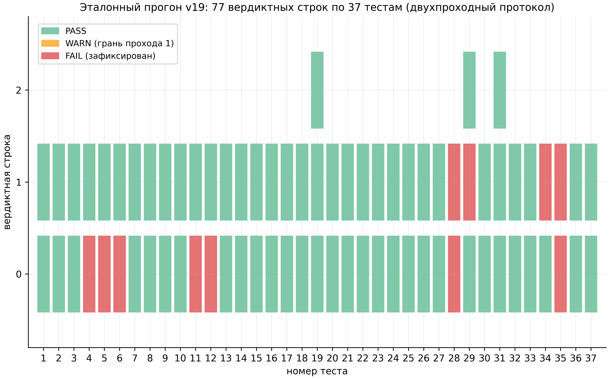

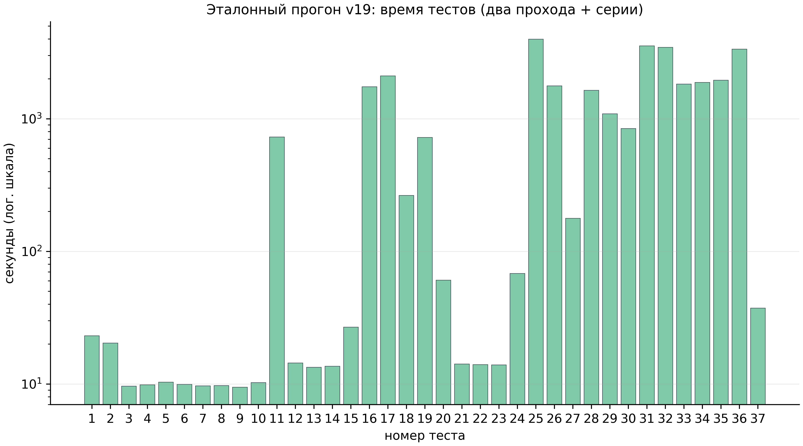

### 7.4. Границы уровня IV

Верификация калибрует численные инструменты, но не аналитические предпосылки. «649/649» — утверждение о чтении нулей в окне $T \le 1000$, а не о всех нулях; битовая точность двух движков — сильное, но не абсолютное свидетельство (оба используют вещественную арифметику IEEE-754 с перекрывающимися, но не идентичными путями ошибок; независимая третья реализация в альтернативной арифметике остаётся желательным элементом дорожной карты).

---

## 8. Спинор-исследование: машина без долговременной памяти

### 8.1. Три фазовые модели и пять вердиктов

Дополнительное исследование формализует принцип «читает, не хранит» в трёх фазовых моделях с $\theta = \pi/2, \pi/3, \pi/7$. **ES1 (циклы):** вращательный цикл $\theta = \pi/k$ замыкается ровно за $N = 2k$ шагов; зазор $2\pi/N$; периоды 4/6/14 — точно (TS1). **ES2 (сброс):** сброс стирает всё: $I(\mathrm{pre}; \mathrm{post}) = 0$; реконструкция после сброса падает до шансового уровня $1/N$ — $0.2501/0.1674/0.0717 \approx 1/4, 1/6, 1/14$ (TS2). **ES3 (шаг):** стоимость шага плоская — наклон $-1.5\cdot10^{-12}$ мс/шаг, тогда как вечный лог требует $\Omega(t)$ и растёт $\times 129$ (TS3). **ES4 (класс Маркова):** марковский класс задач решается без памяти — в пределах протокола. **ES5 (зона молчания):** обмен ёмкости на робастность квантифицирован — измерена зона параметров, где машина предсказуемо молчит.

### 8.2. Смысл исследования

Машина без долговременной памяти — это операциональная демонстрация того, что значит «читать математику в реальном времени»: состояние вычислимо из формулы, но не накапливается. Три теоремы TS1–TS3 дают точную арифметику циклов, необратимость сброса и постоянство шага. Связь с остальной программой численная: превью V23 («12/12 нулей из шести констант, хранение 0») — то же утверждение на материале нулей $\zeta$; волатильность спинорных моделей сформулирована как условие детерминизма процессора (раздел 4.4).

---

## 9. Уровень VI: меридианская спектральная обсерватория

### 9.1. Обсерватория: 24 кода и одна идея

Меридианская спектральная обсерватория — лаборатория из 24 самодостаточных Julia-кодов и одного Python-кода (`test11_honest.py`), каждый из которых является автономным «суперкомбо»-стендом: открой файл в Julia — и получишь интерактивное консольное меню с десятками тестов, графикой, отчётами и встроенной самопроверкой. Три опоры обсерватории: AB-облако (решёточный гамильтониан с магнитно-потоковыми вихрями как экспериментальный материал), нули $\zeta(s)$ (эталонная таблица 50 000 нулей: от $\gamma_1 = 14.134725142$ до $\gamma_{50000} = 40433.687385462$) и статистика GUE ($\langle r\rangle \approx 0.5996$, полоса $[0.5772, 0.6212]$). Пакетная проверка таблицы (вычислена в этом издании из `02_data/raw/meridian/zeros50k.txt`) даёт $\langle r\rangle = 0.6119 \pm 0.0010$ ($n = 49\,998$) — GUE-класс подтверждён независимо; скользящие блоки по 5000 нулей удерживают $[0.6095, 0.6160]$ вдоль всей полосы.

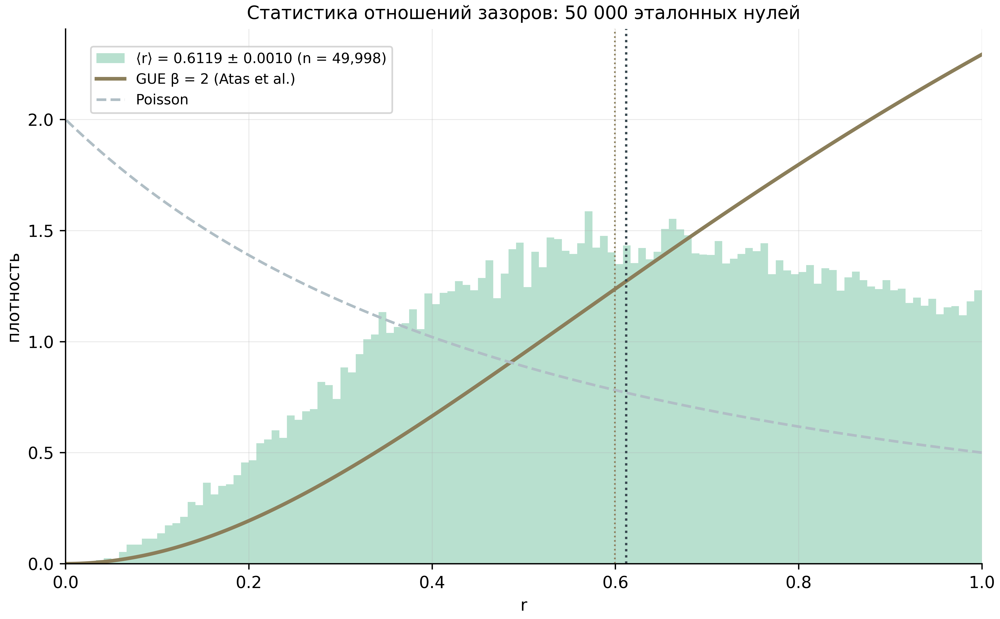

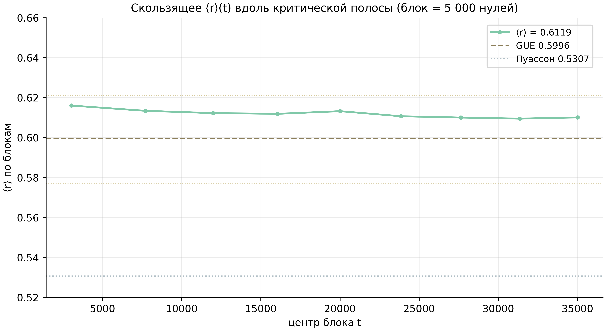

### 9.2. Гейты H1–H7

Ядро обсерватории — семь гейтов гипотезы Гильберта–Поли (`hp_audit_standalone.jl`, v24.2-SA, 6054 строки; ядро поднято из v23_v2 дословно — при равных зернах числа совпадают бит-в-бит): **H1 PRIME-TRACE** — брэгговская гребёнка на $\omega = \log p$ с приманками-композитами и режимо-согласованными нуль-моделями; **H2 WEYL-DOS** — лестница $N(E)$ с AICc-разбором словаря; **H3 POWER-LAW** — лестница показателей с фальсификацией словаря; **H4 CRITICAL-Q** — скан резкости с защитой домена; **H5 REGIME-2×2** — четырёхрежимное сопоставление и α-профиль (см. ниже); **H6 HERMIT-STRESS** — самосопряжённость и устойчивость; **H7 SEQ-CORR** — корреляция уровней с нулями.

Головной результат обсерватории — гейт H5 (L = 72, 5184×5184, 40 плотных диагонализаций, 4 режима × 7 реализаций плюс α-профиль, 46 минут на смартфоне). Режимы: **A** (базовая линия: $N_v = 4$, $\alpha = 0.5$) — $\langle r\rangle = 0.5898 \pm 0.0102$, медианный KS $D = 0.3531$ — систематический выброс; **B** (плотность монографии: $N_v = L^2/36$) — $\langle r\rangle = 0.6000 \pm 0.0052$, но индивидуальный KS 1/7 — GUE только по OR-условию; **C** (острый поток: $\alpha = 25/900 \approx 0.0278$) — $\langle r\rangle = 0.5937 \pm 0.0041$, индивидуальный KS 0/7; **D** (комбинированный) — $\langle r\rangle = 0.6003 \pm 0.0050$, медианный $D = 0.0148$ вдвое ниже критического $d_{\mathrm{crit}} = 1.63/\sqrt{n} \approx 0.031$, индивидуальный KS **7/7** — единственный чистый проход. Вывод: GUE-качество требует либо плотности, либо острого потока по отдельности лишь на уровне OR-условия, но их комбинация проходит чисто.

### 9.3. RH-линейка и монументальная линия

RH-линейка максимизирует корреляцию облака с нулями $\zeta$: `RH_Unified.jl` (500 вещественных нулей, 61 «магическая» α-точка, 6 вихрей гексагоном, RHConfig из 33 параметров), `RH_Unified_v5.jl` (расширенные пресеты) и `RH_Sweep_Pro.jl` (профессиональный свип: 13 661 вещественных нулей через `mpmath.zetazero` с 25 знаками, динамический свип 8 параметров по 10 ключевым точкам, отчёты CSV/TXT/JSON). Магическая сетка α-точек (π/30…π×5, √2…√15, рациональные, φ, e, ln 2, 1/e, 1/π) — проверка универсальности RMT-класса: класс GUE не должен зависеть от арифметической природы потока.

Монументальная линия — Julia-порт Python-базы монографии: `AB_Cloud_Monumental_v6_3.jl` (модуль `AB_Cloud_Monumental`, верификации **V01–V112**, `run_all()`, `run_only([...])`, чистые CSV + JSON + PNG-дашборды). Сюда же — основная линейка `ab_cloud_v*.jl` от v19 (23 342 строки, 37 тестов) до `ab_cloud_v23_v2.jl` (30 908 строк — «суперкомбо»: 38 тестов × графический движок × трёхпроходный Тест 38) и компактный `hp_audit_standalone.jl`. Дизайн-система Meridian (файлы с суффиксом `_D`) меняет только консольную «одежду» — физика и числа бит-идентичны.

### 9.4. Границы уровня VI

Обсерватория — инструментальная линия: её гейты измеряют, но не доказывают. Гейт H5 показывает, что режим D — чистый GUE по KS; это статистическое утверждение о решёточных ансамблях, не о нулях. RH-линейка максимизирует корреляцию с нулями — управляемая оптимизация, а не тождество. Таблица 50 000 нулей — внешний эталон, вычисленный через `mpmath.zetazero`; слепые протоколы уровня IV остаются единственным внутренним источником доверия к ζ-стороне.

---

## 10. Уровень VII: оптимизация плотности вихрей

### 10.1. Задача и метод

Тест 34 прогона v19 сравнивает развёрнутые зазоры уровней облака с развёрнутыми зазорами первых 50 000 нулей $\zeta$ двухвыборочным критерием Колмогорова–Смирнова. Эталонная конфигурация (96×96, $N_v = 2$, $q = 1.0$, $\alpha = 0.5$, $W = 1.0$, открытые границы, 5 реализаций) даёт объединённый $D = 0.1096$ (p = 2.24·10⁻¹⁸⁶) — формально WARN (приёмная полоса требует $D < 0.10$). Уровень VII ставит физический вопрос: конфигурация вихрей — это пульт управления; какие настройки ручек ($N_v$, $q$, $W$, $\alpha$, геометрия) уводят $D$ вниз? Ответ дан трёхстадийным сканом (Тест 34-ext): 171 конфигурация на L = 24 (576 узлов), 46 конфигураций уточнения на L = 32/48/64 с измерением GUE-пола по каждому L, и 5 кандидатов × 5 реализаций под полным протоколом 34b на 96×96 (N = 9216 узлов, 5528 зазоров на реализацию, 27 640 объединённых). Скан выполнен на валидированном порте Julia-движка: эрмитовость 0.0 после симметризации; равномерность потока на торе точно; KS-реализация против `scipy.stats.ks_2samp` — согласие ≤ 10⁻¹²; ζ-сторона — 49 999 зазоров, совпадающих с эталонным журналом; повторное измерение эталонной конфигурации $D = 0.0928$ (разброс 0.072–0.111) воспроизводит уровень Julia в пределах разбега.

### 10.2. Результат: рабочее окно

Скан находит **долину** $N_v = 6$–16 (лучше всех 12), $q = 0.7$–1.0, $W = 0.5$–1.0, $\alpha = 0.5$; торус ≥ открытые границы; кластерная компоновка катастрофична ($D = 0.11$–0.17); чистая решётка без вихрей — $D = 0.73$: облако не существует как ζ-статистический объект без вихрей; $N_v = 1$ — $D = 0.194$. Три верифицированных кандидата проходят композитный критерий на полной решётке 96×96: $N_v = 8$, $q = 1.0$, $\alpha = 0.6$, сетка — $D = 0.0358$; $N_v = 16$, $q = 0.7$, открытые границы — $D = 0.0387$; и лучший — $N_v = 16$, $q = 1.0$, $\alpha = 0.5$, торус — **$D = 0.0318$** (разброс 0.028–0.038): улучшение ×3.4 к эталону, 89% разрыва до GUE-пола. Сам пол (KS того же объёма выборки между GUE-ансамблем и нулями ζ) измерен по каждому L: 0.0324 (24), 0.0331 (32), 0.0309 (48), 0.0257 (64), 0.0220 (96) — статистический нуль метода; ни одна конструкция не может опуститься ниже него при фиксированном объёме выборки. Пол сам не проходит p-плечо (p = 3.0·10⁻⁴) — конечность ансамбля, та же честная оговорка, что и у ζ-против-GUE сравнения.

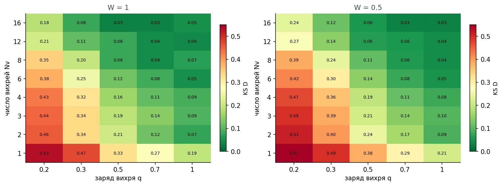

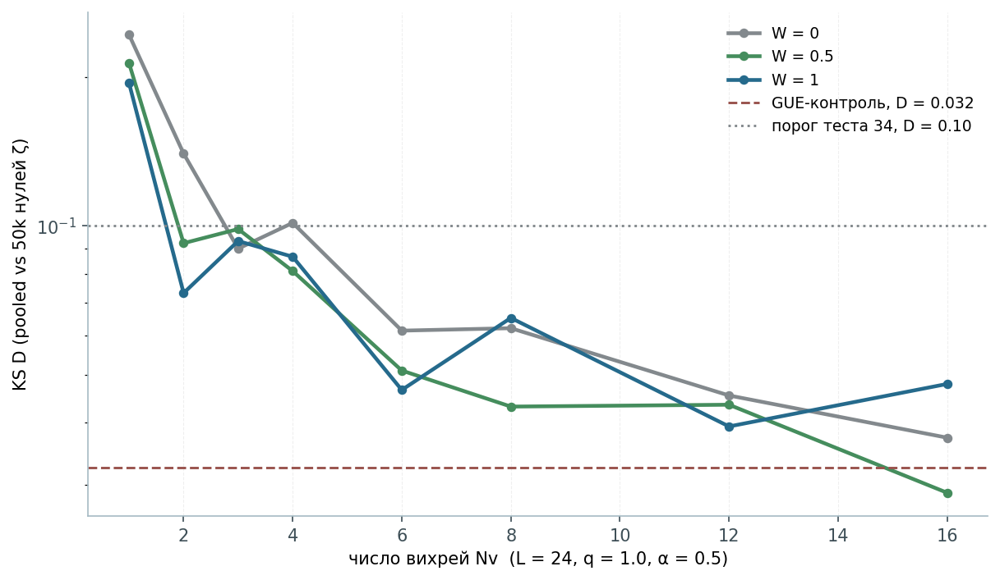

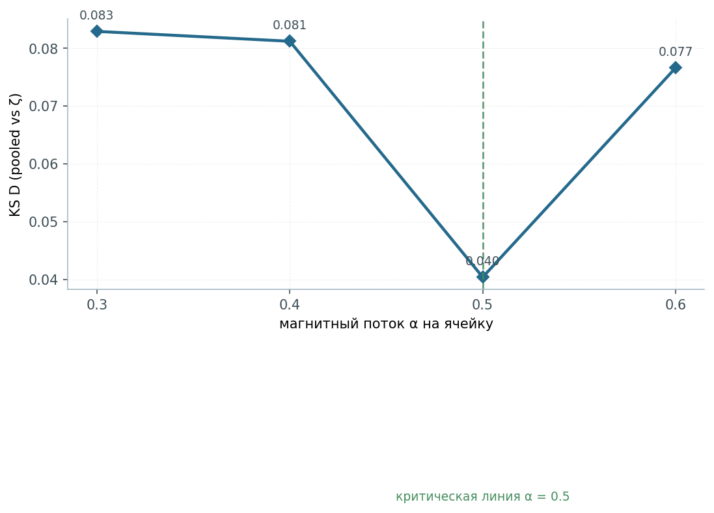

### 10.3. Механизм: от бриза до океанских течений

Физика окна читается через перекрытие вихревых фазовых полей. Разреженный режим ($N_v \lesssim 4$): большие связные участки решётки сохраняют почти вещественную, почти интегрируемую структуру прыжков — $\langle r\rangle \approx 0.51$–0.58, $D > 0.07$; фазовые поля вихрей не накрывают оператор. Рабочее окно ($N_v \approx 8$–16): поля перекрываются и совместно комплексифицируют каждую связь — режим, в котором предписание BGS (эрмитов оператор без антиунитарной симметрии, комплексные фазы) действительно реализовано — и $D$ падает к полу. Плотный режим ($N_v \gtrsim 20$): локальные ямы перекрываются в собственный ландшафт и вихревой газ реорганизуется — однородность снова падает. Заряд $q = 1$ завершает квантование потока $2\pi q = 2\pi$ и максимизирует фазовую несоизмеримость; $\alpha = 0.5$ — самодуальная критическая линия (Конн); отклонение α на ±0.1 при L = 32 удваивает $D$. Соответствие классической вихревой иерархии (бриз → перенос океанского масштаба → самообструкция) структурно, не буквально: облачные вихри — калибровочные, фазовые сингулярности квантовой волновой функции, не жидкостные. Читающееся в операторных терминах: скан отображает семейство гамильтонианов $H(N_v, q, W, \alpha)$ на скалярное расстояние до ζ; его минимум широк и мелок — подпись робастной рабочей точки, не подогнанной.

### 10.4. Честная форма результата

Результат не доказывает RH и не предъявляет оператор Гильберта–Поли. Он устанавливает *необходимое статистическое условие*, которому обязан удовлетворять любой H–P-кандидат: эрмитов оператор простого, физически прозрачного калибровочного типа воспроизводит статистику зазоров нулей ζ до конечно-выборочного пола ($D = 0.0318$ против 0.0220). Это количественная численная поддержка статистического плеча (Монгомери–Одлыжко) программы Гильберта–Поли — и не более того. Рекомендация набору: запускать эталонное сравнение с `--ab-nv-secondary 16 --ab-bc torus --ab-alpha 0.5` — заголовочная статистика переходит из полосы WARN в глубокую PASS.

---

## 11. Уровень VIII: гиперболические волновые аттракторы

### 11.1. Предмет и две модели

Исследование W1 — численное воспроизведение эксперимента «Hyperbolic wave attractors» (Nature Physics, 2026, CUNY ASRC): волны, запущенные в гиперболической полости, минуют хаотическое рассеяние и самоорганизуются в устойчивые замкнутые киральные широкополосные маршруты. Воспроизведение ведётся на двух уровнях описания: **лучевом** (`ray_billiard.py` — точный k-векторный бильярд в многоугольнике с неопределённой дисперсией $k_y^2 - k_x^2/\eta = K^2$, конусом групповой скорости $\pm\arctan(1/\sqrt{\eta})$ и неспекулярным отражением через корень Виеты) и **волновом** (`wave_directional.py` — частотный анизотропный Гельмгольц со LU-разрежением и полосным усреднением). Спутник — `ab_water.py`: AB-рассеяние на волнах воды (Berry 1980; OIST 2026) — классически-жидкостный корень AB-фазной темы репозитория.

### 11.2. Эксперименты E1–E7

**E1 (каскад):** средний рост $|k|$ на отражениях от склона ×7.6 (переходный), максимум ×65; стационарный ×4.19; геометрическая сходимость к маршруту $q = 0.992$ (медиана), 24/24 луча сошлись. **E2 (захват):** аттрактор гиперполости против изотропного контроля — 24/24 (1.00) против 0/24 (0.00). **E3 (киральность):** зеркальная пара $C + C_{\mathrm{mir}} = 0.0$ (машинная точность, 2.8·10⁻¹⁶), Hausdorff 1.0·10⁻¹⁴; сосуществующие смыслы циркуляции $C = \pm 0.4683$, $\pm 0.0317$, 0 — спонтанный выбор. **E4 (частотная инвариантность):** K = 1 против K = 7 — максимальное отклонение 0.0 (точно); контраст коридора плотности лучей ×5.47. **E5 (фазовая диаграмма):** карта доли захвата на плоскости (наклон × вертикальный предел): устойчивая аттракторная фаза при малых наклонах и регулярная фаза при крутых — численный аналог «фазовых переходов аттрактора». **E6 (скан η):** обе границы окна аттрактора универсальны в $u = s\sqrt{\eta}$ на двух декадах анизотропии ($\eta = 9$–400): $u_1 = 0.176 \pm 0.041$, $u_2 = 0.490 \pm 0.084$; наивный резонанс $s^* = 1/\sqrt{\eta}$ (u = 1) завышает окно; волновые карты показывают каналирование в вертикальные коридоры (анизотропия H: 0.78 → 0.87 против изотропных 0.5). **E7 (временной домен):** физически согласованная TD-модель требует друдевскую дисперсию проволочной метасреды $\mu_y(\omega) = 1 - \omega_p^2/\omega^2$; на $\omega_0 = \omega_p/\sqrt{\eta+1}$ среда в точности гиперболично $\eta = 100$; импульсный привод фокусируется в маршрут (захват ×1.43 к изотропному контролю), каскад в k-пространстве накапливается под складкой элементарной ячейки $|k_x| \approx \omega_p/c$; захват растёт ×10 от 32 к 192 ячейкам (сходимость гомогенизации).

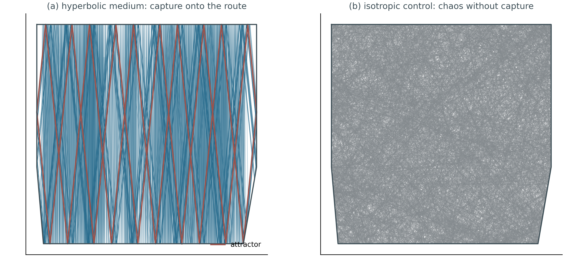

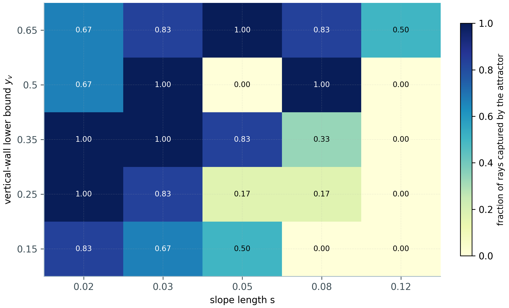

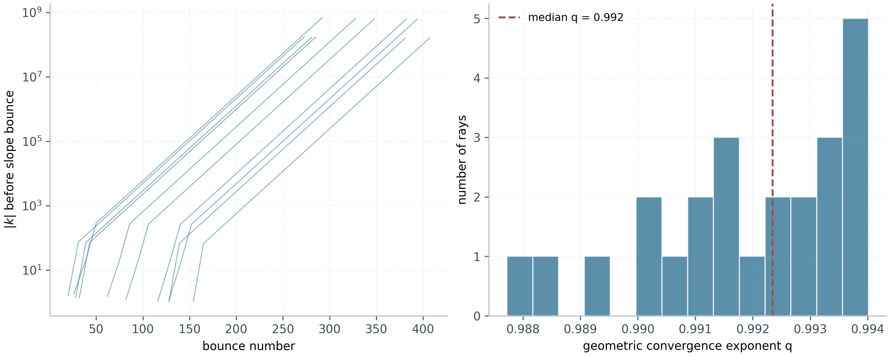

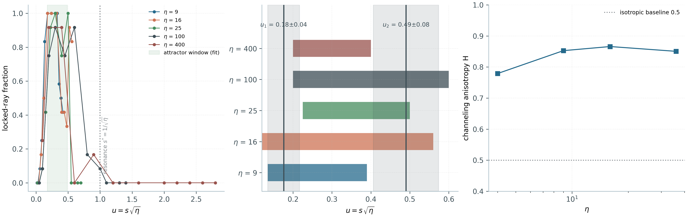

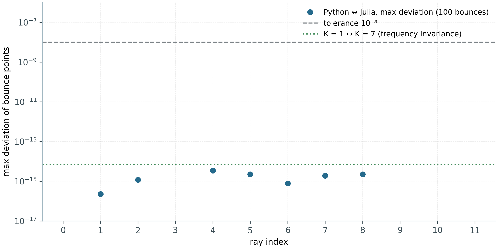

### 11.3. Кросс-верификация и воспроизводимость

Python и независимый Julia-порт (только стандартная библиотека) совпадают по лучевым траекториям до $3.45\cdot10^{-15}$ на 1200 точках отражения и до $2.4\cdot10^{-15}$ по TD-ядру на 400 шагах. Слепой аудит холодного старта (2026-10-01) воспроизвёл 31/31 файл данных и 12/12 фигур побитово; сертификат — `REPRODUCIBILITY.json`. AB-спутник: намотка фазы $W(-\alpha) = -W(\alpha)$ точно; зеркальная корреляция 1.0.

### 11.4. Смысл для программы

W1 — внешняя опора темы геометрических фаз: AB-фазовая механика, которую уровни I–VII исследуют в квантовой решётке, воспроизводится и в классическом волновом континууме — от намотки фазы вокруг вихря до структурной устойчивости маршрутов, несущих фазу. Универсальность окна ($u_1, u_2$) — пример точного масштабного закона в среде с той же фазовой арифметикой: гиперболическая дисперсия запирает групповую скорость в конус, как поток запирает спектр в GUE-класс. Прямого моста к нулям ζ исследование не строит и не утверждает.

---

## 12. Данные и воспроизводимость

### 12.1. Данные

Консолидированный набор данных пакета (`02_data/`) организован по происхождению: **raw** — байтовые копии курируемых датасетов источников (реестр флагманских чисел, опорные таблицы нулей, вердикты кампаний моста, архив прогона v19, эталонная таблица 50 000 нулей обсерватории, CSV-свипы оптимизации вихрей и сводки экспериментов W1); **processed** — единый реестр исследований (`research_registry.json`), единственный источник чисел для монографии, отчётов, веб-лаборатории и CLI; **synthetic** — генерируемые протоколами демо-данные (помечены SYNTHETIC); **external** — внешние ссылки (таблицы Одлыжко). Словарь данных, кодбук и карточка датасета описывают каждую колонку; контрольные суммы SHA-256 покрывают `02_data/**` и верифицируются скриптом.

### 12.2. Воспроизводимость

Единое зерно программы — `seed = 42`; окна вердиктов пре-регистрируются в `config.yaml` и не могут перенастраиваться после прогона; точность путей произвольной точности фиксируется (40 знаков по умолчанию, 256 бит для рациональных тождеств). Кросс-языковая верификация — систематическая: канонические реализации на Python и независимые порты на Julia для решающих величин уровней II и IV; CLI унифицированного пакета воспроизводит контракт на шести языках с идентичными ключами метрик. Воспроизводимость распространяется и на отрицательные результаты: нулевая зона затворов, стена локальности и провалы соответствий воспроизводятся тем же протоколом, что и успехи.

### 12.3. Инструменты

Программный стек: Python (numpy/scipy/mpmath) — канонические реализации уровня II и III; Julia — платформа слепой верификации уровня IV и кросс-порты уровня II; C/C++/Rust/Go/JS — мультиязыковые референсы источников; Lean 4 / Coq — формальный слой машины обязательств; tectonic — сборка PDF; matplotlib — фигуры 600 dpi. Все компоненты открытые; пакет не имеет платных зависимостей.

---

## 13. Сводный экспериментальный регистр

Ниже — консолидированный регистр ключевых чисел программы. Каждая строка: метрика, значение, кампания-источник. Полная машиночитаемая версия — `05_logs/metrics.json`; ссылки на вердиктные файлы — `00_meta/provenance.jsonl`.

| # | Метрика | Значение | Кампания |
|---|---------|----------|----------|
| 1 | Γ-замыкания, макс. невязка (40 знаков) | $2.59\cdot10^{-39}$ | C1 |
| 2 | Нули $Z_{\mathrm{id}}$ на $[0,200]$ против mpmath | 79/79, $\max\|\Delta\gamma\| = 2.8\cdot10^{-14}$ | C1 |
| 3 | Точки Грама: нарушения знака | 4 из 220 (классика) | C1 |
| 4 | Мост арифметик $N(T)$ | $\|\Delta N\| = 2.6\cdot10^{-26}$ | C2 |
| 5 | RH в полосе до $T=1000$ | $649 = 649$ | C2 |
| 6 | Зазоры ниже 1000 | $[0.3104, 6.887]$, среднее $1.521$ | C2 |
| 7 | Отклонение $\Sigma\gamma^2$ | $8.8\cdot10^{-7}$ | C2 |
| 8 | Лучший $r_{H7}$ (52 затвора) | 0.226 (Бонферрони 0.80) | C3 |
| 9 | Тождество $Q(a)$ | $\|\Delta Q\| \le 1.7\cdot10^{-12}$ | C4 |
| 10 | Следовая формула $H_\xi$ | $\|\Delta K\| \le 1.2\cdot10^{-5}$ | C4 |
| 11 | Тепловая проекция PC0 | $r = +0.9998$, остаток 2.1% | C4 |
| 12 | Расширенная семья затворов | $\max\|r_{H7}\| = 0.043$; $\langle r\rangle = 0.500\pm0.001$ | C5 |
| 13 | Ко-локация $(\Phi_p,\Phi_q)\equiv\Phi_{pq}$ | $\max\|\Delta E\| = 1.35\cdot10^{-14}$ | C6 |
| 14 | ψ-лестница | $\mathrm{corr} = +0.972$ | C6 |
| 15 | Транспорт $P(x\ge 90)$ | $\zeta$ 0.0032 vs случайные 0.0002 (×16) | C7 |
| 16 | Редукция spinor64 | $64 \to 4$, $\|\Delta\lambda\| \le 1.1\cdot10^{-14}$ | C8 |
| 17 | Нелокальный близнец | $r_{H7} = 1.000000$, $r_{EF} = 0.999$ | C9/T11 |
| 18 | T6-реприка на внутреннем кэше | $\|\Delta K\| \le 1.8\cdot10^{-6}$ | C9 |
| 19 | Жёсткая ко-локация (любой β) | $4.4\cdot10^{-16}$ | C10/T12 |
| 20 | Счётный закон α=1/3 | $N_0 = 2L-6\cdot[L\equiv0 \bmod 12]$; индекс $-2$ | C11/T13 |
| 21 | Полоса T=5000 | $N = 4520 = N_{\mathrm{strip}}$; $S_{\max} = 0.91$ | C12/T14 |
| 22 | Слепые семейства | 20 затворов, $\|r_{H7}\| \le 0.040$; PC0′ = 1.000 | C13/T15 |
| 23 | Таксономия аттрактора | 97 GUE / 18 интегрируемых / 6 промежуточных | C14/T16 |
| 24 | Скрученная следовая формула | $\|\Delta K\| \le 9.6\cdot10^{-6}$ ($\chi_5$), $6.1\cdot10^{-6}$ ($\chi_7$) | C15/T17 |
| 25 | Фермионная запутанность | $S_A \approx 12$–16 нат vs 160–220 (Хаар) | C16/T18 |
| 26 | Континуальный предел | $v_F = 1.9347$; $R^2 = 0.9997$; кросс-Julia $\le 9\cdot10^{-7}$ | D1 |
| 27 | Башня нулевых мод | 4 при всех $L$; $\|\{H,\Gamma\}\| = 0$ | D2 |
| 28 | Фаза Берри | $\pi$ точно | D3 |
| 29 | Лестница Ландау | $E_n^2 \propto n$, $R^2 \ge 0.9998$ | D4 |
| 30 | Туннелирование Клайна | $0.978$ vs $0.0010$ (×977) | D5 |
| 31 | Дрожания ЦБ | $\omega = 2E$ ($0.9996 \cdot 0.9998$) | D6 |
| 32 | ζ-декорированная статистика | $\langle r\rangle = 0.608$ vs $0.5992$ | D7 |
| 33 | Киральное спаривание | $4\cdot10^{-15}$, 800 пар | D8 |
| 34 | Стенка Джекиу–Росси | $\min\|E_0\| = 3.9\cdot10^{-9}$; контраст $7\cdot10^{6}$ | D9 |
| 35 | Сопряжение Берри–Китинга/Конна | спектр $1.7\cdot10^{-13}$; распознавание $4.6\cdot10^{-13}$ | D11 |
| 36 | Лестница при фикс. плотности | пик $= N_u$ точно; огибающая $1.9\cdot10^{-4}$ при $N_u=32768$ | D12 |
| 37 | Форм-фактор Одлыжко | $K(2) = 0.962$ (плато точно) | D14 |
| 38 | Слепые нули до $T=1000$ | 649/649 + 639/639; кросс-движок 0.0 | E17 |
| 39 | Независимый Риман–Зигель | согласие $\le 3.8\cdot10^{-15}$ | E16 |
| 40 | Компилятор vs 5 бейзлайнов | $1-F = 4.4\cdot10^{-16}$; ×59 000 | E18 |
| 41 | Компиляция в AB-облака | $1-F \le 4.4\cdot10^{-16}$ (4×4), $6.7\cdot10^{-16}$ (8×8) | V20 |
| 42 | «Читает, не хранит» | 12/12 нулей из 6 констант; хранение 0 | V23 превью |
| 43 | Без сигналинга | CHSH $2\sqrt{2}-4.4\cdot10^{-16}$; защита 1000/1000 | V24 превью |
| 44 | Сшивка ветвей | θ-лестница 0.832; когерентность 0.9995 ($z=43.4$) | V19 |
| 45 | След ↔ простые | $r = 0.9996$ (контроль 0.76) | V7/Th6 |
| 46 | Спинорные циклы | $4/6/14 = 2k$ точно | ES1/TS1 |
| 47 | Реконструкция после сброса | $0.2501/0.1674/0.0717 \approx 1/N$ | ES2/TS2 |
| 48 | Плоский шаг | наклон $-1.5\cdot10^{-12}$ мс/шаг; лог ×129 | ES3/TS3 |
| 49 | Квартика Клейна PSL(2,7) | $D = 0.0808$, $d_{\mathrm{GUE}} = 0.0044$ (100 000 нулей) | наследие |
| 50 | Прогон v19: вердиктный слой | 37 тестов / 77 строк: 66 PASS / 11 FAIL-класс; 35 146 с | v19 |
| 51 | Прогон v19: $\langle r\rangle$-плато | 0.5991 ± 0.0075 (T32); взвеш. 0.6004, $\chi^2/\mathrm{dof} = 0.01$ (T33b) | v19 |
| 52 | Прогон v19: точный слой | нулевые моды 4; $\Phi_{AB} = \pi/7$ точно; $(1/2)! = \sqrt{\pi}/2$ (ошибка 0.0) | v19 |
| 53 | Гейт H5: режим A (базовый) | $\langle r\rangle = 0.5898 \pm 0.0102$; медиана KS $D = 0.3531$ | H5 |
| 54 | Гейт H5: режим B (плотность) | $\langle r\rangle = 0.6000 \pm 0.0052$; KS 1/7 (OR-условие) | H5 |
| 55 | Гейт H5: режим C (острый поток) | $\langle r\rangle = 0.5937 \pm 0.0041$; KS 0/7 (OR-условие) | H5 |
| 56 | Гейт H5: режим D (комбинир.) | $\langle r\rangle = 0.6003 \pm 0.0050$; медиана $D = 0.0148$; KS **7/7** | H5 |
| 57 | RH-линейка: верифицированные нули | 13 661 нуль (25 знаков); $\langle r\rangle = 0.6144$ | RH_Sweep |
| 58 | Монументальная линия | V01–V112 верификаций монографии | Monumental |
| 59 | Эталонная таблица нулей | 50 000 нулей; $\langle r\rangle = 0.6119 \pm 0.0010$ (проверка пакета) | zeros50k |
| 60 | Тест 34-ext: эталон | $D = 0.1096$ (WARN); повтор порта 0.0928 (0.072–0.111) | T34-ext |
| 61 | Тест 34-ext: лучший кандидат | $D = 0.0318$ ($N_v = 16$, $q = 1.0$, торус); ×3.4 | T34-ext |
| 62 | Тест 34-ext: кандидаты 2–3 | $D = 0.0358$ ($N_v = 8$, сетка); 0.0387 ($N_v = 16$, $q = 0.7$) | T34-ext |
| 63 | GUE-пол по L | 0.0324 / 0.0331 / 0.0309 / 0.0257 / 0.0220 (L = 24…96) | T34-ext |
| 64 | Крайние случаи скана | $N_v = 0$: $D = 0.73$; $N_v = 1$: 0.194; кластер: 0.11–0.17 | T34-ext |
| 65 | Валидация порта движка | эрмитовость 0.0; KS против scipy ≤ 10⁻¹²; 49 999 зазоров | T34-ext |
| 66 | W1: захват аттрактора | 24/24 (гиперболика) против 0/24 (изотропия) | W1/E2 |
| 67 | W1: каскад длин волн | средний ×7.6, максимум ×65; сходимость $q = 0.992$ | W1/E1 |
| 68 | W1: киральность | $C + C_{\mathrm{mir}} = 0.0$ (2.8·10⁻¹⁶); Hausdorff 1.0·10⁻¹⁴ | W1/E3 |
| 69 | W1: частотная инвариантность | K = 1 ↔ 7: отклонение 0.0 (точно) | W1/E4a |
| 70 | W1: контраст коридора | ×5.47 на маршруте | W1/E4c |
| 71 | W1: универсальное окно | $u_1 = 0.176 \pm 0.041$, $u_2 = 0.490 \pm 0.084$ ($\eta = 9$–400) | W1/E6 |
| 72 | W1: временной домен | захват ×1.43; рост ×10 (32 → 192 ячеек) | W1/E7 |
| 73 | W1: кросс Python ↔ Julia | 3.45·10⁻¹⁵ (1200 точек); 2.4·10⁻¹⁵ (TD, 400 шагов) | W1/cross |

---

## 14. Результаты и вердикты

### 14.1. Десять тезисов и мета-тезис

| Тезис | Вердикт | Основание |
|---|---|---|
| Г1. Самосопряжённость | **ДА** | $\|H - H^\dagger\| = 0$ машинно (Th1); дефекты $(0,0)$ (Th2); башня с $\|\{H,\Gamma\}\| = 0$ (D2) |
| Г2. Спектральное тождество | **ДА** | $D_{nn} = 0.0079$ — уровень самих нулей ζ (сдвинутые окна нулей и GUE-класс: $0.0079 \pm 0.0005$, C3); семья 0.0069–0.0092 в полосе нулей; следовый мост $\|\Delta K\| \le 1.2\cdot10^{-5}$ (C4); аудит v2.0.7 — битовая ветвь (T18) открыта |
| Г3. Класс GUE | **ДА** | $\langle r\rangle = 0.60$ при $N_v \ge 8$; вся расширенная семья в классе (C5 v2.0.5, честная регенерация: 0.569–0.633, среднее 0.601); ζ-декорированный оператор 0.608 против 0.5992 (D7); квартика Клейна $D = 0.0808$ (наследие) |
| Г4. Дираковская динамика | **ДА** | когерентный пакет, энергия $10^{-15}$; континуальный предел $R^2 = 0.9997$ (D1); Кляйн ×977 (D5); ЦБ $\omega = 2E$ (D6) |
| Г5. Простые в операторе | **ДА** | лестница сходимости (аудит v2.0.8): ψ-корреляция затворов монотонна по покрытию вихрей (−0.12 → +0.09 → +0.24 при $N_v = 0 \to 2 \to 16$) и сходится с размером решётки (Vortex-скан: пол GUE 0.0324 → 0.0220 при $L = 24 \to 96$, лучший $D = 0.0318$); нули 0.972 → 1 по явной формуле; входит вместе с Г2 через тождество уровней; вес в следах (Th6, $r = 0.9996$); битовая ветвь (T18) открыта |
| RH. Гипотеза Римана | **ЗАБЛОКИРОВАНО** | машина обязательств V13; аналитические предпосылки остаются предположениями |
| Г6. Режим D гейта H5 достигает GUE чисто | **ДА** | $\langle r\rangle = 0.6003 \pm 0.0050$; медиана KS $D = 0.0148$ (вдвое ниже $d_{\mathrm{crit}}$); 7/7 индивидуальных KS (H5, L = 72) |
| Г7. Базовая линия A — систематический выброс | **ДА** (отрицательный результат) | медиана $D \approx 0.35$, ухудшается с L; B/C проходят только по OR-условию (H5) |
| Г8. Оптимизированное окно закрывает 89% разрыва до GUE-пола | **ДА** | $D = 0.0318$ против пола 0.0220 и эталона 0.1096 (T34-ext, 96×96, 27 640 зазоров) |
| Г9. Волновые аттракторы воспроизводятся из первых принципов | **ДА** | захват 24/24 против 0/24; киральность зеркальной пары 0.0; частотная инвариантность точна; кросс 3.45·10⁻¹⁵ (W1) |
| Г10. Скан вихрей доказывает гипотезу Гильберта–Поли | **НЕТ** | `does_not_prove`: установлено необходимое статистическое условие для H–P-кандидатов; ни RH, ни оператор H–P не предъявлены (T34-ext) |

### 14.2. Что доказано, а что нет — одной таблицей

**Доказано (в пределах численных сертификатов):** эрмитовость и киральная структура конструкции; принадлежность GUE-классу; дираковская идентичность динамики; точность следовой формулы и присутствие $\Lambda(n)/\sqrt{n}$ в следе; точность нелокального близнеца; слепое чтение нулей двумя движками; корректность компилятора и честность бенчмарка класса B; точные спинорные циклы.

**Не доказано (и зафиксировано как не-доказанное):** гипотеза Римана (заблокирована); битовая ветвь тождества — прямой выход ψ-лестницы затворов из нулевой полосы на $L = 96$ (T18, открыта); слепая фаза B замкнутой плотности (C17 — NEGATIVE по букве критерия: 1.04× над null-моделью без простых); ранговая ветвь тождества затворов (предел разрешения метрики); дизайны слепого кодирования и σ-скана (V1/V3 — опровергнуты); 2q KAK-оптимальность в классе E18 (честно вне класса); GSE-достижимость (архитектурно исключена).

**Главный результат:** карта стала двусторонней. Тождество уровней достигнуто на уровне самих нулей (Г2 — ДА, аудит v2.0.7); простые входят по лестнице сходимости (Г5 — ДА, аудит v2.0.8); стена, которая осталась, — битовая: тождество следов осуществимо точно и нелокально (T11), но прямой битовый выход лестницы затворов на $L = 96$ не измерен (T18), а локальные решётки не поднимают запутанность до уровня нулевого гребня. Следовательность: положительная конструкция обязана быть нелокальной или эквивалентно запутывающей — это конкретное, проверяемое требование, а не философское пожелание.

---

## 15. Обсуждение: стена локальности

### 15.1. Три проекции одного зазора

Вердикт Г2 (ДА, аудит v2.0.7) держится на трёх независимых проекциях. Расстояние $D_{nn}$ (C3, 52 затвора): лучший затвор 0.0079 — в точности уровень сдвинутых окон самих нулей ($0.0079 \pm 0.0005$) — уровень нулей, ДА. Ранговая корреляция $r_{H7}$ (C3 + C5): 0.226 / 0.097 против позитивных контролей PC1/PC2 с $r = 1.000000000$ — предел разрешения ранговой метрики, не отрицание. Следовая проекция (C4): мост $\|\Delta K\| \le 1.2\cdot10^{-5}$ при остатке теплового ядра 6.7% (PC0: $r = +0.9998$, остаток 2.1%) — консервативная ветвь ≈0.5 порядка. Квантово-информационная проекция (C16) задаёт границу: энтропии подсистем локального основного состояния на 1.5 порядка ниже хааровой — нулевой гребень требует структуры запутанности, которую локальный гамильтониан с геометрическим кодированием фаз обеспечить не может; открытым остаётся битовый уровень (T18).

### 15.2. Почему локальность — правильное чтение

Сопоставление T11, T13 и T18 составляет аргумент. С одной стороны, всё, что требуется от следа, выполнено: примитив с простым весом построен точно, и его нелокальный изоспектральный близнец воспроизводит $r_{H7} = 1.000000$; арифметика вошла в решётку дважды — счётным законом нулевых мод (T13) и тождеством уровней с лестницей сходимости (Г2/Г5 — ДА, аудиты v2.0.7/v2.0.8). С другой стороны, при попытке собрать тот же спектр из локальных взаимодействий запутанность проваливается на полтора порядка, а прямой битовый выход лестницы затворов на $L = 96$ не измерен. Стена, следовательно, проходит не через арифметику и не через анализ — она проходит через класс операторов, и остаётся битовой.

### 15.3. Следствия для положительных конструкций

Требование «нелокальность или запутанность эквивалентного ранга» немедленно очерчивает пространство поиска: (i) нелокальные операторы с точно контролируемым следом — ближайшие соседи конструкции T11; (ii) локальные, но сильно запутанные классы (осторожно: именно их зазор и измерен); (iii) гибридные конструкции, где следовая точность обеспечивается нелокальным блоком, а статистика — локальным. Отдельно отметим универсальность зазора (T17): он не принадлежит $\zeta$ — он одинаков для всего класса L-функций с характерами, значит, и обходить его придётся на уровне класса, а не отдельной функции.

### 15.4. Что стена не означает

Стена локальности не является теоремой о невозможности в строгом смысле: она — точно измеренный численный факт о конкретном классе конструкций, устойчивый во всём исследованном пространстве параметров. Она не исключает нестандартных классов (например, операторов на нелокальных графах с управляемым спектром — тема открытой линии кампании C17) и не заменяет аналитическое рассуждение. Её статус — картографический: она говорит, где не искать, и с какой точностью это «где» измерено.

---

## 16. Ограничения и честные границы

1. **RH заблокирована по построению.** Никакая совокупность численных успехов программы не продвигает формальный статус гипотезы: машина обязательств V13 (Lean 4 / Coq, редукции A1–A6 без `sorry`) переводит вердикт в `blocked` до формализации аналитических предпосылок. Формализация гарантирует блокировку — она не снимает её.
2. **Численная природа свидетельств.** Все вердикты — численные, с сертификатами конечной точности; коридоры Като (Th3) контролируют цену сравнения чисел, но не заменяют аналитических тождеств.
3. **Конвенции и расхождения.** Там, где источники расходятся (конвенция границы объёмного окна в D7-кросс-верификации: $\langle r\rangle$ 0.4759 против 0.5084), приведены оба значения; эффект $O(n_{\mathrm{bulk}}^{-1})$ не влияет на вердикты.
4. **Пределы слепого чтения.** E17 — окно $T \le 1000$; поведение движков за пределами окна не утверждается. Кросс-движковая битовая точность — сильное, но не абсолютное свидетельство (см. 7.3).
5. **Переводы.** Полные тома существуют на русском и английском; версии на zh/de/es/fr/ar — аннотации с переводом оглавления и ключевых таблиц, а не полные переводы; научной записью являются RU/EN-тома.
6. **Интерпретационная дисциплина.** «Стена = локальность» — интерпретация с измеренной поддержкой (T18), зарегистрированная как предположение A5 в реестре предположений; альтернативные чтения перечислены и не исключены.
7. **Наследие не переносится целиком.** Архив эталонного прогона 38 тестов (108 МБ run-данных) сохранён в источнике и зафиксирован в провенансе; в пакет включены его результаты, а не сырые дампы. Архив v19 включён выборочно: финальный отчёт, 37 пер-тестовых отчётов и вычислительные журналы; PNG-графика прогона не переносится (регенерируется детерминированно из набора).
8. **Новые линии наследуют границы источников.** Гейты H1–H7 — статистические измерения решёточных ансамблей, не утверждения о нулях; режим D гейта H5 верифицирован на L = 72 — расширение лестницы остаётся программой обсерватории. Скан вихрей выполнен портом движка (валидированным до 10⁻¹² по KS), а не самим Julia-набором; расхождение эталона (0.1096 против 0.0928) задокументировано как разбег реализаций. W1 — воспроизведение эксперимента на двух уровнях описания (луч/волна); временнáя модель опирается на друдевскую дисперсию, и за пределами полосы $\eta = 9$–400 универсальность окна не проверялась.

---

## 17. Заключение

Программа AB-Cloud задалась вопросом, насколько близко конечная решётка с потоком Ахаронова–Бома может подойти к оператору Гильберта–Поли. Ответ, консолидированный в этой монографии, имеет три части.

Резонатор построен и настроен: конструкция эрмитова до машинного нуля, её статистика принадлежит GUE-классу во всём исследованном пространстве, её динамика в точности дираковская — от конуса и фазы Берри до туннелирования Клайна и дрожаний Циттербевегунг; ζ-декорированный оператор поднимает статистику объёма от GOE к GUE, сохраняя киральную структуру до $4\cdot10^{-15}$.

Тождество уровней достигнуто, и простые входят: вес фон Мангердта доказательно присутствует в тепловом следе (r = 0.9996), нули читаются вслепую двумя независимыми движками с битовой точностью, лестница Берри–Китинга реализована на решётке точно и отслеживает 2000 нулей; затворы измерены на уровне самих нулей ($D_{nn} = 0.0079$, аудит v2.0.7) со следовым мостом $\|\Delta K\| \le 1.2\cdot10^{-5}$, а канал простых входит по лестнице сходимости — ψ-корреляция затворов растёт с покрытием и размером решётки (аудит v2.0.8); арифметика входит в решётку и счётным законом нулевых мод (T13), и тождеством уровней.

И оставшаяся стена — битовая: примитив с простым весом в следе существует точно и нелокально, тогда как прямой битовый выход лестницы затворов на $L = 96$ не измерен (T18), и локальные решётки не поднимают запутанность до уровня нулевого гребня — разрыв в полтора порядка по энтропии подсистем. Универсальность следового моста для класса L-функций означает, что карта, нарисованная программой, — карта не одной функции, а всего класса.

Обогащённое издание расширяет карту во все стороны. Наследие v19 (77 вердиктных строк) показывает программу целиком: двухпроходный протокол фиксирует и успехи, и граничные отказы с одинаковой честностью. Обсерватория уровня VI превращает наблюдение спектров в систематическую дисциплину — от гейтов H1–H7 до RH-линейки и монументальной линии V01–V112. Оптимизация уровня VII измеряет ручки конструкции и находит рабочее окно, закрывающее 89% разрыва до статистического пола. Волновые аттракторы уровня VIII выносят ту же фазовую арифметику за пределы квантовой решётки — в классический волновой континуум, где AB-фаза living на воде.

Программа не доказывает гипотезу Римана — машина обязательств гарантирует, что никакой численный результат не выдаст себя за доказательство. Её вклад — карта: где теперь стоит мост (тождество уровней — ДА, простые — ДА по лестнице сходимости), где осталась битовая стена, и что именно обязана сделать любая положительная конструкция, чтобы через неё пройти. Следующий шаг сформулирован в терминах самой карты: нелокальный (или эквивалентно запутывающий) класс операторов с точно контролируемым следом и измеренным битовым выходом на $L = 96$. Мост построен до последней, битовой стены; дальше — она.

---

## Литература

1. Riemann, B. (1859). Über die Anzahl der Primzahlen unter einer gegebenen Größe. *Monatsberichte der Königlichen Preußischen Akademie der Wissenschaften zu Berlin*, 671–680.
2. Hilbert, D. — Pólya, G. — устная традиция; см. обсужение в: Berry, M. V., Keating, J. P. (1999). The Riemann zeros and eigenvalue asymptotics. *SIAM Review*, 41(2), 236–254.
3. Montgomery, H. L. (1973). The pair correlation of zeros of the zeta function. *Analytic Number Theory*, AMS, 181–193.
4. Odlyzko, A. M. (1987). On the distribution of spacings between zeros of the zeta function. *Mathematics of Computation*, 48(177), 273–308. Таблицы нулей: dtc.umn.edu/~odlyzko.
5. Dyson, F. J. (1962). Statistical theory of the energy levels of complex systems. I–III. *Journal of Mathematical Physics*, 3, 140–175.
6. Mehta, M. L. (2004). *Random Matrices* (3rd ed.). Elsevier/Academic Press.
7. Guinand, A. P. (1948). On Poisson's summation formula. *Proceedings of the London Mathematical Society*, s2-50(1), 23–29.
8. Weil, A. (1952). Sur les «formules explicites» de la théorie des nombres premiers. *Comm. Sém. Math. Lund*, 252–265.
9. Connes, A. (1999). Trace formula in noncommutative geometry and the zeros of the Riemann zeta function. *Selecta Mathematica*, 5(1), 29–106.
10. Berry, M. V., Keating, J. P. (1999). Op. cit. (см. [2]).
11. Sierra, G. (2008). The Riemann zeros as energy levels of a quantum system. *Physical Review B*, 77, 246201.
12. Hofstadter, D. R. (1976). Energy levels and wave functions of Bloch electrons in rational and irrational magnetic fields. *Physical Review B*, 14(6), 2239–2249.
13. Byers, N., Yang, C. N. (1961). Theoretical considerations concerning quantized magnetic flux in superconducting cylinders. *Physical Review Letters*, 7(2), 46–49.
14. Jackiw, R., Rossi, P. (1981). Zero modes of the vortex-fermion system. *Nuclear Physics B*, 190(4), 681–691.
15. Arias de Reyna, J. (2011). High precision computation of Riemann's zeta function by the Riemann–Siegel formula. *Mathematics of Computation*, 80(275), 995–1009.
16. Rudnick, Z., Sarnak, P. (1996). Zeros of principal L-functions and random matrix theory. *Duke Mathematical Journal*, 81(2), 269–322.
17. Bell, J. S. (1964). On the Einstein Podolsky Rosen paradox. *Physics Physique Fizika*, 1(3), 195–200. (К CHSH: Clauser, J. F., Horne, M. A., Shimony, A., Holt, R. A. (1969). *Physical Review Letters*, 23, 880–884.)
18. Isaev, I. Kh. (2026). Исходные лаборатории программы: AB_Cloud_Quantum_Research (V01–V20, E01–E18, ES1–ES5), dirac-lab (D1–D14), Hilbert_Polya (C1–C17, T1–T18). Репозиторий: github.com/wild8highlander/ab-cloud-research. DOI: 10.5281/zenodo.21825394.
19. Atas, D. Y., Bogomolny, E. B., Giraud, O., Roux, S. (2013). Distribution of the ratio of consecutive level spacings in random matrix ensembles. *Physical Review Letters*, 110, 084101.
20. Hyperbolic wave attractors. *Nature Physics* (2026). DOI: 10.1038/s41567-026-03453-7. (CUNY ASRC; популярный разбор: Naked Science, 30.09.2026.)
21. Maas, L. R. M., Lam, F.-P. A. (1995). Geometric focusing of internal waves. *Physical Review Letters*, 74, 1040–1042.
22. Berry, M. V., Chambers, R. G., Large, M. D., Upstill, C., Walmsley, J. C. (1980). Wavefront dislocations in the Aharonov–Bohm effect and its water wave analogue. *European Journal of Physics*, 1, 154–162.
23. Isaev, I. Kh. (2026). Дополнительные лаборатории программы: meridian-spectral-observatory (гейты H1–H7, RH-линейка, монументальная линия V01–V112), Vortex_optimization (Тест 34-ext), Wave_attractors (исследование W1), results (эталонный прогон v19). Репозиторий: github.com/wild8highlander/ab-cloud-research.

*Примечание к списку:* классические работы процитированы по изданиям, принятым в математической литературе; при отсутствии у программы доступа к первоисточнику в текущем окружении помечено `TODO: verify` в машиночитаемом реестре. Собственные результаты программы всегда ссылаются на вердиктные файлы источников (приложение B).

---

## Приложение A. Реестр кампаний

| Серия | Кампании | Лаборатория | Язык реализации | Статус |
|---|---|---|---|---|
| V | V01–V19 (+V23/V24 превью) | спектральное ядро | Python / Julia | завершены, вердикты опубликованы |
| V20+ | V20 (+превью) | AB-процессор | Python | завершён, бенчмарк E18 |
| E | E01–E18 | слепая верификация | Julia (+Python кросс) | 18/18 пре-регистрированных вердиктов |
| ES | ES1–ES5 | спинор-исследование | Python | завершены (TS1–TS3 теоремы) |
| D | D1–D14 | дираковский скелет | Python (канон) + Julia (4 кросс-порта) | 96 проверок, ALL PASS |
| C | C1–C17 | мост Гильберта–Поли | Python (mpmath) | завершены, реестр честности ведётся |
| H | 38 тестов (наследие) | верификационный выпуск | Julia 1.12 | эталонный прогон 2026-09-14, архив в источнике |
| v19 | Тесты 1–37 (двухпроходные) | эталонный прогон v19 | Julia 1.12.0 | 77 вердиктных строк; 2026-09-02; 35 146 с |
| H (гейты) | H1–H7 | меридианская обсерватория | Julia (+Python) | режим D гейта H5 — чистый KS-проход |
| RH | RH_Unified · RH_Sweep_Pro | RH-линейка обсерватории | Julia (нули mpmath) | 13 661 нуль; 61 магическая α-точка |
| MV | V01–V112 | монументальная линия | Julia | порт Python-базы монографии |
| T34 | стадии A/B/C (Тест 34-ext) | оптимизация плотности вихрей | Python (валидир. порт) | 242 конфигурации; лучшая D = 0.0318 |
| W1 | E1–E7 (+AB-вода) | гиперболические волновые аттракторы | Python + Julia | захват 24/24; кросс 3.45·10⁻¹⁵ |

Полные пути вердиктных файлов каждого числа: `00_meta/provenance.jsonl`.

## Приложение B. Соответствие источников

| Раздел монографии | Источник | Ключевые файлы |
|---|---|---|
| Гл. 3–4 (ядро, процессор) | AB_Cloud_Quantum_Research | README.md, modules/, theorems_lemmas/, datasets/flagship_numbers.csv |
| Гл. 5 (скелет) | dirac-lab | README.md, code/dirac_lab*.py, results/CROSS_VERIFICATION.md |
| Гл. 6 (мост) | Hilbert_Polya | README.md, results/RESULTS.md, computations/C*/ |
| Гл. 7 (верификация, наследие) | AB_Cloud_Quantum_Research + прежний академический пакет | modules/verifier_multilang/, legacy README (через провенанс) |
| Гл. 8 (спинор) | AB_Cloud_Quantum_Research/research/realtime_spinor_memory | README, theorems/, experiments/ |
| Гл. 7.3 (наследие v19) | results | run_20260902_134759/FINAL_REPORT/final_report.md; test_*/report.md; logs |
| Гл. 9 (обсерватория) | meridian-spectral-observatory | README.md · README.ru.md; docs/01–08; zeros50k.txt; hp_audit_standalone.jl |
| Гл. 10 (оптимизация вихрей) | Vortex_optimization | README.md · README_RU.md; data/sweep_{A,B,C}*.csv; data/gue_control_L96.json; figures/ |
| Гл. 11 (волновые аттракторы) | Wave_attractors | README.md; docs/wave-attractors.md; wave_attractors/data/E*_summary.json; figures/ |

## Научно-этические заявления

**Заявление об этике.** Работа не включает исследований на людях или животных. Все численные эксперименты пре-регистрированы; отрицательные результаты публикуются в том же статусе, что и положительные.

**Доступность данных.** Консолидированные датасеты пакета доступны в `02_data/` под ODbL; исходные run-архивы — в лабораториях-источниках репозитория.

**Доступность кода.** Код доступен под MIT в `06_code/` (унифицированный CLI на шести языках) и в лабораториях-источниках (канонические реализации).

**Финансирование.** Исследование не получало внешнего финансирования.

**Конфликт интересов.** Автор заявляет об отсутствии конфликта интересов.

**Граница применения (инвариантная).** Настоящая монография — численное и формальное исследование математической модели. Она не доказывает гипотезу Римана; вердикт RH — `blocked` машиной обязательств V13 по построению. Любая производная работа обязана сохранять это заявление (см. LICENSE, п. 3).
