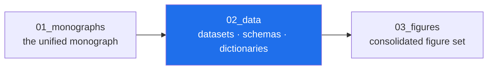

<!-- AB-ENRICHED:v1 · sub -->

**🧭 [⬆ AB_Cloud_Academic_Package/](../README.md) · [🏠 Root README](../../../README.md)**

# 02_data — datasets, schemas, dictionaries, cards

> **🧭 Navigation:** [Package root](../README.md) · [AB_Cloud_Academic_Package/](../../README.md) · [Repo root](../../../README.md)

*Layer map of the unified package — the highlighted node is this layer.*

| Path | What it is |
|---|---|
| [`raw/`](raw/README.md) | byte copies of the sources' curated datasets (read-only) |
| [`processed/`](processed/) | the unified research registry — the single source of numbers |
| [`frozen/`](frozen/README.md) | the frozen ζ-zero datasets the verification suite reads (byte-identical to the repo's `verification/` canon) |
| [`synthetic/`](synthetic/README.md) | SYNTHETIC-marked demo data |
| [`external/`](external/README.md) | external sources (Odlyzko tables) — links + notes |
| [`schemas/`](schemas/) | JSON Schema, SQL DDL, Avro, Protobuf for the registry |
| [`data_dictionary.md`](data_dictionary.md) / `.csv` | dataset descriptions |
| [`codebook.md`](codebook.md) / `.yaml` | verdicts, series, precision conventions |
| [`datacard.md`](datacard.md) | Datasheets for Datasets |
| [`modelcard.md`](modelcard.md) | model cards (protocols, not ML models) |
| [`checksums.sha256`](checksums.sha256) | integrity over `02_data/**` |
| [`lineage.json`](lineage.json) | the transformation lineage |
| [`differential_privacy.json`](differential_privacy.json) | differential-privacy statement (`applicable: false` — no personal or human-subject data) |
| [`sampling_protocol.md`](sampling_protocol.md) | how the sources' numbers were sampled |

## The golden rule

Numbers are **verbatim from verdict files** (see `lineage.json` invariants).
The registry (`processed/research_registry.json`) is the funnel through which
every display artefact in this package is fed.

⚡ Part of <a href="../../../README.md">AB-Cloud Research</a> — numbers are verbatim from the unified registry; no result on this page is a claim about the Riemann hypothesis · <a href="../README.md">⬆ parent section</a>

