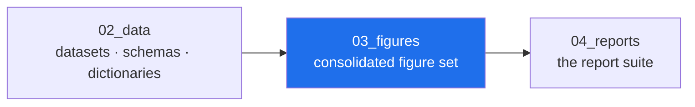

<!-- AB-ENRICHED:v1 · sub -->

**🧭 [⬆ AB_Cloud_Academic_Package/](../README.md) · [🏠 Root README](../../../README.md)**

# 03_figures — the consolidated figure set

> **🧭 Navigation:** [Package root](../README.md) · [AB_Cloud_Academic_Package/](../../README.md) · [Repo root](../../../README.md)

*Layer map of the unified package — the highlighted node is this layer.*

| Path | What it is |
|---|---|
| `static/dirac/` | the Dirac laboratory's 14 test figures (D1–D14), 600 dpi |
| `static/hilbert_polya/{en,ru}/` | the bridge's high-resolution figures (fig01–fig32, RU/EN) |
| `static/spectral_core/{en,ru}/` | the theorem tiles Th1–Th6 (RU/EN) |
| `static/meridian/{en,ru}/` | the observatory's statistics figures (M1–M3, RU/EN) |
| `static/results_run/{en,ru}/` | the v19 reference-run figures (verdict map, time profile; RU/EN) |
| `static/vortex_optimization/` | the vortex-density scan's 7 report figures (heatmap, D(Nv), D(q), L-ladder, α-scan, R₂(s), stability) |
| `static/wave_attractors/` | the wave-attractor study's 12 figures (chambers, cascade, phase diagram, chirality, …) |
| `diagrams/` | mermaid architecture diagrams (`architecture.mmd`) |
| `palettes/` | theme palettes for figure generation (light/dark/accessible) |
| [`captions.ru.md`](captions.ru.md) / [`captions.en.md`](captions.en.md) | bilingual captions |
| [`figure_index.csv`](figure_index.csv) | the full index |
| [`alt_texts.csv`](alt_texts.csv) | accessibility alt texts |

All figures are byte copies from the source laboratories (see
`00_meta/provenance.jsonl`); captions were written fresh for the unified
edition in both languages.

⚡ Part of <a href="../../../README.md">AB-Cloud Research</a> — numbers are verbatim from the unified registry; no result on this page is a claim about the Riemann hypothesis · <a href="../README.md">⬆ parent section</a>

