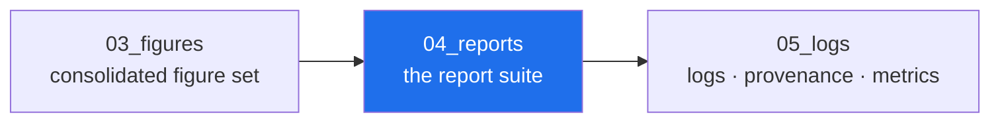

<!-- AB-ENRICHED:v1 · sub -->

**🧭 [⬆ AB_Cloud_Academic_Package/](../README.md) · [🏠 Root README](../../../README.md)**

# 04_reports — the report suite

> **🧭 Navigation:** [Package root](../README.md) · [AB_Cloud_Academic_Package/](../../README.md) · [Repo root](../../../README.md)

*Layer map of the unified package — the highlighted node is this layer.*

| File | What it is |
|---|---|
| [`report.md`](report.md) · [`report.pdf`](report.pdf) · [`report.docx`](report.docx) | the unified report (EN canonical) |
| [`executive_summary.md`](executive_summary.md) | one page for decision makers |
| [`lay_summary.md`](lay_summary.md) | for the general public (EN + RU) |
| [`press_release.md`](press_release.md) | for media (RU + EN) |
| [`policy_brief.md`](policy_brief.md) | open-science infrastructure note |
| [`per_language/`](per_language/) | the RU edition of the report |
| [`per_audience/`](per_audience/README.md) | audience-specific reading guides (academic / executive / general / policy / industry) |
| [`slides/deck.md`](slides/deck.md) | the slide deck source (Marp) |
| [`posters/poster_a0.svg`](posters/poster_a0.svg) | the A0 poster (SVG) |
| [`one_pager/one_pager.md`](one_pager/one_pager.md) | the one-pager |
| [`dashboards/`](dashboards/README.md) | dashboard manifests (Grafana/Superset JSON) |
| [`templates/`](templates/README.md) | journal / conference / grant templates |

**Funnel rule:** all numbers derive from
[`../02_data/processed/research_registry.json`](../02_data/processed/research_registry.json).

⚡ Part of <a href="../../../README.md">AB-Cloud Research</a> — numbers are verbatim from the unified registry; no result on this page is a claim about the Riemann hypothesis · <a href="../README.md">⬆ parent section</a>

