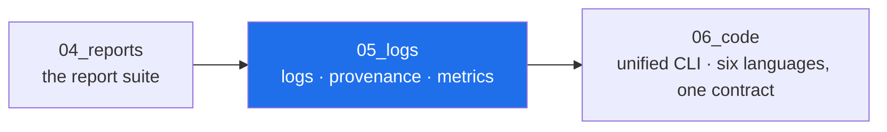

<!-- AB-ENRICHED:v1 · sub -->

**🧭 [⬆ AB_Cloud_Academic_Package/](../README.md) · [🏠 Root README](../../../README.md)**

# 05_logs — logs, provenance, metrics

> **🧭 Navigation:** [Package root](../README.md) · [AB_Cloud_Academic_Package/](../../README.md) · [Repo root](../../../README.md)

*Layer map of the unified package — the highlighted node is this layer.*

| File | What it is |
|---|---|
| [`metrics.json`](metrics.json) | the machine-readable numbers registry (every entry names its campaign) |
| [`run.log`](run.log) | the package build/doctor run log (human-readable) |
| [`errors.log`](errors.log) | errors only (empty on a clean build) |
| [`warnings.log`](warnings.log) | warnings (typography notes, font fallbacks) |
| [`debug.log`](debug.log) | debug detail of the build pipeline |
| [`audit.log`](audit.log) | audit trail of package operations |
| [`provenance.jsonl`](provenance.jsonl) | step-by-step provenance of the build |
| [`sessions/`](sessions/) | per-run session records |

`metrics.json` is generated from `02_data/processed/research_registry.json` —
the funnel rule applies: displays derive from the registry, never from
hand-typed copies.

⚡ Part of <a href="../../../README.md">AB-Cloud Research</a> — numbers are verbatim from the unified registry; no result on this page is a claim about the Riemann hypothesis · <a href="../README.md">⬆ parent section</a>

