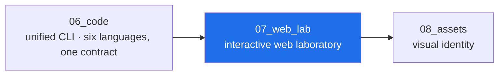

<!-- AB-ENRICHED:v1 · sub -->
<div align="center">


**🧭 [⬆ AB_Cloud_Academic_Package/](../README.md) · [🏠 Root README](../../../README.md)**

</div>
# 07_web_lab — the interactive web laboratory

> **🧭 Navigation:** [Package root](../README.md) · [AB_Cloud_Academic_Package/](../../README.md) · [Repo root](../../../README.md)



*Layer map of the unified package — the highlighted node is this layer.*

| File | What it is |
|---|---|
| [`index.html`](index.html) | **the laboratory** — one offline HTML file: 9 themes, RU/EN, search, explain mode, verdict ledger, flagship results, metrics bars, numbers registry |
| [`app.py`](app.py) | the Streamlit face (optional; same funnel — the registry) |
| [`api/`](api/) | the FastAPI service + openapi.json |
| [`i18n/`](i18n/) | language manifests (UI strings are embedded in index.html) |
| [`pwa/`](pwa/) | PWA manifest + service worker (offline-first; the lab is already offline) |
| [`docker/`](docker/README.md) | container recipes |

## Open it

```bash
open index.html                      # works from the ZIP, no server needed
python3 -m http.server 8322          # or serve it
streamlit run app.py                 # or the Streamlit face
```

## What it shows

- **Levels**: the six cards of the machine (I core, I⁺ processor, II Dirac,
  III bridge, IV verification, V spinor) with their campaign series.
- **Verdict ledger**: G1–G10 + RH, with basis; YES/NO/CERTIFIED colored.
- **Flagship results**: 24 rows, each naming its campaign; searchable.
- **Metrics**: the decisive quantities drawn on pre-registered scales.
- **Numbers registry**: 20 verbatim rows from the sources' verdict files.
- **Honesty layer**: the boundary statement — always visible, never optional.

The data is injected from
[`../02_data/processed/research_registry.json`](../02_data/processed/research_registry.json)
at build time; the page itself makes zero network requests.

<div align="center">


<sub>⚡ Part of <a href="../../../README.md">AB-Cloud Research</a> — numbers are verbatim from the unified registry; no result on this page is a claim about the Riemann hypothesis · <a href="../README.md">⬆ parent section</a></sub>

</div>
