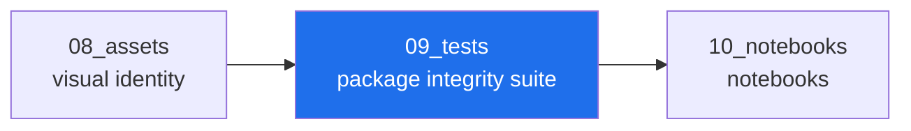

<!-- AB-ENRICHED:v1 · sub -->
<div align="center">


**🧭 [⬆ AB_Cloud_Academic_Package/](../README.md) · [🏠 Root README](../../../README.md)**

</div>
# 09_tests — the package integrity suite

> **🧭 Navigation:** [Package root](../README.md) · [AB_Cloud_Academic_Package/](../../README.md) · [Repo root](../../../README.md)



*Layer map of the unified package — the highlighted node is this layer.*

| File | What it checks |
|---|---|
| [`python/test_package_structure.py`](python/test_package_structure.py) | the skeleton matches the unified spec; versionless naming; every section has a README |
| [`python/test_config_schema.py`](python/test_config_schema.py) | config.yaml validates against config.schema.json; the honesty gate (rh_status=certified) |
| [`python/test_i18n_parity.py`](python/test_i18n_parity.py) | RU/EN catalogues have identical keys (CLI, shared, web lab, glossary) |
| [`python/test_contract.py`](python/test_contract.py) | the six-language CLI contract: identical metrics, JSON modes, honesty gate hook |
| [`python/test_checksums.py`](python/test_checksums.py) | checksums.sha256 covers and matches the data funnel |
| [`python/test_monograph_structure.py`](python/test_monograph_structure.py) | the monograph keeps its section skeleton and honesty boundary; PDF/DOCX built |
| [`python/test_reports_and_lab.py`](python/test_reports_and_lab.py) | report suite completeness; web lab data injection and offline-ness |
| `bench_runners.sh` | quick timing of the six runners |
| `python/conftest.py` | shared pytest configuration for the suite |
| `python/fixtures/` | small fixtures |
| `reports/` | coverage output |

## Run

```bash
python3 -m pytest 09_tests/python -q        # from the package root
bash 09_tests/bench_runners.sh              # benchmark the runners
```

The suite is the merge gate (`CONTRIBUTING.md`). It encodes the three
invariants of the unified edition: the funnel rule, the versionless naming
and the honesty layer.

<div align="center">


<sub>⚡ Part of <a href="../../../README.md">AB-Cloud Research</a> — numbers are verbatim from the unified registry; no result on this page is a claim about the Riemann hypothesis · <a href="../README.md">⬆ parent section</a></sub>

</div>
