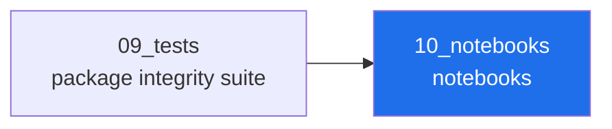

<!-- AB-ENRICHED:v1 · sub -->

**🧭 [⬆ AB_Cloud_Academic_Package/](../README.md) · [🏠 Root README](../../../README.md)**

# 10_notebooks

> **🧭 Navigation:** [Package root](../README.md) · [AB_Cloud_Academic_Package/](../../README.md) · [Repo root](../../../README.md)

*Layer map of the unified package — the highlighted node is this layer.*

| Notebook | What it does |
|---|---|
| [`exploration.ipynb`](exploration.ipynb) | load the registry, view levels & verdicts |
| [`analysis.ipynb`](analysis.ipynb) | the decisive quantities drawn; flagship results by level |
| [`report.ipynb`](report.ipynb) | regenerate the report tables as dataframes |
| [`tutorial.ipynb`](tutorial.ipynb) | five minutes with the programme (+ CLI from the notebook) |
| [`glossary.ipynb`](glossary.ipynb) | the glossary, live |

All notebooks read only from the funnel
(`02_data/processed/research_registry.json`); reruns are identical.

⚡ Part of <a href="../../../README.md">AB-Cloud Research</a> — numbers are verbatim from the unified registry; no result on this page is a claim about the Riemann hypothesis · <a href="../README.md">⬆ parent section</a>

