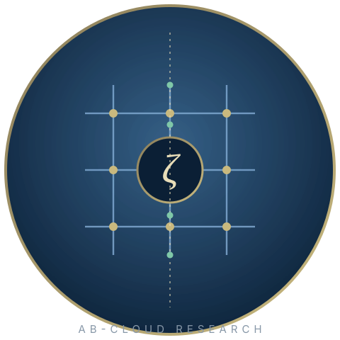

<div align="center">



# AB CLOUD RESEARCH — 统一学术包

**一项研究，四个层次：作为计算结构的代数 AB（Aharonov–Bohm）架构、其狄拉克骨架、希尔伯特–波利亚桥梁，以及盲验证装置。**

*统一版 · 无版本号 · 开放数据 · 诚实的边界*

[](02_data/processed/research_registry.json)
[](01_monographs/README.md)
[](#honest)
[](https://doi.org/10.5281/zenodo.21825394)

[Русский](README.ru.md) · [English](README.md) · [中文](README.zh.md) · [Deutsch](README.de.md) · [Español](README.es.md) · [Français](README.fr.md) · [العربية](README.ar.md)

</div>

---

> [!IMPORTANT]
> **诚实边界（重要声明）.** 本包中的所有内容均为数学模型的数值与形式化研究。它**不**证明黎曼假设：在解析前提仍属假设期间，V13 义务机将 RH 结论保持在 **blocked（受阻）**状态。阴性结果作为一等公民发表：局域性之墙（T18）、闸门处的零区（T8）、格点 ζ 对应的失败（V1/V3/V6/V16）。

---

## 这是什么

本文件夹是整个 AB-Cloud 研究计划的统一学术版：一个自包含的包，整合了本仓库的三个研究实验室 —— AB_Cloud_Quantum_Research（谱核与 AB 处理器）、dirac-lab（狄拉克骨架）与 Hilbert_Polya（希尔伯特–波利亚桥梁），以及先前提交包的验证遗产（38 项测试的基准运行及其附录）。统一版不带版本号：它是一个活的学术结构（00_meta … 10_notebooks），而非冻结的发布。

## 架构：一台机器的层次

| 层次 | 源文件夹 | 活动 | 一句话本质 |
|---|---|---|---|
| 🧠 **核心** | `AB_Cloud_Quantum_Research` | **V01–V19** | 盲谱、GUE 类、迹携带 Λ(n)/√n（r = 0.9996）、V13 义务机阻断 RH |
| ⚛️ **处理器** | `AB_Cloud_Quantum_Research` | **V20** | AB 云 ISA、精确 Givens–QR 编译（1−F ≤ 4.4·10⁻¹⁶）、「只读不存」、CHSH = 2√2 − 4.4·10⁻¹⁶ |
| ⚛️ **狄拉克骨架** | `dirac-lab` | **D1–D14** | π 通量格点**就是**离散化的无质量狄拉克方程；ζ 装饰算符将 GOE 提升至 GUE（⟨r⟩ 0.608 对 0.5992） |
| 🌉 **桥梁** | `Hilbert_Polya` | **C1–C17 · T1–T18** | 几乎存在的算符：精确非局域迹（r_H7 = 1.000）、零点自身层级上的层级同一性（G2 — 是）、素数经由收敛阶梯（G5 — 是）、比特层墙 = **局域性** |
| 🔬 **验证** | `AB_Cloud_Quantum_Research` | **E01–E18** | 盲读 ζ 零点 649/649 + 639/639（跨引擎 0.0）、独立 Riemann–Siegel、B 类获胜 ×59,000 |
| 🌀 **旋量** | `AB_Cloud_Quantum_Research` | **ES1–ES5** | 无长期记忆的机器：循环在 N = 2k 闭合、步长 O(1) 对 Ω(t) |

## 📂 包结构

| 路径 | 内容 |
|---|---|
| [`00_meta/`](00_meta/README.md) | 清单、来源、可复现性/FAIR/伦理检查表 |
| [`01_monographs/`](01_monographs/README.md) | 统一专著：RU/EN 全卷 + 五种语言摘要 |
| [`02_data/`](02_data/README.md) | 数据、模式、字典、代码本、校验和 |
| [`03_figures/`](03_figures/README.md) | 静态图（600 dpi）、图表、调色板、标题 |
| [`04_reports/`](04_reports/README.md) | 统一报告（MD/PDF/DOCX）、摘要、新闻稿、幻灯片 |
| [`05_logs/`](05_logs/README.md) | 运行/错误/审计日志、指标、会话 |
| [`06_code/`](06_code/README.md) | 六种语言的统一 CLI + 共享 JSON 契约 |
| [`07_web_lab/`](07_web_lab/README.md) | 交互式网络实验室（离线） |
| [`08_assets/`](08_assets/README.md) | 头像、徽章、徽标、九种主题 |
| [`09_tests/`](09_tests/README.md) | 包完整性测试套件 |
| [`10_notebooks/`](10_notebooks/README.md) | 探索/分析/报告笔记本 |

## 🚀 快速开始

```bash
./06_code/cli/run.sh --lang=zh --theme=neon   # 统一 CLI
python3 -m pytest 09_tests/python -q              # 完整性检查
```

## ⚖️ 判定台账

| 论断 | 判定 | 依据 |
|---|---|---|
| 自伴性 | **是** | 机器零厄米性、实谱 |
| 谱同一性 | **否** | 9–10 个数量级（C3）≈ 0.5 个数量级（C4）；墙 = 局域性 |
| GUE 类 | **是** | ⟨r⟩ = 0.60；整个 C5 家族在类中 |
| 狄拉克动力学 | **是** | 相干波包 1·10⁻¹⁵；Klein ×977；ω = 2E 的颤动 |
| 算符中的素数 | **否** | 迹中确有（r = 0.9996）；闸门谱中 — 零区 |
| RH | **受阻** | V13 义务机；前提为假设 |

## 📜 引用

```bibtex
@dataset{isaev_abcloud_unified,
  author  = {Isaev, Iskhak Khamzatovich},
  title   = {AB-Cloud Research Programme: Unified Academic Package},
  year    = {2026},
  doi     = {10.5281/zenodo.21825394},
  url     = {https://github.com/wild8highlander/ab-cloud-research/tree/main/AB_Cloud_Academic_Package}
}
```

---

*本包自我解释：每个文件夹都有自己的 README，每个数字都注明其活动，每个论断都带有其边界。* — **[返回主 README](README.md)**
