# 📮 AB-Cloud — Journal Submission Deliverables

**Three sealed submission packages, each tailored to its venue's class file and wizard —
compiled from the unified edition, sealed with SHA-256, ready to upload.**

*NSR (JINR) · SciPost Physics · arXiv · 48 figures each · supplemental included*

<picture>
  <source media="(prefers-color-scheme: dark)" srcset="https://readme-typing-svg.demolab.com?font=Fira+Code&size=15&pause=1400&color=E8DDB8&center=true&vCenter=true&random=false&width=660&height=34&lines=Three+packages+%C2%B7+three+wizards+%C2%B7+one+manuscript;NSR+%28JINR%29%3A+100+pp.+on+official+nsr.cls+v1.5;SciPost%3A+60+pp.+Publication+%2B+11+pp.+Core;arXiv%3A+flat+main.tex+%C2%B7+zip-and-upload+ready">
  
</picture>

**Prepared:** 8 October 2026 · from [github.com/wild8highlander/ab-cloud-research](https://github.com/wild8highlander/ab-cloud-research)

**Author:** Isaev Iskhak Khamzatovich (I. K. Isaev) · ORCID [0009-0003-7299-0701](https://orcid.org/0009-0003-7299-0701) · [aslan08_05@mail.ru](mailto:aslan08_05@mail.ru)

**Affiliation** (with postal address, used in all three packages):
AB-Cloud Research Laboratory, Independent Researcher,
Prospekt Lenina 29, Apt. 140, Nalchik, Kabardino-Balkarian Republic, Russian Federation

## 📦 Packages

| File | For | Content |
|---|---|---|
| `NSR_JINR_submission_AB-Cloud_v23.zip` | Natural Science Review (JINR), [nsr.jinr.int](https://nsr.jinr.int) | Full manuscript (100 pp.) on official `nsr.cls` v1.5, cover letter, 48 figures, supplemental (code + run data), README how-to-submit, SHA256SUMS |
| `SciPost_Physics_submission_AB-Cloud_v23.zip` | SciPost Physics, [scipost.org](https://scipost.org) | Publication version (60 pp.) + condensed **Core version (11 pp.)** on official `scipost.cls`, cover letter, 48 figures, supplemental, README, SHA256SUMS |
| `arXiv_submission_AB-Cloud_v23.zip` | [arXiv.org](https://arxiv.org) preprint | Flat package: `main.tex` (standard article class, inline bibliography), `figures/` (48), metadata README; ready to zip-and-upload |

## 👁️ Preview PDFs (not for upload)

- `NSR_manuscript_preview.pdf` — compiled reference PDF of the NSR manuscript
- `SciPost_manuscript_preview.pdf` — Publication version
- `SciPost_core_manuscript_preview.pdf` — Core (short) version
- `arXiv_manuscript_preview.pdf` — how arXiv will compile `main.tex`

## 🤔 Which SciPost version to submit?

Submit **one** of the two. The Publication version is the complete academic account
(60 pp.); the Core version is the condensed communication (11 pp.) for SciPost's
short-format article type — pick Core if you prefer a faster, tighter review.
The same `figures/` and `supplemental/` serve both.

## 🧭 Human steps remaining

1. **NSR wizard:** topic **Physics** (pre-selected in the plan); metadata forms mirror the
   declarations inside the manuscript.
2. **SciPost wizard:** pick specialties (recommended: **Statistical Physics** + **Mathematical
   Physics**) and the article type (**Publication** or **Core**, matching the tex you upload).
3. **arXiv:** request endorsement for **math-ph** (first-time submitters), paste the metadata
   from `README_arxiv_metadata.md`, choose the **non-exclusive licence to distribute** —
   arXiv's default and most restrictive option, consistent with the strictly personal
   licence of this repository.

> [!TIP]
> Every package carries its own `README_how_to_submit.md` (or `README_arxiv_metadata.md`)
> with the step-by-step wizard guide and requirements checklist — open it before
> starting the corresponding wizard.

## 🔒 License & attribution

These submission packages are part of the AB-Cloud Research programme and are
**proprietary**: all rights belong to the Author under the strictly personal
licence — see the repository-wide [`../../LICENSE`](../../LICENSE) and the package
licence note [`../README.md`](../README.md#-license). Once a journal accepts a
manuscript, that journal's own publication agreement governs the published
version; everything else on this shelf stays under the Author's exclusive
control. Please cite with attribution and the DOI
[10.5281/zenodo.21825394](https://doi.org/10.5281/zenodo.21825394).

---

**[↑ back to top](#-ab-cloud--journal-submission-deliverables)** · [Academic Package](../README.md) · [Repository root](../../README.md)

*Sealed, checksummed, wizard-ready — three doors into peer review.*

