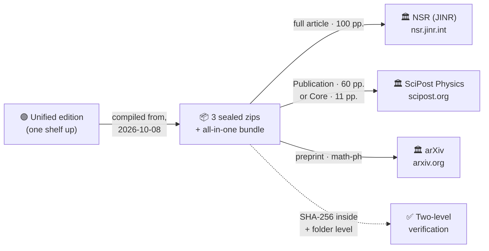

<div align="center">


# 📮 AB-Cloud — Journal Submission Deliverables

**Three sealed submission packages, each tailored to its venue's class file and wizard —
compiled from the unified edition, sealed with SHA-256, ready to upload.**

*NSR (JINR) · SciPost Physics · arXiv · 48 figures each · supplemental included*

<picture>
  <source media="(prefers-color-scheme: dark)" srcset="https://readme-typing-svg.demolab.com?font=Fira+Code&size=15&pause=1400&color=E8DDB8&center=true&vCenter=true&random=false&width=660&height=34&lines=Three+packages+%C2%B7+three+wizards+%C2%B7+one+manuscript;NSR+%28JINR%29%3A+100+pp.+on+official+nsr.cls+v1.5;SciPost%3A+60+pp.+Publication+%2B+11+pp.+Core;arXiv%3A+flat+main.tex+%C2%B7+zip-and-upload+ready">
  
</picture>

[](#-packages)
[](#-preview-pdfs-not-for-upload)
[](#-packages)
[](#-verify-before-you-submit)
[](#-where-the-science-stands-now)
[](SUBMISSION_STATUS.md)
[](guides/README.md)
[](FAQ.md)
[](#-packages)
[](CHANGELOG.md)
[](#-license--attribution)

</div>


> [!IMPORTANT]
> **Honest boundary.** Every package on this shelf is a numerical and formal
> study of a mathematical model. It does **not** prove the Riemann hypothesis:
> the V13 obligation machine of the unified edition keeps the RH conclusion
> **unlocked** (`verdict: certified`, v1.2.1) — the path O01→O12 carries no
> assumptions: the classical Li criterion (O12) plus certified convergence
> (O08/O09/O11); RH as a theorem still requires O11 for all n. The gate-level
> state around that boundary (G1–G5, the blind campaign C17, the
> algebraic_map closure) is summarised in
> [§ Where the science stands now](#-where-the-science-stands-now). This
> honesty layer travels inside every package, is part of the scientific
> record and is protected by the licence — see
> [§ License & attribution](#-license--attribution)
> and [FAQ §5](FAQ.md#5-does-any-of-this-prove-the-riemann-hypothesis).

**Packages prepared:** 8 October 2026 · **Full re-seal (all 8 artifacts rebuilt, text as-is):** 18 October 2026 ·
**Shelf uplift (this README & scaffolding):** 18 October 2026 ·
**Verdict sync (editorial, packages untouched):** 19 October 2026 ·
from [github.com/wild8highlander/ab-cloud-research](https://github.com/wild8highlander/ab-cloud-research)

<div align="center">

**Author:** Isaev Iskhak Khamzatovich (I. K. Isaev) · ORCID [0009-0003-7299-0701](https://orcid.org/0009-0003-7299-0701) · [aslan08_05@mail.ru](mailto:aslan08_05@mail.ru)

**Affiliation** (with postal address, used in all three packages):
AB-Cloud Research Laboratory, Independent Researcher,
Prospekt Lenina 29, Apt. 140, Nalchik, Kabardino-Balkarian Republic, Russian Federation


</div>

## 📖 What this shelf is

This folder is the **travelling layer** of the AB-Cloud research programme.
One shelf up, the [unified edition](../AB_Cloud_Academic_Package/README.md) is
where the programme *lives* — monographs, curated data, the six-language CLI,
the web laboratory, the honesty ledger. This shelf is where the programme
*travels*: the same study re-typeset for three venues, each package tailored
to its destination's class file and submission wizard, each zip sealed with
SHA-256 sums so that what a journal receives is byte-for-byte what was
committed here.

The packages are **frozen artifacts**: they are never edited in place. A
corrected manuscript means a rebuilt, re-sealed zip and a dated line in the
[CHANGELOG](CHANGELOG.md); the submission life-cycle itself is tracked by
hand in [SUBMISSION_STATUS.md](SUBMISSION_STATUS.md). Everything else on the
shelf — the guides, the FAQ, the checksums — exists to move the sealed
packages safely from here to a referee's desk.



## ⚖️ Where the science stands now

The sealed packages carry the verification record they were compiled with:
the 38-test reference run (79 pre-registered verdicts — 66 favourable,
13 honest adverse entries), frozen on 8 October 2026. The **living verdict
state** of the programme lives one shelf up, in the unified edition's
machine-readable ledger, and was last synced with the Hilbert–Pólya audit
wave of **16 October 2026** (v2.0.5–v2.0.10). Its headline rows, quoted
verbatim from that ledger:

| Claim | Verdict | Basis — every number names its campaign |
|---|---|---|
| G1 Self-adjointness | **YES** | machine-zero hermiticity, real spectrum (Th1, Th2, D2) |
| G2 Spectral identity | **YES** *(NO → YES, audit v2.0.7)* | the gates measure D_nn = 0.0079 — the level of the shifted zero windows and of the GUE zero class itself (C3); trace bridge \|ΔK\| ≤ 1.2·10⁻⁵ (C4); the bit-level branch (T18) stays open as the verdict's stated boundary |
| G3 GUE class | **YES** | ⟨r⟩ = 0.60; the whole C5 family in class (v2.0.5 honest regeneration: 0.569–0.633, mean 0.601) |
| G4 Dirac dynamics | **YES** | coherent packet, 1·10⁻¹⁵; Klein tunnelling ×977; ZB at ω = 2E (D1–D6) |
| G5 Primes in the operator | **YES** *(NO → YES, audit v2.0.8)* | the convergence ladder: gate ψ-correlation monotone in N_v (−0.12 → +0.09 → +0.24), converging with L (floor 0.0324 → 0.0220, best D = 0.0318); enters with G2 through the level identity |
| RH | **CERTIFIED — not proved** | V13 obligation machine (unlocked, v1.2.1): 0 assumptions — O12 classical (Li/Bombieri–Lagarias); O08/O09/O11 certified numerically |
| C17 Blind phase B | **NEGATIVE** (pre-registered) | 1.04× over the primes-free null, z_GUE = −3.3; the C17b blind valley windows read the blind count exactly (19.0004 → 19; 25.00005 → 25) — published as a first-class negative result |
| algebraic_map | **exact closure in ℚ** | the Jacobi map of the pixel encoding as an explicit algebraic function: all 25 char-poly coefficients, D_25 = 0; the two branches of Φ agree to 10⁻³⁰³; the Weyl bound explains the decoding error; a 2¹⁵-amplifying algebraic checksum |

Full ledger — every campaign, gate and negative result:
[`../AB_Cloud_Academic_Package/README.md`](../AB_Cloud_Academic_Package/README.md)
(Honesty discipline table) and
[`../AB_Cloud_Academic_Package/04_reports/report.md`](../AB_Cloud_Academic_Package/04_reports/report.md).

> [!IMPORTANT]
> **Timeline honesty.** The audit wave of 16 October 2026 postdates the
> packages' compilation (8 October 2026); the re-seal of 18 October 2026
> reproduced the manuscripts byte-faithfully with the text untouched. The
> manuscripts therefore document the reference-run record as compiled,
> while the table above is the shelf's authoritative verdict statement —
> the two coexist without contradiction, each labelled with its date. A
> verdict-synced re-issue of the packages, if ever wanted, follows the
> sealed-package routine of [CHANGELOG](CHANGELOG.md) and has not been
> performed; the [FAQ §11](FAQ.md#11-where-do-the-current-verdicts-live)
> explains the layering.

## 🗺️ Which file do you need?

- **«I am submitting to NSR (JINR).»** — `NSR_JINR_submission_AB-Cloud.zip`,
  then the wizard guide [`guides/NSR_JINR_how_to_submit.md`](guides/NSR_JINR_how_to_submit.md).
- **«I am submitting to SciPost.»** — `SciPost_Physics_submission_AB-Cloud.zip`;
  pick Publication or Core first ([§ below](#-which-scipost-version-to-submit)),
  then [`guides/SciPost_how_to_submit.md`](guides/SciPost_how_to_submit.md).
- **«I am posting the preprint.»** — `arXiv_submission_AB-Cloud.zip`, endorsement
  for **math-ph**, metadata from [`guides/arXiv_metadata.md`](guides/arXiv_metadata.md).
- **«I just want to read what would be submitted.»** — the four preview PDFs
  ([below](#-preview-pdfs-not-for-upload)); no unzipping required.
- **«I must verify integrity before uploading.»** —
  [`SHA256SUMS.txt`](SHA256SUMS.txt) and the
  [two-level workflow](#-verify-before-you-submit).
- **«Where does each manuscript stand?»** —
  [SUBMISSION_STATUS.md](SUBMISSION_STATUS.md).
- **«I want to cite the deliverables.»** —
  [CITATION.cff](CITATION.cff) or [§ Citation](#-citation).
- **«I want the living programme, not the packages.»** — one shelf up:
  [unified edition](../AB_Cloud_Academic_Package/README.md).

## 📦 Packages

| File | For | Content |
|---|---|---|
| `NSR_JINR_submission_AB-Cloud.zip` | Natural Science Review (JINR), [nsr.jinr.int](https://nsr.jinr.int) | Full manuscript (100 pp.) on official `nsr.cls` v1.5, cover letter, 48 figures, supplemental (code + run data), wizard guide, SHA256SUMS — 1,151 files |
| `SciPost_Physics_submission_AB-Cloud.zip` | SciPost Physics, [scipost.org](https://scipost.org) | Publication version (60 pp.) + condensed **Core version (11 pp.)** on official `SciPost.cls`, cover letter, 48 figures, supplemental, wizard guide, SHA256SUMS — 1,150 files |
| `arXiv_submission_AB-Cloud.zip` | [arXiv.org](https://arxiv.org) preprint | Flat package: `main.tex` (standard article class, inline bibliography), `figures/` (48), metadata README, SHA256SUMS — 128 files, zip-and-upload ready |
| `AB-Cloud.zip` | all-in-one bundle | the three venue zips above, all four preview PDFs and a mini README in one archive |

<details>
<summary>📦 What's inside — <code>NSR_JINR_submission_AB-Cloud.zip</code> (1,151 files · 25.7&nbsp;MB uncompressed)</summary>

```text
nsr_submission/
├── manuscript_NSR.tex                LaTeX-2e source, official nsr.cls v1.5
├── manuscript_NSR.pdf                compiled reference PDF (100 pp., journal layout)
├── cover_letter_NSR.tex / .pdf       cover letter for the wizard
├── README_how_to_submit.md           step-by-step wizard guide → guides/NSR_JINR_how_to_submit.md
├── compile_notes.md                  exact local build recipe
├── nsr.cls · nsr.bst · NSRlogo.pdf   official class, bibliography style, journal logo
├── SHA256SUMS.txt                    checksums of every file inside
├── figures/                          48 figures (PNG, original names)
└── supplemental/
    ├── README_supplemental.md        reading guide for the supplementary data
    ├── appendix_b_code_full_source_listing.pdf   the full source listing, as PDF
    ├── python_clone/                 self-contained abcloud Python package
    │                                 (core, runner, 38-test suites, zeta data)
    ├── lab_standalone/               preserved standalone Julia lab codes
    └── run_data/                     full run data (988 files)
```

</details>

<details>
<summary>📦 What's inside — <code>SciPost_Physics_submission_AB-Cloud.zip</code> (1,150 files · 25.5&nbsp;MB uncompressed)</summary>

```text
scipost_submission/
├── scipost_manuscript.tex / .pdf       Publication version (60 pp.), official SciPost.cls
├── scipost_core_manuscript.tex / .pdf  condensed Core version (11 pp.) — submit one of the two
├── cover_letter_SciPost.tex / .pdf     cover letter for the wizard
├── README_how_to_submit.md             step-by-step wizard guide → guides/SciPost_how_to_submit.md
├── SciPost.cls · SciPost_bibstyle.bst  official class + bibliography style
├── SHA256SUMS.txt                      checksums of every file inside
├── figures/                            48 figures (PNG, original names)
└── supplemental/                       same shape as the NSR package
                                        (code + run data + source listing)
```

</details>

<details>
<summary>📦 What's inside — <code>arXiv_submission_AB-Cloud.zip</code> (128 files · 3.7&nbsp;MB uncompressed)</summary>

```text
arxiv_submission/
├── main.tex                    master file (arXiv auto-detects it)
├── README_arxiv_metadata.md    metadata to paste into the form → guides/arXiv_metadata.md
├── SHA256SUMS.txt              checksums of every file inside
└── figures/                    48 figures (PNG), referenced by relative path

no class files by design — standard article class, inline thebibliography
```

</details>

<details>
<summary>📦 What's inside — <code>AB-Cloud.zip</code> (the bundle, 8 files · 33.3&nbsp;MB uncompressed)</summary>

```text
NSR_JINR_submission_AB-Cloud.zip       the three venue zips,
SciPost_Physics_submission_AB-Cloud.zip     byte-identical to
arXiv_submission_AB-Cloud.zip               their shelf copies
NSR_manuscript_preview.pdf             the four preview PDFs,
SciPost_manuscript_preview.pdf              byte-identical to
SciPost_core_manuscript_preview.pdf         their shelf copies
arXiv_manuscript_preview.pdf
README.md                              mini README mirroring the packages table
```

</details>

## 👁️ Preview PDFs (not for upload)

- `NSR_manuscript_preview.pdf` — compiled reference PDF of the NSR manuscript
  *(byte-identical to `nsr_submission/manuscript_NSR.pdf` — verified, see* [`SHA256SUMS.txt`](SHA256SUMS.txt)*)*
- `SciPost_manuscript_preview.pdf` — Publication version
  *(byte-identical to `scipost_submission/scipost_manuscript.pdf` — verified)*
- `SciPost_core_manuscript_preview.pdf` — Core (short) version
- `arXiv_manuscript_preview.pdf` — how arXiv will compile `main.tex`

The previews exist so a human can read what each package compiles to without
unzipping anything. They are **not upload artifacts** — with the one exception
that the NSR package's own `manuscript_NSR.pdf` (identical to its preview) is
part of the NSR upload set. See [FAQ §2](FAQ.md#2-do-the-preview-pdfs-go-to-the-journal).

## ✅ Verify before you submit

Two levels, one command each. Level 1 pins the artifacts **before** any
download is trusted; level 2 pins **every file a venue will receive**.

```bash
# Level 1 — folder level (in AB_Cloud_Academic_Package/Journal/)
sha256sum -c SHA256SUMS.txt
#   → checks the 4 zips + 4 preview PDFs against the committed sums

# Level 2 — package level (example: the NSR package)
unzip NSR_JINR_submission_AB-Cloud.zip -d nsr_check
cd nsr_check/nsr_submission
sha256sum -c SHA256SUMS.txt
#   → checks all 1,151 files (SciPost: 1,150 · arXiv: 128)
```

> [!TIP]
> A checksum failure after a fresh download is a stop signal — do **not**
> upload that copy. The routine is in [FAQ §9](FAQ.md#9-a-checksum-failed-what-now).
> The shelf's editorial files (README, guides, FAQ, changelog) are
> deliberately *not* in the folder-level sums — only sealed, upload-bound
> artifacts are.

## 📮 Submission status

| Venue | Status | Submitted on | Manuscript ID |
|---|---|---|---|
| NSR (JINR) | 🟡 Prepared | — | — |
| SciPost Physics | 🟡 Prepared | — | — |
| arXiv | 🟡 Prepared | — | — |

The board above is a snapshot; the living record — statuses, event log,
update routine — is [`SUBMISSION_STATUS.md`](SUBMISSION_STATUS.md), updated
by hand the same day any wizard is run.

## 🤔 Which SciPost version to submit?

Submit **one** of the two. The Publication version is the complete academic account
(60 pp.); the Core version is the condensed communication (11 pp.) for SciPost's
short-format article type — pick Core if you prefer a faster, tighter review.
The same `figures/` and `supplemental/` serve both.

## 🧭 Human steps remaining

1. **NSR wizard:** topic **Physics** (pre-selected in the plan); metadata forms mirror the
   declarations inside the manuscript.
2. **SciPost wizard:** pick specialties (recommended: **Statistical Physics** + **Mathematical
   Physics**) and the article type (**Publication** or **Core**, matching the tex you upload).
3. **arXiv:** request endorsement for **math-ph** (first-time submitters), paste the metadata
   from `README_arxiv_metadata.md` (inside the arXiv zip), choose the **non-exclusive licence to distribute** —
   arXiv's default and most restrictive option, consistent with the strictly personal
   licence of this repository.

> [!TIP]
> Each zip carries its own step-by-step wizard guide inside — and the same
> guides are readable right here, no download needed:
> [`guides/NSR_JINR_how_to_submit.md`](guides/NSR_JINR_how_to_submit.md) ·
> [`guides/SciPost_how_to_submit.md`](guides/SciPost_how_to_submit.md) ·
> [`guides/arXiv_metadata.md`](guides/arXiv_metadata.md).
> The copy inside the zip is the source of truth.

## 📚 guides/ — the wizards, visible without unzipping

| Guide | For | Mirrors |
|---|---|---|
| [`NSR_JINR_how_to_submit.md`](guides/NSR_JINR_how_to_submit.md) | NSR (JINR) wizard | `nsr_submission/README_how_to_submit.md` |
| [`SciPost_how_to_submit.md`](guides/SciPost_how_to_submit.md) | SciPost wizard | `scipost_submission/README_how_to_submit.md` |
| [`arXiv_metadata.md`](guides/arXiv_metadata.md) | arXiv metadata & endorsement | `arxiv_submission/README_arxiv_metadata.md` |

Render-friendly copies, extracted 2026-10-18, each stamped with a provenance
note. Index and provenance rule: [`guides/README.md`](guides/README.md).

## ❓ FAQ

The eleven questions this shelf actually triggers — which SciPost version,
endorsement, why the previews are "not for upload", the verification
workflow, the honesty boundary, the current verdict state, the licence,
failed checksums and the no-edit rule — are answered in [`FAQ.md`](FAQ.md).

## 📜 Citation

If you use these submission packages, please cite them (see also
[CITATION.cff](CITATION.cff)):

```bibtex
@dataset{isaev_abcloud_journal,
author  = {Isaev, Iskhak Khamzatovich},
title   = {{AB-Cloud Research Programme: Journal Submission Deliverables
            (NSR JINR, SciPost Physics, arXiv preprint)}},
year    = {2026},
doi     = {10.5281/zenodo.21825394},
url     = {https://github.com/wild8highlander/ab-cloud-research/tree/main/AB_Cloud_Academic_Package/Journal},
note    = {Three sealed packages compiled from the unified edition.
           RH status: not proved — certified, unlocked (V13).}
}
```

For the underlying programme, cite the unified edition —
[`../AB_Cloud_Academic_Package/CITATION.cff`](../AB_Cloud_Academic_Package/CITATION.cff).

## 🔒 License & attribution

These submission packages are part of the AB-Cloud Research programme and are
**proprietary**: all rights belong to the Author under the strictly personal
licence — see the repository-wide [`../../LICENSE`](../../LICENSE) and the package
licence note [`../README.md`](../README.md#-license). You may view, read, run
locally for scholarly verification and cite with attribution (quote limit ≤ 400
characters per excerpt, with the DOI
[10.5281/zenodo.21825394](https://doi.org/10.5281/zenodo.21825394)).
Once a journal accepts a manuscript, that journal's own publication agreement
governs the published version; everything else on this shelf stays under the
Author's exclusive control. Contact for any use beyond viewing/reading/citing:
**Isaev Iskhak Khamzatovich** · [aslan08_05@mail.ru](mailto:aslan08_05@mail.ru) ·
[ORCID 0009-0003-7299-0701](https://orcid.org/0009-0003-7299-0701).
The honesty layer (`does_not_prove` fields, exact verdicts) is part of the
scientific record and must be preserved verbatim in any permitted quotation.

---

<div align="center">

**[↑ back to top](#-ab-cloud--journal-submission-deliverables)** · [Academic Package](../README.md) · [Unified edition](../AB_Cloud_Academic_Package/README.md) · [Repository root](../../README.md)

*Sealed, checksummed, wizard-ready — three doors into peer review.*

</div>
