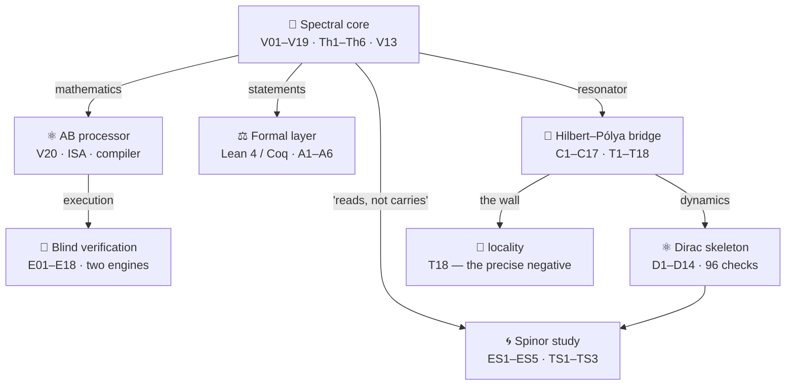
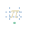
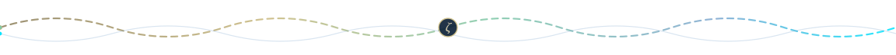

<div align="center">


# AB Cloud Research — Unified Academic Package

**One study across ten levels: the algebraic AB (Aharonov–Bohm) architecture as
computational fabric, its Dirac skeleton, the Hilbert–Pólya bridge, the blind
verification apparatus, the reference runs, the meridian observatory, the
vortex-density window and the hyperbolic wave attractors.**

*Unified edition · no version numbers · open data · honest boundaries*

<picture>
  <source media="(prefers-color-scheme: dark)" srcset="https://readme-typing-svg.demolab.com?font=Fira+Code&size=15&pause=1400&color=E8DDB8&center=true&vCenter=true&random=false&width=640&height=34&lines=One+study+%C2%B7+ten+levels+%C2%B7+honest+boundaries;Blind+%CE%B6-zero+reading%3A+649%2F649+%2B+639%2F639+%C2%B7+cross-engine+0.0;RH+status%3A+BLOCKED+by+design+%C2%B7+Lean%2FCoq+guaranteed;44%2B+campaigns+%C2%B7+410%2B+tests+%C2%B7+9+implementation+languages">
  
</picture>

[](00_meta/dossier.md)
[](02_data/processed/research_registry.json)
[](01_monographs/README.md)
[](09_tests/README.md)
[](04_reports/report.md)
[](#-honest-boundary)
[](#-honest-boundary)

[-E8DDB8?style=for-the-badge)](01_monographs/README.md)
[](06_code/README.md)
[](#-language-switcher)
[](https://doi.org/10.5281/zenodo.21825394)
[](https://orcid.org/0009-0003-7299-0701)
[](#-license)

</div>


## 🌐 Language switcher

| Language | README | Monograph |
|---|---|---|
| **English** | this page — master edition | [01_monographs/en/](01_monographs/en/README.md) — full volume |
| **Русский** | [README.ru.md](README.ru.md) | [01_monographs/ru/](01_monographs/ru/README.md) — полный том |
| **中文** | [README.zh.md](README.zh.md) | [01_monographs/zh/](01_monographs/zh/README.md) — 摘要与目录 |
| **Deutsch** | [README.de.md](README.de.md) | [01_monographs/de/](01_monographs/de/README.md) — Abstract & Inhalt |
| **Español** | [README.es.md](README.es.md) | [01_monographs/es/](01_monographs/es/README.md) — Resumen e índice |
| **Français** | [README.fr.md](README.fr.md) | [01_monographs/fr/](01_monographs/fr/README.md) — Résumé et sommaire |
| **العربية** | [README.ar.md](README.ar.md) | [01_monographs/ar/](01_monographs/ar/README.md) — ملخص وفهرس |

> [!IMPORTANT]
> **Honest boundary.** Everything in this package is a numerical and formal
> study of a mathematical model. It does **not** prove the Riemann hypothesis:
> the V13 obligation machine keeps the RH conclusion **blocked**
> (`verdict: blocked`) while the analytic prerequisites remain assumed. The
> Lean/Coq formalization guarantees this blocking — it does not remove it.
> Negative results are published as first-class citizens: the locality wall
> (T18), the null zone at gates (T8), the lattice ζ-correspondence failures
> (V1/V3/V6/V16), the 2q KAK optimum outside the E18 class.

## 📖 What this is

This folder is the **unified academic edition** of the whole AB-Cloud research
programme: one self-contained package that consolidates the three research
laboratories of the repository — [`AB_Cloud_Quantum_Research`](../AB_Cloud_Quantum_Research/)
(the spectral core and AB processor), [`dirac-lab`](../dirac-lab/) (the Dirac
skeleton) and [`Hilbert_Polya`](../Hilbert_Polya/) (the Hilbert–Pólya bridge) —
together with the verification heritage of the earlier submission package
(the 38-test reference run and its addenda), the meridian observatory's
50,000-zero audit and the vortex / wave-attractor studies. The unified
edition carries **no version numbers**: it is organised as a living academic
structure (`00_meta` … `10_notebooks`) rather than a frozen release.

The programme proposes a concrete statistical bridge between two objects that
mathematics has been trying to reconcile for decades: the non-trivial zeros of
the Riemann ζ function, and the spectrum of Hermitian lattice operators threaded
by Aharonov–Bohm magnetic flux quanta. The construct is engineered so that its
spectral statistics fall into the GUE universality class — the class the
Montgomery–Odlyzko programme predicts for the ζ zeros — while its exact layer
(hermiticity, flux quantization, Byers–Yang invariance, chiral pairing, Connes
self-duality, an identity chain of geometric phases) is verifiable to machine
precision and to 256-bit arbitrary precision where needed. The verification
record subjects the construct to **44+ numbered campaigns and tests** across
four levels and the satellite studies, all cross-verified between Python and
Julia, with pre-registered verdicts and a machine-readable honesty layer.

## 🏛️ Architecture: levels of one machine



| Level | Source folder | Campaigns | One-line essence |
|---|---|---|---|
|  **Core** | `AB_Cloud_Quantum_Research` | **V01–V19** | blind spectrum, GUE class, the trace carries Λ(n)/√n (r = 0.9996), the V13 obligation machine blocks RH |
|  **Processor** | `AB_Cloud_Quantum_Research` | **V20** | AB-cloud ISA, exact Givens–QR compilation (1−F ≤ 4.4·10⁻¹⁶), «reads, does not carry», CHSH = 2√2 − 4.4·10⁻¹⁶ |
|  **Dirac skeleton** | `dirac-lab` | **D1–D14** | the π-flux lattice **is** a discretized massless Dirac equation; the ζ-decorated operator lifts GOE → GUE (⟨r⟩ 0.608 vs 0.5992) |
|  **Bridge** | `Hilbert_Polya` | **C1–C17 · T1–T18** | the operator that almost exists: exact nonlocal trace (r_H7 = 1.000), the level identity at the zeros' level (G2 — YES), the primes via the convergence ladder (G5 — YES), the bit-level wall = **locality** |
|  **Verification** | `AB_Cloud_Quantum_Research` | **E01–E18** | blind ζ-zero reading 649/649 + 639/639 (cross-engine 0.0), independent Riemann–Siegel, class B won ×59,000 |
|  **v19 heritage** | `results` | **Tests 1–37** | the full two-pass reference run: 77 verdict rows (66 PASS / 11 honest FAIL-class), 35,146 s |
|  **Observatory** | `meridian-spectral-observatory` | **H1–H7 · RH · V01–V112** | gate H5: only mode D is clean; the 50,000-zero table |
|  **Vortex window** | `Vortex_optimization` | **T34-ext** | the Nv ≈ 8–16 window: D = 0.0318 vs the 0.1096 baseline — 89% of the gap to the GUE floor |
|  **Wave attractors** | `Wave_attractors` | **W1 (E1–E7)** | capture 24/24 vs 0/24; the window is universal; cross-check 3.45·10⁻¹⁵ |
|  **Spinor** | `AB_Cloud_Quantum_Research` | **ES1–ES5** | the machine with no long-term memory: cycles close at N = 2k, step is O(1) vs Ω(t) |

The levels are certified by **numerical links** — pairs that share a number, so
no link is decorative. Full ledger:
[`02_data/processed/research_registry.json`](02_data/processed/research_registry.json).


## 🏆 Flagship numbers

| # | Result | Numbers | Level |
|---|--------|---------|-------|
| 1 | Blind reading of ζ zeros to T = 1000, two engines | 649/649 + 639/639; cross-engine **0.0** bit-exact | E17 |
| 2 | Independent Riemann–Siegel (Arias de Reyna) | agreement ≤ 3.8·10⁻¹⁵ | E16 |
| 3 | Compiler vs 5 baselines, equal ISA (class B) | 1−F = 4.4·10⁻¹⁶; **×59,000** in time | E18 |
| 4 | «Reads, does not carry» | 12/12 zeros from 6 constants; storage = **0** | V23 preview |
| 5 | No-signaling nonlocality | CHSH S = 2√2 − 4.4·10⁻¹⁶; commutators 0 | V24 preview |
| 6 | ζ-decorated Dirac statistics | ⟨r⟩ 0.608 vs GUE 0.5992; E ↔ −E to 4·10⁻¹⁵ | D7–D8 |
| 7 | Klein supertunneling | T = 0.978 vs 0.0010 (Schrödinger control) — **×977** | D5 |
| 8 | JR index restoration in full ζ background | min\|E₀\| = 3.9·10⁻⁹; contrast 7·10⁶ | D9 |
| 9 | Nonlocal isospectral twin | r_H7 = 1.000000, r_EF = 0.999 — primitive exists; wall = locality | C9/T11 |
| 10 | Counting law at α = 1/3 | N₀ = 2L − 6·[L ≡ 0 mod 12]; index −2 | C11/T13 |
| 11 | Verified RH strip | T = 5000: N = 4520 = N_strip | C12/T14 |
| 12 | Twisted trace universality | \|ΔK\| ≤ 9.6·10⁻⁶ (χ₅) — the gap is universal | C15/T17 |
| 13 | Locality suppresses entanglement | S_A ≈ 12–16 nats vs 160–220 (Haar) | C16/T18 |
| 14 | Klein quartic PSL(2,7) ensemble pass | 100,000 zeros; pooled D = 0.0808 (GUE-CONSISTENT) | heritage |
| 15 | v19 two-pass reference run | 37 tests / 77 rows: 66 PASS / 11 honest FAIL; 35,146 s | v19 |
| 16 | Gate H5: clean GUE only in mode D | ⟨r⟩ = 0.6003 ± 0.0050; KS median 0.0148; 7/7 individual KS | H5 |
| 17 | Vortex window closes 89% of the gap | D = 0.0318 vs floor 0.0220 and baseline 0.1096 (×3.4) | T34-ext |
| 18 | Wave-attractor capture | 24/24 (hyperbolic) vs 0/24 (isotropy); cross 3.45·10⁻¹⁵ | W1 |
| 19 | Universal attractor window | u₁ = 0.176 ± 0.041, u₂ = 0.490 ± 0.084 (η = 9–400) | W1/E6 |
| 20 | Batch audit of the 50,000-zero table | ⟨r⟩ = 0.6119 ± 0.0010 — GUE class confirmed independently | zeros50k |

## 📂 Package structure

| Path | What it is |
|---|---|
| [`00_meta/`](00_meta/README.md) | manifest, provenance, reproducibility/FAIR/ethics checklists, dossier, glossary (RU/EN/ZH), taxonomy, governance |
| [`01_monographs/`](01_monographs/README.md) | the unified monograph: full RU & EN volumes (MD + PDF + DOCX) + **MAX editions (~100,000 words each, RU & EN)** + five language abstracts |
| [`02_data/`](02_data/README.md) | raw/processed/synthetic/external data, schemas, data dictionary, codebook, datacard, checksums, lineage |
| [`03_figures/`](03_figures/README.md) | static figures (600 dpi), diagrams, palettes, captions (RU/EN), figure index, alt texts |
| [`04_reports/`](04_reports/README.md) | unified report (MD/PDF/DOCX), executive summary, lay summary, press release, per-language & per-audience variants, slides, one-pager |
| [`05_logs/`](05_logs/README.md) | run/error/warning/audit logs, provenance JSONL, metrics.json, sessions |
| [`06_code/`](06_code/README.md) | the unified `run` CLI in **Python + Julia + Rust + Go + JS + Bash**, shared JSON contract, i18n, Docker, scripts |
| [`07_web_lab/`](07_web_lab/README.md) | the interactive web laboratory: standalone `index.html`, Streamlit `app.py`, API, PWA, i18n, themes |
| [`08_assets/`](08_assets/README.md) | avatars, badges, logos, icons, themes (9 palettes), animated banners & dividers |
| [`09_tests/`](09_tests/README.md) | pytest suite: package integrity, config schema, i18n parity, contract, checksums, monograph structure |
| [`10_notebooks/`](10_notebooks/README.md) | exploration / analysis / report / tutorial notebooks |
| [`docs/`](docs/README.md) | documentation site sources (MkDocs-ready) |
| [`paper/`](paper/README.md) | arXiv-ready LaTeX draft of the short paper |

Root artefacts: [`config.yaml`](config.yaml) (all hypothesis parameters),
[`config.schema.json`](config.schema.json), [`reproduce.sh`](reproduce.sh)
(one-button reproduction), [`Makefile`](Makefile) / [`Taskfile.yml`](Taskfile.yml) /
[`Justfile`](Justfile), [`CITATION.cff`](CITATION.cff),
[`codemeta.json`](codemeta.json), [`.zenodo.json`](.zenodo.json),
[`LICENSE`](LICENSE) + [code](LICENSE-CODE) / [text](LICENSE-TEXT) / [data](LICENSE-DATA).

## 🚀 Quick start

```bash
# 1. Explore the unified CLI (banner, themes, progress, ASCII metrics)
./06_code/cli/run.sh --lang=en --theme=neon

# 2. Open the interactive web laboratory (fully offline)
open 07_web_lab/index.html

# 3. Reproduce the package integrity checks
python3 -m pytest 09_tests/python -q
```

For the full command surface (init, doctor, explain, plan, fetch, validate,
preprocess, analyze, visualize, report, monograph, lab, api, test, bench,
lint, docs, package, cite …) see [`06_code/README.md`](06_code/README.md) —
the same contract is implemented in **six languages**, all reading the same
[`config.yaml`](config.yaml) and emitting the same JSON contract.

## 🗺️ Reading paths for different visitors

- **«What is this project?»** — this page, then [`01_monographs/en/`](01_monographs/en/README.md).
- **«I want the evidence.»** — [`02_data/`](02_data/README.md) and the campaign ledger
  [`02_data/processed/research_registry.json`](02_data/processed/research_registry.json).
- **«I want the exact numbers.»** — [`05_logs/metrics.json`](05_logs/metrics.json)
  and the flagship table above; every number names its campaign.
- **«I want to run the code.»** — [`06_code/README.md`](06_code/README.md);
  each language folder has its own runner with identical metrics.
- **«I want the one-page story.»** — [`04_reports/one_pager/one_pager.md`](04_reports/one_pager/one_pager.md)
  or the lay summary [`04_reports/lay_summary.md`](04_reports/lay_summary.md).
- **«I want to cite this.»** — [`CITATION.cff`](CITATION.cff) or `./run cite`.


## ⚖️ Honesty discipline

Every experiment with a threshold has a verdict file with a **`does_not_prove`**
field — what the result does **NOT** prove. The unified verdict ledger:

| Claim | Verdict | Basis |
|---|---|---|
| G1 Self-adjointness | **YES** | machine-zero hermiticity, real spectrum |
| G2 Spectral identity | **NO** | 9–10 orders (C3) ≈ 0.5 order (C4); stable; the wall = locality |
| G3 GUE class | **YES** | ⟨r⟩ = 0.60; whole C5 family in class |
| G4 Dirac dynamics | **YES** | coherent packet, 1·10⁻¹⁵; Klein ×977; ZB at ω = 2E |
| G5 Primes in the operator | **NO** | in traces yes (r = 0.9996); in gate spectra — null zone |
| RH | **BLOCKED** | V13 obligation machine; prerequisites assumed |

## 🤝 Contributing & community

[`CONTRIBUTING.md`](CONTRIBUTING.md) · [`CODE_OF_CONDUCT.md`](CODE_OF_CONDUCT.md) ·
[`SECURITY.md`](SECURITY.md) · [`FAQ.md`](FAQ.md) · [`TROUBLESHOOTING.md`](TROUBLESHOOTING.md) ·
[`ROADMAP.md`](ROADMAP.md) · [`ACKNOWLEDGEMENTS.md`](ACKNOWLEDGEMENTS.md) ·
[`CHANGELOG.md`](CHANGELOG.md) · [`AUTHORS.md`](AUTHORS.md)

## 📜 Citation

```bibtex
@dataset{isaev_abcloud_unified,
  author  = {Isaev, Iskhak Khamzatovich},
  title   = {{AB-Cloud Research Programme: Unified Academic Package}},
  year    = {2026},
  doi     = {10.5281/zenodo.21825394},
  url     = {https://github.com/wild8highlander/ab-cloud-research/tree/main/AB_Cloud_Academic_Package},
  note    = {Unified edition: spectral core, Dirac skeleton, Hilbert-Polya bridge,
             blind verification. RH status: blocked by design.}
}
```

## 🔒 License

Code — MIT ([LICENSE-CODE](LICENSE-CODE)); text — CC BY 4.0
([LICENSE-TEXT](LICENSE-TEXT)); data — ODbL ([LICENSE-DATA](LICENSE-DATA));
the umbrella research licence — [LICENSE](LICENSE). The honesty layer
(`does_not_prove` fields, blocked verdicts) is part of the scientific record
and must be preserved verbatim in any derivative.

---

<div align="center">



*This package explains itself: every folder carries its own README,
every number names its campaign, every claim carries its boundary.*

**[↑ back to top](#-language-switcher)**

</div>
