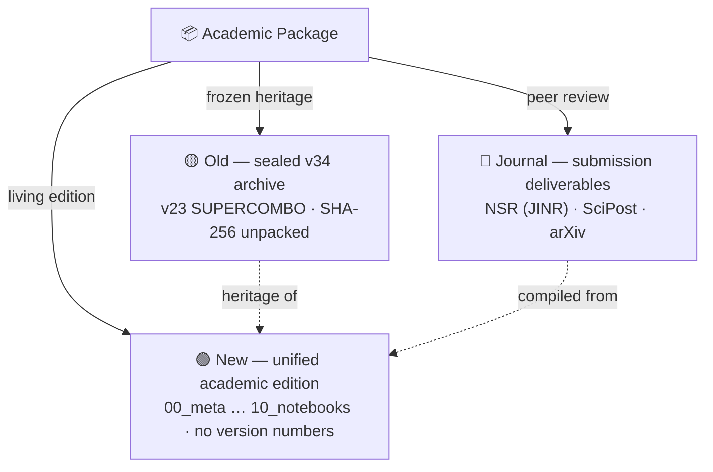
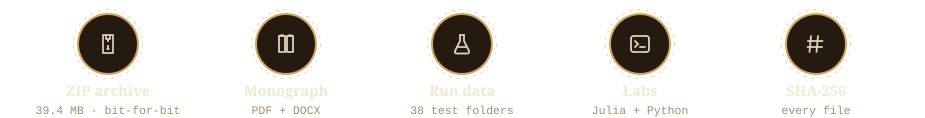

<div align="center">


# AB-Cloud Research — Academic Package

**The packaged submission layer of the repository: the living unified edition, the sealed
heritage archive and the journal deliverables — one programme, three shelves.**

*Unified edition · sealed v34 archive · NSR (JINR) / SciPost / arXiv packages*

<picture>
  <source media="(prefers-color-scheme: dark)" srcset="https://readme-typing-svg.demolab.com?font=Fira+Code&size=15&pause=1400&color=E8DDB8&center=true&vCenter=true&random=false&width=660&height=34&lines=Three+shelves+%C2%B7+one+research+programme;New%3A+the+unified+academic+edition+00%E2%80%A610;Old%3A+the+sealed+v34+heritage+archive;Journal%3A+NSR+%C2%B7+SciPost+%C2%B7+arXiv+packages">
  
</picture>

[](#-the-three-shelves)
[](New/README.md)
[](Old/README.md)
[](Journal/README.md)

[](New/01_monographs/README.md)
[](New/09_tests/README.md)
[](https://doi.org/10.5281/zenodo.21825394)
[](https://orcid.org/0009-0003-7299-0701)
[](#-license)

</div>


> [!IMPORTANT]
> **Honest boundary.** Everything on these three shelves is a numerical and formal
> study of a mathematical model. It does **not** prove the Riemann hypothesis:
> the V13 obligation machine of the unified edition keeps the RH conclusion
> **blocked** (`verdict: blocked`) while the analytic prerequisites remain assumed.
> This honesty layer is part of the scientific record and is protected by the
> licence — see [§ License](#-license).

## 📖 What this folder is

This folder is the **packaged, self-contained layer** of the AB-Cloud research
programme. Where the repository root holds the living laboratories — the spectral
core, the Dirac skeleton, the Hilbert–Pólya bridge, the observatory and the
satellite studies — this folder holds what has been **bound, sealed and shipped**:
the unified academic edition that consolidates the whole programme into one
numbered structure, the frozen submission archive that accompanied the earlier
journal package, and the per-journal deliverables prepared for peer review.

The three shelves serve different moments of the same research life-cycle. **New**
is where the programme currently *lives* as a citable academic object: monographs
in full and MAX editions, curated data with schemas and checksums, a six-language
CLI, a web laboratory and a machine-readable honesty ledger. **Old** is where an
earlier complete edition *rests*, unpacked byte-for-byte with its SHA-256 sums so
that every historical number stays checkable. **Journal** is where the programme
*travels*: three sealed submission packages, each tailored to its venue's class
files and wizard, with preview PDFs for the eye and SHA256SUMS for the audit.

## 🏛️ The three shelves



| Shelf | Status | What lives there | Landing |
|---|---|---|---|
|  **New** | living · unversioned | the unified academic edition: monographs (RU/EN + MAX ~100k words), curated data, figures, reports, six-language CLI, web laboratory, 410+ tests, honesty ledger | [`New/README.md`](New/README.md) |
|  **Old** | frozen · sealed | the complete GitHub edition of the v23 SUPERCOMBO submission package (v34): the 32,095-line Julia verification apparatus, every document, dataset, run archive and SHA-256 sum | [`Old/README.md`](Old/README.md) |
|  **Journal** | shipping · sealed | three submission packages (NSR JINR `nsr.cls`, SciPost `scipost.cls`, arXiv `article.cls`), 48 figures each, supplemental, cover letters, wizard READMEs, preview PDFs | [`Journal/README.md`](Journal/README.md) |

<div align="center">

</div>

## 🗺️ Which shelf do you need?

- **«I want the current monograph and the evidence.»** — [`New/`](New/README.md):
  start at [`New/01_monographs/`](New/01_monographs/README.md), then the campaign
  ledger [`New/02_data/processed/research_registry.json`](New/02_data/processed/research_registry.json).
- **«I must verify a number from the earlier papers.»** — [`Old/`](Old/README.md):
  the file index [`Old/FILE_INDEX.md`](Old/FILE_INDEX.md) and the sums
  [`Old/SHA256SUMS_unpacked.txt`](Old/SHA256SUMS_unpacked.txt).
- **«I am a reviewer/editor handling a submission.»** — [`Journal/`](Journal/README.md):
  your venue's zip plus its step-by-step `README_how_to_submit.md`.
- **«I want the one-page story.»** — [`New/04_reports/one_pager/one_pager.md`](New/04_reports/one_pager/one_pager.md)
  or the lay summary [`New/04_reports/lay_summary.md`](New/04_reports/lay_summary.md).
- **«I want to run everything myself.»** — [`New/reproduce.sh`](New/reproduce.sh)
  and [`New/06_code/`](New/06_code/README.md).

## 🚀 Quick start

```bash
# 1. Open the unified edition's landing page
$PAGER New/README.md

# 2. Verify the sealed heritage archive byte-for-byte
sha256sum -c Old/SHA256SUMS_unpacked.txt

# 3. Run the unified edition's package-integrity tests
python3 -m pytest New/09_tests/python -q
```


## 🔒 License

**Everything on all three shelves is proprietary — the strictly personal licence
of the Author.** All copyright, related and neighbouring rights belong fully and
exclusively to **Isaev Iskhak Khamzatovich**. You may view, read, run locally for
scholarly verification and cite with attribution (quote limit ≤ 400 characters
per excerpt, with the DOI). Redistribution, republishing, mirroring, public
forks, derivative publications, commercial use and ML training on the content are
**not licensed** without the Author's separate written consent.

- Unified edition: [`New/LICENSE`](New/LICENSE) — umbrella, plus component
  addenda [`New/LICENSE-CODE`](New/LICENSE-CODE),
  [`New/LICENSE-TEXT`](New/LICENSE-TEXT), [`New/LICENSE-DATA`](New/LICENSE-DATA);
- Heritage archive and journal packages: the repository-wide
  [`../LICENSE`](../LICENSE) (Custom Research License) applies;
- Contact for any use beyond viewing/reading/citing:
  **Isaev Iskhak Khamzatovich** · AB-Cloud Research Laboratory, Independent
  Researcher, Prospekt Lenina 29, Apt. 140, Nalchik, Kabardino-Balkarian
  Republic, Russian Federation · [aslan08_05@mail.ru](mailto:aslan08_05@mail.ru) ·
  [ORCID 0009-0003-7299-0701](https://orcid.org/0009-0003-7299-0701).

The honesty layer (`does_not_prove` fields, blocked verdicts) is part of the
scientific record and must be preserved verbatim in any permitted quotation.

## 📜 Citation

```bibtex
@dataset{isaev_abcloud_unified,
  author  = {Isaev, Iskhak Khamzatovich},
  title   = {{AB-Cloud Research Programme: Unified Academic Package}},
  year    = {2026},
  doi     = {10.5281/zenodo.21825394},
  url     = {https://github.com/wild8highlander/ab-cloud-research/tree/main/AB_Cloud_Academic_Package},
  note    = {Unified edition: spectral core, Dirac skeleton, Hilbert-Polya bridge,
             blind verification. RH status: blocked by design.}
}
```

---

<div align="center">


*Three shelves, one programme: the living edition, the sealed archive,
the travelling packages — every number checkable on every shelf.*

**[↑ back to top](#-what-this-folder-is)** · [Repository root](../README.md)

</div>
