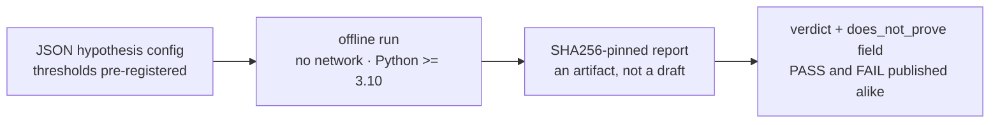

<div align="center">


# HYPOTHESIS LAB

**The open laboratory of the AB Cloud Quantum Research program: anyone can test
their own hypotheses under the program discipline — pre-registered thresholds,
blind protocols, SHA256-pinned outputs, verdicts with `does_not_prove`.**

Hypothesis testing laboratory · CLI + browser · Python ≥ 3.10


</div>

> **🧭 Navigation:** [AB_Cloud_Quantum_Research/](../README.md) · [Root README](../../README.md) · [modules/](../modules/README.md)



*The discipline loop of the lab — thresholds are fixed before the run.*

> [!IMPORTANT]
> **Discipline.** A hypothesis is formulated as a JSON config *before* the run:
> what is tested, which thresholds, what the result does **not** prove. Changing
> thresholds after a run invalidates the verdict. PASS and FAIL are published
> alike — the report is an artifact, not a draft.

---

## 📖 Contents

- [Quick start](#-quick-start)
- [The four batteries](#-the-four-batteries)
- [Hypothesis configs](#-hypothesis-configs)
- [Browser laboratory](#-browser-laboratory)
- [Reports and pins](#-reports-and-pins)
- [Honest boundaries](#-honest-boundaries)

---

## 🚀 Quick start

```bash
# environment check
python3 ab_lab.py doctor

# the spinor battery with your own phase
python3 ab_lab.py run spinor --theta 0.37 --steps 400

# the phase model of the program: theta = pi/3 → N = 6 exactly
python3 ab_lab.py run spinor --theta 1.0471975511965976

# blind zero reading (mini-E17) — first 8 zeros, grid 0.02
python3 ab_lab.py run zeros --n 8 --grid 0.02

# the explicit-formula check (primes side vs zeros side)
python3 ab_lab.py run trace --x 100 --t 300

# exact compilation of a random unitary 4x4 (V20-style)
python3 ab_lab.py run compile --n 4 --seed 7

# a full hypothesis from a config
python3 ab_lab.py run custom --config examples/hypothesis_spinor.json

# list past reports
python3 ab_lab.py verdicts
```

## 🔬 The four batteries

| Battery | What it tests | Program link | Typical result |
|---------|--------------|--------------|----------------|
| `spinor` | the phase model θ = π/k: cycle N = 2k, reset reconstruction ≈ 1/N, O(1) step cost | TS1–TS3, ES1–ES5 | θ = π/3 → N = 6 exactly; reconstruction 0.1667 ≈ 1/6 |
| `zeros` | blind reading of ζ zeros: the detector scans Z(t) (Riemann–Siegel), the validator compares with `mpmath.zetazero` **after** pinning | E16/E17 | 8/8 matched, precision = recall = 1, max err ~7e−15 |
| `trace` | the Riemann–Weil explicit formula: ψ(x) = x − Σ x^ρ/ρ − log 2π − ½log(1−x⁻²); the truncation bound O(x·log²(xT)/T) is reported alongside | V7/Th6 | residual ~0.3% at x = 100, T = 300 (bound 38%) |
| `compile` | exact two-level Givens decomposition of a random unitary n×n and its reconstruction | V20 | 1−F ≤ 1.3e−15 — machine epsilon |

Every battery is self-contained (numpy/mpmath only), deterministic where seeded,
and offline. The spinor battery also runs the *contrast machine* — the eternal
journal — to demonstrate Ω(t) growth against the O(1) volatile step.

## 📋 Hypothesis configs

```json
{
  "name": "my-spinor-phase",
  "battery": "spinor",
  "params": { "theta": 1.0471975511965976, "steps": 400 },
  "thresholds": {
    "cycle_closure": "exact",
    "reconstruction_max": 0.18,
    "step_slope_abs_max": 0.001
  },
  "does_not_prove": "RH; applicability beyond the Markov task class",
  "blind": true
}
```

Rules: `name`, `battery`, `params`, `thresholds` are mandatory;
`does_not_prove` is mandatory by discipline; `blind` enables output pinning.
Ready examples in [`examples/`](examples/):

- [`hypothesis_spinor.json`](examples/hypothesis_spinor.json) — spinor-family hypothesis (θ = π/3, 400 steps);
- [`hypothesis_zeros.json`](examples/hypothesis_zeros.json) — blind zero reading (first 8 zeros, grid 0.02);
- [`hypothesis_trace.json`](examples/hypothesis_trace.json) — explicit-formula check (x = 100, T = 300);
- [`hypothesis_compile.json`](examples/hypothesis_compile.json) — exact compilation of a random unitary 4×4 (seed 42).

## 🌐 Browser laboratory

[`hypothesis_lab.html`](hypothesis_lab.html) — the same batteries where possible,
in pure JavaScript, without any installation: the spinor cycle with a live phase
plot, the Givens-QR compilation with fidelity against machine epsilon, and the
Riemann–von Mangoldt counter N(T) with the actual zero staircase. Open the file
locally — no network is used.

## 🗄️ Reports and pins

Each run writes `reports/<campaign>_<timestamp>.json`:

```json
{
  "campaign": "lab-spinor",
  "battery": "spinor",
  "pre_registered": { "cycle_closure": "exact" },
  "metrics": { "cycle_N": 6, "post_reset_reconstruction_max": 0.1667 },
  "pass": true,
  "does_not_prove": "…",
  "pins": { "output": { "file": "reports/lab-spinor_output.json",
                        "sha256": "f2d6…" } },
  "status": "done"
}
```

The pinned output files carry SHA256 hashes — the same blind protocol the main
program uses (E11/E17). Attach the report to your own campaign documentation.
In the repository the folder contains only a `.gitkeep` placeholder — reports
are generated artifacts and appear here after the first local run.

## ⚠️ Honest boundaries

The laboratory reproduces the *method*, not the full campaigns: `zeros` reads
the first zeros by direct scanning (the program's E17 reads 649+639 blind with
two engines), `trace` checks the truncated explicit formula (V7 computes the
trace of H_ξ with certificates), `compile` decomposes random unitaries (V20
compiles the program's target set within the ISA class). A PASS here means
*your hypothesis is consistent with the tested thresholds* — nothing more.

---

<div align="center">

*Test as strictly as you test us: pre-registration · blindness · replication*

**AB Cloud Quantum Research** · HYPOTHESIS_LAB · v1.1.0 · © Isaev Iskhak Khamzatovich

</div>
