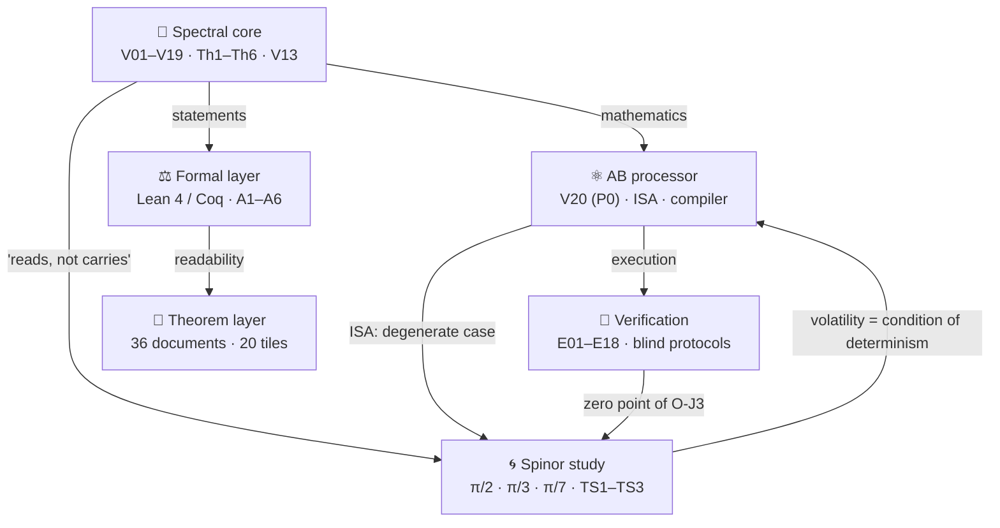
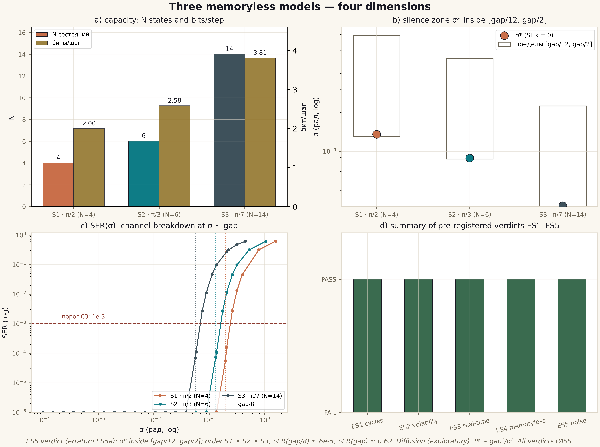
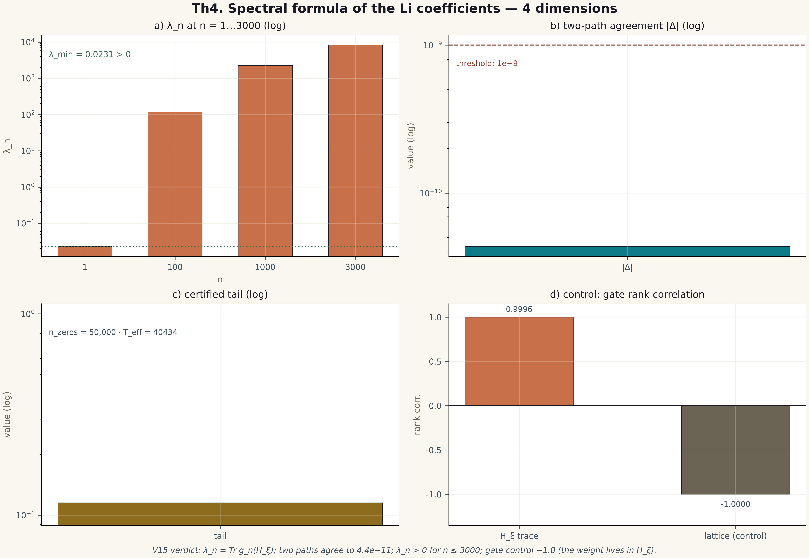
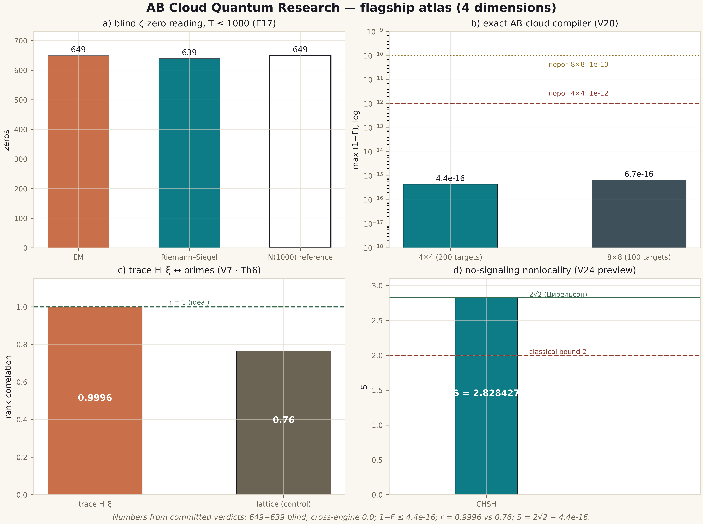

<div align="center">

<picture>
  <source media="(prefers-color-scheme: dark)" srcset="assets/logo_abcloud_dark.png">
  
</picture>

# AB CLOUD QUANTUM RESEARCH

**One study: the algebraic AB (Aharonov–Bohm) architecture as a computing
fabric that reads mathematics in real time and stores nothing**
Version **1.1.0** · proprietary license · Python / Julia / C / C++ / Rust / Go / JS / Lean / Coq


<table>
<tr>
<td align="center"><br><sub><strong>Isaev I. Kh.</strong><br>author · ORCID 0009-0003-7299-0701</sub></td>
<td align="center"><br><sub><strong>Spectral core</strong><br>V01–V19 · Th1–Th6 · V13</sub></td>
<td align="center"><br><sub><strong>AB processor</strong><br>V20 · ISA · Givens-QR</sub></td>
<td align="center"><br><sub><strong>Verification</strong><br>E01–E18 · blind · Julia</sub></td>
<td align="center"><br><sub><strong>Spinor study</strong><br>ES1–ES5 · TS1–TS3</sub></td>
</tr>
</table>


*Animated banner: ζ zeros rise along the critical line Re(s) = ½
(public Odlyzko data) · generated by `scripts/make_banner.py`*


*The four levels of one machine, animated — from
[`VISUAL_ANIMATIONS/`](VISUAL_ANIMATIONS/README.md). Click-through version:
[`VISUAL_ANIMATIONS/html/architecture_tour.html`](VISUAL_ANIMATIONS/html/architecture_tour.html)*

</div>

> [!IMPORTANT]
> **Honest boundary.** Everything below is a numerical and formal study
> of a mathematical model. It does **not** prove the Riemann hypothesis:
> the V13 obligation machine keeps the RH conclusion **blocked**
> (`verdict: blocked`) while the analytic prerequisites remain assumed.
> The Lean/Coq formalization guarantees this blocking — it does not
> remove it.

---

## 📖 Contents

- [What this is](#-what-this-is)
- [At a glance](#-at-a-glance)
- [Architecture: levels of one machine](#-architecture-levels-of-one-machine)
- [Flagship results](#-flagship-results)
- [Theorems Th1–Th6 and TS1–TS3](#-theorems-th1th6-and-ts1ts3)
- [Supplementary study: the machine with no long-term memory](#-supplementary-study-the-machine-with-no-long-term-memory)
- [Four-dimension tiles](#-four-dimension-tiles)
- [📚 MONOGRAPH ARCHIVE](#-monograph-archive)
- [🧪 HYPOTHESIS LAB](#-hypothesis-lab)
- [🎞 VISUAL ANIMATIONS](#-visual-animations)
- [Repository structure](#-repository-structure)
- [Quick start](#-quick-start)
- [Web laboratories](#-web-laboratories)
- [Honesty discipline](#-honesty-discipline)
- [Roadmaps](#-roadmaps)
- [Citation](#-citation)
- [License](#-license)
- [Russian version](#russian-version)

---

## 🌌 What this is

**AB Cloud Quantum Research** is a coherent study of one idea: the algebraic
AB architecture as a computer that *reads* mathematics — from operator
spectra to zeta zeros — in real time and retains nothing. ζ zeros are
reproduced from six constants of the trace formula at request time; the prime
weight provably lives in the heat trace of the operator; the machine state is
a volatile spinor phase executing steps in real time. **Storage = 0 is an
architectural principle proved by theorems, not a slogan.**

The program accepts three commitments and keeps them everywhere:

1. **Reads, does not carry.** Nothing the machine needs is stored: the six
   constants of the trace formula parameterize the operator's heat trace
   (Th6), and the trace contains the spectrum. A zero is a computation, not
   a table row. In the processor preview (V23) twelve of twelve zeros were
   reproduced from six constants with zero storage.
2. **The state is volatile, the steps are real-time.** A single spinor phase
   is simultaneously the register, the counter and the carrier of the result.
   The supplementary study proves the consequence as theorems: cycles close
   exactly (TS1), a reset erases everything (TS2), and an eternal log grows
   Ω(t) and misses deadlines while the memoryless step stays O(1) (TS3) —
   *volatility is the condition of real-time determinism*.
3. **Honesty is enforced, not promised.** Thresholds are pre-registered
   before runs; detectors and validators are separated and outputs are
   SHA256-pinned before validation; results are replicated across languages
   and arithmetics; negative results and errata are published; and the V13
   obligation machine keeps the RH conclusion formally blocked.

- **43 campaigns** with pre-registered thresholds — all verdicts PASS
  (V01–V19 core · V20 processor · E01–E18 verification · ES1–ES5
  spinor study);
- **9 theorems** with certificates and documents: Th1–Th6 + TS1–TS3;
  formal statements in Lean 4 + Coq (reductions A1–A6, no
  `sorry`/`admit`);
- **36 documents** RU/EN × PDF/DOCX in the theorem layer, plus the
  monograph archive (below) — 24 more documents and 10 LaTeX sources;
- **20 four-dimension tiles** @600 dpi, 3 web laboratories, multi-language
  core implementations (C / C++ / Rust / Go / JS / Julia);
- **410+ tests** and 95+ package integrity checks.

## 📊 At a glance

<details>
<summary><strong>🔑 Numbers cheat sheet (click to expand)</strong></summary>

| Metric | Value | Where |
|--------|-------|-------|
| Blind ζ zeros up to T=1000 | 649/649 (EM) + 639/639 (RS), cross-engine 0.0 bit-exact | E17 |
| Completeness N(1000) | 649.0 exactly | E17 |
| Compilation fidelity | 1−F ≤ 4.4e−16 (4×4) · 6.7e−16 (8×8) | V20 |
| Class B: compiler vs 5 baselines | **×59,000** in time at equal ISA | E18 |
| Trace ↔ primes | r = 0.9996 (lattice control 0.76) | V7/Th6 |
| CHSH | S = 2√2 − 4.4e−16; commutators 0 | V24 preview |
| Branch stitching V19 | θ-ladder 0.832; coherence 0.9995 | V19 |
| Phase cycles (π/2·π/3·π/7) | N = 4·6·14 = 2k exactly | ES1 |
| Post-reset reconstruction | 0.2501/0.1674/0.0717 ≈ 1/N (chance level) | ES2 |
| Machine step cost | flat (slope −1.5e−12 ms/step); log — Ω(t), ×129 | ES3 |
| Blind erratum γ₁₂ | detector 56.446247697063399 vs hand-made 56.446200059994141 | E17 |
| RH status | **blocked** (V13) | V13 |

</details>

<details>
<summary><strong>🏛 What each level proved (click to expand)</strong></summary>

| Level | Campaigns | What it established |
|-------|-----------|---------------------|
| 🧠 Spectral core | V01–V19 | the blind spectrum agrees statistically but predicts no individual ordinates (honest negative); the AB cloud falls into the GUE class; lattices do **not** reproduce ζ arithmetic (V3/V6/V16); the heat trace carries Λ(n)/√n with r = 0.9996 (Th6); Kato corridors ~1e−27 (Th3); the Li criterion computes (Th4); block reduction to 7.1e−15 (Th5); the obligation machine blocks RH (V13); branch stitching coherent to 0.9995 (V19) |
| ⚛️ AB processor | V20 (+P previews) | the ISA of AB clouds is fixed; exact Givens-QR compilation at machine epsilon; the "reads, does not carry" preview (12/12 zeros from 6 constants); CHSH = 2√2 − 4.4e−16 with no signaling |
| 🔬 Verification | E01–E18 | the infrastructure is calibrated (noise, codes, cost, readout); the independent Riemann–Siegel agrees to 3.8e−15; blind zero reading is exact to T = 1000; the class-B benchmark is fair and won |
| 🌀 Spinor study | ES1–ES5 | cycles close exactly at N = 2k; reset erases to the chance level; the step is O(1) against the Ω(t) log; the Markov task class is solvable memoryless; the silence zone quantifies the capacity/robustness trade-off |

</details>

---

## 🏛️ Architecture: levels of one machine



| Level | Folder | Campaigns | Essence |
|-------|--------|-----------|---------|
| 🧠 Core | [`modules/core_spectrum/`](modules/core_spectrum/README.md) | **V01–V19** | Blind spectrum, null models, critical line, the V13 obligation machine, branch stitching V19; theorems Th1–Th6; a 10-tab web lab |
| ⚛️ Processor | [`modules/processor_ab/`](modules/processor_ab/README.md) | **V20** (P0) | AB-cloud ISA, exact Givens-QR compiler, **"reads, does not carry"**, no-signaling nonlocality; an 8-tab web lab |
| 🔬 Verification | [`modules/verifier_multilang/`](modules/verifier_multilang/README.md) | **E01–E18** | Julia platform: blind ζ-zero reading by two engines, independent Riemann–Siegel, class B; 18/18 pre-registered verdicts |
| 🌀 Spinor | [`research/realtime_spinor_memory/`](research/realtime_spinor_memory/README.md) | **ES1–ES5** | The machine with no long-term memory: three phase models, 3 theorems, 5 verdicts |

The level map and data flow: [`docs/ARCHITECTURE.md`](docs/ARCHITECTURE.md).

The architecture is certified by **numerical links** between levels — pairs
that share a number, so no link is decorative:

- **Core V7 ↔ verification E11/E17** — the trace carries Λ(n)/√n; zeros are
  read, not stored: r = 0.9996, zero zeros in storage.
- **Processor V20 ↔ verification E18** — one ISA, equal constraints, five
  baselines: ×59,000 in time; the 2q KAK optimum (3 gates) is honestly
  outside the class (the compiler gives 10).
- **E17 ↔ V23 preview** — two blind engines, 649/649 + 639/639,
  cross-engine 0.0 bit-exact.
- **V13 ↔ all levels** — the obligation machine keeps RH blocked regardless
  of numerical successes.
- **Th6 ↔ spinor study** — "reads, does not carry" formalized to volatile
  phase models θ = π/2, π/3, π/7.

---

## 🏆 Flagship results

| # | Result | Numbers | Level |
|---|--------|---------|-------|
| 1 | **Blind reading of ζ zeros up to T=1000** by two independent engines | 649/649 (EM) + 639/639 (RS); precision = recall = 1; cross-engine **0.0** bit-exact; N(1000) = 649.0 | Verification E17 |
| 2 | **Independent Riemann–Siegel** (Arias de Reyna, no external packages) | agreement with EM ≤ 3.8e−15 (threshold 1e−9); floor 1e−17 | Verification E16 |
| 3 | **Compiler vs 5 strong baselines under equal ISA constraints** (class B) | max 1−F = 4.4e−16; primitives ≤ BL1/BL2/BL4 on every target; **×59,000** in time | Verification E18 |
| 4 | **Exact compilation of unitary logic into AB clouds** | 1−F ≤ 4.4e−16 (4×4) / 6.7e−16 (8×8); depth ≤ 7/29 gates | Processor V20 |
| 5 | **Reads, does not carry**: ζ zeros reproduced from 6 formula constants | 12/12 zeros exactly; storage = **0** | Processor V23 preview |
| 6 | **No-signaling nonlocality** | CHSH S = 2√2 − 4.4e−16; protection 1000/1000; commutators = 0 | Processor V24 preview |
| 7 | **Branch stitching** | θ-ladder 0.832; coherence 0.9995 (z = 43.4); Z₂-monodromy | Core V19 |
| 8 | **Trace ↔ primes** (Th6) | r = 0.9996; the B/C₀ erratum found and fixed | Core V7 |
| 9 | **The machine with no long-term memory** | cycles 4/6/14 = 2k; reset irreversible; O(1) steps vs Ω(t) logs | Spinor ES1–ES3 |

> [!NOTE]
> Every experiment with a threshold has a verdict file (`*_verdict.json`,
> `claim_v*.json`) with a **does_not_prove** field — what the result does
> NOT prove. Negative results are published: lattice ζ-correspondences
> are NOT found (V1/V3/V6/V16), vortices break Th5, the 2q KAK optimum is
> unreachable in the E18 ISA class.

---

## 📐 Theorems Th1–Th6 and TS1–TS3

| Theorem | Statement (short) | Certificate | Reduction |
|---------|-------------------|-------------|-----------|
| **Th1** (V4) | H_L = H_L† ⇒ spec ⊂ ℝ; λ↔−λ at α=½, W=0 | ‖H−H†‖ = 0.0 exactly | A1 |
| **Th2** (V8) | finite-dimensional self-adjointness: defects (0,0), e^{−iHt} unitary | drift 2.2e−16 | A2b |
| **Th3** (V12) | Kato \|λ̂−λ̃\| ≤ δ²/gap + Gershgorin | widths ~1e−27 (dps 40) | A4, A5 |
| **Th4** (V15) | λ_n = Tr g_n(H_ξ); absolute convergence | two paths ≤ 4.4e−11 | A6 |
| **Th5** (V9) | [H,A]=[H,B]=0 ⇒ block reduction by characters | union ≈ spectrum to 7.1e−15 | A2 |
| **Th6** (V7) | Guinand–Weil: Q(a) ↔ ζ′/ζ; K(x) = Tr e^{−xH_ξ} | the trace carries Λ(n)/√n | A3 |
| **TS1** (ES1) | the rotation cycle θ=π/k closes after exactly N=2k steps; gap 2π/N | periods 4/6/14 exactly | — |
| **TS2** (ES2) | reset erases everything: I(pre;post)=0; reconstruction ≤ 1/N; time → mod N | 0.2501/0.1674/0.0717 ≈ 1/N | — |
| **TS3** (ES3) | the step is O(1) for all t; an eternal log ⇒ Ω(t) ⇒ deadline misses | slope −1.5e−12; ×129 growth | — |

Each theorem lives in its own folder: [`theorems_lemmas/`](theorems_lemmas/README.md)
(Th1–Th6, 24 documents) and
[`research/realtime_spinor_memory/theorems/`](research/realtime_spinor_memory/README.md)
(TS1–TS3, 12 documents): a **README with the proof idea** (4 dimensions,
boundaries) + **4 documents** (RU/EN × PDF/DOCX) + a **2×2 tile**.
Statements of Th1–Th6: [`formal/`](formal/README.md) — Lean 4 + Coq,
reductions A1–A6, **no** `sorry`/`admit`.

The full theorem narratives — statement, proof idea, certificate and boundary
for each of the nine — are chapter 30–31 of the main monograph (below).

---

## 🌀 Supplementary study: the machine with no long-term memory

> The AB computer has **no long-term memory** — only volatile state
> executing steps in real time.

[`research/realtime_spinor_memory/`](research/realtime_spinor_memory/README.md)
reduces the central claim to three explicit models — spinor phases
**θ = π/2, π/3, π/7** with a single volatile register:

| Model | Phase | Cycle N=2k | Bits/step | Silence zone σ* |
|-------|-------|------------|-----------|-----------------|
| S1 · quadrant | π/2 | 4 | 2.000 | 0.135 rad |
| S2 · sextant | π/3 | 6 | 2.585 | 0.089 rad |
| S3 · 14-phase | π/7 | 14 | 3.807 | 0.038 rad |

**Theorems:** TS1 (cycles close, gap = step) · TS2 (reset irreversibility,
I = 0) · TS3 (O(1) steps; an eternal log ⇒ Ω(t) ⇒ deadline misses —
*volatility is the condition of real-time determinism*). Five campaigns
ES1–ES5 with pre-registered thresholds — all PASS, two errata published
(ES2a, ES5a). The capacity log₂N vs robustness 1/k trade-off is fixed as
an honest boundary.

<div align="center">



*Three memoryless models — the four-dimension tile (600 dpi, from the ES5
verdict)* · live version:
[`VISUAL_ANIMATIONS/html/spinor_lab.html`](VISUAL_ANIMATIONS/html/spinor_lab.html)


*The same cycles as an animation — from [`VISUAL_ANIMATIONS/`](VISUAL_ANIMATIONS/README.md)*

</div>

---

## 🖼️ Four-dimension tiles

Every tile is a **2×2 grid of four independent measurement dimensions**:
**metric** · **instance behaviour** · **control** · **threshold**.
600 dpi, the "Critical Line & Copper" style, RU/EN, built **only from
committed verdicts**. The levels' original figures are preserved in
`modules/*/figures_hires/`.

<div align="center">

| Th4 (Li formula) | Flagship atlas |
|----|----|
|  |  |

*Left: Th4 — the λ_n ladder · two-path agreement · tail · gate control.
Right: the atlas — blind zeros · compiler · trace·primes · CHSH*

</div>

Full sets: [`figures_tiled/`](figures_tiled/README.md) (12 tiles for
Th1–Th6) · [`atlas/`](atlas/README.md) ·
[`research/realtime_spinor_memory/figures/`](research/realtime_spinor_memory/figures/)
(8 tiles for TS1–TS3).

---

## 📚 MONOGRAPH ARCHIVE

**[`MONOGRAPH_ARCHIVE/`](MONOGRAPH_ARCHIVE/README.md)** — the publication
layer of the program: one large main monograph in **Russian and English**
(**DOCX + PDF**, 104+ pages each, 28 figures, 44 tables), four **level
research program monographs** (core · processor · verification · spinor,
RU/EN × PDF/DOCX), and **10 compilable LaTeX sources** (.tex) generated from
the same content model as the PDF/DOCX versions.

<div align="center">

| Document | RU | EN |
|----------|----|----|
| **Main monograph** — the whole program in 43 chapters and appendices A–Q | [PDF](MONOGRAPH_ARCHIVE/main_monograph/AB_Cloud_Quantum_Research_Monograph_RU.pdf) · [DOCX](MONOGRAPH_ARCHIVE/main_monograph/AB_Cloud_Quantum_Research_Monograph_RU.docx) | [PDF](MONOGRAPH_ARCHIVE/main_monograph/AB_Cloud_Quantum_Research_Monograph_EN.pdf) · [DOCX](MONOGRAPH_ARCHIVE/main_monograph/AB_Cloud_Quantum_Research_Monograph_EN.docx) |
| **Core program** (V01–V19, Th1–Th6, V13) | [PDF](MONOGRAPH_ARCHIVE/research_programs/Program_Core_RU.pdf) · [DOCX](MONOGRAPH_ARCHIVE/research_programs/Program_Core_RU.docx) | [PDF](MONOGRAPH_ARCHIVE/research_programs/Program_Core_EN.pdf) · [DOCX](MONOGRAPH_ARCHIVE/research_programs/Program_Core_EN.docx) |
| **Processor program** (V20, P0–P6) | [PDF](MONOGRAPH_ARCHIVE/research_programs/Program_Processor_RU.pdf) · [DOCX](MONOGRAPH_ARCHIVE/research_programs/Program_Processor_RU.docx) | [PDF](MONOGRAPH_ARCHIVE/research_programs/Program_Processor_EN.pdf) · [DOCX](MONOGRAPH_ARCHIVE/research_programs/Program_Processor_EN.docx) |
| **Verification program** (E01–E18, O-J) | [PDF](MONOGRAPH_ARCHIVE/research_programs/Program_Verification_RU.pdf) · [DOCX](MONOGRAPH_ARCHIVE/research_programs/Program_Verification_RU.docx) | [PDF](MONOGRAPH_ARCHIVE/research_programs/Program_Verification_EN.pdf) · [DOCX](MONOGRAPH_ARCHIVE/research_programs/Program_Verification_EN.docx) |
| **Spinor program** (ES1–ES5, TS1–TS3) | [PDF](MONOGRAPH_ARCHIVE/research_programs/Program_Spinor_RU.pdf) · [DOCX](MONOGRAPH_ARCHIVE/research_programs/Program_Spinor_RU.docx) | [PDF](MONOGRAPH_ARCHIVE/research_programs/Program_Spinor_EN.pdf) · [DOCX](MONOGRAPH_ARCHIVE/research_programs/Program_Spinor_EN.docx) |

LaTeX sources: [`MONOGRAPH_ARCHIVE/main_monograph/latex/`](MONOGRAPH_ARCHIVE/main_monograph/latex/) ·
[`MONOGRAPH_ARCHIVE/research_programs/latex/`](MONOGRAPH_ARCHIVE/research_programs/latex/) —
compile with `pdflatex` (twice, for the TOC); figures resolve through
repository-relative paths.

</div>

The monographs follow the discipline of the program: **no hand-typed
numbers** — campaign tables come from `datasets/campaign_timeline.csv`,
flagship numbers from `datasets/flagship_numbers.csv`, verdict excerpts from
the committed verdict JSONs. The repository license is duplicated verbatim in
the archive.

---

## 🧪 HYPOTHESIS LAB

**[`HYPOTHESIS_LAB/`](HYPOTHESIS_LAB/README.md)** — the open laboratory of the
program: **anyone can test their own hypotheses** under the project discipline.
A hypothesis is a JSON config written *before* the run (what is tested, which
thresholds, what the result does not prove); the lab executes it, pins the
output with SHA256 and issues a PASS/FAIL verdict with a report.

| Battery | What it tests | Program link | Typical result |
|---------|--------------|--------------|----------------|
| `spinor` | the phase model θ = π/k: cycle N = 2k, reset ≈ 1/N, O(1) steps | TS1–TS3 · ES1–ES5 | θ = π/3 → N = 6 exactly |
| `zeros` | blind ζ-zero reading: a Z(t) detector validated against `mpmath.zetazero` after pinning | E16/E17 | 8/8 matched, max err ~7e−15 |
| `trace` | the Riemann–Weil explicit formula: primes side vs zeros side, truncation bound reported | V7/Th6 | residual ~0.3% at x=100, T=300 |
| `compile` | exact two-level Givens decomposition of a random unitary | V20 | 1−F ≤ 1.3e−15 |

```bash
cd HYPOTHESIS_LAB
python3 ab_lab.py doctor                                  # environment check
python3 ab_lab.py run spinor --theta 1.0471975511965976   # θ = π/3 → N = 6
python3 ab_lab.py run zeros --n 8 --grid 0.02             # blind mini-E17
python3 ab_lab.py run trace --x 100 --t 300               # explicit formula
python3 ab_lab.py run compile --n 4 --seed 7              # exact compilation
python3 ab_lab.py run custom --config examples/hypothesis_spinor.json
```

Prefer the browser? [`HYPOTHESIS_LAB/hypothesis_lab.html`](HYPOTHESIS_LAB/hypothesis_lab.html)
runs the spinor cycle, the Givens-QR compilation and the N(T) counter **in
pure JavaScript, offline** — nothing to install. Laboratory rules:
thresholds before the run · blindness · `does_not_prove` · replication ·
publish PASS and FAIL alike.

---

## 🎞 VISUAL ANIMATIONS

**[`VISUAL_ANIMATIONS/`](VISUAL_ANIMATIONS/README.md)** — how the whole folder
works, shown rather than told. Five GIFs for READMEs and slides, seven animated
SMIL SVGs that play **directly on GitHub**, and six interactive HTML pages —
all offline, all rebuilt by scripts in the folder.

<div align="center">

| | |
|---|---|
|  |  |
| *ζ zeros rise along Re(s) = 1/2* | *43 campaigns appear — all PASS* |
|  |  |
| *pulsing zeros on the line (animated SVG)* | *the folder map with highlight sweeps* |

Interactive: [architecture tour](VISUAL_ANIMATIONS/html/architecture_tour.html) ·
[zeros live](VISUAL_ANIMATIONS/html/zeros_live.html) ·
[spinor lab](VISUAL_ANIMATIONS/html/spinor_lab.html) ·
[how this folder works](VISUAL_ANIMATIONS/html/how_this_folder_works.html) ·
[pipeline flow](VISUAL_ANIMATIONS/html/pipeline_flow.html) ·
[portal](VISUAL_ANIMATIONS/html/index.html)

</div>

---
### 🧭 Reading paths

Different readers need different routes through the program. Three proven
paths, each three steps long:

<details>
<summary><strong>⚡ The fast route — "show me the results" (~15 minutes)</strong></summary>

1. Read the [flagship results](#-flagship-results) table and the numbers
   cheat sheet — nine results with their certificates.
2. Open the flagship atlas: [`atlas/atlas_flagships_en.png`](atlas/atlas_flagships_en.png)
   — one picture, four proved results, every number with a verdict.
3. Run the animated tour: [`VISUAL_ANIMATIONS/html/architecture_tour.html`](VISUAL_ANIMATIONS/html/architecture_tour.html)
   — the four levels in motion, no installation.

</details>

<details>
<summary><strong>🔬 The verification route — "prove it to me" (~1 evening)</strong></summary>

1. Read [Honesty discipline](#-honesty-discipline), then the verdict-anatomy
   section below — how a verdict earns trust.
2. Run the package validator and the spinor campaigns:
   `python3 scripts/validate_package.py` → `RESULT: PASS`;
   `cd research/realtime_spinor_memory && python3 experiments/run_all.py`
   → five campaigns, ~2.5 minutes, all PASS.
3. Open the E17 verdict file
   (`modules/verifier_multilang/results/e17_verdict.json`) and check the
   SHA256 pins against the pinned detector outputs — the blind protocol is
   auditable end to end.

</details>

<details>
<summary><strong>📚 The deep route — "I want the whole story" (~1 week)</strong></summary>

1. Read the main monograph:
   [`MONOGRAPH_ARCHIVE/main_monograph/AB_Cloud_Quantum_Research_Monograph_EN.pdf`](MONOGRAPH_ARCHIVE/main_monograph/AB_Cloud_Quantum_Research_Monograph_EN.pdf)
   — 43 chapters and appendices A–Q, every claim with its verdict source.
2. Study the theorem folders: [`theorems_lemmas/`](theorems_lemmas/README.md)
   and the spinor theorems — statement, proof idea, certificate, boundary.
3. Test your own hypothesis in [`HYPOTHESIS_LAB/`](HYPOTHESIS_LAB/README.md)
   and reproduce the level campaigns with the Quick start commands.

</details>

### 📮 The anatomy of a verdict

Every thresholded campaign produces a verdict file — the minimal contract
between the experiment and the reader. The richest example is E17, the blind
zero reading:

```text
blindness           : both detectors contain no reference zeros; outputs
                      are fixed and hashed before validation
sha_em              : 3843fb52...e5  e17_detector_em.csv
sha_rs              : 08cd95b6...17  e17_detector_rs.csv
n_detected_em       : 649            N_rvm            : 649
n_detected_rs       : 639            N_rvm_rounded    : 649
max_err_em          : 3.019522409886122e-10
cross_engine_max    : 0              (bit-exact)
precision_em/recall : 1 / 1          precision_rs/recall: 1 / 1
grid_robustness_max_shift : 0
pass                : true
does_not_prove      : RH above T=1000; primality of all zeros;
                      absence of off-line zeros for gamma > 1000
```

Reading it takes thirty seconds and gives everything: the blindness is fixed
before the experiment, the pins provide temporal proof, the values beat the
thresholds by three to four orders of magnitude, and the boundary of the
claim is stated in the same file as the success. The built-in negative
control — the blind erratum γ₁₂ — shows the same detector refuting a
hand-made framework constant. One procedure, both confirmations and
refutations.

### 🌍 Multi-language implementations

The core is implemented six times — and all six agree bit-exactly:

| Language | File | Role |
|----------|------|------|
| C | [`modules/core_spectrum/multilang/c/`](modules/core_spectrum/multilang/c/verify_core.c) | the minimal reference implementation |
| C++ | [`modules/core_spectrum/multilang/cpp/`](modules/core_spectrum/multilang/cpp/verify_core.cpp) | the modern stack, same arithmetic |
| Rust | [`modules/core_spectrum/multilang/rust/`](modules/core_spectrum/multilang/rust/verify_core.rs) | memory safety without GC |
| Go | [`modules/core_spectrum/multilang/go/`](modules/core_spectrum/multilang/go/verify_core.go) | simple distribution, cross-compilation |
| JavaScript | [`modules/core_spectrum/multilang/javascript/`](modules/core_spectrum/multilang/javascript/verify_core.js) | the browser laboratories |
| Julia | [`modules/core_spectrum/multilang/julia/`](modules/core_spectrum/multilang/julia/verify_core.jl) | BigFloat verification of the platform |

Control files (`verify_control.txt`, `stitch_control.txt`) hold the reference
outputs; any implementation can be checked against them with one command.
This is replication built into distribution: there is no "language
difference" to argue about.

### 📊 Data and provenance

The data layer follows one direction — **verdict → dataset → artifact**:

- [`datasets/flagship_numbers.csv`](datasets/flagship_numbers.csv) — 15
  flagship metrics, each with its verdict source;
- [`datasets/campaign_timeline.csv`](datasets/campaign_timeline.csv) — all
  43 campaigns with status and key result;
- [`datasets/zeta_zeros_reference.csv`](datasets/zeta_zeros_reference.csv) —
  the blind E17 reference: 660 ordinates, 0 < γ ≤ 1000.

No number in any README, tile or monograph is typed by hand: the derived
artifacts are rebuilt by `scripts/make_*.py` and cross-checked by
`scripts/validate_package.py` (95+ checks). The reverse direction is
forbidden — derived artifacts never feed campaigns, which is what kills
circularity.

### ❓ Frequently asked questions

<details>
<summary><strong>Does this prove the Riemann hypothesis?</strong></summary>

No — and the program says so in the same breath as every result. The V13
obligation machine keeps the RH conclusion blocked while four analytic
hypotheses (O08/O09/O11/O12) are unproved. No numerical check — not 649
matched zeros, not r = 0.9996 — raises their status. What the program
*does* establish: the accuracy of two independent computational paths, the
arithmetic consistency of the trace construction, and a verification
methodology that survives its own audits.
</details>

<details>
<summary><strong>Why does the compiler use 10 gates for 2q instead of 3 (KAK)?</strong></summary>

The ISA class cannot express the KAK-optimal sequence — clouds with an
Aharonov–Bohm flux are a different primitive set. E18 fixes the class in
advance and reports the boundary honestly: within the class the compiler is
×59,000 faster than the best of five strong baselines at equal accuracy;
outside the class no superiority is claimed.
</details>

<details>
<summary><strong>What exactly is "storage = 0"?</strong></summary>

No table of zeros, no log, no cache. The six constants of the trace formula
parameterize the operator's heat trace (Th6), and the trace contains the
spectrum — so a zero is recomputed at request time rather than recalled. The
V23 preview demonstrates it on the processor level: 12/12 zeros reproduced
from six constants with nothing stored. The spinor study proves the
real-time corollary: a machine that logs everything grows Ω(t) and misses
deadlines (TS3), while the memoryless step stays O(1).
</details>

<details>
<summary><strong>Can I use this in my own research or teaching?</strong></summary>

Yes, within the license: read, clone for private non-commercial study, run
the code locally for scholarly verification, cite with attribution (see
[Citation](#-citation)). Testing your own hypotheses is explicitly invited —
that is what [`HYPOTHESIS_LAB/`](HYPOTHESIS_LAB/README.md) is for.
Republication of substantial parts, commercial use and appropriation
require the author's written consent — see [`LICENSE`](../LICENSE).
</details>


---

## 🗂️ Repository structure

```
AB_Cloud_Quantum_Research/
├── modules/                        # three levels of one machine
│   ├── core_spectrum/              #   🧠 spectral core (V01–V19, Th1–Th6, V13)
│   ├── processor_ab/               #   ⚛️ AB processor (V20/P0, ISA, compiler)
│   └── verifier_multilang/         #   🔬 verification (E01–E18, Julia, blind)
├── research/
│   └── realtime_spinor_memory/     # 🌀 the machine with no long-term memory
│       ├── spinor/ experiments/ data/ figures/{ru,en}/ theorems/ tests/ docs/
├── theorems_lemmas/                # 📐 Th1–Th6: 24 documents + 12 tiles + READMEs
├── figures_tiled/                  # 🖼️ 12 four-dimension tiles @600 dpi
├── atlas/                          # 🏛️ flagship atlas (2×2 tile, 600 dpi)
├── timeline/                       # 🗓️ timeline of 43 campaigns (600 dpi)
├── datasets/                       # 📊 flagships · 43 campaigns · 660 ζ zeros
├── whitepaper/                     # 📄 white paper (RU/EN PDF)
├── glossary/                       # 📖 bilingual glossary
├── formal/                         # ⚖️ bridge to the formal layer (Lean/Coq, A1–A6)
├── web_lab/                        # 🌐 portal + level laboratories
├── docs/ARCHITECTURE.md            # 🏛️ level map, links, data flow
├── MONOGRAPH_ARCHIVE/              # 📚 main monograph RU/EN × DOCX/PDF + LaTeX,
│                                   #    4 level research programs, license inside
├── HYPOTHESIS_LAB/                 # 🧪 test your own hypotheses: CLI + browser lab
├── VISUAL_ANIMATIONS/              # 🎞 how it all works: GIF + animated SVG + HTML
├── scripts/ tests/ assets/         # 🔧 pipelines · smoke tests · logo/banner/avatars
└── CHANGELOG.md · CITATION.cff · Makefile · VERSION 1.1.0
```

---

## 🚀 Quick start

```bash
# package integrity (95+ checks)
python3 scripts/validate_package.py

# rebuild derived artifacts
python3 scripts/make_tiled_figures.py     # Th1–Th6 tiles @600 dpi
python3 scripts/make_theorem_docs.py      # 24 theorem documents
python3 scripts/make_datasets.py          # data: flagships, 43 campaigns, zeros
python3 scripts/make_atlas.py             # flagship atlas
python3 scripts/make_timeline.py          # campaign timeline
python3 scripts/make_whitepaper.py        # white paper RU/EN
python3 scripts/make_banner.py            # banner + logo
python3 scripts/make_avatars.py           # the avatar medallions (new in 1.1.0)

# supplementary study: campaigns ES1–ES5 (~2.5 min, all PASS)
cd research/realtime_spinor_memory
python3 experiments/run_all.py
python3 make_figures.py && python3 make_theorem_docs.py
python3 -m pytest tests/ -q

# verification platform: full E01–E18 run (~2.5 min)
julia modules/verifier_multilang/experiments/run_all.jl all
julia modules/verifier_multilang/experiments/verdicts.jl

# core and processor
cd modules/core_spectrum && python3 -m pytest tests/ -q
python3 modules/processor_ab/scripts/compute_v20.py

# the hypothesis laboratory
cd HYPOTHESIS_LAB && python3 ab_lab.py doctor
python3 ab_lab.py run spinor --theta 1.0471975511965976
```

> [!TIP]
> Requirements: Python ≥ 3.10 (`requirements.txt`), Julia ≥ 1.10
> (standard library only). No network, no external services — the monographs
> are the only heavy artifacts (PDF ~0.6 MB each), everything else is plain
> text and code.

---

## 🌐 Web laboratories

| Laboratory | Tabs | Inside |
|------------|------|--------|
| [`web_lab/index.html`](web_lab/index.html) — **portal** | 3 blocks + theorems | the levels, the Th1–Th6 layer, formal status, the spinor study |
| [`modules/core_spectrum/web_lab/`](modules/core_spectrum/web_lab/index.html) | **10** | Riemann–Siegel Z(t), gate constructor, trace↔primes, Li criterion, ψ-ladder, V16–V19, **Theorems** |
| [`modules/processor_ab/web_lab/`](modules/processor_ab/web_lab/index.html) | **8** | ISA, the V20 compiler, zero reading (V23·E11/E17), nonlocality, roadmap, data, **Theorems** |
| [`HYPOTHESIS_LAB/hypothesis_lab.html`](HYPOTHESIS_LAB/hypothesis_lab.html) | 4 batteries | spinor cycles, Givens-QR compilation, N(T) counter, the discipline rules — **your hypotheses** |

All laboratory computations run **locally in the browser** — no network,
no dependencies.

---

## 🛡️ Honesty discipline

1. **Pre-registration** — all thresholds fixed BEFORE the run
   (protocols of campaigns V*, E*, ES*; the `pre_registered` field quotes
   them verbatim in every verdict).
2. **Blind protocols** — detector and validator separated; detector
   outputs SHA256-pinned before validation (E11/E17/V01/ES*).
3. **Cross-language replication** — Julia BigFloat ↔ Python mpmath (0.0
   disagreement, bit-exact), numpy replicas of the compiler (0 counter
   mismatches), multi-language control files (C/C++/Rust/Go/JS).
4. **Negative results are published** — lattice ζ-correspondences not found
   (V1/V3/V6/V16), vortices break Th5, the 2q KAK optimum is outside the
   ISA class.
5. **Errata** — the B/C₀ constants of Th6 found and fixed; the γ₁₂
   framework value refuted by a blind detector; ES2a/ES5a thresholds
   replaced before acceptance — all published in verdicts.
6. **The V13 obligation machine** — the RH conclusion stays blocked while
   the analytic prerequisites (O08/O09/O11/O12) are unproved; no numerical
   check raises their status.

---

## 🗺️ Roadmaps (chained)

| Level | Status | Next |
|-------|--------|------|
| Core (R2) | V19 stitching — algebraic certificate | r_align ≤ 0.135; ζ monodromy; Lean/Coq compilation (O-lean/O-coq) |
| Processor (P0–P6) | **P0 done** (V20) | P1 memory V21 → P2 ALU V22 → P3 reading V23 → P4 nonlocality V24 → P5 benchmarks → P6 Datasheet 1.0 |
| Verification (O-J) | **O-J1, O-J2 done** | O-J3 QEC memory → O-J4 digital twin → O-J5 integration; heights T ≫ 1000 |
| Spinor | **ES1–ES5 done** | phases θ = π/k for k > 7; task compilation into phase cycles; the diffusion channel |

Chaining: P3 (V23) builds on E17; P4 (V24) on E13/E14; O-J3 on E07 and
V21; the spinor study formalizes "reads, not carries" for P1. Full map:
[`docs/ARCHITECTURE.md`](docs/ARCHITECTURE.md).

---

## 📜 Citation

```bibtex
@misc{ab_cloud_quantum_research_2026,
  title  = {AB Cloud Quantum Research: an AB (Aharonov--Bohm) algebraic
            architecture that reads mathematics in real time and stores
            nothing},
  author = {Isaev, Iskhak Khamzatovich},
  year   = {2026},
  version= {1.1.0},
  url    = {https://github.com/wild8highlander/ab-cloud-research}
}
```

See also `CITATION.cff` and the modules' own CITATION.cff files.

---

## 📜 License

All materials of this folder — including `MONOGRAPH_ARCHIVE/`,
`HYPOTHESIS_LAB/` and `VISUAL_ANIMATIONS/` — are distributed under the
**individual proprietary personal license of the author**
(© 2026 Isaev Iskhak Khamzatovich, ORCID 0009-0003-7299-0701):
reading, cloning for private non-commercial study, local scholarly runs and
citation with attribution are permitted; republication of substantial parts,
commercial use and appropriation are not. The license is duplicated verbatim
in each new folder. Full text: [`LICENSE`](../LICENSE).

<div align="center">

</div>

---

## Russian version

The Russian summary that previously ended this README was removed during the
English-only documentation cleanup. A language note is kept at
[`README.ru.md`](README.ru.md); all documentation in this repository is
maintained in English.

---

<div align="center">

*Built by discipline: pre-registration · blind protocols · replication ·
negative results published*


**AB Cloud Quantum Research** · v1.1.0 · © Isaev Iskhak Khamzatovich

</div>
