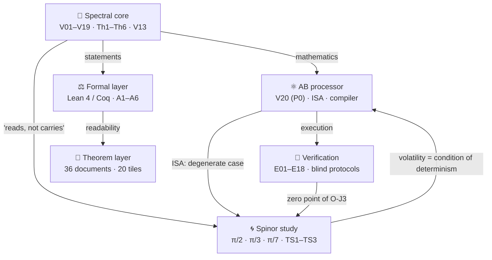

<div align="center">

<picture>
  <source media="(prefers-color-scheme: dark)" srcset="assets/logo_abcloud_dark.png">
  
</picture>

# AB CLOUD QUANTUM RESEARCH

**One study: the algebraic AB (Aharonov–Bohm) architecture as a computing
fabric that reads mathematics in real time and stores nothing**
Version **1.0.0** · proprietary license · Python / Julia / C / C++ / Rust / Go / JS / Lean / Coq


*Animated banner: ζ zeros rise along the critical line Re(s) = ½
(public Odlyzko data) · generated by `scripts/make_banner.py`*

</div>

> [!IMPORTANT]
> **Honest boundary.** Everything below is a numerical and formal study
> of a mathematical model. It does **not** prove the Riemann hypothesis:
> the V13 obligation machine keeps the RH conclusion **blocked**
> (`verdict: blocked`) while the analytic prerequisites remain assumed.
> The Lean/Coq formalization guarantees this blocking — it does not
> remove it.

---

## 📖 Contents

- [What this is](#-what-this-is)
- [Architecture: levels of one machine](#-architecture-levels-of-one-machine)
- [Flagship results](#-flagship-results)
- [Theorems Th1–Th6 and TS1–TS3](#-theorems-th1th6-and-ts1ts3)
- [Supplementary study: the machine with no long-term memory](#-supplementary-study-the-machine-with-no-long-term-memory)
- [Four-dimension tiles](#-four-dimension-tiles)
- [Repository structure](#-repository-structure)
- [Quick start](#-quick-start)
- [Web laboratories](#-web-laboratories)
- [Honesty discipline](#-honesty-discipline)
- [Roadmaps](#-roadmaps)
- [Citation](#-citation)
- [Русская версия](#русская-версия)

---

## 🌌 What this is

**AB Cloud Quantum Research** is a coherent study of one idea: the
algebraic AB architecture as a computer that *reads* mathematics — from
operator spectra to zeta zeros — in real time and retains nothing. ζ
zeros are reproduced from six constants of the trace formula at request
time; the prime weight provably lives in the heat trace of the operator;
the machine state is a volatile spinor phase executing steps in real
time. **Storage = 0 is an architectural principle proved by theorems,
not a slogan.**

- **43 campaigns** with pre-registered thresholds — all verdicts PASS
  (V01–V19 core · V20 processor · E01–E18 verification · ES1–ES5 spinor
  study);
- **9 theorems** with certificates and documents: Th1–Th6 + TS1–TS3;
  formal statements in Lean 4 + Coq (reductions A1–A6, no
  `sorry`/`admit`);
- **36 documents** RU/EN × PDF/DOCX, **20 four-dimension tiles** @600
  dpi, 3 web laboratories, multi-language core implementations
  (C / C++ / Rust / Go / JS / Julia);
- **410+ tests** and 95+ package integrity checks.

<details>
<summary><b>🔑 Numbers cheat sheet (click to expand)</b></summary>

| Metric | Value | Where |
|--------|-------|-------|
| Blind ζ zeros up to T=1000 | 649/649 (EM) + 639/639 (RS), cross-engine 0.0 bit-exact | E17 |
| Completeness N(1000) | 649.0 exactly | E17 |
| Compilation fidelity | 1−F ≤ 4.4e−16 (4×4) · 6.7e−16 (8×8) | V20 |
| Class B: compiler vs 5 baselines | **×59,000** in time at equal ISA | E18 |
| Trace ↔ primes | r = 0.9996 (lattice control 0.76) | V7/Th6 |
| CHSH | S = 2√2 − 4.4e−16; commutators 0 | V24 preview |
| Branch stitching V19 | θ-ladder 0.832; coherence 0.9995 | V19 |
| Phase cycles (π/2·π/3·π/7) | N = 4·6·14 = 2k exactly | ES1 |
| Post-reset reconstruction | 0.2501/0.1674/0.0717 ≈ 1/N (chance level) | ES2 |
| Machine step cost | flat (slope −1.5e−12 ms/step); log — Ω(t), ×129 | ES3 |
| Blind erratum γ₁₂ | detector 56.446247697063399 vs hand-made 56.446200059994141 | E17 |
| RH status | **blocked** (V13) | V13 |

</details>

---

## 🏛️ Architecture: levels of one machine



| Level | Folder | Campaigns | Essence |
|-------|--------|-----------|---------|
| 🧠 Core | [`modules/core_spectrum/`](modules/core_spectrum/README.md) | **V01–V19** | Blind spectrum, null models, critical line, the V13 obligation machine, branch stitching V19; theorems Th1–Th6; a 10-tab web lab |
| ⚛️ Processor | [`modules/processor_ab/`](modules/processor_ab/README.md) | **V20** (P0) | AB-cloud ISA, exact Givens-QR compiler, **"reads, does not carry"**, no-signaling nonlocality; an 8-tab web lab |
| 🔬 Verification | [`modules/verifier_multilang/`](modules/verifier_multilang/README.md) | **E01–E18** | Julia platform: blind ζ-zero reading by two engines, independent Riemann–Siegel, class B; 18/18 pre-registered verdicts |
| 🌀 Spinor | [`research/realtime_spinor_memory/`](research/realtime_spinor_memory/README.md) | **ES1–ES5** | The machine with no long-term memory: three phase models, 3 theorems, 5 verdicts |

The level map and data flow: [`docs/ARCHITECTURE.md`](docs/ARCHITECTURE.md).

---

## 🏆 Flagship results

| # | Result | Numbers | Level |
|---|--------|---------|-------|
| 1 | **Blind reading of ζ zeros up to T=1000** by two independent engines | 649/649 (EM) + 639/639 (RS); precision = recall = 1; cross-engine **0.0** bit-exact; N(1000) = 649.0 | Verification E17 |
| 2 | **Independent Riemann–Siegel** (Arias de Reyna, no external packages) | agreement with EM ≤ 3.8e−15 (threshold 1e−9); floor 1e−17 | Verification E16 |
| 3 | **Compiler vs 5 strong baselines under equal ISA constraints** (class B) | max 1−F = 4.4e−16; primitives ≤ BL1/BL2/BL4 on every target; **×59,000** in time | Verification E18 |
| 4 | **Exact compilation of unitary logic into AB clouds** | 1−F ≤ 4.4e−16 (4×4) / 6.7e−16 (8×8); depth ≤ 7/29 gates | Processor V20 |
| 5 | **Reads, does not carry**: ζ zeros reproduced from 6 formula constants | 12/12 zeros exactly; storage = **0** | Processor V23 preview |
| 6 | **No-signaling nonlocality** | CHSH S = 2√2 − 4.4e−16; protection 1000/1000; commutators = 0 | Processor V24 preview |
| 7 | **Branch stitching** | θ-ladder 0.832; coherence 0.9995 (z = 43.4); Z₂-monodromy | Core V19 |
| 8 | **Trace ↔ primes** (Th6) | r = 0.9996; the B/C₀ erratum found and fixed | Core V7 |
| 9 | **The machine with no long-term memory** | cycles 4/6/14 = 2k; reset irreversible; O(1) steps vs Ω(t) logs | Spinor ES1–ES3 |

> [!NOTE]
> Every experiment with a threshold has a verdict file (`*_verdict.json`,
> `claim_v*.json`) with a **does_not_prove** field — what the result does
> NOT prove. Negative results are published: lattice ζ-correspondences
> are NOT found (V1/V3/V6/V16), vortices break Th5, the 2q KAK optimum is
> unreachable in the E18 ISA class.

---

## 📐 Theorems Th1–Th6 and TS1–TS3

| Theorem | Statement (short) | Certificate | Reduction |
|---------|-------------------|-------------|-----------|
| **Th1** (V4) | H_L = H_L† ⇒ spec ⊂ ℝ; λ↔−λ at α=½, W=0 | ‖H−H†‖ = 0.0 exactly | A1 |
| **Th2** (V8) | finite-dimensional self-adjointness: defects (0,0), e^{−iHt} unitary | drift 2.2e−16 | A2b |
| **Th3** (V12) | Kato \|λ̂−λ̃\| ≤ δ²/gap + Gershgorin | widths ~1e−27 (dps 40) | A4, A5 |
| **Th4** (V15) | λ_n = Tr g_n(H_ξ); absolute convergence | two paths ≤ 4.4e−11 | A6 |
| **Th5** (V9) | [H,A]=[H,B]=0 ⇒ block reduction by characters | union ≈ spectrum to 7.1e−15 | A2 |
| **Th6** (V7) | Guinand–Weil: Q(a) ↔ ζ′/ζ; K(x) = Tr e^{−xH_ξ} | the trace carries Λ(n)/√n | A3 |
| **TS1** (ES1) | the rotation cycle θ=π/k closes after exactly N=2k steps; gap 2π/N | periods 4/6/14 exactly | — |
| **TS2** (ES2) | reset erases everything: I(pre;post)=0; reconstruction ≤ 1/N; time → mod N | 0.2501/0.1674/0.0717 ≈ 1/N | — |
| **TS3** (ES3) | the step is O(1) for all t; an eternal log ⇒ Ω(t) ⇒ deadline misses | slope −1.5e−12; ×129 growth | — |

Each theorem lives in its own folder: [`theorems_lemmas/`](theorems_lemmas/README.md)
(Th1–Th6, 24 documents) and
[`research/realtime_spinor_memory/theorems/`](research/realtime_spinor_memory/README.md)
(TS1–TS3, 12 documents): a **README with the proof idea** (4 dimensions,
boundaries) + **4 documents** (RU/EN × PDF/DOCX) + a **2×2 tile**.
Statements of Th1–Th6: [`formal/`](formal/README.md) — Lean 4 + Coq,
reductions A1–A6, **no** `sorry`/`admit`.

---

## 🌀 Supplementary study: the machine with no long-term memory

> The AB computer has **no long-term memory** — only volatile state
> executing steps in real time.

[`research/realtime_spinor_memory/`](research/realtime_spinor_memory/README.md)
reduces the central claim to three explicit models — spinor phases
**θ = π/2, π/3, π/7** with a single volatile register:

| Model | Phase | Cycle N=2k | Bits/step | Silence zone σ* |
|-------|-------|------------|-----------|-----------------|
| S1 · quadrant | π/2 | 4 | 2.000 | 0.135 rad |
| S2 · sextant | π/3 | 6 | 2.585 | 0.089 rad |
| S3 · 14-phase | π/7 | 14 | 3.807 | 0.038 rad |

**Theorems:** TS1 (cycles close, gap = step) · TS2 (reset irreversibility,
I = 0) · TS3 (O(1) steps; an eternal log ⇒ Ω(t) ⇒ deadline misses —
*volatility is the condition of real-time determinism*). Five campaigns
ES1–ES5 with pre-registered thresholds — all PASS, two errata published
(ES2a, ES5a). The capacity log₂N vs robustness 1/k trade-off is fixed as
an honest boundary.

<div align="center">


*Three memoryless models — the four-dimension tile (600 dpi, from the ES5
verdict)*

</div>

---

## 🖼️ Four-dimension tiles

Every tile is a **2×2 grid of four independent measurement dimensions**:
**metric** · **instance behaviour** · **control** · **threshold**.
600 dpi, the "Critical Line & Copper" style, RU/EN, built **only from
committed verdicts**. The levels' original figures are preserved in
`modules/*/figures_hires/`.

<div align="center">

| Th4 (Li formula) | Flagship atlas |
|----|----|
|  |  |

*Left: Th4 — the λ_n ladder · two-path agreement · tail · gate control.
Right: the atlas — blind zeros · compiler · trace·primes · CHSH*

</div>

Full sets: [`figures_tiled/`](figures_tiled/README.md) (12 tiles for
Th1–Th6) · [`atlas/`](atlas/README.md) ·
[`research/.../figures/`](research/realtime_spinor_memory/README.md)
(8 tiles for TS1–TS3).

---

## 🗂️ Repository structure

```
AB_Cloud_Quantum_Research/
├── modules/                        # three levels of one machine
│   ├── core_spectrum/              #   🧠 spectral core (V01–V19, Th1–Th6, V13)
│   ├── processor_ab/               #   ⚛️ AB processor (V20/P0, ISA, compiler)
│   └── verifier_multilang/         #   🔬 verification (E01–E18, Julia, blind protocols)
├── research/
│   └── realtime_spinor_memory/     # 🌀 the machine with no long-term memory
│       ├── spinor/ experiments/ data/ figures/{ru,en}/ theorems/ tests/ docs/
├── theorems_lemmas/                # 📐 Th1–Th6: 24 documents + 12 tiles + READMEs
├── figures_tiled/                  # 🖼️ 12 four-dimension tiles @600 dpi
├── atlas/                          # 🏛️ flagship atlas (2×2 tile, 600 dpi)
├── timeline/                       # 🗓️ timeline of 43 campaigns (600 dpi)
├── datasets/                       # 📊 flagships · 43 campaigns · 660 ζ zeros
├── whitepaper/                     # 📄 white paper (RU/EN PDF)
├── glossary/                       # 📖 bilingual glossary
├── formal/                         # ⚖️ bridge to the formal layer (Lean/Coq, A1–A6)
├── web_lab/                        # 🌐 portal + level laboratories
├── docs/ARCHITECTURE.md            # 🏛️ level map, links, data flow
├── scripts/ tests/ assets/         # 🔧 pipelines · smoke tests · logo/banner
└── CHANGELOG.md · CITATION.cff · Makefile · VERSION 1.0.0
```

---

## 🚀 Quick start

```bash
# package integrity (95+ checks)
python3 scripts/validate_package.py

# rebuild derived artifacts
python3 scripts/make_tiled_figures.py     # Th1–Th6 tiles @600 dpi
python3 scripts/make_theorem_docs.py      # 24 theorem documents
python3 scripts/make_datasets.py          # data: flagships, 43 campaigns, zeros
python3 scripts/make_atlas.py             # flagship atlas
python3 scripts/make_timeline.py          # campaign timeline
python3 scripts/make_whitepaper.py        # white paper RU/EN
python3 scripts/make_banner.py            # banner + logo

# supplementary study: campaigns ES1–ES5 (~2.5 min, all PASS)
cd research/realtime_spinor_memory
python3 experiments/run_all.py
python3 make_figures.py && python3 make_theorem_docs.py
python3 -m pytest tests/ -q

# verification platform: full E01–E18 run (~2.5 min)
julia modules/verifier_multilang/experiments/run_all.jl all
julia modules/verifier_multilang/experiments/verdicts.jl

# core and processor
cd modules/core_spectrum && python3 -m pytest tests/ -q
python3 modules/processor_ab/scripts/compute_v20.py
```

> [!TIP]
> Requirements: Python ≥ 3.10 (`requirements.txt`), Julia ≥ 1.10
> (standard library only). No network, no external services.

---

## 🌐 Web laboratories

| Laboratory | Tabs | Inside |
|------------|------|--------|
| [`web_lab/index.html`](web_lab/index.html) — **portal** | 3 blocks + theorems | the levels, the Th1–Th6 layer, formal status, the spinor study |
| [`modules/core_spectrum/web_lab/`](modules/core_spectrum/web_lab/index.html) | **10** | Riemann–Siegel Z(t), gate constructor, trace↔primes, Li criterion, ψ-ladder, V16–V19, **Theorems** |
| [`modules/processor_ab/web_lab/`](modules/processor_ab/web_lab/index.html) | **8** | ISA, the V20 compiler, zero reading (V23·E11/E17), nonlocality, roadmap, data, **Theorems** |

All laboratory computations run **locally in the browser** — no network,
no dependencies.

---

## 🛡️ Honesty discipline

1. **Pre-registration** — all thresholds fixed BEFORE the run.
2. **Blind protocols** — detector and validator separated; detector
   outputs SHA256-pinned before validation (E11/E17/V01/ES*).
3. **Cross-language replication** — Julia BigFloat ↔ Python mpmath (0.0
   disagreement), numpy replicas of the compiler (0 counter mismatches).
4. **Negative results are published** — see [flagships](#-flagship-results).
5. **Errata** — the B/C₀ constants of Th6 found and fixed; the γ₁₂
   framework value refuted by a blind detector; ES2a/ES5a thresholds
   replaced before acceptance — all published in verdicts.
6. **The V13 obligation machine** — the RH conclusion stays blocked while
   the analytic prerequisites are unproved.

---

## 🗺️ Roadmaps (chained)

| Level | Status | Next |
|-------|--------|------|
| Core (R2) | V19 stitching — algebraic certificate | r_align ≤ 0.135; ζ monodromy; Lean/Coq compilation (O-lean/O-coq) |
| Processor (P0–P6) | **P0 done** (V20) | P1 memory V21 → P2 ALU V22 → P3 reading V23 → P4 nonlocality V24 → P5 benchmarks → P6 Datasheet 1.0 |
| Verification (O-J) | **O-J1, O-J2 done** | O-J3 QEC memory → O-J4 digital twin → O-J5 integration; heights T ≫ 1000 |
| Spinor | **ES1–ES5 done** | phases θ = π/k for k > 7; task compilation into phase cycles; the diffusion channel |

Chaining: P3 (V23) builds on E17; P4 (V24) on E13/E14; O-J3 on E07 and
V21; the spinor study formalizes "reads, not carries" for P1. Full map:
[`docs/ARCHITECTURE.md`](docs/ARCHITECTURE.md).

---

## 📜 Citation

```bibtex
@misc{ab_cloud_quantum_research_2026,
  title  = {AB Cloud Quantum Research: an AB (Aharonov--Bohm) algebraic
            architecture that reads mathematics in real time and stores
            nothing},
  author = {AB Cloud Quantum Research},
  year   = {2026},
  version= {1.0.0},
  url    = {https://github.com/ab-cloud-quantum/AB_Cloud_Quantum_Research}
}
```

See also `CITATION.cff` and the modules' own CITATION.cff files.

## Русская версия

**AB Cloud Quantum Research v1.0.0** — единое исследование одной идеи:
алгебраическая AB-архитектура как вычислитель, который читает математику
в реальном времени и хранит ничего. Четыре уровня — спектральное ядро
(V01–V19, Th1–Th6, машина обязательств V13), AB-процессор (V20/P0:
точная компиляция Givens-QR, 1−F ≤ 4.4e−16; «читает, а не несёт»: 12/12
нулей ζ из шести констант следовой формулы; нелокальность без
сигналинга), верификационная платформа (E01–E18: слепое чтение всех
649+639 нулей ζ до T=1000 двумя движками с побитовым согласием; класс B
— компилятор против 5 baseline, ×59 000) и вспомогательное спинор-исследование
(research/realtime_spinor_memory: три фазовые модели θ = π/2, π/3, π/7
машины без долговременной памяти — циклы N = 2k точно, необратимость
сброса, шаги O(1) против журналов Ω(t)). Девять теорем с сертификатами,
36 двуязычных документов (RU/EN × PDF/DOCX), 20 плиток «4 измерения»
@600 dpi, 43 предрегистрированные кампании — все PASS, эрратумы
опубликованы, отрицательные результаты открыты. Полная русская версия —
[`README.md`](README.md); каждая папка несёт двуязычные README.

---

<div align="center">

*Built by discipline: pre-registration · blind protocols · replication ·
negative results published*

**AB Cloud Quantum Research** · v1.0.0 · © I. Isaev

</div>
