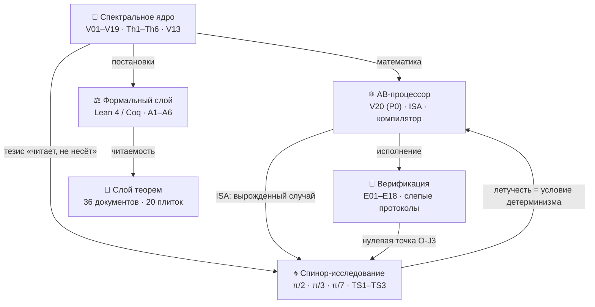

<div align="center">

<picture>
  <source media="(prefers-color-scheme: dark)" srcset="assets/logo_abcloud_dark.png">
  
</picture>

# AB CLOUD QUANTUM RESEARCH

**Одно исследование: алгебраическая AB-архитектура (Aharonov–Bohm) как
вычислитель, который читает математику в реальном времени и не хранит ничего**
Версия **1.0.0** · собственная лицензия автора · Python / Julia / C / C++ / Rust / Go / JS / Lean / Coq


*Анимированный баннер: нули ζ «поднимаются» по критической прямой Re(s) = ½
(открытые данные Одлыжко) · сгенерирован `scripts/make_banner.py`*

</div>

> [!IMPORTANT]
> **Честная граница.** Всё ниже — численное и формальное исследование
> математической модели. Оно **не доказывает гипотезу Римана**: машина
> обязательств V13 держит вывод RH **заблокированным** (`verdict:
> blocked`), пока аналитические предпосылки — assumed. Формализация
> Lean/Coq гарантирует эту блокировку, а не снимает её.

---

## 📖 Оглавление

- [Что это](#-что-это)
- [Архитектура: уровни одной машины](#-архитектура-уровни-одной-машины)
- [Флагманские результаты](#-флагманские-результаты)
- [Теоремы Th1–Th6 и TS1–TS3](#-теоремы-th1th6-и-ts1ts3)
- [Вспомогательное исследование: машина без долговременной памяти](#-вспомогательное-исследование-машина-без-долговременной-памяти)
- [Плиточные фигуры «4 измерения»](#-плиточные-фигуры-4-измерения)
- [Структура репозитория](#-структура-репозитория)
- [Быстрый старт](#-быстрый-старт)
- [Веб-лаборатории](#-веб-лаборатории)
- [Дисциплина честности](#-дисциплина-честности)
- [Дорожные карты](#-дорожные-карты)
- [Цитирование](#-цитирование)
- [English](#english)

---

## 🌌 Что это

**AB Cloud Quantum Research** — целостное исследование одной идеи:
*алгебраическая AB-архитектура (Aharonov–Bohm) как вычислитель, который
читает математику в реальном времени и ничего не хранит*. Нули
дзета-функции воспроизводятся из шести констант следовой формулы в момент
запроса; вес простых доказательно живёт в тепловом следе оператора;
состояние машины — летучая спинорная фаза, исполняющая шаги в реальном
времени. **Хранение = 0 — архитектурный принцип, доказанный теоремами,
а не постулат.**

- **43 кампании** с предрегистрированными порогами — все вердикты PASS
  (V01–V19 ядро · V20 процессор · E01–E18 верификация · ES1–ES5
  спинор-исследование);
- **9 теорем** с сертификатами и документами: Th1–Th6 + TS1–TS3;
  формальные постановки Lean 4 + Coq (редукции A1–A6, без
  `sorry`/`admit`);
- **36 документов** RU/EN × PDF/DOCX, **20 плиточных фигур** «4 измерения»
  @600 dpi, 3 веб-лаборатории, мультиязычные реализации ядра (C / C++ /
  Rust / Go / JS / Julia);
- **410+ тестов** и 95+ проверок целостности пакета.

<details>
<summary><b>🔑 Шпаргалка чисел (клик, чтобы развернуть)</b></summary>

| Метрика | Значение | Где |
|---------|----------|-----|
| Слепые нули ζ до T=1000 | 649/649 (ЭМ) + 639/639 (РС), кросс-движок 0.0 побитово | E17 |
| Полнота N(1000) | 649.0 точно | E17 |
| Точность компиляции | 1−F ≤ 4.4e−16 (4×4) · 6.7e−16 (8×8) | V20 |
| Класс B: компилятор против 5 baseline | **×59 000** по времени при равном ISA | E18 |
| След ↔ простые | r = 0.9996 (контроль решётки — 0.76) | V7/Th6 |
| CHSH | S = 2√2 − 4.4e−16; коммутаторы 0 | V24-превью |
| Сшивка ветвей V19 | θ-лестница 0.832; когерентность 0.9995 | V19 |
| Фазовые циклы (π/2·π/3·π/7) | N = 4·6·14 = 2k точно | ES1 |
| Реконструкция после сброса | 0.2501/0.1674/0.0717 ≈ 1/N (уровень случайности) | ES2 |
| Стоимость шага машины | плоская (наклон −1.5e−12 мс/шаг); журнал — Ω(t), ×129 | ES3 |
| Слепой эрратум γ₁₂ | детектор 56.446247697063399 vs рукотворный 56.446200059994141 | E17 |
| Статус RH | **blocked** (V13) | V13 |

</details>

---

## 🏛️ Архитектура: уровни одной машины



| Уровень | Папка | Кампании | Суть |
|---------|-------|----------|------|
| 🧠 Ядро | [`modules/core_spectrum/`](modules/core_spectrum/README.md) | **V01–V19** | Слепой спектр, нуль-модели, критическая прямая, машина обязательств **V13**, сшивка ветвей V19; теоремы Th1–Th6; веб-лаборатория на 10 вкладок |
| ⚛️ Процессор | [`modules/processor_ab/`](modules/processor_ab/README.md) | **V20** (P0) | ISA AB-облаков, точный компилятор Givens-QR, **«читает, а не несёт»**, нелокальность без сигналинга; веб-лаборатория на 8 вкладок |
| 🔬 Верификация | [`modules/verifier_multilang/`](modules/verifier_multilang/README.md) | **E01–E18** | Julia-платформа: слепое чтение нулей ζ двумя движками, независимый Риман–Зигель, класс B; 18/18 предрегистрированных вердиктов |
| 🌀 Спинор | [`research/realtime_spinor_memory/`](research/realtime_spinor_memory/README.md) | **ES1–ES5** | Машина без долговременной памяти: три фазовые модели, 3 теоремы, 5 вердиктов |

Карта уровней и поток данных: [`docs/ARCHITECTURE.md`](docs/ARCHITECTURE.md).

---

## 🏆 Флагманские результаты

| # | Результат | Числа | Уровень |
|---|-----------|-------|---------|
| 1 | **Слепое чтение нулей ζ до T=1000** двумя независимыми движками | 649/649 (ЭМ) + 639/639 (РС); precision = recall = 1; кросс-движок **0.0** побитово; N(1000) = 649.0 | Верификация E17 |
| 2 | **Независимый Риман–Зигель** (Ариас де Рейна, без внешних пакетов) | согласие с ЭМ ≤ 3.8e−15 (порог 1e−9); пол 1e−17 | Верификация E16 |
| 3 | **Компилятор против 5 baseline при равных ограничениях ISA** (класс B) | max 1−F = 4.4e−16; примитивы ≤ BL1/BL2/BL4 на каждой цели; **×59 000** по времени | Верификация E18 |
| 4 | **Точная компиляция унитарной логики в AB-облака** | 1−F ≤ 4.4e−16 (4×4) / 6.7e−16 (8×8); глубина ≤ 7/29 затворов | Процессор V20 |
| 5 | **Читает, а не несёт**: нули ζ воспроизводятся из 6 констант формулы | 12/12 нулей точно; хранение = **0** | Процессор V23-превью |
| 6 | **Нелокальность без сигналинга** | CHSH S = 2√2 − 4.4e−16; защита 1000/1000; коммутаторы = 0 | Процессор V24-превью |
| 7 | **Сшивка ветвей** | θ-лестница 0.832; когерентность 0.9995 (z = 43.4); Z₂-монодромия | Ядро V19 |
| 8 | **След ↔ простые** (Th6) | r = 0.9996; эрратум констант B/C₀ найден и исправлен | Ядро V7 |
| 9 | **Машина без долговременной памяти** | циклы 4/6/14 = 2k; сброс необратим; шаг O(1) против журнала Ω(t) | Спинор ES1–ES3 |

> [!NOTE]
> Каждый эксперимент с порогом имеет вердикт-файл (`*_verdict.json`,
> `claim_v*.json`) с полем **does_not_prove** — что именно результат НЕ
> доказывает. Отрицательные результаты публикуются: ζ-соответствия на
> решётке НЕ найдены (V1/V3/V6/V16), вихри ломают Th5, 2q-оптимум KAK
> недостижим в ISA-классе E18.

---

## 📐 Теоремы Th1–Th6 и TS1–TS3

| Теорема | Формулировка (кратко) | Сертификат | Редукция |
|---------|----------------------|------------|----------|
| **Th1** (V4) | H_L = H_L† ⇒ spec ⊂ ℝ; λ↔−λ при α=½, W=0 | ‖H−H†‖ = 0.0 точно | A1 |
| **Th2** (V8) | самосопряжённость на ℂ^N: дефекты (0,0), e^{−iHt} унитарен | дрейф 2.2e−16 | A2b |
| **Th3** (V12) | Каутский \|λ̂−λ̃\| ≤ δ²/gap + Гершгорин | ширины ~1e−27 (dps 40) | A4, A5 |
| **Th4** (V15) | λ_n = Tr g_n(H_ξ); абсолютная сходимость | два пути ≤ 4.4e−11 | A6 |
| **Th5** (V9) | [H,A]=[H,B]=0 ⇒ блочная редукция по характерам | объединение ≈ спектр до 7.1e−15 | A2 |
| **Th6** (V7) | Гуинанд–Вейль: Q(a) ↔ ζ′/ζ; K(x) = Tr e^{−xH_ξ} | след несёт Λ(n)/√n | A3 |
| **TS1** (ES1) | цикл вращения θ=π/k замыкается ровно через N=2k; зазор 2π/N | периоды 4/6/14 точно | — |
| **TS2** (ES2) | сброс стирает всё: I(пре;пост)=0; реконструкция ≤ 1/N; время → mod N | 0.2501/0.1674/0.0717 ≈ 1/N | — |
| **TS3** (ES3) | шаг O(1) при любом t; вечный журнал ⇒ Ω(t) ⇒ срыв дедлайнов | наклон −1.5e−12; ×129 роста | — |

Каждая теорема — в собственной папке: [`theorems_lemmas/`](theorems_lemmas/README.md)
(Th1–Th6, 24 документа) и [`research/realtime_spinor_memory/theorems/`](research/realtime_spinor_memory/README.md)
(TS1–TS3, 12 документов): **README с выводом** (идея доказательства,
4 измерения, границы) + **4 документа** (RU/EN × PDF/DOCX) + **плиточная
фигура 2×2**. Постановки Th1–Th6: [`formal/`](formal/README.md) — Lean 4 +
Coq, редукции A1–A6, `sorry`/`admit` **не используются**.

---

## 🌀 Вспомогательное исследование: машина без долговременной памяти

> У AB-компьютера **нет долговременной памяти** — только оперативное
> (летучее) состояние, исполняющее шаги в реальном времени.

[`research/realtime_spinor_memory/`](research/realtime_spinor_memory/README.md)
доводит центральный тезис программы до трёх явных моделей — спинорных фаз
**θ = π/2, π/3, π/7** с единственным летучим регистром:

| Модель | Фаза | Цикл N=2k | Биты/шаг | Зона тишины σ* |
|--------|------|-----------|----------|----------------|
| S1 · квадрантная | π/2 | 4 | 2.000 | 0.135 рад |
| S2 · секстантная | π/3 | 6 | 2.585 | 0.089 рад |
| S3 · 14-фазная | π/7 | 14 | 3.807 | 0.038 рад |

**Теоремы:** TS1 (замкнутость циклов, зазор = шагу) · TS2 (необратимость
сброса, I = 0) · TS3 (шаг O(1); вечный журнал ⇒ Ω(t) ⇒ срыв дедлайнов —
*летучесть есть условие детерминизма реального времени*). Пять кампаний
ES1–ES5 с предрегистрированными порогами — все PASS, два эрратума
опубликованы (ES2a, ES5a). Компромисс «ёмкость log₂N против робастности
1/k» зафиксирован как честная граница.

<div align="center">


*Три модели без долговременной памяти — плитка «4 измерения» (600 dpi,
из вердикта ES5)*

</div>

---

## 🖼️ Плиточные фигуры «4 измерения»

Каждая фигура — сетка **2×2 из четырёх независимых измерений**: **метрика**
· **поведение по инстансам** · **контроль** · **порог**. 600 dpi, стиль
«Critical Line & Copper», RU/EN, построены **только из закоммиченных
вердиктов**. Оригинальные графики уровней сохранены в
`modules/*/figures_hires/`.

<div align="center">

| Th4 (формула Ли) | Атлас флагманов |
|----|----|
|  |  |

*Слева: Th4 — λ_n-лестница · согласование двух путей · хвост · контроль
затворов. Справа: атлас — слепые нули · компилятор · след·простые · CHSH*

</div>

Полные наборы: [`figures_tiled/`](figures_tiled/README.md) (12 фигур
Th1–Th6) · [`atlas/`](atlas/README.md) ·
[`research/.../figures/`](research/realtime_spinor_memory/README.md)
(8 фигур TS1–TS3).

---

## 🗂️ Структура репозитория

```
AB_Cloud_Quantum_Research/
├── modules/                        # три уровня одной машины
│   ├── core_spectrum/              #   🧠 спектральное ядро (V01–V19, Th1–Th6, V13)
│   ├── processor_ab/               #   ⚛️ AB-процессор (V20/P0, ISA, компилятор)
│   └── verifier_multilang/         #   🔬 верификация (E01–E18, Julia, слепые протоколы)
├── research/
│   └── realtime_spinor_memory/     # 🌀 машина без долговременной памяти (π/2·π/3·π/7)
│       ├── spinor/ experiments/ data/ figures/{ru,en}/ theorems/ tests/ docs/
├── theorems_lemmas/                # 📐 Th1–Th6: 24 документа + 12 фигур + README
├── figures_tiled/                  # 🖼️ 12 плиток «4 измерения» @600 dpi
├── atlas/                          # 🏛️ атлас флагманов (плитка 2×2, 600 dpi)
├── timeline/                       # 🗓️ хронология 43 кампаний (600 dpi)
├── datasets/                       # 📊 флагманы · 43 кампании · эталон 660 нулей ζ
├── whitepaper/                     # 📄 белый отчёт (RU/EN PDF)
├── glossary/                       # 📖 двуязычный глоссарий
├── formal/                         # ⚖️ мост к формальному слою (Lean/Coq, A1–A6)
├── web_lab/                        # 🌐 портал исследования + лаборатории уровней
├── docs/ARCHITECTURE.md            # 🏛️ карта уровней, связей и потоков данных
├── scripts/ tests/ assets/         # 🔧 пайплайны · smoke-тесты · лого/баннер
└── CHANGELOG.md · CITATION.cff · Makefile · VERSION 1.0.0
```

---

## 🚀 Быстрый старт

```bash
# самопроверка целостности (95+ проверок)
python3 scripts/validate_package.py

# пересборка производных артефактов
python3 scripts/make_tiled_figures.py     # плитки Th1–Th6 @600 dpi
python3 scripts/make_theorem_docs.py      # 24 документа теорем
python3 scripts/make_datasets.py          # данные: флагманы, 43 кампании, нули
python3 scripts/make_atlas.py             # атлас флагманов
python3 scripts/make_timeline.py          # хронология кампаний
python3 scripts/make_whitepaper.py        # белый отчёт RU/EN
python3 scripts/make_banner.py            # баннер + лого

# вспомогательное исследование: кампании ES1–ES5 (~2.5 мин, все PASS)
cd research/realtime_spinor_memory
python3 experiments/run_all.py
python3 make_figures.py && python3 make_theorem_docs.py
python3 -m pytest tests/ -q

# верификационная платформа: полный прогон E01–E18 (~2.5 мин)
julia modules/verifier_multilang/experiments/run_all.jl all
julia modules/verifier_multilang/experiments/verdicts.jl

# ядро и процессор
cd modules/core_spectrum && python3 -m pytest tests/ -q
python3 modules/processor_ab/scripts/compute_v20.py
```

> [!TIP]
> Требования: Python ≥ 3.10 (`requirements.txt`), Julia ≥ 1.10 (только
> стандартная библиотека). Никакой сети и внешних сервисов не нужно.

---

## 🌐 Веб-лаборатории

| Лаборатория | Вкладок | Что внутри |
|-------------|---------|------------|
| [`web_lab/index.html`](web_lab/index.html) — **портал** | 3 блока + теоремы | уровни исследования, слой Th1–Th6, формальный статус, спинор-исследование |
| [`modules/core_spectrum/web_lab/`](modules/core_spectrum/web_lab/index.html) | **10** | Z(t) Римана–Зигеля, конструктор затворов, след↔простые, критерий Ли, ψ-лестница, V16–V19, **Теоремы** |
| [`modules/processor_ab/web_lab/`](modules/processor_ab/web_lab/index.html) | **8** | ISA, компилятор V20, считывание нулей (V23·E11/E17), нелокальность, дорожная карта, данные, **Теоремы** |

Все вычисления в лабораториях исполняются **локально в браузере** — без
сети и зависимостей.

---

## 🛡️ Дисциплина честности

1. **Предрегистрация** — все пороги зафиксированы ДО прогона
   (протоколы кампаний V*, E*, ES*).
2. **Слепые протоколы** — детектор и валидатор разделены; выходы
   пинованы SHA256 до валидации (E11/E17/V01/ES*).
3. **Кросс-языковая репликация** — Julia BigFloat ↔ Python mpmath (0.0
   расхождений), numpy-репликации компилятора (0 расхождений счётчиков).
4. **Отрицательные результаты публикуются** — см. [флагманы](#-флагманские-результаты).
5. **Эрратумы** — константы B/C₀ Th6 найдены и исправлены; γ₁₂ каркаса
   опровергнут слепым детектором; пороги ES2a/ES5a заменены до принятия
   вердиктов — всё опубликовано в вердиктах.
6. **Машина обязательств V13** — вывод RH заблокирован, пока аналитические
   предпосылки не доказаны.

---

## 🗺️ Дорожные карты (сцеплены)

| Уровень | Статус | Дальше |
|---------|--------|--------|
| Ядро (R2) | V19 сшивка — алгебраический сертификат | r_align ≤ 0.135; монодромия ζ; компиляция Lean/Coq (O-lean/O-coq) |
| Процессор (P0–P6) | **P0 исполнен** (V20) | P1 память V21 → P2 АЛУ V22 → P3 чтение V23 → P4 нелокальность V24 → P5 бенчмарки → P6 Datasheet 1.0 |
| Верификация (O-J) | **O-J1, O-J2 исполнены** | O-J3 QEC-память → O-J4 цифровой двойник → O-J5 интеграция; высоты T ≫ 1000 |
| Спинор | **ES1–ES5 исполнены** | фазы θ = π/k для k > 7; компиляция задач в фазовые циклы; диффузионный канал |

Сцепление: P3 (V23) опирается на E17; P4 (V24) — на E13/E14; O-J3 — на
E07 и V21; спинор-исследование формализует «читает, не несёт» для P1.
Полная карта — [`docs/ARCHITECTURE.md`](docs/ARCHITECTURE.md).

---

## 📜 Цитирование

```bibtex
@misc{ab_cloud_quantum_research_2026,
  title  = {AB Cloud Quantum Research: an AB (Aharonov--Bohm) algebraic
            architecture that reads mathematics in real time and stores
            nothing},
  author = {AB Cloud Quantum Research},
  year   = {2026},
  version= {1.0.0},
  url    = {https://github.com/ab-cloud-quantum/AB_Cloud_Quantum_Research}
}
```

См. также `CITATION.cff` и CITATION.cff модулей.

## English

**AB Cloud Quantum Research v1.0.0** is a single study of one idea: the
algebraic AB (Aharonov–Bohm) architecture as a computing fabric that
*reads* mathematics in real time and stores nothing. Four levels — the
spectral core (V01–V19, theorems Th1–Th6, the V13 obligation machine
keeping RH honestly blocked), the AB processor (V20/P0: exact Givens-QR
compilation into AB clouds, 1−F ≤ 4.4e−16; "reads, does not carry":
12/12 ζ zeros reproduced from six trace-formula constants; no-signaling
nonlocality), the cross-language verification platform (E01–E18: blind
reading of all 649+639 ζ zeros up to T = 1000 by two engines with
bit-exact agreement; the class-B compiler vs 5 strong baselines at
×59,000), and the supplementary spinor study (research/
realtime_spinor_memory: three phase models θ = π/2, π/3, π/7 of a
machine with no long-term memory — cycles N = 2k exactly, reset
irreversibility, O(1) steps vs Ω(t) logs). Nine theorems with
certificates, 36 bilingual documents (RU/EN × PDF/DOCX), 20
four-dimension tiles @600 dpi, 43 pre-registered campaigns — all PASS,
published errata, negative results public. See the Russian sections
above — every folder carries bilingual READMEs.

---

<div align="center">

*Собрано дисциплиной: предрегистрация · слепые протоколы · репликация ·
отрицательные результаты публикуются*

**AB Cloud Quantum Research** · v1.0.0 · © Исаев И. Х.

</div>
