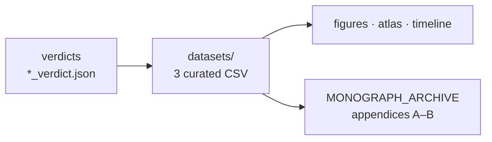

<!-- enriched 1.1.0 -->
<div align="center">

<picture>
  <source media="(prefers-color-scheme: dark)" srcset="../assets/logo_abcloud_dark.png">
  
</picture>

### 📊 Datasets — verdict-derived data

`AB Cloud Quantum Research` · v1.1.0 · part of one machine


</div>

> 🧭 **Navigation:** [↑ main README](../README.md) · [📚 monographs](../MONOGRAPH_ARCHIVE/README.md) · [🧪 hypothesis lab](../HYPOTHESIS_LAB/README.md) · [🎞 animations](../VISUAL_ANIMATIONS/README.md)
# 📊 datasets/ — курируемые наборы данных

Каждое значение в этих файлах взято **из закоммиченного вердикта
кампании** (никаких ручных чисел). Файлы пересобираются скриптом
`scripts/make_datasets.py`.

| Файл | Содержание | Происхождение |
|------|------------|---------------|
| `flagship_numbers.csv` | 15 флагманских метрик программы: метрика · значение · вердикт-источник · модуль | v20_verdict, v07_verdict, e16/e17/e18_verdict, es1–es5_verdict |
| `campaign_timeline.csv` | 43 кампании четырёх уровней: идентификатор · модуль · название · статус · ключевой результат | вердикты v01–v19, v20, e01–e18, es1–es5 |
| `zeta_zeros_reference.csv` | эталонные ординаты нулей ζ, 0 < γ ≤ 1000 (660 строк) — тот самый слепой эталон E17 | `modules/verifier_multilang/results/e17_zetazero_reference.csv` (SHA256-пин) |




## Примеры использования

```bash
# флагманы в одну строку
python3 -c "import csv; [print(r['metric'], '=', r['value']) for r in csv.DictReader(open('datasets/flagship_numbers.csv'))]"

# перестроить из вердиктов
python3 scripts/make_datasets.py
```

## Связанные артефакты

- хронологическая карта кампаний: [`../timeline/`](../timeline/README.md);
- атлас флагманов (плитка 2×2, 600 dpi): [`../atlas/`](../atlas/README.md).

## English summary

`datasets/` holds curated, verdict-derived data: `flagship_numbers.csv`
(15 flagship metrics with their source verdicts), `campaign_timeline.csv`
(43 campaigns across the four levels), and `zeta_zeros_reference.csv`
(the very blind E17 reference of 660 ζ ordinates). Rebuilt by
`scripts/make_datasets.py` — no hand-typed numbers anywhere.

---

<div align="center">


*Part of the discipline: pre-registration · blind protocols · replication ·
negative results published*

**AB Cloud Quantum Research** · v1.1.0 ·
[license](../../LICENSE) · © Isaev Iskhak Khamzatovich

</div>
