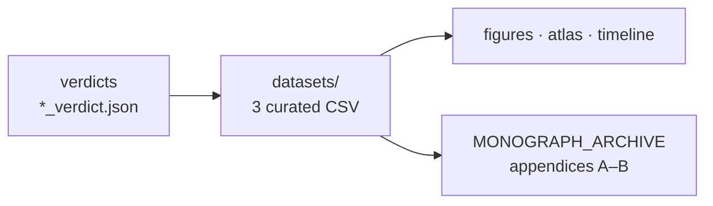

<!-- enriched 1.1.0 -->
<div align="center">

<picture>
  <source media="(prefers-color-scheme: dark)" srcset="../assets/logo_abcloud_dark.png">
  
</picture>

### 📊 Datasets — verdict-derived data

`AB Cloud Quantum Research` · v1.1.0 · part of one machine


</div>

> 🧭 **Navigation:** [↑ main README](../README.md) · [📚 monographs](../MONOGRAPH_ARCHIVE/README.md) · [🧪 hypothesis lab](../HYPOTHESIS_LAB/README.md) · [🎞 animations](../VISUAL_ANIMATIONS/README.md)
# 📊 datasets/ — curated datasets

Every value in these files is taken **from a committed campaign verdict**
(no hand-typed numbers). The files are rebuilt by the script
`scripts/make_datasets.py`.

| File | Contents | Provenance |
|------|------------|---------------|
| `flagship_numbers.csv` | 15 flagship metrics of the program: metric · value · source verdict · module | v20_verdict, v07_verdict, e16/e17/e18_verdict, es1–es5_verdict |
| `campaign_timeline.csv` | 43 campaigns of the four levels: id · module · title · status · key result | verdicts v01–v19, v20, e01–e18, es1–es5 |
| `zeta_zeros_reference.csv` | reference ordinates of the ζ zeros, 0 < γ ≤ 1000 (660 rows) — the very blind E17 reference | `modules/verifier_multilang/results/e17_zetazero_reference.csv` (SHA256 pin) |




## Example usage

```bash
# flagships in one line
python3 -c "import csv; [print(r['metric'], '=', r['value']) for r in csv.DictReader(open('datasets/flagship_numbers.csv'))]"

# rebuild from verdicts
python3 scripts/make_datasets.py
```

## Related artifacts

- the campaign timeline map: [`../timeline/`](../timeline/README.md);
- the flagship atlas (2×2 tile, 600 dpi): [`../atlas/`](../atlas/README.md).

---

<div align="center">


*Part of the discipline: pre-registration · blind protocols · replication ·
negative results published*

**AB Cloud Quantum Research** · v1.1.0 ·
[license](../../LICENSE) · © Isaev Iskhak Khamzatovich

</div>
