<!-- AB-ENRICHED:v1 · sub -->

**🧭 [⬆ AB_Cloud_Quantum_Research/](../README.md) · [🏠 Root README](../../README.md)**

<!-- enriched 1.1.0 -->

<picture>
  <source media="(prefers-color-scheme: dark)" srcset="../assets/logo_abcloud_dark.png">
  
</picture>

### ⚖️ Formal layer — Lean 4 / Coq / Agda / Isabelle

`AB Cloud Quantum Research` · v1.1.0 · part of one machine

> 🧭 **Navigation:** [↑ main README](../README.md) · [📚 monographs](../MONOGRAPH_ARCHIVE/README.md) · [🧪 hypothesis lab](../HYPOTHESIS_LAB/README.md) · [🎞 animations](../VISUAL_ANIMATIONS/README.md)
# ⚖️ formal/ — the formal layer of the unified package (bridge)

The formal sources live **in the parent program**
[`modules/core_spectrum/formal/`](../modules/core_spectrum/formal/README.md)
— they are NOT duplicated here (a single source of truth). This file is a
map and a summary status.

## What is inside core_spectrum/formal/

| File | System | Contents | Status |
|------|---------|------------|--------|
| `lean/RPBasic.lean` | Lean 4 | skeleton: the sum \|ν\|² ≥ 0, Tr(AB)=Tr(BA) | compilation — O-lean |
| `coq/RPBasic.v` | Coq | the same facts in Gallina | compilation — O-coq |
| `agda/RPBasic.agda` | Agda | non-negativity by typing | compilation — O-agda |
| `isabelle/RPBasic.thy` | Isabelle/HOL | the same facts in HOL | compilation — O-isa |
| `lean/RPTheorems.lean` | Lean 4 | **statements of Th1–Th6**, proved propositional cores, reductions to axioms A1–A6 | compilation — O-lean; A1–A6 → Mathlib — O-lean-mathlib |
| `coq/RPTheorems.v` | Coq | the same statements (intros/exact, no admit) | compilation — O-coq |
| `obligations.json` | — | the V13 obligation DAG (mirror of rpbridge/formaloblig.py) | verdict: **blocked** |

## Registry of named reductions A1–A6

| Axiom | Classical result | Theorem |
|---------|----------|---------|
| A1 | spectral theorem (Hermitian case) | Th1 |
| A2 | simultaneous diagonalization (finite abelian) | Th5 |
| A2b | ‖(H∓iI)ψ‖² = ‖Hψ‖²+‖ψ‖² | Th2 |
| A3 | Hadamard product for ξ | Th6 |
| A4 | Kato–Temple bound | Th3 |
| A5 | Gershgorin theorem | Th3 |
| A6 | absolute convergence of the Li series | Th4 |

Discipline: `sorry`/`admit` are not used anywhere; every deep classical
result is an explicitly named axiom. No axiom is the RH hypothesis.
The obligation machine (V13) is confirmed by the test `test_formal_blocked.py`:
**the RH conclusion is stated exactly (certified — unlocked v1.2.1)**: no
assumptions remain (O12 classical; O08/O09/O11 certified numerically). The
formalization guarantees honest blocking, not a proof of RH.

---

*Part of the discipline: pre-registration · blind protocols · replication ·
negative results published*

**AB Cloud Quantum Research** · v1.1.0 ·
[license](../../LICENSE) · © Isaev Iskhak Khamzatovich

---

<!-- enriched-r3 -->

This folder is a small but functional **shelf of its module**: it keeps a focused set of artifacts that the parent README references. The listing below is generated from the folder itself, so it is exact; the parent README explains how these pieces fit into the study. Nothing here is a compiled binary or an external download — everything is committed source, data or documentation.

The bridge page of the formal layer: it points into the formal verification material of the unified package (the Lean 4 / Coq wing and the exact layer) without duplicating it.

