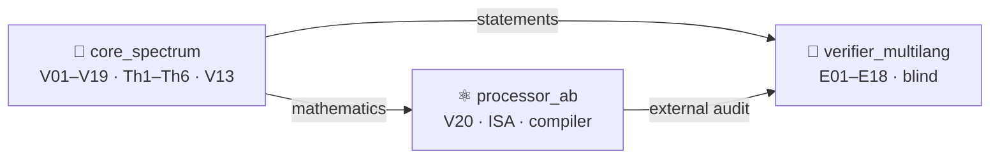

<!-- enriched 1.1.0 -->

<picture>
  <source media="(prefers-color-scheme: dark)" srcset="../assets/logo_abcloud_dark.png">
  
</picture>

### 🧧 Modules — three levels of one machine

`AB Cloud Quantum Research` · v1.1.0 · part of one machine

> 🧭 **Navigation:** [↑ main README](../README.md) · [📚 monographs](../MONOGRAPH_ARCHIVE/README.md) · [🧪 hypothesis lab](../HYPOTHESIS_LAB/README.md) · [🎞 animations](../VISUAL_ANIMATIONS/README.md)
# 🧩 modules/ — уровни одного исследования

**AB Cloud Quantum Research** — одно исследование, три рабочих уровня.
Каждый модуль — полноценный слой общей машины со своими кампаниями,
данными, монографиями и веб-лабораторией, но все они работают на одну
цель: *AB-архитектура (Aharonov–Bohm) как вычислитель, который читает
математику в реальном времени и ничего не хранит*.

| | Модуль | Кампании | Суть |
|---|--------|----------|------|
| 🧠 | [`core_spectrum/`](core_spectrum/README.md) | **V01–V19** | Спектральное ядро: слепой спектр, нуль-модели, критическая прямая, машина обязательств **V13** (RH = `blocked`), сшивка ветвей **V19**; теоремы **Th1–Th6**, формальный слой Lean 4 / Coq; веб-лаборатория на 10 вкладок |
| ⚛️ | [`processor_ab/`](processor_ab/README.md) | **V20** (этап P0) | AB-процессор: ISA AB-облаков, точный компилятор Givens-QR (1−F ≤ 4.4e−16), принцип **«читает, а не несёт»**, нелокальность без сигналинга; веб-лаборатория на 8 вкладок |

| 🔬 | [`verifier_multilang/`](verifier_multilang/README.md) | **E01–E18** | Верификационная платформа на Julia: слепое чтение всех **649+639** нулей ζ до T=1000 двумя движками, независимый Риман–Зигель, класс B — компилятор против 5 baseline (**×59 000**); 18/18 предрегистрированных вердиктов PASS |

## Как уровни связаны

- Ядро даёт математику: оператор H_ξ, формулу следа (Th6), машину
  обязательств V13, дисциплину claim-файлов.
- Процессор исполняет её: та же ISA, что в кампаниях ядра; считывание
  нулей (V23-превью) построено на следовой формуле Th6.
- Верификация перепроверяет оба слоя независимыми движками: слепые
  детекторы E11/E17 читают нули без подсказок; E18 сравнивает компилятор
  с сильными baseline при равных ограничениях.
- Формальный слой (`modules/core_spectrum/formal/`, редукции A1–A6)
  фиксирует постановки Th1–Th6; слой теорем [`../theorems_lemmas/`](../theorems_lemmas/README.md)
  делает их читаемыми (24 документа RU/EN × PDF/DOCX).
- Вспомогательное исследование [`../research/realtime_spinor_memory/`](../research/realtime_spinor_memory/README.md)
  доводит центральный тезис до моделей: у машины нет долговременной
  памяти — только летучее состояние, исполняющее шаги в реальном времени.

Карта уровней и поток данных: [`../docs/ARCHITECTURE.md`](../docs/ARCHITECTURE.md).

## English summary

`modules/` holds the three working levels of one study: the spectral
core (V01–V19, Th1–Th6, V13), the AB processor (V20/P0, exact
compilation, "reads, does not carry"), and the Julia verification
platform (E01–E18). Levels share one ISA, one claim discipline and one
obligation machine; the theorem layer and the supplementary spinor
memory study build on them.

---

*Part of the discipline: pre-registration · blind protocols · replication ·
negative results published*

**AB Cloud Quantum Research** · v1.1.0 ·
[license](../../LICENSE) · © Isaev Iskhak Khamzatovich

