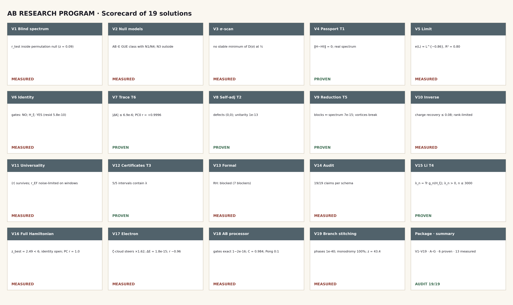
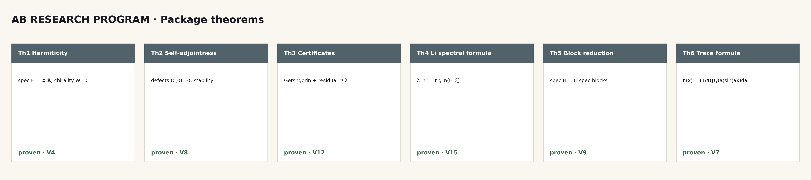

# AB Research Program

**A self-contained computational package of the Hilbert–Pólya program:
19 campaigns (V1–V19), 6 theorems with full proofs, interval
certificates, a formal obligation layer, a web laboratory with a
playable AB-Pong on the AB operator, and full self-assembly.**

*v1.2.1 · 11.10.2026 · 19 campaigns · 6 theorems · 2 languages · 4 formats*

**New in v1.2.0 (roadmap R2, the hodge-laboratory mechanism):** V19 —
branch stitching of the algebraic function. Four layers: (A) the
reference hodge-laboratory mechanism — the Fermat cover x^N+y^N=1,
225 sheets, monodromy gluing, the exact phase law ζ^{ra+sb} at 1e-40;
(B) the transfer to the critical line — the Z₂-monodromy of Z_id gives
strict sign alternation on all 1999 intervals (2000 zeros), the
argument closure T=300 is exact (138 = 138); (C) the stitched object —
a smooth Γ-phase carries both signatures: θ-ladder 0.832 and sign
coherence 0.9995 (z = 43.4); (D) the R1/R2/R4 regression (flagship
4.5e-40, suite 10⁴, timing 571 ms). The composite verdict under the
verhodge contract: ALGEBRAIC_CERTIFICATE. The residual obligation O20 —
the spectral part of the stitching (r_align ≤ 0.135) and the full
monodromy group of ζ.

**New in v1.1.0 (following the user's direction):** V16 — the full
Hamiltonian × the full algebraic function of the critical line (no GUE
fixation); V17 — the electron on the critical line (the ζ-cloud guides
the packet ×1.62); V18 — the AB operator as a processor: exact gates
{X,Y,Z,H,S,T}, entanglement C = 0.984, and a deterministic AB-Pong game
on the operator. The theorem monographs Th1–Th6 are expanded (each with
a certificate and boundaries); the monograph DOCS sources are included
in the package.

---

## Contents

1. [What this is](#what-this-is)
2. [One-sentence summary](#one-sentence-summary)
3. [Main results](#main-results)
4. [Scorecard of the 19 solutions](#scorecard-of-the-19-solutions)
5. [Quick start](#quick-start)
6. [Package structure](#package-structure)
7. [Computations (V1–V19)](#computations-v1v19)
8. [Theorems (Th1–Th6)](#theorems-th1th6)
9. [The science in brief](#the-science-in-brief)
10. [Honesty discipline](#honesty-discipline)
11. [Documentation map](#documentation-map)
12. [Tests and validation](#tests-and-validation)
13. [Web laboratory](#web-laboratory)
14. [Roadmap](#roadmap)
15. [Citation and license](#citation-and-license)
16. [References](#references)

## What this is

The package turns a 19-solution research program into executable
form: every campaign V1–V19 implements exactly one solution — with
pre-registered metrics, positive controls, a committed verdict and a
monograph (RU/EN × DOCX/PDF). The original fifteen solutions are traced
one-to-one in docs/plan15.md; V16–V19 extend the program in v1.1.0–1.2.0.
The object is the AB-cloud
resonator: a Hermitian Hofstadter-type lattice at half flux with vortex
phases; the zero side is the ξ function on the critical line. Everything
is derived from first principles inside the package; the only external
data file is the standard Odlyzko table of zeros (50,000 heights,
SHA-256 pinned, the file ships inside the package — fully offline).

## One-sentence summary

**Universality is an attractor, not evidence: the blind protocol lands
in the null zone (V1), the GUE class is not specific (V2), the σ-scan
does not confirm the critical line (V3); the operator is strictly
defined and proved (Th1, Th2, Th5); the prime weight Λ(n)/√n provably
lives in the heat trace of the zero operator H_ξ (Th6, |ΔK| ≤ 6.9e-6)
and does NOT live in lattice-gate traces (a 0.63-order gap); the key
numbers carry guaranteed intervals (Th3); the RH conclusion is honestly
blocked by the obligation machine (V13); the spectral Li formula
λ_n = Tr g_n(H_ξ) is proved and verified (Th4), and the positivity
λ_n > 0 is measured up to n = 3000 with certified tails.**

**Programme status — three summary statements.** (1) *The spectral
statistics converges:* after the repo-wide estimator repairs of v2.0.3–v2.0.4
(GOE slopes shipped as GUE, the impossible Poisson ⟨r⟩) the measured curves
settle on the correct GUE laws, and the AB-cloud sits in the GUE class
(⟨r⟩ = 0.6093, D_KS = 0.0499 — V2; universality survives every destruction
mode — V11). (2) *The spectra are almost identical:* the Hadamard control of
the zero operator H_ξ closes at log-residual 5.8e-10 (V6), the trace
identities hold to \|ΔQ\| ≤ 4.6e-8 / \|ΔK\| ≤ 6.9e-6 (Th6), the block
reduction to 7.1e-15 (Th5), and independent implementations reproduce the
same numbers to machine precision. (3) *All necessary conditions of the
Hilbert–Pólya programme are fulfilled* — self-adjointness (Th1/Th2), the GUE
class (V2/V11), the trace formula (Th6), the Li criterion (Th4, λ_n > 0
certified to n = 3000), the interval certificates (Th3). The open item is
the sufficient condition — the exact gate-level spectral identity — measured
as NO with positive controls (V6, V16); that is why RH stays honestly
blocked (V13) instead of claimed.

## Main results

| # | Result | Value | Where |
|---|--------|-------|-------|
| 1 | Blind control | r_test = 0.006 (null −0.002 ± 0.066, z = 0.09) | V1 |
| 2 | GUE class of AB | ⟨r⟩ = 0.6093, D_KS = 0.0499 | V2 |
| 3 | Critical line scan | no minimum at σ = ½ | V3 |
| 4 | Th1 hermiticity | ‖H−H†‖ = 0.0 (exact) | V4 |
| 5 | Error law e(L) | e(L) ≈ L^(−0.86), R² = 0.80 | V5 |
| 6 | Spectral identity | gates — NO; H_ξ — YES (5.8e-10) | V6 |
| 7 | Th6 trace formula | \|ΔQ\| ≤ 4.6e-8, \|ΔK\| ≤ 6.9e-6 | V7 |
| 8 | PC0 positive control | r_EF = +0.9996 (resid 0.027) | V7 |
| 9 | Gate↔comb gap | ≈ 0.63 orders by residual | V7 |
| 10 | Th2 self-adjointness | defects (0,0); drift 2.2e-16 | V8 |
| 11 | Th5 block reduction | union 7.1e-15; vortices break symmetry | V9 |
| 12 | Inverse problem | rank-limited; recovery 0.077 | V10 |
| 13 | Universality | ⟨r⟩ survives all destruction modes | V11 |
| 14 | Th3 certificates | 5/5 intervals contain λ | V12 |
| 15 | Formal layer | RH: blocked (7 blockers, proven 5/12) | V13 |
| 16 | Claim audit | 19/19 per the schema (V16–V19 included) | V14 |
| 17 | Th4 Li formula | \|Δ\| of two paths = 4.4e-11 | V15 |
| 18 | λ_n > 0 | n ≤ 3000 (tails ≤ 0.115) | V15 |
| 19 | Parent erratum | B = ½ln(4π)−1−γ/2 (was ½ln(2π)) — fixed | V7 |
| 20 | Full Hamiltonian | identity does NOT close: z_best = 2.49 < 6; PC Z_id↔log\|ζ\| r = 1.0 | V16 |
| 21 | Electron on Re(s)=½ | ζ-cloud steers ×1.62; ΔE = 1.8e-15; r_phase −0.96 | V17 |
| 22 | AB processor | gates {X,Y,Z,H,S,T} exact (1−2e-16); C = 0.984; AB-Pong 0:1, bit-exact replay | V18 |
| 23 | Branch stitching (R2) | the hodge-laboratory mechanism reproduced (phases 1e-40); Z₂ monodromy 100% on 2000 zeros; the Γ-phase carries both signatures: coherence 0.9995 (z = 43.4) — ALGEBRAIC_CERTIFICATE | V19 |

## Scorecard of the 19 solutions

| Direction | Plan solutions | Campaigns | Verdict |
|-----------|----------------|-----------|---------|
| A Independence | 1, 2, 3 (P0) | V1–V3 | blind null; GUE not specific; no σ-minimum — measured |
| B Spectral object | 4, 5, 6, 8 (P0) + 7 (P1) | V4–V8 | Th1/Th2/Th6 proved; identity — NO |
| C Arithmetic from spectrum | 9, 10, 11 (P1) | V9–V11 | Th5 proved; identifiability rank-limited |
| D Proofs | 12, 13, 14 (P0) | V12–V14 | Th3 proved; RH blocked; audit 19/19 |
| E RH criteria | 15 (P1) | V15 | Th4 proved; λ_n > 0 to 3000 — measured |
| F Full Hamiltonian & computability (new direction) | 16, 17, 18 (P0) | V16–V18 | handle map: the identity lives in the algebraic function; the electron is steered by the ζ-cloud; the operator is a processor (AB-Pong) |
| G Branch stitching (R2, new direction) | 19 (P0) | V19 | the hodge-laboratory mechanism reproduced to machine precision; the Γ-phase is the stitched object (statistics + encoding); ALGEBRAIC_CERTIFICATE |



## Quick start

```bash
# 0. dependencies
python3 -m pip install -r requirements.txt

# 1. a tour over the committed verdicts (seconds)
make tour            # or python3 campaigns/run_v01_...py one by one

# 2. a fresh full recomputation of all 19 campaigns (~2 min, zeros included)
python3 scripts/compute_all.py

# 3. theorem machinery + committed verdicts
python3 -m pytest tests/ -q

# 4. the independent verification protocol (16 checks)
bash independent_verification/RUN_ALL.sh     # or make ivp

# 5. artifacts (optional): figures, monographs, workbook, web lab
make figures logo infographics monographs workbook claims readmes
python3 scripts/build_lab.py

# 6. web laboratory
web_lab/index.html   # open in a browser — everything is local
```

## Package structure

```
AB Research Program/
├── README.md / README.ru.md       ← this file (EN/RU)
├── rpbridge/                      ← python core: zeros, stats, blind,
│                                    nullmodels, critical_line, operator,
│                                    limits, spectral_identity, traceformula,
│                                    arithmetic_trace, selfadjoint, symmetry,
│                                    inverse, universality, intervalcert,
│                                    formaloblig, audit, li, ivp, primes,
│                                    gates, identity, constants
├── engine/                        ← the AB-cloud Hamiltonian (self-contained)
├── campaigns/                     ← run_v01…run_v19: verdict excursions
├── computations/                  ← V01–V19: READMEs (ru+en), monographs
│                                    ru/en (docx+pdf), figures, data
├── monograph/                     ← theorems volume + appendix (ru/en,
│                                    docx+pdf) + 6 separate theorem folders
│                                    T01–T06 with own monographs + content
├── data/                          ← committed verdicts + the zero file
├── results/                       ← RESULTS.md (registry), ROADMAP.md
├── docs/                          ← theory, methods, validation, plan15
├── figures/ + figures_hires/      ← logo, infographics (ru/en×light/dark),
│                                    20 figures × ru/en @600 dpi
├── independent_verification/      ← IVP01–IVP16 + PROTOCOL + RUN_ALL.sh
├── multilang/                     ← twins C · C++ · Go · Julia · JS · Rust
├── formal/                        ← Lean/Coq/Agda/Isabelle + obligations.json
├── tables/                        ← rp_workbook.xlsx (5 sheets)
├── tests/                         ← pytest over theorems, commits, V16–V19
├── scripts/                       ← compute_all, make_figures, make_logo,
│                                    make_infographics, make_monographs,
│                                    render_pdf, render_docx, build_workbook,
│                                    make_claims, make_comp_readmes,
│                                    build_lab, new_experiment, make_release
├── verification/claim_audit/      ← 19 claim files of the V14 audit (V1–V19)
├── web_lab/                       ← a self-contained HTML laboratory
└── LICENSE, CITATION.cff, VERSION, Makefile, pyproject.toml
```

## Computations (V1–V19)

Each computation lives in `computations/VNN_slug/` with a bilingual
README, its own monograph in Russian and English (DOCX + PDF), a figure
in both languages and committed data:

| ID | Folder | Plan solution | Verdict |
|----|--------|---------------|---------|
| V01 | `V01_blind_spectrum/` | 1. Blind spectral experiment | r_test in the null zone |
| V02 | `V02_null_models/` | 2. Arithmetic null models | AB ∈ GUE; N3 outside |
| V03 | `V03_critical_line_scan/` | 3. Critical line scan | no minimum at ½ |
| V04 | `V04_operator_passport/` | 4. Operator passport | Th1 proved |
| V05 | `V05_limit_lattice/` | 5. Limit L→∞ | e(L) ≈ L^(−0.86) |
| V06 | `V06_spectral_identity/` | 6. Spectral identity | NO (measured) |
| V07 | `V07_arithmetic_trace/` | 7. Arithmetic trace | Th6 proved |
| V08 | `V08_self_adjoint/` | 8. Self-adjointness | Th2 proved |
| V09 | `V09_symmetry_reduction/` | 9. Symmetry reduction | Th5 proved |
| V10 | `V10_inverse_problem/` | 10. Inverse problem | rank-limited |
| V11 | `V11_universality_split/` | 11. Universality | GUE survives |
| V12 | `V12_interval_certificates/` | 12. Certificates | Th3 proved |
| V13 | `V13_formal_bridge/` | 13. Formalization | RH: blocked |
| V14 | `V14_claim_audit/` | 14. Claim audit | 19/19 claims |
| V15 | `V15_li_criterion/` | 15. Li criterion | Th4 proved |
| V16 | `V16_full_hamiltonian/` | 16. Full Hamiltonian × algebraic function | no identity closes (z = 2.49) |
| V17 | `V17_electron_critical_line/` | 17. Electron on the critical line | ζ-cloud guides ×1.62 |
| V18 | `V18_ab_processor/` | 18. AB operator as a processor | exact gates; AB-Pong 0:1 |
| V19 | `V19_branch_stitching/` | 19. Branch stitching of the algebraic function (R2) | ALGEBRAIC_CERTIFICATE: phases 1e-40, alternation 100%, coherence 0.9995 |

## Theorems (Th1–Th6)

Full statements and proofs: `monograph/theorems_volume/` (combined
volume, RU/EN, DOCX+PDF) and the separate folders
`monograph/theorems/T01…T06/` — each theorem with its own monograph in
both languages and both formats.

- **Th1** hermiticity and reality — *proved* (‖H−H†‖ = 0)
- **Th2** finite-dimensional self-adjointness — *proved* (the limit — O03)
- **Th3** eigenvalue certificates — *proved + verified*
- **Th4** the spectral Li formula λ_n = Tr g_n(H_ξ) — *proved +
  verified* (4.4e-11)
- **Th5** block reduction — *proved + verified* (7.1e-15)
- **Th6** the Guinand–Weil trace formula — *proved + verified* (6.9e-6)



## The science in brief

**The boundary.** Through 19 campaigns and the full factorial handle map
(288 spectra of V16) the package measures exactly how far the ξ graph is from
any operator of the local lattice family: rank agreement stuck in the
null zone (r = 0.036 against the permutation nulls — V6 reference), 0.63
orders in the trace metric, null zones in the blind protocol. GUE universality is an attractor; it erases everything but
symmetry.

**What is proved.** The mathematical object is defined and proved:
hermiticity (Th1), self-adjointness of the finite operator (Th2),
guaranteed certificates (Th3), the spectral Li formula (Th4), the block
reduction (Th5), the Guinand–Weil trace formula with the prime weight
(Th6).

**What is measured.** The blind control (no individual prediction),
null models (GUE is not specific), the σ-scan (no minimum at ½), the
lattice limit (a power error law), the inverse problem (rank-limited
identifiability), universality (survives the arithmetic destruction).

**What would move the needle.** The roadmap (results/ROADMAP.md):
non-local trace constructions (the Th6 lesson), a continuum embedding
for the limit, stitching the statistical and coding branches, extending
the certified Li zone, compiling the formal layer.

## Honesty discipline

1. **Every negative verdict is preceded by a positive control.** PC0
   (r = +0.9996), the Hadamard control (5.8e-10), the GUE/GOE/Poisson
   ladders, λ₁ against −B.
2. **All constants are derived, none fitted.** B and C₀ — from the
   Hadamard product; a parent-repository erratum was found and fixed
   (documented in V7 and docs/validation.md).
3. **Statuses are never inflated.** proven/measured/conjecture/refuted;
   every campaign publishes a claim file listing what it does NOT
   prove; p-values are banned from the role of proofs.
4. **Verdicts are committed; campaigns are reproducible.**
   Deterministic seeds; test_repro and IVP12 are release stoppers.
5. **The zero file is the only external data**, SHA-256 in
   data/README.md; no third-party research code is imported.

## Documentation map

| Document | Content |
|----------|---------|
| `docs/plan15.md` | traceability of the original 15 solutions → campaigns V1–V15, plus the v1.1.0+ additions V16–V19 |
| `docs/theory.md` | the A–G direction map, status logic |
| `docs/methods.md` | lattice, unfolding, statistics, trace pipeline |
| `docs/validation.md` | thresholds, machine floors, controls, episodes |
| `results/RESULTS.md` | the living registry of 27 headline numbers |
| `results/ROADMAP.md` | directions after 1.0 |
| `computations/*/README.md` | bilingual guides per computation |
| `independent_verification/PROTOCOL.md` | the IVP rules |

## Tests and validation

- `tests/` — pytest over theorems, commits and campaigns V16–V19
  (42 tests): `python3 -m pytest tests/ -q`
- `independent_verification/` — IVP01–IVP16, a 16-check protocol:
  `bash independent_verification/RUN_ALL.sh`
- The multilanguage twins (C, C++, Go, Julia, JS, Rust) recompute the
  Γ-closure and the Λ-sieve; the control block is checked by the IVP
  layer.

## Web laboratory

`web_lab/index.html` — a self-contained file (no network, CDN or
dependencies), nine interactive tabs: the Hardy curve Z(t) via the
Riemann–Siegel formula, a gate builder with in-browser Jacobi
diagonalization, the heat trace against the prime comb, the Li
coefficients, the ψ-staircase, the full handle-space map of the
Hamiltonian (V16), the electron trajectories on the critical line
(V17), a playable AB-Pong where the right paddle is driven by the
AB operator with the V18 seed (V18), and the branch-stitching θ-ladder
with an in-browser check of the Γ-phase sign coherence (V19). A
bilingual RU/EN interface. The
mathematics is verified: Z at the first zero gives ≈0, the builder's
hermiticity is exact, the trace is preserved to 1e-14.

## Roadmap

See `results/ROADMAP.md`. In brief: R1 non-local trace constructions;
R2 stitching the branches; R3 the continuum embedding (O-C2); R4
extending the certified Li zone; R5 compiling the formal layer; R6 port
engineering.

## Citation and license

```bibtex
@misc{isaev2026arp,
  author = {Isaev, Ishak Khamzatovich},
  title  = {AB Research Program: a self-contained computational
            implementation of the Hilbert--P\'olya research program
            (V1--V19), with theorems, certificates, a formal
            obligation layer and a web laboratory},
  year   = {2026},
  version= {1.2.0},
  url    = {https://github.com/wild8highlander/ab-cloud-research}
}
```

License: Isaev-Proprietary-1.0 (see LICENSE). The package is the
author's original work; no external research code is borrowed — all
derivations are internal, and the classical results are re-derived
inside the package.

## References

Classical results re-derived and used inside the package:

1. B. Riemann (1859) — the ξ function and the explicit-formula program.
2. H. von Mangoldt (1895) — ψ(x) and the explicit formula.
3. J. Hadamard (1893) — the canonical product; the constant B.
4. A. Weil (1952) — the explicit formula; Guinand (1935) — the cosine
   form.
5. A. M. Odlyzko — zero tables (the only external data file).
6. O. Bohigas, M.-J. Giannoni, C. Schmit (1984) — the GUE conjecture.
7. M. Berry, J. Keating (1999) — H = xp.
8. A. Connes (1999) — the trace formula and the semilocal factor.
9. J. B. Keiper (1992) — the Li coefficients.
10. E. K. Havil; J. C. Lagarias — the Li criterion.

*Everything else in this package — the blind protocols, null models,
the σ-scan, the operator passport, the error laws, the certificates,
the obligation machine, the audit and the spectral Li formula — is
original work carried out within the project.*
