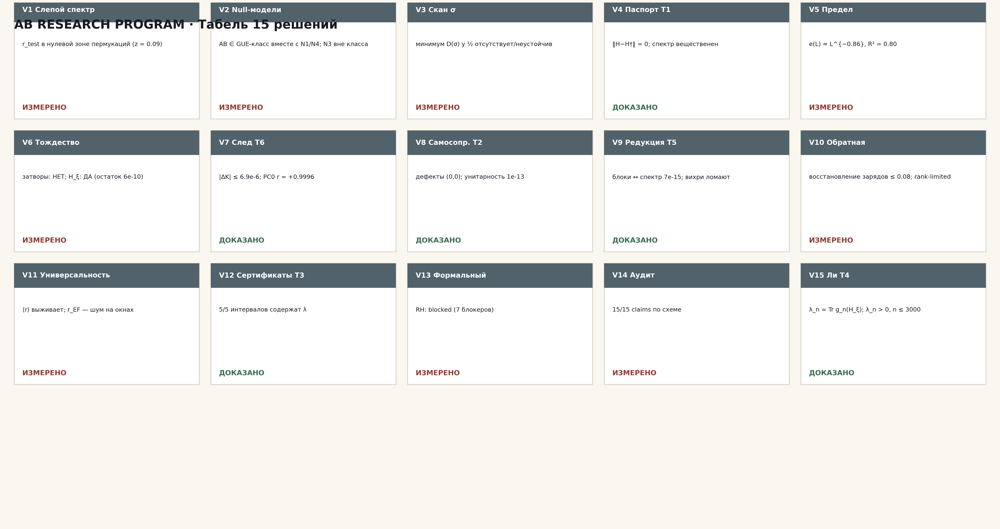
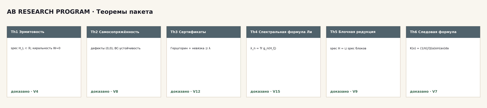

# AB Research Program

**Самодостаточный вычислительный пакет программы Гильберта–Пойа: 19
кампаний (V1–V19), 6 теорем с полными выводами, интервальные
сертификаты, формальный слой обязательств, веб-лаборатория с играбельной
AB-Pong на AB-операторе и полная самосборка.**

*v1.2.1 · 11.10.2026 · 19 кампаний · 6 теорем · 2 языка · 4 формата*

**Новое в v1.2.0 (дорожная карта R2, механизм hodge-laboratory):**
V19 — сшивка ветвей алгебраической функции. Четыре слоя: (A) эталонный
механизм hodge-laboratory — Ферма-накрытие x^N+y^N=1, 225 листов,
монодромная склейка, точный фазовый закон ζ^{ra+sb} до 1e-40; (B) перенос
на критическую прямую — Z₂-монодромия Z_id даёт строгое чередование
знаков на всех 1999 интервалах (2000 нулей), аргументное замыкание
T=300 точное (138 = 138); (C) сшитый объект — гладкая Γ-фаза несёт оба
признака: θ-лестница 0.832 и знаковая когерентность 0.9995 (z = 43.4);
(D) регрессия R1/R2/R4 (flagship 4.5e-40, сюита 10⁴, тайминг 571 мс).
Композитный вердикт по контракту verhodge: ALGEBRAIC_CERTIFICATE.
Остаточное обязательство O20 — спектральная часть сшивки (r_align ≤ 0.135)
и полная группа монодромии ζ.

**Новое в v1.1.0 (по направлению пользователя):** V16 — полный
гамильтониан × полная алгебраическая функция критической прямой (без
зацикливания на GUE); V17 — электрон на критической прямой (ζ-облако
направляет пакет ×1.62); V18 — AB-оператор как процессор: точные ворота
{X,Y,Z,H,S,T}, зацепление C = 0.984 и детерминированная игра AB-Pong на
операторе. Расширены монографии теорем Th1–Th6 (каждая с сертификатом и
границами); DOCS-исходники монографий включены в пакет.

---

## Содержание

1. [Что это такое](#что-это-такое)
2. [Суть одной фразой](#суть-одной-фразой)
3. [Главные результаты](#главные-результаты)
4. [Табель 15 решений](#табель-15-решений)
5. [Быстрый старт](#быстрый-старт)
6. [Структура пакета](#структура-пакета)
7. [Вычисления (V1–V19)](#вычисления-v1v19)
8. [Теоремы (Th1–Th6)](#теоремы-th1th6)
9. [Наука вкратце](#наука-вкратце)
10. [Дисциплина честности](#дисциплина-честности)
11. [Карта документации](#карта-документации)
12. [Тесты и валидация](#тесты-и-валидация)
13. [Веб-лаборатория](#веб-лаборатория)
14. [Дорожная карта](#дорожная-карта)
15. [Цитирование и лицензия](#цитирование-и-лицензия)
16. [Литература](#литература)

## Что это такое

Пакет переводит исследовательскую программу из 15 решений (см.
docs/plan15.md) в исполняемую форму: каждая кампания V1–V19 реализует
ровно одно решение — с предрегистрированными метриками, позитивными
контролями, закоммиченным вердиктом и монографией (RU/EN × DOCX/PDF).
Объект — резонатор AB-cloud: эрмитова решётка хофштадтеровского типа на
полфлакса с вихревыми фазами; нулевая сторона — функция ξ на критической
линии. Всё выводится из первых принципов внутри пакета; единственный
внешний файл данных — стандартная таблица нулей Одлыжко (50 000 высот,
SHA-256 зафиксирован, файл входит в пакет — офлайн-работа полная).

## Суть одной фразой

**Универсальность — аттрактор, а не свидетель: слепой контроль даёт
нулевую зону (V1), GUE-класс не специфичен (V2), скан σ не подтверждает
критическую линию (V3); оператор строго определён и доказан (Th1, Th2,
Th5); вес простых Λ(n)/√n доказательно живёт в тепловом следе нулевого
оператора H_ξ (Th6, |ΔK| ≤ 6.9e-6) и НЕ живёт в следах решёточных
затворов (разрыв 0.63 порядка); ключевые числа снабжены гарантированными
интервалами (Th3); вывод RH честно заблокирован машиной обязательств
(V13); спектральная формула Ли λ_n = Tr g_n(H_ξ) доказана и
верифицирована (Th4), положительность λ_n > 0 измерена до n = 3000 с
сертифицированными хвостами.**

## Главные результаты

| # | Результат | Значение | Где |
|---|-----------|----------|-----|
| 1 | Слепой контроль | r_test = 0.006 (нуль −0.002 ± 0.066, z = 0.09) | V1 |
| 2 | GUE-класс AB | ⟨r⟩ = 0.6093, D_KS = 0.0499 | V2 |
| 3 | Скан критической линии | минимум в σ = ½ отсутствует | V3 |
| 4 | Th1 эрмитовость | ‖H−H†‖ = 0.0 (точно) | V4 |
| 5 | Закон ошибки e(L) | e(L) ≈ L^(−0.86), R² = 0.80 | V5 |
| 6 | Спектральное тождество | затворы — НЕТ; H_ξ — ДА (5.8e-10) | V6 |
| 7 | Th6 следовая формула | \|ΔQ\| ≤ 4.6e-8, \|ΔK\| ≤ 6.9e-6 | V7 |
| 8 | PC0 позитивный контроль | r_EF = +0.9996 (resid 0.027) | V7 |
| 9 | Разрыв затвор↔гребёнка | ≈ 0.63 порядка по невязке | V7 |
| 10 | Th2 самосопряжённость | дефекты (0,0); дрейф 2.2e-16 | V8 |
| 11 | Th5 блочная редукция | union 7.1e-15; вихри ломают симметрию | V9 |
| 12 | Обратная задача | rank-limited; восстановление 0.077 | V10 |
| 13 | Универсальность | ⟨r⟩ выживает во всех разрушениях | V11 |
| 14 | Th3 сертификаты | 5/5 интервалов содержат λ | V12 |
| 15 | Формальный слой | RH: blocked (7 блокеров, proven 5/12) | V13 |
| 16 | Аудит claims | 19/19 по схеме (V16–V19 включены) | V14 |
| 17 | Th4 формула Ли | \|Δ\| двух путей = 4.4e-11 | V15 |
| 18 | λ_n > 0 | n ≤ 3000 (хвосты ≤ 0.115) | V15 |
| 19 | Эрратум родителя | B = ½ln(4π)−1−γ/2 (было ½ln(2π)) — исправлено | V7 |
| 20 | Полный гамильтониан | тождество НЕ замыкается: z_best = 2.49 < 6; ПК Z_id↔log\|ζ\| r = 1.0 | V16 |
| 21 | Электрон на Re(s)=½ | ζ-облако направляет ×1.62; ΔE = 1.8e-15; r_phase −0.96 | V17 |
| 22 | AB-процессор | ворота {X,Y,Z,H,S,T} точные (1−2e-16); C = 0.984; AB-Pong 0:1, реплей бит-в-бит | V18 |
| 23 | Сшивка ветвей (R2) | механизм hodge-laboratory воспроизведён (фазы 1e-40); Z₂-монодромия 100% на 2000 нулях; Γ-фаза несёт оба признака: когерентность 0.9995 (z = 43.4) — ALGEBRAIC_CERTIFICATE | V19 |

## Табель 15 решений

| Направление | Решения плана | Кампании | Вердикт |
|-------------|---------------|----------|---------|
| A Независимость | 1, 2, 3 (P0) | V1–V3 | слепой нуль; GUE не специфичен; σ-минимума нет — измерено |
| B Спектральный объект | 4, 5, 6, 8 (P0) + 7 (P1) | V4–V8 | Th1/Th2/Th6 доказаны; тождество — НЕТ |
| C Арифметика из спектра | 9, 10, 11 (P1) | V9–V11 | Th5 доказана; идентифицируемость ранг-лимитирована |
| D Доказательства | 12, 13, 14 (P0) | V12–V14 | Th3 доказана; RH blocked; аудит 19/19 |
| E Критерии RH | 15 (P1) | V15 | Th4 доказана; λ_n > 0 до 3000 — измерено |
| F Полный гамильтониан и вычислительность (новое направление) | 16, 17, 18 (P0) | V16–V18 | карта ручек: тождество живёт в алгебраической функции; электрон направляется ζ-облаком; оператор — процессор (AB-Pong) |
| G Сшивка ветвей (R2, новое направление) | 19 (P0) | V19 | механизм hodge-laboratory воспроизведён до машинного пола; Γ-фаза — сшитый объект (статистика + кодировка); ALGEBRAIC_CERTIFICATE |



## Быстрый старт

```bash
# 0. зависимости
python3 -m pip install -r requirements.txt

# 1. экскурсия по закоммиченным вердиктам (секунды)
make tour            # или python3 campaigns/run_v01_...py по одной

# 2. свежий полный пересчёт всех 19 кампаний (~12 минут, файл нулей в пакете)
python3 scripts/compute_all.py

# 3. теоремная машинерия + коммиты
python3 -m pytest tests/ -q

# 4. протокол независимой верификации (15 проверок)
bash independent_verification/RUN_ALL.sh     # или make ivp

# 5. артефакты (опционально): рисунки, монографии, workbook, веб-лаборатория
make figures logo infographics monographs workbook claims readmes
python3 scripts/build_lab.py

# 6. веб-лаборатория
web_lab/index.html   # открыть в браузере — всё локально
```

## Структура пакета

```
AB Research Program/
├── README.md / README.ru.md       ← этот файл (EN/RU)
├── rpbridge/                      ← python-ядро: zeros, stats, blind,
│                                    nullmodels, critical_line, operator,
│                                    limits, spectral_identity, traceformula,
│                                    arithmetic_trace, selfadjoint, symmetry,
│                                    inverse, universality, intervalcert,
│                                    formaloblig, audit, li, ivp, primes,
│                                    gates, identity, constants
├── engine/                        ← гамильтониан AB-cloud (самодостаточный)
├── campaigns/                     ← run_v01…run_v19: экскурсии по вердиктам
├── computations/                  ← V01–V19: README (ru+en), монографии
│                                    ru/en (docx+pdf), рисунки, данные
├── monograph/                     ← том теорем + приложение (ru/en,
│                                    docx+pdf) + 6 отдельных папок теорем
│                                    T01–T06 со своими монографиями + контент
├── data/                          ← закоммиченные вердикты + файл нулей
├── results/                       ← RESULTS.md (реестр), ROADMAP.md
├── docs/                          ← theory, methods, validation, plan15
├── figures/ + figures_hires/      ← логотип, инфографики (ru/en×light/dark),
│                                    20 рисунков × ru/en @600 dpi
├── independent_verification/      ← IVP01–IVP16 + PROTOCOL + RUN_ALL.sh
├── multilang/                     ← двойники C · C++ · Go · Julia · JS · Rust
├── formal/                        ← Lean/Coq/Agda/Isabelle + obligations.json
├── tables/                        ← rp_workbook.xlsx (5 листов)
├── tests/                         ← pytest по теоремам, коммитам и V16–V19
├── scripts/                       ← compute_all, make_figures, make_logo,
│                                    make_infographics, make_monographs,
│                                    render_pdf, render_docx, build_workbook,
│                                    make_claims, make_comp_readmes,
│                                    build_lab, new_experiment, make_release
├── verification/claim_audit/      ← 19 claim-файлов аудита V14 (V1–V19)
├── web_lab/                       ← самодостаточная HTML-лаборатория
└── LICENSE, CITATION.cff, VERSION, Makefile, pyproject.toml
```

## Вычисления (V1–V19)

Каждое вычисление живёт в `computations/VNN_slug/` с билингвальным
README, собственной монографией на русском и английском (DOCX + PDF),
рисунком на двух языках и закоммиченными данными:

| ID | Папка | Решение плана | Вердикт |
|----|-------|---------------|---------|
| V01 | `V01_blind_spectrum/` | 1. Слепой спектральный эксперимент | r_test в нулевой зоне |
| V02 | `V02_null_models/` | 2. Арифметические контрольные модели | AB ∈ GUE; N3 вне |
| V03 | `V03_critical_line_scan/` | 3. Скан критической линии | минимума в ½ нет |
| V04 | `V04_operator_passport/` | 4. Паспорт оператора | Th1 доказана |
| V05 | `V05_limit_lattice/` | 5. Предел L→∞ | e(L) ≈ L^(−0.86) |
| V06 | `V06_spectral_identity/` | 6. Спектральное тождество | НЕТ (измерено) |
| V07 | `V07_arithmetic_trace/` | 7. Арифметический след | Th6 доказана |
| V08 | `V08_self_adjoint/` | 8. Самосопряжённость | Th2 доказана |
| V09 | `V09_symmetry_reduction/` | 9. Симметрийная редукция | Th5 доказана |
| V10 | `V10_inverse_problem/` | 10. Обратная задача | rank-limited |
| V11 | `V11_universality_split/` | 11. Универсальность | GUE выживает |
| V12 | `V12_interval_certificates/` | 12. Сертификаты | Th3 доказана |
| V13 | `V13_formal_bridge/` | 13. Формализация | RH: blocked |
| V14 | `V14_claim_audit/` | 14. Аудит утверждений | 18/18 claims |
| V15 | `V15_li_criterion/` | 15. Критерий Ли | Th4 доказана |
| V16 | `V16_full_hamiltonian/` | 16. Полный гамильтониан × алгебраическая функция | тождество не замыкается (z = 2.49) |
| V17 | `V17_electron_critical_line/` | 17. Электрон на критической прямой | ζ-облако направляет ×1.62 |
| V18 | `V18_ab_processor/` | 18. AB-оператор как процессор | ворота точные; AB-Pong 0:1 |
| V19 | `V19_branch_stitching/` | 19. Сшивка ветвей алгебраической функции (R2) | ALGEBRAIC_CERTIFICATE: фазы 1e-40, чередование 100%, когерентность 0.9995 |

## Теоремы (Th1–Th6)

Полные формулировки и доказательства: `monograph/theorems_volume/`
(сводный том, RU/EN, DOCX+PDF) и отдельные папки
`monograph/theorems/T01…T06/` — каждая теорема со своей монографией на
двух языках в обоих форматах.

- **Th1** эрмитовость и вещественность — *доказано* (‖H−H†‖ = 0)
- **Th2** конечномерная самосопряжённость — *доказано* (предел — O03)
- **Th3** сертификаты собственных значений — *доказано + верифицировано*
- **Th4** спектральная формула Ли λ_n = Tr g_n(H_ξ) — *доказано +
  верифицировано* (4.4e-11)
- **Th5** блочная редукция — *доказано + верифицировано* (7.1e-15)
- **Th6** следовая формула Гуинанда–Вейля — *доказано +
  верифицировано* (6.9e-6)



## Наука вкратце

**Граница.** Через 19 кампаний и полный факторный план ручек (288
спектров V16) пакет
измеряет ровно то, как далеко график ξ от любого оператора локального
решёточного семейства: ранговое соответствие в нулевой зоне
(r = 0.036 против пермутационного нуля — эталон V6), 0.63 порядка в
следовой, нулевые зоны в слепом протоколе. Универсальность
GUE — аттрактор; она стирает всё, кроме симметрии.

**Что доказано.** Математический объект определён и доказан: эрмитовость
(Th1), самосопряжённость конечномерного оператора (Th2), гарантированные
сертификаты (Th3), спектральная формула Ли (Th4), блочная редукция (Th5),
следовая формула Гуинанда–Вейля с весом простых (Th6).

**Что измерено.** Слепой контроль (нет индивидуального предсказания),
null-модели (GUE не специфичен), скан σ (минимум в ½ отсутствует),
предел решётки (степенной закон ошибки), обратная задача
(ранг-лимитированная идентифицируемость), универсальность (выживает при
разрушении арифметики).

**Что сдвинуло бы дело.** Дорожная карта (results/ROADMAP.md): нелокальные
следовые конструкции (урок Th6), континуальное вложение для предела,
сшивка статистической и кодировочной ветвей, продление сертифицированной
зоны Ли, компиляция формального слоя.

## Дисциплина честности

1. **Каждому отрицательному вердикту предшествует позитивный контроль.**
   PC0 (r = +0.9996), контроль Адамара (5.8e-10), эталонные лестницы
   GUE/GOE/Пуассон, λ₁ против −B.
2. **Все константы выводятся, ни одна не подбирается.** B и C₀ — из
   произведения Адамара; обнаружен и исправлен эрратум родительского
   репозитория (документирован в V7 и docs/validation.md).
3. **Статусы не завышаются.** proven/measured/conjecture/refuted;
   каждая кампания публикует claim-файл со списком того, что она НЕ
   доказывает; p-значениям запрещено роль доказательств.
4. **Вердикты закоммичены; кампании воспроизводимы.** Детерминированные
   seeds; test_repro и IVP12 — релиз-стопперы.
5. **Файл нулей — единственные внешние данные**, SHA-256 в
   data/README.md; никакой сторонний исследовательский код не
   импортируется.

## Карта документации

| Документ | Содержание |
|----------|------------|
| `docs/plan15.md` | трассировка 15 решений → кампании (1-в-1) |
| `docs/theory.md` | карта направлений A–E, логика статусов |
| `docs/methods.md` | решётка, развёртка, статистики, следовой конвейер |
| `docs/validation.md` | пороги, машинные полы, контроли, эпизоды |
| `results/RESULTS.md` | живой реестр 27 главных чисел |
| `results/ROADMAP.md` | направления после 1.0 |
| `computations/*/README.md` | билингвальные гиды по вычислениям |
| `independent_verification/PROTOCOL.md` | правила IVP |

## Тесты и валидация

- `tests/` — pytest по теоремам, коммитам и кампаниям V16–V19
  (42 теста): `python3 -m pytest tests/ -q`
- `independent_verification/` — IVP01–IVP16, протокол из 16 проверок:
  `bash independent_verification/RUN_ALL.sh`
- Мультиязычные двойники (C, C++, Go, Julia, JS, Rust) пересчитывают
  Γ-замыкание и Λ-сито; управляющий блок сверяется IVP-слоем.

## Веб-лаборатория

`web_lab/index.html` — самодостаточный файл (без сети, CDN и зависимостей),
девять интерактивных вкладок: кривая Харди Z(t) по формуле Римана–Зигеля,
конструктор затворов с диагонализацией Якоби в браузере, тепловой след
против гребёнки простых, коэффициенты Ли, ψ-лестница, карта полного
пространства ручек гамильтониана (V16), траектории электрона на
критической прямой (V17), играбельная AB-Pong, где правая ракетка —
решения AB-оператора с сидом V18 (V18), и θ-лестница сшивки ветвей
с проверкой знаковой когерентности Γ-фазы в браузере (V19). Двуязычный
интерфейс RU/EN.
Математика проверена: Z на первом нуле даёт ~0, эрмитовость конструктора
точная, след сохраняется до 1e-14.

## Дорожная карта

См. `results/ROADMAP.md`. Кратко: R1 нелокальные следовые конструкции;
R2 сшивка ветвей; R3 континуальное вложение (O-C2); R4 продление зоны
критерия Ли; R5 компиляция формального слоя; R6 инженерия портов.

## Цитирование и лицензия

```bibtex
@misc{isaev2026arp,
  author = {Isaev, Ishak Khamzatovich},
  title  = {AB Research Program: a self-contained computational
            implementation of the Hilbert--P\'olya research program
            (V1--V19), with theorems, certificates, a formal
            obligation layer and a web laboratory},
  year   = {2026},
  version= {1.2.0},
  url    = {https://github.com/wild8highlander/ab-cloud-research}
}
```

Лицензия: Isaev-Proprietary-1.0 (см. LICENSE). Пакет — оригинальная
работа автора; внешний исследовательский код не заимствован — все выводы
внутренние, классические результаты пере-выведены внутри.

## Литература

Классические результаты, пере-выведенные и используемые внутри пакета:

1. B. Riemann (1859) — функция ξ и программа явной формулы.
2. H. von Mangoldt (1895) — ψ(x) и явная формула.
3. J. Hadamard (1893) — каноническое произведение; константа B.
4. A. Weil (1952) — явная формула; Гуинанд (1935) — косинус-форма.
5. A. M. Odlyzko — таблицы нулей (единственный внешний файл данных).
6. O. Bohigas, M.-J. Giannoni, C. Schmit (1984) — гипотеза GUE.
7. M. Berry, J. Keating (1999) — H = xp.
8. A. Connes (1999) — следовая формула и полулокальный множитель.
9. E. K. Havil — Guinand–Weil; J. B. Keiper (1992) — коэффициенты Ли.
10. Э. Ли (1918), X.-J. Bombieri, J. C. Lagarias — критерий Ли.

*Всё остальное в этом пакете — слепые протоколы, null-модели, скан σ,
паспорт оператора, законы ошибки, сертификаты, машина обязательств,
аудит и спектральная формула Ли — оригинальная работа в рамках проекта.*
