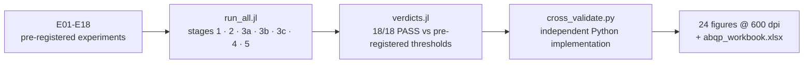

# AB Quantum Processor — Julia Research Program
> **🧭 Navigation:** [modules/](../README.md) · [AB_Cloud_Quantum_Research/](../../README.md) · [Root README](../../../README.md)



## 18 computational experiments for testing and developing the hypothesis

**Version:** 0.4.0 · **Language:** Julia 1.10+ · **Status:** EXECUTED — 18 experiments (E01–E18); all 18 pre-registered verdicts PASS; the obligations O-J1 (the height T=1000 + Riemann–Siegel) and O-J2 (class B: the compiler against strong baselines under equal constraints) are executed; the flagship is reproduced by an independent Python implementation.

The platform structure mirrors the processor-level specification of the AB Quantum Processor Program ([`../processor_ab/`](../processor_ab/README.md)): its `docs/theory.md`, `docs/methods.md`, `rpbridge/compiler.py`, `rpbridge/nonlocality.py`, `rpbridge/memory.py`, `rpbridge/alu.py`, `rpbridge/riemann_reader.py`, `scripts/compute_v20.py` and `claim_v20.json`; this module keeps its own `results/RESULTS.md` and `results/ROADMAP.md`.

### An important scientific delineation

The main result of V20 is the **numerical verification of the mathematical specification** of the compiler on 4×4 and 8×8 matrices. This by itself does not demonstrate a physically realized quantum processor. Memory, the ALU, zero reading and nonlocality are described as previews of future campaigns. In particular, the agreement of the simulation with the formula does not prove the Riemann hypothesis, physical topological protection, experimental nonlocality or a quantum advantage.

Therefore the program below separates:
- **implementation verification** — do the code and the mathematical specifications agree;
- **robustness verification** — does the conclusion survive noise, parameter changes and independent seeds;
- **hypothesis verification** — is there a pre-defined effect against strong null models;
- **a physical claim** — it would require a separate experimental device and an error model.

All 18 experiments below started as pre-registered proposals; the numerical results shown are committed (18/18 verdicts PASS) and are not invented.

## Quick start

1. Install Julia 1.10 or newer.
2. From the project root run:
   ```bash
   julia experiments/run_all.jl all   # the full E01–E18 run (stages: 1,2,3a,3b,3c,4,5)
   julia experiments/verdicts.jl      # verdicts against the pre-registered thresholds
   python3 scripts/cross_validate.py  # cross-language validation (mpmath+numpy)
   python3 scripts/make_figures.py    # 24 figures @600 dpi (ru/en)
   python3 scripts/build_workbook.py  # tables/abqp_workbook.xlsx (7 sheets)
   ```
3. Results are written to `results/` (CSV + JSON verdicts), the report — to `monograph/`.

## v0.4.0 results — the obligation O-J2, class B (new)

| Block | Result |
|---|---|
| **E18: the compiler against strong baselines** | an independent set of 69 targets + controls (seeds 41800+, disjoint from V20/E02); all methods — in one ISA (AB2 + PHASE), the numerical baselines — on the same slots (an equal primitive budget). ABQP: max 1−F = **4.4e−16** on 100% of the targets (threshold 1e−12); the primitive budget is no worse than BL1/BL2/BL4 on every target (permutation8: **36 against 148** for BL2 and 120 for BL4); the median time on Haar 4×4: **0.0039 ms against 232.2 ms** for coordinate descent — **×59,000** (threshold ×50); identity → **0 AB2 blocks**; a spoiled target compiles. Honestly: BL3 — a near miss of 3e−12 after 520,803 evaluations; the 2q context — the KAK optimum of 3 is outside the ISA class (ABQP max 10, no superiority is claimed) |

## v0.3.0 results — the obligation O-J1

| Block | Result |
|---|---|
| **E16: the Riemann–Siegel engine** | the F coefficients — from the integer recurrence of the Euler numbers (no hand-typed tables); the asymptotics U-turn truncation with step 2; the floor of the error is uniform (median 1.8e−17); agreement with Euler–Maclaurin at equal accuracy **≤ 3.8e−15** (threshold 1e−9); cost: the crossover ≈ t≈500, at t=10⁴ RS is 25 times faster than EM |
| **E17: blind ζ zeros up to T=1000** | detector A (EM): **649/649 zeros** on [0.3,1000]; detector B (RS): **639/639** on [50,1000]; precision = recall = 1 for both; cross-engine **0.0 (bitwise)**; N(1000) = **649.0** via the standard path (the argument principle) = the number found; max \|Δγ\| = 3.0e−10 (Gauss–Newton, threshold 1e−9); the detector before refinement: 2.3e−13 over all 649; Python replication [900,960]: 48/48, Δ = 2.3e−13 |

## v0.2.0 results (in brief)

| Block | Result |
|---|---|
| Compilation (E01–E04) | max (1−F) = 4.4e−16 (4×4) / 6.7e−16 (8×8); the O(d³) slope: b = 2.939 [2.63, 3.25]; a byte-for-byte replay |
| Noise/memory/codes (E05–E07) | σ* = 1e−5 rad; the three memory channels = the analytics; the (3,1) code: a CI-separable gain, the correlated control kills it |
| Arithmetic/phases (E08–E10) | the ALU 256/256 is bijective; the reversible adder: 0 errors on 87,380 inputs, Toffoli = 4n−2, CNOT = 10n−3 |
| **Blind ζ zeros (E11)** | **13/13 zeros on [0.3, 60]; max \|Δγ\| = 1.4e−14 against mpmath.zetazero; N(60) = 13.000000000000002; cross-language: a bitwise match (Δ = 0); a hand-typed γ12 erratum found** |
| Nonlocality (E12–E14) | the interferometer 6.7e−16; no-signaling 6.2e−16 (the CNOT control ≥ 0.062); S = 2.8291 ± 0.0014 vs the LHV max = 2 |
| Robustness (E15) | the discriminating signature: M1 ≈ 0, the M3 full quantum ≈ 0, the M3 semi-quantum = 0.309, the ablation = 0 |

Full tables: `results/RESULTS.md`; reports: `monograph/report_v040_{ru,en}.{pdf,docx}`
(the v0.3.0 reports `report_v030_{ru,en}.{pdf,docx}` are kept alongside);
roadmap: `results/ROADMAP.md`; provenance and boundaries: `PROVENANCE_AND_LIMITATIONS.md`.

## The map of 18 experiments

| № | Experiment | Main question | Key metric |
|---:|---|---|---|
| 01 | Control unitary matrices | Are the fidelity and the basic tests implemented correctly? | \(1-F\), the unitary residual |
| 02 | Haar compilation 4×4 and 8×8 | Is the claimed accuracy reproduced on fresh samples? | max/median/quantile \(1-F\) |
| 03 | Dimension scaling | How do the block count, time and memory grow? | time, gates, bytes |
| 04 | Independent seeds and replay | How reproducible are the results? | hash/ULP/distributions |
| 05 | Phase noise | How does the phase error affect the fidelity? | fidelity vs \(\sigma_\phi\) |
| 06 | Depolarization and dephasing of memory | How much information survives T steps? | the probability of a correct readout |
| 07 | Coding and error correction | Does the code give a gain against the uncoded control? | logical error rate |
| 08 | The full ALU sweep | Are the operations reversible and is the truth table correct? | the match fraction, collisions |
| 09 | Arithmetic and cost growth | How do the depth and the primitive count grow? | cost vs the bit width |
| 10 | Algebraic phases | Are the known phases restored without a lookup table? | circular error |
| 11 | ζ-zero reading: the blind protocol | Does the algorithm find zeros from a function, not from a table? | precision/recall, position error |
| 12 | The AB phase of the interferometer | Is the law \(P=\sin^2(\phi/2)\) reproduced? | max residual |
| 13 | No-signaling and marginals | Does the local marginal change with the remote choice? | trace distance |
| 14 | CHSH and null models | What are the correlations and the Bell inequality? | S, local bound, controls |
| 15 | Topological robustness and ablations | What survives local and global perturbations? | phase drift, effect size |
| 16 | The Riemann–Siegel engine (O-J1) | How independent is the second estimate of ζ and what does it cost? | agreement at equal accuracy, ms |
| 17 | Blind zeros up to T=1000 (O-J1) | Do both engines find all the zeros blindly? | precision/recall, N(1000), max \|Δγ\| |
| 18 | The compiler against strong baselines (O-J2) | Does the compiler win under equal ISA constraints? | max 1−F, the primitive budget, the median time |

## General pre-registration rules

Before launching each campaign, save:
- the hypothesis and the null hypothesis;
- the primary outcome and the PASS threshold;
- the parameters, the range and the number of repetitions;
- the development seeds separately from the final-test seeds;
- the criteria for excluding runs;
- the negative controls and the ablations;
- the code/commit hash before revealing the test set.

**Do not choose a threshold after looking at the results.** For distributions, report the median, the 5th/95th percentiles and a confidence interval, not only the best run. For a series of checks, account for multiple comparisons. PASS means only that this test passed in this model.

## Structure

- `experiments/run_all.jl` — the single entry point, standard libraries only.
- `experiments/experiment_01_15.md` — step-by-step protocols, formulas, criteria and limitations.
- `results/` — the machine results are written here.
- `Project.toml` — a minimal configuration.
