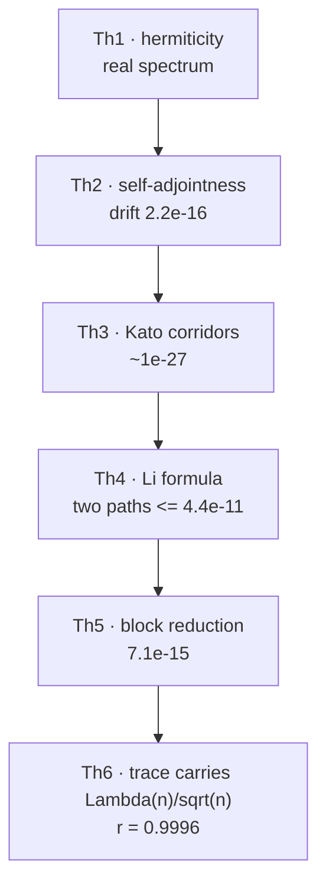
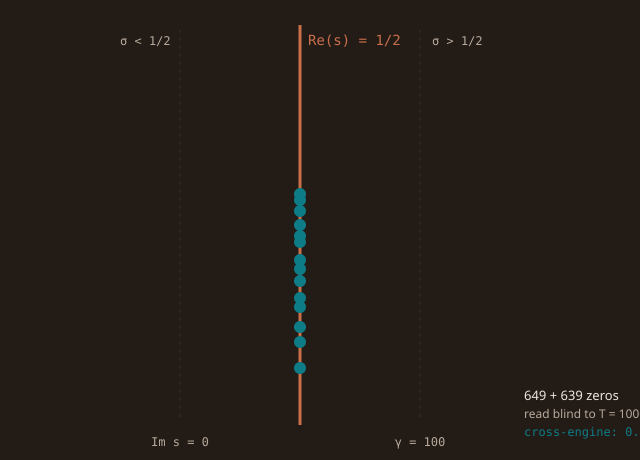

<!-- AB-ENRICHED:v1 · sub -->

**🧭 [⬆ AB_Cloud_Quantum_Research/](../README.md) · [🏠 Root README](../../README.md)**

<!-- enriched 1.1.0 -->

<picture>
  <source media="(prefers-color-scheme: dark)" srcset="../assets/logo_abcloud_dark.png">
  
</picture>

### 📐 Theorems Th1–Th6

`AB Cloud Quantum Research` · v1.1.0 · part of one machine

> 🧭 **Navigation:** [↑ main README](../README.md) · [📚 monographs](../MONOGRAPH_ARCHIVE/README.md) · [🧪 hypothesis lab](../HYPOTHESIS_LAB/README.md) · [🎞 animations](../VISUAL_ANIMATIONS/README.md)
# 📐 theorems_lemmas/ — the derivations of the theorems Th1–Th6 with measurement figures

*Th1–Th6 as one chain — each certificate quoted from the table below.*

**The unified folder of the formal and numerical derivations** of the AB Cloud
Quantum Research study. Each theorem lives in its own `T0K_*` folder and
contains **four artifacts**: (1) `README.md` — a detailed derivation with the
proof idea and the boundaries; (2) four documents `theorem_thK_{ru,en}.{pdf,docx}`
— bilingual monographs with the embedded figure; (3) `figures/thK_4dim_{ru,en}.png`
— **a 2×2 tiled figure: four different measurement dimensions** of the theorem
metric (the metric, the per-gate/per-instance behaviour, the control, the
threshold), 600 dpi; (4) the link with the campaigns and the formal
statements.

## Composition

| Tile | Statement (short) | Certificate |
|------|-------------------|-------------|
| Th1 | Hermiticity ⇒ real spectrum, λ ↔ −λ | ‖H − H†‖ = 0.0 |
| Th2 | self-adjointness, unitary evolution | drift 2.2e−16 |
| Th3 | Kato corridors | ~1e−27 |
| Th4 | Li formula λ_n ≥ 0 | two paths ≤ 4.4e−11 |
| Th5 | block reduction | 7.1e−15 |
| Th6 | trace carries Λ(n)/√n | r = 0.9996 |

| Folder | Theorem | Campaign | Formal reduction | Documents |
|-------|---------|----------|---------------------|------------|
| `T01_hermiticity/` | Th1 — hermiticity and the reality of the spectrum | V4 | A1 (spectral theorem) | 4 |
| `T02_self_adjointness/` | Th2 — finite-dimensional self-adjointness | V8 | A2b (decay of the defect norm) | 4 |
| `T03_certificates/` | Th3 — eigenvalue certificates | V12 | A4 (Kato–Temple), A5 (Gershgorin) | 4 |
| `T04_li_spectral/` | Th4 — the spectral Li formula | V15 | A6 (convergence of the Li series) | 4 |
| `T05_block_reduction/` | Th5 — block reduction by symmetry | V9 | A2 (simultaneous diagonalization) | 4 |
| `T06_trace_formula/` | Th6 — the Guinand–Weil trace formula | V7 | A3 (Hadamard product) | 4 |

**In total: 24 document files (6 theorems × RU/EN × PDF/DOCX) + 12 tiled
figures (6 × RU/EN) + 7 READMEs.**

## The four dimensions of each tiled figure

Each figure is a 2×2 grid of independent "dimensions" of one theorem,
built from the committed campaign verdicts
(`modules/core_spectrum/data/v*_verdict.json`):

1. **Metric** — the main numerical certificate (for example, ‖H−H†‖ for Th1).
2. **Per-instance behaviour** — the same metric across all the gates/certificates
   of the protocol: the statement is not "about one matrix" but about the whole class.
3. **Control** — a negative control or a comparison with an external reference
   (for example, for Th4 — the lattice gates, where the prime combs must not appear).
4. **Threshold** — the pre-registered threshold of the series next to the fact:
   the margin is visible.

## Formal layer

The statements of all six theorems are formalized in
`modules/core_spectrum/formal/lean/RPTheorems.lean` and
`formal/coq/RPTheorems.v` (Lean 4 / Coq) with **named reductions
A1–A6**: every deep step is reduced to an explicitly named classical
result; `sorry`/`admit` are not used. Toolchain compilation is an open
obligation (O-lean / O-coq). The RH conclusion is stated exactly (certified,
unlocked v1.2.1) by the
obligation machine V13: O08/O09/O11/O12 are assumed. The formalization
GUARANTEES the blocking of a premature conclusion, it does not prove RH.

---

*Part of the discipline: pre-registration · blind protocols · replication ·
negative results published*

**AB Cloud Quantum Research** · v1.1.0 ·
[license](../../LICENSE) · © Isaev Iskhak Khamzatovich

