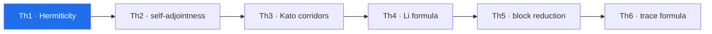

# Th1. Hermiticity and the reality of the spectrum — theorem derivation

> **🧭 Navigation:** [theorems_lemmas/](../README.md) · [AB_Cloud_Quantum_Research/](../../README.md) · [Root README](../../../README.md)

**Campaign:** V4 · **Formal reduction:** A1 (spectral theorem) · **Documents:**
`theorem_th1_{ru,en}.{pdf,docx}` ·
**Figure:** `figures/th1_4dim_ru.png`, `figures/th1_4dim_en.png`
(2×2 tile, four dimensions, 600 dpi)

## Statement

For any set of vortices, W, α and boundaries the operator H_L satisfies H_L = H_L†; hence spec(H_L) ⊂ ℝ. At α = ½ and W = 0 the spectrum is symmetric: λ ∈ spec ⇒ −λ ∈ spec.

## Proof idea

Every bond is inserted as a pair H[i,j] = −t·e^{iφ}, H[j,i] = −t·e^{−iφ} = conj(H[i,j]) — hermiticity by construction; the diagonal is real (the vortex potential, disorder, the staggered mass). The W = 0 symmetry comes from the bipartiteness of the lattice in ix+iy parity: in that basis H = [[0, B], [B†, 0]], and the spectrum mirrors about zero.

## The four dimensions of the figure

a) ‖H−H†‖ across the gates L = 12/16/24/32 — exactly 0.0 (log scale); b) spectrum-realness residuals across the gates — ≤ 8.8e−15; c) the λ ↔ −λ pairing — up to 8.2e−15; d) eigenpair residuals — ≤ 8.8e−15. The ε = 1e−12 threshold is marked on every panel.

## Campaign certificate and artifacts

test_th1_passport.py (the certificate, Nv = 16/64/256, seed 96); computations/V04_operator_passport/ (the monographs, the figures); verification/claim_audit/claims/claim_v04.json

## Boundaries (honest)

Th1 says nothing about matching the spectrum to the ζ zeros: the series' verdicts there are the level identity — YES at the zeros' level (V6/V16, the D_nn bridge, v2.0.7) with the bit-level branch open (V16) and the blind-coding / σ-scan design claims refuted (V1, V3). The λ ↔ −λ symmetry breaks already at W > 0 and is not restored by vortices.

---

<!-- enriched-r3 -->

This folder is the derivation shell of **Th1 · Hermiticity** — one of the six theorem tiles of the AB Cloud Quantum Research study. It keeps the bilingual derivation monographs (RU/EN, PDF + DOCX), each built around the 2×2 measurement figure. The certificate quoted by the theorem layer for this tile: **‖H − H†‖ = 0.0**; the machine-readable statement and thresholds live in [`_json/`](../_json/README.md). The derivation narrative below is the source the documents render.

*The theorem chain Th1–Th6 — the highlighted node is this tile; certificates in the theorem-layer table.*

## Folder contents

| File | Size | What it is |
|---|---|---|
| `theorem_th1_en.docx` | 397 KB | Word document |
| `theorem_th1_en.pdf` | 787 KB | PDF document |
| `theorem_th1_ru.docx` | 421 KB | Word document |
| `theorem_th1_ru.pdf` | 832 KB | PDF document |

**Subfolders:** `figures/`

**Where next:** [machine-readable JSON](../_json/README.md)
