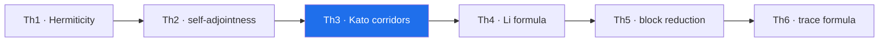

# Th3. Eigenvalue certificates — theorem derivation

> **🧭 Navigation:** [theorems_lemmas/](../README.md) · [AB_Cloud_Quantum_Research/](../../README.md) · [Root README](../../../README.md)

**Campaign:** V12 · **Formal reduction:** A4 (Kato–Temple), A5 (Gershgorin) · **Documents:**
`theorem_th3_{ru,en}.{pdf,docx}` ·
**Figure:** `figures/th3_4dim_ru.png`, `figures/th3_4dim_en.png`
(2×2 tile, four dimensions, 600 dpi)

## Statement

For Hermitian H, a computed λ̃, a unit v with residual r = Hv − λ̃v, δ = ‖r‖ and the gap to the nearest other level, there exists λ̂ ∈ spec H with |λ̂ − λ̃| ≤ δ²/gap; the whole spectrum lies in the union of the rational Gershgorin intervals.

## Proof idea

Decomposing v = c·u + w with u a normalized eigenvector gives ‖w‖ ≤ δ/gap and the quadratic superconvergence |λ̂ − λ̃| ≤ δ²/gap. Gershgorin: the radii R_i = Σ_{j≠i}|H_ij| in exact rational arithmetic (fractions, limit_denominator 1e12) — rounding-free intervals.

## The four dimensions of the figure

a) the residual δ across the five certificates (log); b) the Kato bound δ²/gap (log); c) the interval widths hi−lo — ~1e−27 (mpmath dps 40); d) the Gershgorin coverage [−4.210, 4.205] with 144 intervals and the λ̃ positions.

## Campaign certificate and artifacts

test_th3_certificates.py (hitting, coverage, reproducibility); computations/V12_interval_certificates/; claim_v12.json

## Boundaries (honest)

The bound is quadratic in δ — an already well-converged λ̃ is required; for close levels the gap is small and the interval widens; rational arithmetic is slow — the layer is applied pointwise.

---

<!-- enriched-r3 -->

This folder is the derivation shell of **Th3 · Kato corridors** — one of the six theorem tiles of the AB Cloud Quantum Research study. It keeps the bilingual derivation monographs (RU/EN, PDF + DOCX), each built around the 2×2 measurement figure. The certificate quoted by the theorem layer for this tile: **~1e−27**; the machine-readable statement and thresholds live in [`_json/`](../_json/README.md). The derivation narrative below is the source the documents render.

*The theorem chain Th1–Th6 — the highlighted node is this tile; certificates in the theorem-layer table.*

## Folder contents

| File | Size | What it is |
|---|---|---|
| `theorem_th3_en.docx` | 483 KB | Word document |
| `theorem_th3_en.pdf` | 973 KB | PDF document |
| `theorem_th3_ru.docx` | 515 KB | Word document |
| `theorem_th3_ru.pdf` | 1.0 MB | PDF document |

**Subfolders:** `figures/`

**Where next:** [machine-readable JSON](../_json/README.md)
