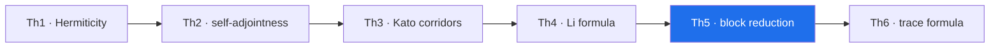

# Th5. Block reduction by symmetry — theorem derivation

> **🧭 Navigation:** [theorems_lemmas/](../README.md) · [AB_Cloud_Quantum_Research/](../../README.md) · [Root README](../../../README.md)

**Campaign:** V9 · **Formal reduction:** A2 (simultaneous diagonalization) · **Documents:**
`theorem_th5_{ru,en}.{pdf,docx}` ·
**Figure:** `figures/th5_4dim_ru.png`, `figures/th5_4dim_en.png`
(2×2 tile, four dimensions, 600 dpi)

## Statement

If [H, A] = [H, B] = 0 for the generators of the abelian group G of magnetic translations, then H is block-diagonal in the decomposition by the characters χ of the group G and spec H = ⊔_χ spec(H|Π_χ Π_χ).

## Proof idea

The commuting unitaries A, B are simultaneously diagonalized; the joint eigenvalues are the characters χ: G → U(1); the projectors Π_χ (polynomials in A, B) commute with H, each Π_χℂ^N is invariant, and H splits into a direct sum of restrictions. Consequence: the spectrum is sought in blocks of ~L²/6 instead of L².

## The four dimensions of the figure

a) the clean-lattice commutators ε_Ux/ε_Uy/ε_AB/off-block (log) — ~9e−15; b) the block-union error 7.1e−15 against the 1e−9 threshold; c) vortices: the commutators over 4 twists — ε ~ O(1), the symmetry is broken (a negative control); d) the mean r over the twists ≈ 0.6.

## Campaign certificate and artifacts

test_th5_block_reduction.py; computations/V09_symmetry_reduction/; claim_v09.json

## Boundaries (honest)

For asymmetric vortex placements the reduction does not apply — this is a boundary of the scope, not a defect; partially symmetric configurations give approximate invariant subspaces (not included in the package).

---

<!-- enriched-r3 -->

This folder is the derivation shell of **Th5 · block reduction** — one of the six theorem tiles of the AB Cloud Quantum Research study. It keeps the bilingual derivation monographs (RU/EN, PDF + DOCX), each built around the 2×2 measurement figure. The certificate quoted by the theorem layer for this tile: **7.1e−15**; the machine-readable statement and thresholds live in [`_json/`](../_json/README.md). The derivation narrative below is the source the documents render.

*The theorem chain Th1–Th6 — the highlighted node is this tile; certificates in the theorem-layer table.*

## Folder contents

| File | Size | What it is |
|---|---|---|
| `theorem_th5_en.docx` | 428 KB | Word document |
| `theorem_th5_en.pdf` | 881 KB | PDF document |
| `theorem_th5_ru.docx` | 440 KB | Word document |
| `theorem_th5_ru.pdf` | 916 KB | PDF document |

**Subfolders:** `figures/`

**Where next:** [machine-readable JSON](../_json/README.md)
