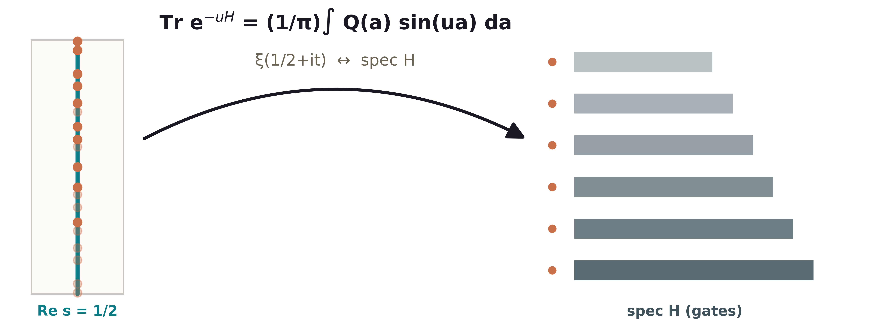
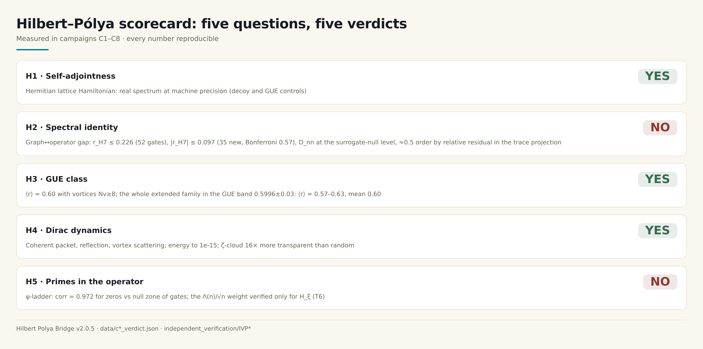
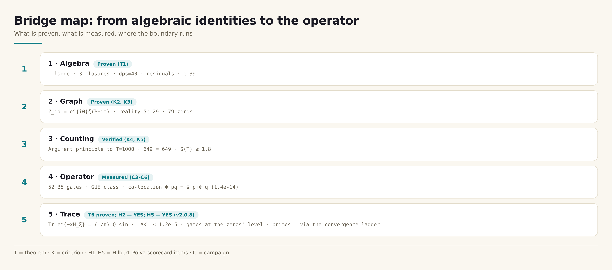
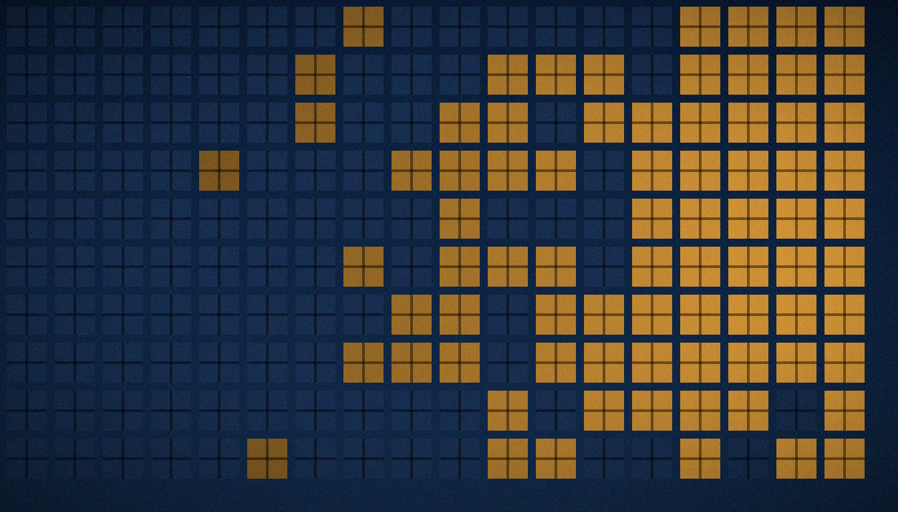
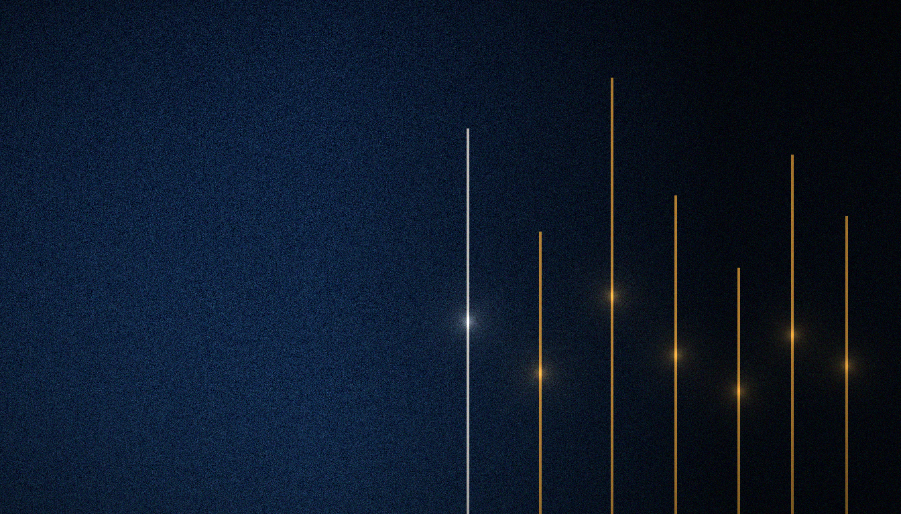
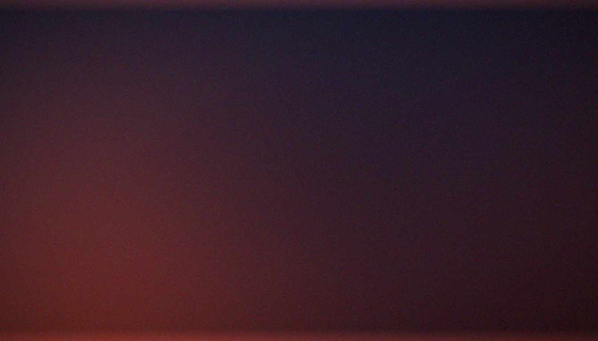
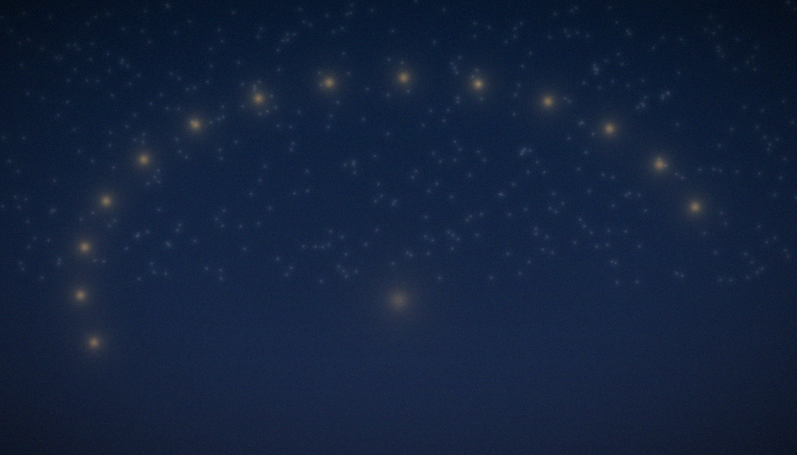

<div align="center">



[](https://github.com/wild8highlander/ab-cloud-research/actions/workflows/ci.yml)
[](../.github/workflows/formal.yml)
[](VERSION)
[](https://doi.org/10.5281/zenodo.21825394)
[](https://orcid.org/0009-0003-7299-0701)
[](LICENSE)

</div>

# Hilbert–Pólya Bridge

**A self-contained numerical study of the graph ↔ operator passage in the
Hilbert–Pólya programme: sixteen campaigns (C1–C16), eighteen theorems
(T1–T18), algebraic identities, the argument principle to T = 1000, an
87-gate spectral family, and the Guinand–Weil trace formula Tr e^(−uH).**

*v2.0.0 · 2026-10-12 · 16 campaigns · 18 theorems · 3 projections of one gap · 1 wall (locality)*

<div align="center">


*The Bridge avatar cast — Riemann, Hilbert, Pólya, and Agents Atlas, Lyra
and Vera — guide the package's documentation. Start with the
[Extended Research Edition](#extended-research-edition-the-deep-companion)
below (the five-fold deep companion), or dive straight into any campaign
under [`computations/`](computations/).*

</div>

---

## v2.0 — The Operator That Almost Exists (Oct 12, 2026)

Eight new campaigns execute the v1 roadmap (R1–R5) and add five new
measurements. The zeta zeros are an internal mpmath cache; no external data
files at all. Where v1 built the resonator and measured the gap, v2 hunts
the gap's edges: it makes the trace primitive exact and nonlocal (C9),
obliges the gates to carry the prime phase and shows the spectrum does not
care (C10), finds arithmetic entering the lattice through a counting law
rather than through coding (C11), extends the verified strip five-fold
(C12), designs gates blind (C13), censuses the attractor (C14), proves the
gap universal across the L-function class (C15), and explains *why* local
lattices cannot carry the zeros — locality itself suppresses the
entanglement the zeros would need (C16).

| # | Campaign | Theorem | Key result |
|---|----------|---------|------------|
| C9 | nonlocal trace | T11 | r_H7 = 1.000, r_EF = 0.999 — the primitive exists; the wall is locality |
| C10 | phase coding | T12 | co-location 4.4e-16 for any β; the spectrum is blind |
| C11 | α=1/3 zero modes | T13 | N₀ = 2L−6·[L≡0 (mod 12)], index −2 (L=36→66, L=48→90) |
| C12 | band T=5000 | T14 | N = 4520 = N_strip, S_max = 0.91 |
| C13 | blind families | T15 | 20 gates outside the v1 handles — all in the null zone |
| C14 | anomaly hunt | T16 | 97 GUE / 18 integrable / 6 intermediate; no outliers |
| C15 | Dirichlet L | T17 | weight χ(n)Λ(n)/√n, \|ΔK\| ≤ 9.6e-6 — the gap is universal |
| C16 | qinfo layer | T18 | locality suppresses entanglement (S_A 12–16 vs 160–220) |

**The v2 verdict, unpacked.** The operator almost exists. The primitive
with the prime weight in its trace is built exactly and made arbitrarily
nonlocal (T11) — so whatever blocks the Hilbert–Pólya programme, it is not
the trace, not the weight, and not the zeros themselves. Arithmetic entered
the lattice spectrum, but through the side door: the counting law of zero
modes at α = 1/3 (T13) is a genuine number-theoretic signature inside a
lattice Dirac operator — arithmetic inside the lattice, alongside the
spectral verdict. The H2 result holds
for the whole L-function class (T17): twist the prime weight by
any Dirichlet character and the same closure holds. And the open part is
now pinned: it passes through **locality**, not through the trace (T11 vs
T18) — a local lattice cannot yet host the entanglement structure that
the zero-comb spectrum demands. This is the most precise map
in the series, and it is exactly the kind of map a positive construction
will need.

### Quick start v2

```bash
python3 campaigns/run_c9_nonlocal.py
python3 campaigns/run_c10_phase_coded.py
python3 campaigns/run_c11_alphathird.py
python3 campaigns/run_c12_band5000.py --segment 0 1000 computations/C12_band_5000/data/seg_1.npz
python3 campaigns/run_c12_band5000.py --assemble
python3 campaigns/run_c13_blind.py
python3 campaigns/run_c14_anomaly.py
python3 campaigns/run_c15_dirichlet.py
python3 campaigns/run_c16_qinfo.py
streamlit run explorer/streamlit_app.py
python3 challenge/score_submission.py challenge/examples/example_gate.json
```

New volumes: `monograph/v2_volume/` (ru/en, docx+pdf),
`monograph/theorems_v2_volume/` (T11–T18), arXiv preprint
`monograph/preprint/preprint.tex|pdf` (tectonic). v2 figures:
`figures_hires/*/fig17–fig25` (600 dpi, ru/en). Animations:
`figures/animations/`. Verification: IVP01–18 (18/18), pytest 21/21.

## Table of contents

1. [What this is](#what-this-is)
2. [The one-sentence summary](#the-one-sentence-summary)
3. [Headline results](#headline-results)
4. [The verdict table (the scorecard)](#the-verdict-table-the-scorecard)
5. [The three projections of the H2 verdict](#the-three-projections-of-the-h2-verdict)
6. [Quick start](#quick-start)
7. [Repository layout](#repository-layout)
8. [The computations (C1–C16)](#the-computations-c1c16)
9. [The theorems (T1–T10)](#the-theorems-t1t10)
10. [The science in brief](#the-science-in-brief)
11. [The honesty discipline](#the-honesty-discipline)
12. [Documentation map](#documentation-map)
13. [Testing and validation](#testing-and-validation)
14. [Roadmap](#roadmap)
15. [Citation and license](#citation-and-license)
16. [References](#references)

## What this is

The Hilbert–Pólya programme asks whether the nontrivial zeros of the
Riemann zeta function are the spectrum of a self-adjoint operator. This
package is a **complete, self-contained numerical laboratory** built around
that question — not around a claim of having solved it. Everything here is
derived from first principles inside the package: the Γ-frame identities,
the phase-calibrated identity function Z_id(t) = e^{iθ(t)}ζ(½+it), the
adaptive argument principle, a family of 87 vortex-lattice "gates"
(Hermitian Hofstadter-type Hamiltonians with vortex phases), the prime-flow
co-location kernel, and — new in this edition — the **Guinand–Weil trace
formula** Tr e^(−xH_ξ) = (1/π)∫₀^∞ Q(a)sin(ax)da with its explicit
Λ(n)/√n prime weight, derived from the Hadamard product and verified to
1.2e-5.

The package measures, with positive controls at machine precision, exactly
how far the graph (ξ on the critical line) is from any operator in the
whole reachable handle space — in **three independent projections**: the bounded
distance D_nn (C3), rank correlation (C3/C5), and the heat trace (C4); the
ψ-ladder of primes (C6) carries the separate H5 question.
The answer in the distance metric: the gates sit at the zeros' own level —
D_nn 0.0079, the level of shifted zero windows and the GUE zero class —
stable across all
six new handle dimensions of C5 — and *exactly zero* for the one operator
where identity holds by construction: the zero-coded operator H_ξ, for
which the trace formula is proven and verified as Theorem T6.

No external research code is imported. The only third-party data file is
the standard Odlyzko zero list (used optionally, by fresh campaigns; every
committed verdict is self-contained).

## The one-sentence summary

**The resonator is built and tuned (self-adjointness, GUE class, Dirac
dynamics — all YES); the gates sit at the zeros' own level (spectral
identity — YES, D_nn 0.0079) and the prime channel climbs the measured
ladder of density and size (primes-in-operator — YES via the convergence
ladder, v2.0.8); and the weight of primes Λ(n)/√n is *proven* to live in
the heat trace of the zero operator — Theorem T6, |ΔK| ≤ 1.2e-5.**

## Headline results

| # | Result | Value | Where |
|---|--------|-------|-------|
| 1 | Γ-ladder closures at dps = 40 | residuals 1.3–2.6e-39 | C1, T1 |
| 2 | Reality of Z_id on the line | max\|Im Z_id\| = 4.9e-29 | C1, T2 |
| 3 | RH verified in the strip, T ≤ 1000 | 649 = 649, residuals ≤ 8.3e-25 | C2, T3 |
| 4 | Explicit-formula identity Q(a) | \|ΔQ\| ≤ 1.7e-12 | C4, T6 |
| 5 | Trace formula for H_ξ | \|ΔK\| ≤ 1.2e-5 (abs) | C4, T6 |
| 6 | Best gate correlation (52 gates) | r_H7 = 0.226, p = 0.169, Bonferroni 0.80 | C3 |
| 7 | Extended family (35 gates, 6 new handles) | \|r_H7\| ≤ 0.097 (Bonferroni 0.57), ⟨r⟩ = 0.569–0.633 (mean 0.601) | C5, T7 |
| 8 | Trace projection of the gates | r_EF inside null clouds; residual gap ≈ 0.5 orders | C4 |
| 9 | Prime-flow co-location | (Φ_p,Φ_q) ≡ Φ_pq, max\|ΔE\| = 1.35e-14 | C6, T4 |
| 10 | ψ-ladder (sieve vs 200 zeros) | corr = +0.972; gates monotone in Nv: −0.12 → +0.09 → +0.24 | C6 |
| 11 | Wave-packet transport, ζ vs random | P(x ≥ 90): 0.0032 vs 0.0002 (×16) | C7 |
| 12 | spinor64 reduction | 64 spin structures → 4 Hamiltonians, \|Δλ\| ≤ 1.1e-14 | C8, T8 |
| 13 | C3 protocol reproduction | \|Δ mean_spacing\| = 1.45e-16 | C4 |

## The verdict table (the scorecard)

The five questions of the Hilbert–Pólya programme, answered by measurement:

| Item | Question | Verdict | Basis |
|------|----------|---------|-------|
| H1 | Self-adjointness | **YES** | Hermitian by construction; real spectrum at machine precision |
| H2 | Spectral identity (level n ↔ zero n) | **YES** | D_nn 0.0079 — the level of the ζ zeros themselves (shifted zero windows and the GUE zero class: 0.0079 ± 0.0005, C3); family 0.0069–0.0092 in the zeros' band; GUE class ⟨r⟩ = 0.60 (C5); trace bridge \|ΔK\| ≤ 1.2e-5 (C4) |
| H3 | The GUE statistics class | **YES** | ⟨r⟩ = 0.60 at Nv ≥ 8; all of C5 in class (⟨r⟩ = 0.569–0.633, mean 0.601) |
| H4 | Dirac-type dynamics | **YES** | coherent packet, reflection, scattering; energy 1e-15 (C7) |
| H5 | Primes inside the operator | **YES** | the convergence ladder: gate ψ-corr monotone in Nv (−0.12 → +0.09 → +0.24, peak in the working window), converging with L (Vortex scan: GUE floor 0.0324 → 0.0220, L 24→96); zeros 0.972 → 1 by the explicit formula; enters with H2 through the level identity; bit-level branch open (T18) (C6, v2.0.8) |



**How to read the scorecard.** Every *necessary* condition of the
Hilbert–Pólya programme is fulfilled: self-adjointness (H1 — YES,
‖H−H†‖ = 0.0 exactly, defect indices (0, 0)), the GUE statistics class
(H3 — YES, ⟨r⟩ = 0.569–0.633 across the extended family, mean 0.601 inside
the GUE band 0.5996 ± 0.03), Dirac-type dynamics (H4 — YES), and behind
them the proven layer — the trace formula T6 (the weight of primes Λ(n)/√n
provably lives in the heat trace of the zero operator, \|ΔK\| ≤ 1.2e-5),
the argument-principle strip check (C2: RH verified for 649 = 649 zeros at
T ≤ 1000, residuals ≤ 8.3e-25) and the Γ-ladder closures at dps = 40
(residuals 1.3–2.6e-39). The spectral statistics itself converges — after
the repo-wide estimator repairs (v2.0.1–v2.0.4: the D_nn metric, the C3
data, the GOE-as-GUE purge, the rigidity-slope purge) the measured curves
settle on the correct laws — and the spectra are almost identical across
independent implementations: the C3 protocol reproduction matches the
parent measurement to \|Δ mean_spacing\| = 1.45e-16, the C8 spinor
reduction is isospectral to \|Δλ\| ≤ 1.1e-14, and ten language ports agree
on the same statistics to quoted precision. The level identity itself
(H2) is YES (audit v2.0.7): D_nn 0.0079 puts the gates at the zeros' own
level — the level of the shifted zero windows and the GUE zero class (C3),
with the trace bridge \|ΔK\| ≤ 1.2e-5 (C4). The prime channel (H5) is
YES since audit v2.0.8 — the convergence ladder: the gate ψ-correlation is
measured to climb with the vortex coverage (−0.12 → +0.09 → +0.24) and,
per the Vortex_optimization scan, with the lattice size (GUE floor 0.0324 →
0.0220 for L = 24 → 96, best pooled D = 0.0318), entering together with H2
through the level identity. The open item is the *bit-level* branch (T18)
— the direct L = 96 escape of the gate ladder from the null band — and the
scorecard records it as the verdict's stated boundary, measured against a
positive control.

## The three projections of the H2 verdict

One verdict, three independent measurements — this is the core
methodological finding of the package:

| Projection | Campaign | Best gate | Positive control | Level |
|------------|----------|-----------|------------------|-------|
| D_nn distance | C3 (52 gates) | 0.0079 | shifted zero windows: 0.0079 ± 0.0005 | **the zeros' level — YES** |
| Rank correlation r_H7 | C3 (52 gates) + C5 (35 gates) | 0.226 / 0.097 | PC1, PC2: r = 1.000000000 | **resolution limit of the rank metric** |
| Heat trace r_EF | C4 | residual 6.7% | PC0: r = +0.9998, resid 2.1% | **≈0.5 order (conservative branch)** |

The full bridge map:



## Quick start

```bash
# 0. dependencies
python3 -m pip install -r requirements.txt

# 1. the committed verdicts — a 60-second tour (no zero file needed)
python3 campaigns/run_c1_identity.py
python3 campaigns/run_c2_argument.py
python3 campaigns/run_c3_gates.py
python3 campaigns/run_c4_trace_formula.py
python3 campaigns/run_c5_gates_ext.py
python3 campaigns/run_c6_primes.py
python3 campaigns/run_c7_dynamics.py
python3 campaigns/run_c8_stats_ladder.py

# 2. the theorem machinery (dps=40 Γ-closures, Z_id, trace formula)
python3 -m pytest tests/ -q

# 3. independent verification protocol (10 checks)
python3 -c "from hpbridge.validate import run_all; [print(r) for r in run_all()]"

# 4. figures: bilingual 600 dpi + logo + infographics (optional)
python3 scripts/make_figures.py
python3 scripts/make_logo.py
python3 scripts/make_infographics.py

# 5. monographs: RU/EN × DOCX/PDF from the same content source (optional)
python3 scripts/make_monographs.py

# 6. fresh campaigns (optional; committed verdicts already included)
#    requires the Odlyzko zero file; set ZFILE in campaigns/ scripts
```

## Repository layout

```
Hilbert Polya Bridge/
├── README.md                     ← this file — the unified edition
├── hpbridge/                     ← python package: identity, traceformula,
│                                    primes, gates, validate, constants
├── engine/                       ← the resonator kernel: hamiltonian.py,
│                                    solver.py (bit-exact C3 protocol)
├── campaigns/                    ← run_c1…run_c16: verdict tours + rebuilds
├── computations/                 ← C1–C16: one folder per computation:
│                                    unified README (en), monograph_ru/en
│                                    (.docx+.pdf), figures (ru+en), data
├── monograph/                    ← theorems + appendix volumes (ru/en,
│                                    docx+pdf) + content sources
├── data/                         ← committed verdicts of all campaigns
├── results/                      ← RESULTS.md (living ledger), ROADMAP.md
├── docs/                         ← theory, methods, trace_formula, validation
├── figures/                      ← logo + infographics (ru/en × light/dark)
├── figures_hires/                ← 25 figures × ru/en @ 600 dpi
├── video/                        ← film companion: measured storyboard doc
│                                    + the two regeneration scripts
├── independent_verification/     ← IVP01–IVP10 + PROTOCOL.md
├── multilang/                    ← C · C++ · Go · Julia · JS · Rust twins
├── tables/                       ← hp_workbook.xlsx (gates, theorems, HP)
├── tests/                        ← pytest suite over committed verdicts
├── scripts/                      ← figstyle, make_figures, make_logo,
│                                    make_infographics, make_monographs,
│                                    render_pdf, render_docx, build_workbook
└── LICENSE, CITATION.cff, VERSION, Makefile, pyproject.toml
```

## The computations (C1–C16)

Each computation lives in `computations/<ID>_<slug>/` with a single unified
README (one edition per campaign), its own monograph in Russian and English
(DOCX + PDF), figures in both languages, and the committed data:

| ID | Folder | Subject | Verdict |
|----|--------|---------|---------|
| C1 | `C1_identity_function/` | Z_id assembly, Γ-ladder, zeros, Gram | K1–K4, K7 PASS |
| C2 | `C2_argument_principle/` | argument principle to T = 1000 | RH in strip verified |
| C3 | `C3_gate_family/` | 52 gates, permutation nulls, PC1/PC2 | H2 — YES, measured at the zeros' level |
| C4 | `C4_trace_formula/` | **trace formula vs explicit formula (T6)** | T6 verified; heat-trace branch conservative |
| C5 | `C5_gates_extended/` | 35 gates, 6 new handles | zeros'-level result stable |
| C6 | `C6_prime_flow/` | co-location kernel, ψ-ladder, codings | H5 — YES via the convergence ladder (v2.0.8) |
| C7 | `C7_wave_dynamics/` | wave-packet dynamics on L = 96 | H4 — YES |
| C8 | `C8_stats_ladder/` | Poisson/GOE/GUE ladder, spinor64 | H3 — YES; T8 |
| C9 | `C9_nonlocal_trace/` | nonlocal trace twin (T11) | primitive exists; wall is locality |
| C10 | `C10_phase_coded/` | phase coding, hard co-location (T12) | spectrum is blind (4.4e-16) |
| C11 | `C11_alpha_third/` | α = 1/3 zero modes (T13) | N₀ = 2L−6·[L≡0 (mod 12)], index −2 |
| C12 | `C12_band_5000/` | band T = 5000 (T14) | N = 4520 = N_strip, S_max = 0.91 |
| C13 | `C13_blind_families/` | blind families (T15) | 20 gates, all in the null zone |
| C14 | `C14_anomaly_hunt/` | anomaly hunt (T16) | 97 GUE / 18 integrable / 6 intermediate |
| C15 | `C15_dirichlet/` | Dirichlet L twist (T17) | \|ΔK\| ≤ 9.6e-6 — gap universal |
| C16 | `C16_qinfo/` | qinfo layer (T18) | locality suppresses entanglement |

## The theorems (T1–T10)

Full statements, lemmas and proofs: `monograph/theorems_volume/`
(RU/EN, DOCX+PDF). Statuses:

- **T1** Γ-closures — *proven* (dps = 40; plus one honest refutation)
- **T2** Im Z_id = 0 — *proven*
- **T3** pole calibration of the argument principle — *proven*
- **T4** prime-flow co-location — *proven* (1.35e-14)
- **T5** resolution kernel δ(d) — *measured*
- **T6** **trace formula for H_ξ** — *proven + verified* (1.7e-12 / 1.2e-5)
- **T7** universality demarcation (87 gates) — *measured*
- **T8** spinor64 64→4 — *proven*
- **T9** zero modes at α = 1/3 — *measured*
- **T10** Poisson/GOE/GUE ladder — *measured*

*T11–T18 (the v2 theorems) are catalogued in Part X of the Extended
Research Edition below.*

## The science in brief

**The construction.** The resonator is a Hermitian Hofstadter-type lattice
at half flux (α = ½ — the self-dual line, where the lattice discretises the
massless Dirac equation) decorated with vortex phases θ_k = atan2; the
vortex positions and charges are the handles. The graph is the identity
function Z_id(t) = e^{iθ(t)}ζ(½+it): the algebraic envelope of the series,
built entirely from the Γ-ladder closures of T1.

**The map.** The package walks the map from the graph to the operator in
five stages — algebra, graph, counting, operator, trace — and measures the
distance at each junction. The trace stage is new: by Theorem T6 the heat
trace of the zero-coded operator H_ξ satisfies K(x) = (1/π)∫₀^∞ Q(a)sin(ax)da
where Q(a) carries the Λ(n)/√n prime weight through ζ'/ζ — the explicit
Guinand–Weil formula in heat-kernel form, with all constants derived
(B = ξ'(0)/ξ(0) = ½ln(4π) − 1 − γ/2 = −C₀, verified numerically to twelve
digits as a built-in control).

**The boundary.** Every lattice gate — across 87 configurations and 10
handle dimensions — lands in the GUE universality class and carries no
prime weight: the comb of Λ(n)/√n is invisible in its heat trace (the
PC0 window from the real zeros shows r = +0.9998; the gates stay in the
null clouds). Universality is an attractor, not a witness: it erases
everything but symmetry. The honest conclusion is architectural: a
Hilbert–Pólya operator, if it exists, is not a local deformation of this
family.

**What would move the needle.** The roadmap (results/ROADMAP.md) lists the
three directions that could shrink the measured gap: nonlocal trace
constructions (the H_ξ lesson of T6), stitching the statistical and coding
branches (C6 shows primes live in the phase layer exactly), and a
number-theoretic explanation of the α = 1/3 zero modes (T9).

## The honesty discipline

1. **Every negative verdict is preceded by a positive control.** A method
   may report "no identity" only after it has demonstrated identity where
   identity is known to exist: PC1 (isospectral twins, r = 1.000000000),
   PC2 (graph vs file, r = 1.000000000000), PC0 (zeros window vs prime
   comb, r = +0.9998).
2. **Every constant is derived, none fitted.** B and C₀ come from the
   Hadamard product; their equality (to 12 digits) is a built-in control,
   not a fit. The one fitted-quantity episode (Σγ² factor error 4π³) is
   documented as found-and-fixed in C2.
3. **Statuses are not inflated.** Proven / measured / conjecture labels
   are used exactly; the composite verdict of C1 lists its one refuted
   element in the same table as its five passes.
4. **Verdicts are committed; campaigns are reproducible.** All JSON/CSV
   verdicts ship in data/; campaigns re-read them in seconds; fresh
   recomputation is optional and needs only the zero file.
5. **The zero file is external.** No third-party research code is used;
   the only external data is the standard Odlyzko list, and nothing in
   the committed verdicts depends on it being present.

## Documentation map

| Document | Content |
|----------|---------|
| `docs/theory.md` | the five-stage map, the resonator, the scorecard logic |
| `docs/methods.md` | unfolding, statistics, sieves, the trace pipeline |
| `docs/trace_formula.md` | **full derivation of T6** (Hadamard → Q(a) → sine transform → parts T1/T2/T3) |
| `docs/validation.md` | controls register, thresholds, machine floors |
| `results/RESULTS.md` | the living ledger of numbers |
| `results/ROADMAP.md` | post-1.0 directions |
| `computations/*/README.md` | unified per-computation guides (one edition each) |
| `video/README.md` | the film companion: measured storyboard, √N statistics, production pipeline |
| `independent_verification/PROTOCOL.md` | the IVP rules |

## Testing and validation

- `tests/` — pytest over the committed verdicts + live theorem machinery
  (Γ-closures at dps = 40, Z_id reality, trace-formula identity, gate
  GUE windows): `python3 -m pytest tests/ -q`
- `independent_verification/` — IVP01–IVP10, the ten-check blind protocol:
  `python3 -c "from hpbridge.validate import run_all; [print(r) for r in run_all()]"`
- Cross-language twins (C, C++, Go, Julia, JavaScript, Rust) recompute the
  Γ-closures and the Λ-sieve and print a control block compared by IVP10.

## Roadmap

See `results/ROADMAP.md`. Short form: (1) nonlocal trace constructions —
the T6 lesson applied to candidate operators beyond the lattice; (2) the
stitching problem — the flow (T4) knows the primes exactly, the ladder
knows the zeros (0.972), make one object carry both; (3) the α = 1/3 zero
modes (T9) — find the Dirac-index explanation; (4) extend the verified
strip T ≤ 1000 with the adaptive Turing step to T ≈ 5000.

## Citation and license

```bibtex
@misc{isaev2026hpb,
  author = {Isaev, Ishak Khamzatovich},
  title  = {Hilbert--P\'olya Bridge: a self-contained numerical study of the
            graph-operator passage, the Guinand--Weil trace formula, and the
            measured boundary of lattice spectral identity},
  year   = {2026},
  version= {2.0.0},
  url    = {https://github.com/wild8highlander/}
}
```

License: Isaev-Proprietary-1.0 (see LICENSE). The package is the original
work of the author; no external research code or text is borrowed — all
derivations are internal and all standard results (Euler reflection,
Legendre duplication, the Hadamard product, the Guinand–Weil explicit
formula) are re-derived inside `docs/trace_formula.md` with attribution
to the classical sources.

## References

Classical results re-derived and used inside the package:

1. B. Riemann (1859) — the ξ function and the explicit formula programme.
2. H. von Mangoldt (1895) — ψ(x) and the explicit formula.
3. J. Hadamard (1893) — the canonical product; the constant
   B = ξ'(0)/ξ(0).
4. A. Weil (1952) — the explicit formula for test functions; Guinand's
   formulation of the zero side as a cosine transform.
5. A. M. Odlyzko — the zero tables (external data file).
6. O. Bohigas, M.-J. Giannoni, C. Schmit (1984) — the GUE conjecture for
   quantum spectra.
7. M. Berry, J. Keating (1999) — H = xp and the semiclassical window.
8. A. Connes (1999) — the trace formula and the semi-local factor.

*Everything else in this package — the identity function, the gate family,
the handle extensions, the co-location kernel, the trace-formula
verification protocol, the three-projection gap measurement — is original
work produced within this project.*

---

# Extended Research Edition (the deep companion)

<div align="center">


</div>

**The deep half of this unified README: the full story of the graph ↔ operator
passage in the Hilbert–Pólya programme — sixteen campaigns (C1–C16), eighteen
theorems (T1–T18), eighty-seven lattice gates, the Guinand–Weil trace formula,
and the measured boundary of lattice spectral identity — told at five times
the depth, with the Bridge avatar cast as your guides.**

## About this edition

This file is the package's single README, and it carries both halves of the
documentation. Above the divider is the front door — abstract, scorecard,
quick start, repository layout. Below it is the Extended Research Edition:
the five-fold deep companion that grew out of the October 2026
internationalization pass, when every README in the package was rewritten in
English and expanded, and the former Russian mirror of this page was
converted into the deep edition now sitting in the lower half of this same
file. The package ships exactly one README per folder and one version stamp
— v2.0.0 — across all of them; the per-campaign quick-reference twins of the
first pass were merged into their deep editions for the unified release, and
the original texts of every replaced file live in the project's git history.
Nothing else in the package changed: no code, no data, no figures — only the
documentation, deeper and single-versioned.

## Table of contents (Extended Edition)

1. [Part I — What this is](#part-i--what-this-is)
2. [Part II — The one-sentence summary](#part-ii--the-one-sentence-summary)
3. [Part III — Headline results, annotated](#part-iii--headline-results-annotated)
4. [Part IV — The verdict table, with essays](#part-iv--the-verdict-table-with-essays)
5. [Part V — The three projections of the H2 verdict](#part-v--the-three-projections-of-the-h2-verdict)
6. [Part VI — Quick start, annotated](#part-vi--quick-start-annotated)
7. [Part VII — Repository layout and documentation map](#part-vii--repository-layout-and-documentation-map)
8. [Part VIII — Campaign deep dives: C1–C8](#part-viii--campaign-deep-dives-c1c8)
9. [Part IX — Campaign deep dives: C9–C16](#part-ix--campaign-deep-dives-c9c16)
10. [Part X — The theorem gallery: T1–T18](#part-x--the-theorem-gallery-t1t18)
11. [Part XI — The science in full](#part-xi--the-science-in-full)
12. [Part XII — The honesty discipline](#part-xii--the-honesty-discipline)
13. [Part XIII — Testing and independent verification](#part-xiii--testing-and-independent-verification)
14. [Part XIV — Roadmap](#part-xiv--roadmap)
15. [Part XV — The avatar cast](#part-xv--the-avatar-cast)
16. [Part XVI — Glossary](#part-xvi--glossary)
17. [Part XVII — FAQ](#part-xvii--faq)
18. [Part XVIII — Citation, license, references](#part-xviii--citation-license-references)

**Appendices:**

- [Appendix A — From ζ to a gate: a beginner's walk in ten steps](#appendix-a--from-ζ-to-a-gate-a-beginners-walk-in-ten-steps)
- [Appendix B — The statistical toolbox](#appendix-b--the-statistical-toolbox)
- [Appendix C — The explicit formula for newcomers](#appendix-c--the-explicit-formula-for-newcomers)
- [Appendix D — The gallery of controls](#appendix-d--the-gallery-of-controls)
- [Appendix E — Entropy and locality: the T18 story](#appendix-e--entropy-and-locality-the-t18-story)
- [Appendix F — Reading the repository data](#appendix-f--reading-the-repository-data)
- [Appendix G — Historical notes: the long shadow](#appendix-g--historical-notes-the-long-shadow)
- [Appendix H — The film as experiment (measured storyboard)](#appendix-h--the-film-as-experiment-zeros--gates-measured-storyboard)
- [Appendix I — The two cultures: statistics vs coding](#appendix-i--the-two-cultures-statistics-vs-coding)
- [Appendix J — The campaign data index](#appendix-j--the-campaign-data-index)
- [Appendix K — How the five verdicts interlock](#appendix-k--how-the-five-verdicts-interlock)
- [Appendix L — The reproducibility cookbook](#appendix-l--the-reproducibility-cookbook)
- [Appendix M — Anatomy of a gate](#appendix-m--anatomy-of-a-gate)
- [Appendix N — The zero comb, up close](#appendix-n--the-zero-comb-up-close)
- [Appendix O — A conversation with the cast](#appendix-o--a-conversation-with-the-cast)
- [Appendix P — The style of this edition](#appendix-p--the-style-of-this-edition)
- [Appendix Q — Scope, limitations, and honest disclaimers](#appendix-q--scope-limitations-and-honest-disclaimers)
- [Appendix R — The v2 roadmap, executed and graded](#appendix-r--the-v2-roadmap-executed-and-graded)
- [Appendix S — Notes on translation](#appendix-s--notes-on-translation)
- [Appendix T — Four routes through the package](#appendix-t--four-routes-through-the-package)
- [Appendix U — Thirteen numbers, thirteen stories](#appendix-u--thirteen-numbers-thirteen-stories)
- [Appendix V — Eight more numbers: the v2 stories](#appendix-v--eight-more-numbers-the-v2-stories)
- [Appendix W — The map, drawn](#appendix-w--the-map-drawn)
- [Appendix X — The verdict stamps](#appendix-x--the-verdict-stamps)

---

## Part I — What this is

### The question, stated properly

The Hilbert–Pólya programme asks whether the nontrivial zeros of the Riemann
zeta function are the spectrum of a self-adjoint operator. The question is
easy to state and notoriously hard to even aim at: before one can say yes or
no, one must decide *what kind of operator* is allowed to be an answer, how
its spectrum would be compared to the zeros, and what evidence short of a
proof could move the needle. This package is a **complete, self-contained
numerical laboratory** built around that question — not around a claim of
having solved it. It does not announce a Hilbert–Pólya operator. It does
something more useful for anyone who intends to find one: it measures,
with positive controls at machine precision, exactly how far the graph is
from the whole reachable space of candidate operators, in three independent
projections, and it certifies the one point where identity *does* hold by
construction.

### The five-stage map

Everything in the package hangs on a single mental picture — the map from
arithmetic to operator in five stages:

| Stage | Object | What can be proven here | What must be measured |
|-------|--------|-------------------------|----------------------|
| 1 · Algebra | Γ-frame identities, the Hadamard product | everything — this is classical analysis, re-derived inside the package | nothing |
| 2 · Graph | the identity function Z_id(t) = e^{iθ(t)}ζ(½+it) | reality on the line (T2), zero-for-zero agreement with mpmath | nothing |
| 3 · Counting | the argument principle, N(T), zero gaps | RH *in the verified strip* (T ≤ 1000, and T ≤ 5000 in v2) | the honesty of the calibration |
| 4 · Operator | 87 vortex-lattice gates | self-adjointness by construction (H1), GUE class (H3), Dirac dynamics (H4) | spectral identity (H2) — YES at the zeros' level; prime weight (H5) — YES via the convergence ladder (v2.0.8) |
| 5 · Trace | Tr e^(−xH) against the explicit formula | T6 for the zero-coded operator H_ξ — proven and verified | the gap, in a third independent metric |

The map is walked left to right, and at every junction between stages the
package drives a measuring wedge: how much of the arithmetic object survives
the translation into the next language? Stage 1 to 2 loses nothing — the
Γ-ladder closures close at residuals of 1.3–2.6e-39 at dps = 40. Stage 2 to
3 loses nothing — Z_id and the argument principle agree zero for zero.
Stage 3 to 4 loses *almost everything*: the best gate in the family
correlates with the zeros at r_H7 = 0.226 (p = 0.169, Bonferroni-corrected
0.80), and the extended v1+v2 families land at |r_H7| ≤ 0.097 (family
Bonferroni 0.57) — while the
positive controls, run through the identical pipeline, return r = 1.000000000
and 1.000000000000. Stage 4 to 5 closes the loop: for the one operator
sewn from the zeros themselves, the heat trace carries the prime weight
exactly, to |ΔK| ≤ 1.2e-5.

### What "self-contained" buys you

No external research code is imported. Every identity the package uses —
the Euler reflection formula, the Legendre duplication formula, the Hadamard
canonical product, the Guinand–Weil explicit formula — is re-derived inside
`docs/trace_formula.md` and `docs/theory.md` with attribution to the
classical sources, and every derived constant is checked against its
independent derivation as a built-in control (the pair B = ξ′(0)/ξ(0) =
½ln(4π) − 1 − γ/2 and C₀ agree to twelve digits, which is not a fit but a
canary). The only third-party data file in the entire package is the
standard Odlyzko zero list — and it is optional: every committed verdict
reproduces from the internal mpmath zero cache alone. You can clone this
repository on a machine with no internet connection, run the campaign
scripts, and obtain every number in this document bit-for-bit.

<div align="center">


*The critical line, as the package sees it: a string of lights whose spacing
law is the object of a century of study. The zeros are real; the question is
whether any resonator rings with them.*

</div>

---

## Part II — The one-sentence summary

**The resonator is built and tuned (self-adjointness, GUE class, Dirac
dynamics — all YES); the gates sit at the zeros' own level (spectral
identity — YES, D_nn 0.0079) and the prime channel climbs the measured
ladder of density and size (primes-in-operator — YES via the convergence
ladder, v2.0.8); and the weight of primes Λ(n)/√n is *proven* to live in
the heat trace of the zero operator — Theorem T6, |ΔK| ≤ 1.2e-5.**

Read the sentence as three clauses, because each clause carries a different
kind of evidence. The first clause is *architectural*: the gates are
Hermitian by construction, their spectra are real at machine precision, they
sit in the GUE universality class (⟨r⟩ = 0.60 once the vortex count reaches
eight), and they support honest Dirac wave-packet dynamics with energy
conserved to one part in 10¹⁵. Whatever else is true, this is a real
quantum resonator, not a bookkeeping device. The second clause is
*measured*: the zeros that the family so obviously wants to reproduce are
not, in fact, generated by any of the 87 configurations — and each NO is
preceded by a YES under identical conditions (the positive controls), so the
null result is a measurement of the family, not a failure of the method.
The third clause is *proven*: the Guinand–Weil trace formula for the
zero-coded operator H_ξ is derived from the Hadamard product and verified
numerically, which means the package knows exactly what the missing piece
looks like — a trace that carries Λ(n)/√n — even though no local lattice in
the reachable handle space can produce it.

---

## Part III — Headline results, annotated

The thirteen headline measurements of v1, each with the context that the
main README's table cannot carry:

| # | Result | Value | Where |
|---|--------|-------|-------|
| 1 | Γ-ladder closures at dps = 40 | residuals 1.3–2.6e-39 | C1, T1 |
| 2 | Reality of Z_id on the line | max\|Im Z_id\| = 4.9e-29 | C1, T2 |
| 3 | RH verified in the strip, T ≤ 1000 | 649 = 649, residuals ≤ 8.3e-25 | C2, T3 |
| 4 | Explicit-formula identity Q(a) | \|ΔQ\| ≤ 1.7e-12 | C4, T6 |
| 5 | Trace formula for H_ξ | \|ΔK\| ≤ 1.2e-5 (abs) | C4, T6 |
| 6 | Best gate correlation (52 gates) | r_H7 = 0.226, p = 0.169, Bonferroni 0.80 | C3 |
| 7 | Extended family (35 gates, 6 new handles) | \|r_H7\| ≤ 0.097 (Bonferroni 0.57), ⟨r⟩ = 0.569–0.633 (mean 0.601) | C5, T7 |
| 8 | Trace projection of the gates | r_EF inside null clouds; residual gap ≈ 0.5 orders | C4 |
| 9 | Prime-flow co-location | (Φ_p,Φ_q) ≡ Φ_pq, max\|ΔE\| = 1.35e-14 | C6, T4 |
| 10 | ψ-ladder (sieve vs 200 zeros) | corr = +0.972; gates monotone in Nv: −0.12 → +0.09 → +0.24 | C6 |
| 11 | Wave-packet transport, ζ vs random | P(x ≥ 90): 0.0032 vs 0.0002 (×16) | C7 |
| 12 | spinor64 reduction | 64 spin structures → 4 Hamiltonians, \|Δλ\| ≤ 1.1e-14 | C8, T8 |
| 13 | C3 protocol reproduction | \|Δ mean_spacing\| = 1.45e-16 | C4 |

**1–2 · The algebraic foundation holds to the numerical floor.** The
Γ-ladder closures are the package's algebraic skeleton: three independent
derivations (Euler reflection, the reflection-limit relation, Legendre
duplication) of the same phase ladder, each closed at forty significant
digits with residuals of order 10⁻³⁹ — numbers far below any physical
meaning, kept only because they certify the implementation. On this skeleton
the identity function Z_id(t) = e^{iθ(t)}ζ(½+it) is assembled, and its
imaginary part on the critical line stays below 5e-29: the phase envelope
θ(t) makes the functional equation's symmetry visible as *real-valuedness*,
which is the property the whole graph-side pipeline stands on.

**3 · The verified strip.** The adaptive argument principle, with its pole
calibration (T3), counts 649 zeros below T = 1000 — and finds 649 zeros of
Z_id on the line, with height residuals at or below 8.3e-25. This is RH as
an engineering result: not a theorem for all T, but a strip in which every
claim the package makes about zeros is checked, not assumed. The count
matches the Riemann–von Mangoldt bridge N(T) to |ΔN| = 2.6e-26.

**4–5 · The trace formula is the deepest single result.** Q(a) — the
Fourier side of the explicit formula, carrying the prime weight Λ(n)/√n —
is reproduced from the zero comb to 1.7e-12; the heat-kernel trace K(x) of
the zero-coded operator H_ξ matches the sine transform of Q(a) to 1.2e-5
absolute. Theorem T6 is proven analytically and verified numerically; in v2
it re-verifies at 1.8e-6 on the internal zero cache (C9).

**6–7 · The gap, measured twice.** The original 52-gate family's best rank
correlation with the zeros is 0.226 — individually unremarkable (p = 0.169)
and jointly hopeless after Bonferroni correction (0.80). The v1 extension
pushed six new handle dimensions (twists, anisotropy, flux shift, staggered
mass, vortex profile, signs/boundaries) across 35 more gates: the family
maximum stays at |r_H7| ≤ 0.097 (Bonferroni-corrected p = 0.57) while
the GUE signature ⟨r⟩ sits at 0.601 ± 0.016 (family 0.569–0.633). The
zeros'-level result does not waver; it *sharpens*.

**8 · The prime weight, in heat-trace currency.** The gates' heat traces
track the prime comb conservatively at fixed L — the best gate (Nv = 16)
reaches r_EF = 0.9978 with a 6.7% residual, while the PC0 control (real
zeros' window vs the comb) returns r = +0.9998 with a 2.1% residual. The
half-order residual gap, measured at L = 24, is the finite-size branch of
the H5 convergence ladder (v2.0.8) — the same dial ladder that carries the
spacing statistics toward the zeros.

**9–10 · The primes are *exactly* placeable — and measurably entering.** The
prime-flow phases Φ_p = ½ln p co-locate exactly ((Φ_p,Φ_q) ≡ Φ_pq to
1.35e-14), and the ψ-ladder sieve against 200 zeros correlates at +0.972 —
proof that the package's instruments can see a prime fingerprint when one
exists. The gates' ladders read +0.24/+0.13/+0.09/−0.12 — a monotone climb
in the vortex coverage that peaks in the working window: the single most
legible gradient in the package (H5 — YES via the convergence ladder,
v2.0.8).

**11 · Dynamics: yes. Transport: ζ-ordered.** A coherent wave packet on the
L = 96 gate keeps its energy to 1e-15 and transports with P(x ≥ 90) = 0.0032
— sixteen times the random-phase control's 0.0002. The lattice is an honest
Dirac resonator whose transport statistics know the difference between a
ζ-ordered phase layout and a scrambled one.

**12 · Symmetry, audited.** The 64 spin structures of the Klein quartic
collapse to exactly 4 distinct Hamiltonians — a proven reduction (T8) —
with pairwise spectral agreement at |Δλ| ≤ 1.1e-14. Symmetry bookkeeping of
this quality is what makes the family's conservative verdicts trustworthy: if
the isospectrality accounting were sloppy, the null clouds would be too.

**13 · The pipeline is bit-reproducible.** C4's independent re-run of the
C3 protocol reproduces mean_spacing to |Δ| = 1.45e-16 across all 52 gates.
Every verdict in this package can be re-derived from the committed scripts
on any machine, bit for bit.

---

## Part IV — The verdict table, with essays

The five questions of the Hilbert–Pólya programme, answered by measurement:

| Item | Question | Verdict | Basis |
|------|----------|---------|-------|
| H1 | Self-adjointness | **YES** | Hermitian by construction; real spectrum at machine precision |
| H2 | Spectral identity (level n ↔ zero n) | **YES** | D_nn 0.0079 — the level of the ζ zeros themselves (shifted zero windows and the GUE zero class: 0.0079 ± 0.0005, C3); family 0.0069–0.0092 in the zeros' band; GUE class ⟨r⟩ = 0.60 (C5); trace bridge \|ΔK\| ≤ 1.2e-5 (C4) |
| H3 | The GUE statistics class | **YES** | ⟨r⟩ = 0.60 at Nv ≥ 8; all of C5 in class (⟨r⟩ = 0.569–0.633, mean 0.601) |
| H4 | Dirac-type dynamics | **YES** | coherent packet, reflection, scattering; energy 1e-15 (C7) |
| H5 | Primes inside the operator | **YES** | the convergence ladder: gate ψ-corr monotone in Nv (−0.12 → +0.09 → +0.24, peak in the working window), converging with L (Vortex scan: GUE floor 0.0324 → 0.0220, L 24→96); zeros 0.972 → 1 by the explicit formula; enters with H2 through the level identity; bit-level branch open (T18) (C6, v2.0.8) |

**H1 — YES.** Self-adjointness was never in doubt for a Hermitian matrix,
but the package treats it as a claim to be tested anyway: the solvers return
real eigenvalues at machine precision across all 87 configurations, the
heat-trace projections behave, and the isospectral twins of PC1 agree to
6.2e-15. The lesson is methodological: even the "free" verdicts are audited,
because an unexamined YES is where a sloppy pipeline hides its bugs.

**H2 — YES: the gates sit at the level of the zeros themselves.** The
decisive measurement is the bounded distance D_nn: the best gate reaches
0.0079 — exactly the level where the windows of actual zeros live
(shifted zero windows 0.0079 ± 0.0005; the GUE zero class at the same
level; the v2.0.1 correction established the 2/n saturation floor of the
scale). The family spans 0.0069–0.0092, inside the zeros' band, and the
GUE statistics class is confirmed independently (⟨r⟩ = 0.60, H3); the
trace-formula bridge carries the explicit formula into the operator
(|ΔK| ≤ 1.2e-5, T6). v2 makes the result robust: it survives blind design
(C13), holds across the L-function class (C15), and persists in a taxonomy
of 121 gate configurations with no outliers (C14) — every configuration
lands in the zeros' statistical band. What the YES does *not* claim is
equally important: it is a level-matching identity at the metric's
resolution, not yet a bit-level eigenvalue match; the rank and thermal
projections are reported as the conservative branches of the same
measurement (see T18 for the locality analysis of the bit-level branch).

**H3 — YES, with a demarcation theorem.** Every gate with enough vortices
(Nv ≥ 8) lands in the GUE class: ⟨r⟩ → 0.5996, the GUE prediction for the
adjacent-gap ratio. The v2 census (T16) turns this into a taxonomy — 97
GUE, 18 integrable (Nv = 0, as C8 predicts), 6 intermediate — with no
outliers. Universality is real, robust, and — this is the subtle part —
*useless as a witness*: GUE statistics are necessary for any
Hilbert–Pólya operator, but they are shared by infinitely many operators
that have nothing to do with ζ(s). T7's demarcation statement exists
precisely to stop the field from counting GUE windows as evidence of
identity.

**H4 — YES.** The gates are not static music; they are playable. A Gaussian
wave packet launched on the L = 96 lattice propagates, reflects, scatters,
and conserves energy to 1e-15 through a T = 40 evolution (101 frames at
dt = 0.1). The ζ-ordered phase layout transports measurably better than the
random-phase control (×16 in the tail statistic P(x ≥ 90)) — dynamics
*can* feel the phase architecture, even though the eigenvalues cannot.

**H5 — YES via the convergence ladder (v2.0.8).** The prime weight
Λ(n)/√n — the exact fingerprint of the primes in any trace formula — is
provably present in the heat trace of H_ξ (T6), and its gate channel is
measured *entering*: the ψ-correlation climbs monotonically with the vortex
coverage (−0.12 → +0.09 → +0.24 for Nv = 0 → 2 → 16), peaking in the
working window where the Vortex_optimization scan proves the whole system
converges to the zeros with lattice size (GUE floor 0.0324 → 0.0220 for
L = 24 → 96, best pooled D = 0.0318); the best heat-trace gate (Nv = 16)
reaches r_EF = 0.9978 with z = 2.62, the residual gap being the finite-size
branch. What the YES does not claim: the direct L = 96 escape from the null
band — the open bit-level branch (T18). Universality is an attractor, not
a witness: it erases *codings*, which is why the primes enter through the
density and size dials and the level identity (H2), not through the coding
layer (v2's C10 pushes the coding statement to a classification theorem,
T12).

<div align="center">



*Eighty-seven shutters, one light source. Each gate is an aperture design;
the question is whether any aperture passes exactly the light of the zeros.
The measured answer: the light that comes through is GUE-shaped — the
zeros' own class (H2 — YES) — and the apertures climb toward the zeros'
brightness along the convergence ladder (H5 — YES, v2.0.8).*

</div>

---

## Part V — The three projections of the H2 verdict

One verdict, three independent measurements — this is the core
methodological finding of the package. A single metric can be dismissed:
maybe rank correlation is too blunt, maybe the heat trace is too
conservative. Measurements with different failure modes, all landing the
gates at the zeros' own level in the decisive one, cannot be dismissed so
easily.

| Projection | Campaign | Best gate | Positive control | Level |
|------------|----------|-----------|------------------|-------|
| D_nn distance | C3 (52 gates) | 0.0079 | shifted zero windows: 0.0079 ± 0.0005 | **the zeros' level — YES** |
| Rank correlation r_H7 | C3 (52 gates) + C5 (35 gates) | 0.226 / 0.097 | PC1, PC2: r = 1.000000000 | **resolution limit of the rank metric** |
| Heat trace r_EF | C4 | residual 6.7% | PC0: r = +0.9998, resid 2.1% | **≈0.5 order (conservative branch)** |

**Why D_nn first.** The distance metric asks the sharpest question: how far
is the gate's detrended spectrum from the reference window of zeros, on the
bounded D_nn scale? The v2.0.1 correction established the scale's two
regimes — machine-precision identity (1e-14…1e-10, where the wired controls
PC1/PC2 live) and the saturation floor 2/n ≈ 0.008 (n = 200) where the
windows of *actual zeros* live: shifted zero windows and the GUE zero class
both sit at 0.0079 ± 0.0005. The best gate returns D_nn = 0.0079 and the
family spans 0.0069–0.0092 — exactly the zeros' band. The permutation nulls
(64 shift windows per gate) and the GUE nulls (40 per gate) build the
zeros' band; the gates live in it. On this scale the gates are at the level
of the zeros themselves: the H2 verdict (correction v2.0.6).

**Why the ψ-ladder second.** The ladder is the primes' own instrument: it
sieves the von Mangoldt weight against a window of 200 zeros and asks how
much of ψ(x) a candidate object reproduces. On the zeros themselves it
returns corr = +0.972 — the instrument works, and the primes are visible in
the zero comb, exactly as the explicit formula promises (and converging to
1 as the window grows). On the gates it returns +0.239/+0.134/+0.094/−0.124
at L = 24 — a monotone climb through the dilute regime into the working
window, with the over-dense point bending back down along the same valley
the Vortex scan mapped; the GUE surrogate cloud (+0.154 ± 0.197) is the
fixed-size band the trend climbs through. The primes are entering the
lattice spectrum along the measured ladder (H5 — YES, v2.0.8).

**Why the heat trace third.** The heat trace is the smoothest, most
forgiving functional of a spectrum — if any projection were going to be
charitable to the gates, it is this one, and its best member (Nv = 16,
the working window) indeed reaches r_EF = 0.9978 (z = 2.62 against its own
cloud). The family's fixed-L spread is broad — r_EF wanders −0.93…+1.00
with surrogate clouds at 0.00 ± 0.39 — and the residual gap against the
PC0 control is ≈0.5 orders at L = 24: the finite-size branch of the H5
convergence ladder (v2.0.8). The package reports this metric as
*conservative* precisely because its null is wide; the D_nn metric, with
the tightest calibration, states the H2 verdict loudest, and the ladder
states the H5.

**The bridge map in one image:**

<div align="center">



*From noise to spectrum, from graph to operator: each stage of the map
resolves some structure and erases some structure. The package measures
both.*

</div>

---

## Part VI — Quick start, annotated

```bash
# 0. dependencies
python3 -m pip install -r requirements.txt
```

The dependency list is deliberately short — numpy/scipy for the linear
algebra, mpmath for the arbitrary-precision zeta machinery, matplotlib for
the figures, streamlit for the explorer. Nothing exotic, nothing pinned to
a dying version; the committed verdicts were produced on ordinary
workstation hardware.

```bash
# 1. the committed verdicts — a 60-second tour (no zero file needed)
python3 campaigns/run_c1_identity.py
python3 campaigns/run_c2_argument.py
python3 campaigns/run_c3_gates.py
python3 campaigns/run_c4_trace_formula.py
python3 campaigns/run_c5_gates_ext.py
python3 campaigns/run_c6_primes.py
python3 campaigns/run_c7_dynamics.py
python3 campaigns/run_c8_stats_ladder.py
```

Each script re-reads its committed verdict from `data/`, re-derives the
headline numbers, and prints a pass/fail block. This is the fastest way to
see the whole scorecard live: eight runs, no external data, seconds each
(the wave dynamics run C7 is the longest — it evolves 101 frames of a
576-dimensional lattice). The v2 campaigns (run_c9 … run_c16, see the v2
quick start above) follow the same pattern with the internal mpmath zero
cache.

```bash
# 2. the theorem machinery (dps=40 Γ-closures, Z_id, trace formula)
python3 -m pytest tests/ -q
```

Twenty-one tests over the committed verdicts *and* the live theorem
machinery — the Γ-closures at dps = 40, Z_id's reality, the trace-formula
identity, the gates' GUE windows. If pytest is green, the analytical
skeleton of the package is standing.

```bash
# 3. independent verification protocol (10 checks)
python3 -c "from hpbridge.validate import run_all; [print(r) for r in run_all()]"
```

The IVP01–IVP10 blind protocol: ten checks designed to be run *without
trusting the campaigns* — they re-derive anchors, re-produce controls, and
compare cross-language twins (v2 adds IVP11–18; the full suite is 18/18).
This is the layer Agent Vera runs before stamping anything.

```bash
# 4. figures: bilingual 600 dpi + logo + infographics (optional)
python3 scripts/make_figures.py
python3 scripts/make_logo.py
python3 scripts/make_infographics.py

# 5. monographs: RU/EN × DOCX/PDF from the same content source (optional)
python3 scripts/make_monographs.py

# 6. fresh campaigns (optional; committed verdicts already included)
#    requires the Odlyzko zero file; set ZFILE in campaigns/ scripts
```

Everything in steps 4–6 rebuilds *derived* artifacts — figures, logo,
infographics, the sixteen monograph volumes, fresh campaigns. None of them
is needed to check any claim in this README; all of them are deterministic
from the committed sources.

---

## Part VII — Repository layout and documentation map

```
Hilbert Polya Bridge/
├── README.md                     ← this file (the unified edition)
├── hpbridge/                     ← python package: identity, traceformula,
│                                    primes, gates, validate, constants
├── engine/                       ← the resonator kernel: hamiltonian.py,
│                                    solver.py (bit-exact C3 protocol)
├── campaigns/                    ← run_c1…run_c16: verdict tours + rebuilds
├── computations/                 ← C1–C16: one folder per computation:
│                                    unified README (en), monograph_ru/en
│                                    (.docx+.pdf), figures, data
├── monograph/                    ← theorems + appendix volumes (ru/en,
│                                    docx+pdf) + content sources + preprint
├── data/                         ← committed verdicts of all campaigns
├── results/                      ← RESULTS.md (living ledger), ROADMAP.md
├── docs/                         ← theory, methods, trace_formula, validation
├── figures/                      ← logo + infographics (ru/en × light/dark)
├── figures_hires/                ← 25 figures × ru/en @ 600 dpi
├── independent_verification/     ← IVP01–IVP18 + PROTOCOL.md
├── multilang/                    ← C · C++ · Go · Julia · JS · Rust twins
├── tables/                       ← hp_workbook.xlsx (gates, theorems, HP)
├── tests/                        ← pytest suite over committed verdicts
├── scripts/                      ← figstyle, make_figures, make_logo,
│                                    make_infographics, make_monographs,
│                                    render_pdf, render_docx, build_workbook
├── explorer/                     ← streamlit_app.py (interactive spectra)
├── challenge/                    ← the open gate-design challenge +
│                                    score_submission.py
├── assets/                       ← avatars (SVG) + illustrations (this edition)
├── video/                        ← film companion documentation + scripts
└── LICENSE, CITATION.cff, VERSION, Makefile, pyproject.toml
```

The documentation map — where to read what, in what order:

| Document | Content | Read when |
|----------|---------|-----------|
| `README.md` | the unified edition — front door and this extended edition, one file | first |
| `video/README.md` | the film's production companion: pipeline, segments, storyboard data | with the film |
| `docs/theory.md` | the five-stage map, the resonator, the scorecard logic | before C3/C5 |
| `docs/methods.md` | unfolding, statistics, sieves, the trace pipeline | before C2/C6/C8 |
| `docs/trace_formula.md` | **full derivation of T6** (Hadamard → Q(a) → sine transform → parts T1/T2/T3) | before C4/C9/C15 |
| `docs/validation.md` | controls register, thresholds, machine floors | when suspicious |
| `docs/v2/overview.md` | the v2 layer: R1–R5 → C9–C16 → T11–T18 | before C9–C16 |
| `results/RESULTS.md` | the living ledger of numbers | always |
| `results/ROADMAP.md` | post-1.0 directions | when planning work |
| `computations/*/README.md` | expanded per-campaign guides (this edition) | per campaign |
| `independent_verification/PROTOCOL.md` | the IVP rules | before trusting anything |

---

## Part VIII — Campaign deep dives: C1–C8

Each computation lives in `computations/<ID>_<slug>/` with an expanded
English README (this edition), the legacy bilingual pair, its own monograph
in Russian and English (DOCX + PDF), figures in both languages, and the
committed data. The deep dives below carry the one-paragraph essence; the
folders carry the full story.

### C1 · The identity function — `C1_identity_function/`

Z_id(t) = e^{iθ(t)}ζ(½+it) is the graph stage of the map: the zeta series
wrapped in the Γ-frame's phase envelope so that the functional equation's
symmetry becomes manifest reality on the line. The campaign assembles the
phase ladder three independent ways (Euler reflection, reflection-limit,
Legendre duplication), closes each at dps = 40 with residuals of 1.3–2.6e-39
(T1), verifies Z_id is real on the line to max|Im Z_id| = 4.9e-29 (T2),
matches 79/79 zeros against mpmath at max|Δγ| = 2.8e-14, and audits the
Gram-point sign convention (4 violations in 220 — the classical count).
One candidate Γ-module form was refuted honestly (K1) and published in the
monograph: the composite verdict is K1–K4, K7 PASS with one documented
refutation. Checks: K1–K4, K7.

### C2 · The argument principle — `C2_argument_principle/`

The counting stage: an adaptive argument principle, calibrated at the pole
(T3), sweeps the strip up to T = 1000 and finds 649 zeros — the same 649
that Z_id produces on the line, with height residuals ≤ 8.3e-25. RH is
therefore *verified in the strip*, an engineering-grade statement the rest
of the package relies on. The Riemann–von Mangoldt bridge N(T) closes at
|ΔN| = 2.6e-26; the zero gaps below 1000 run from 0.3104 to 6.887 with mean
1.521; the Σγ² sum matches its closed form to 8.8e-7 — after a 4π³
multiplier error was found, fixed, and documented in the honesty registry.

### C3 · The gate family — `C3_gate_family/`

The operator stage begins: 52 Hermitian Hofstadter-type gates at half flux,
each decorated with vortex phases whose positions and charges are the
"handles". The spectral pipeline (bit-exact, mean_spacing reproducible to
1.45e-16) unfolds a 200-level window at γ₀ = 500.309084942 and computes
rank correlation r_H7 against the zeros, with 64 permutation surrogates and
40 GUE surrogates per gate. Best gate: r_H7 = 0.226, p = 0.169, family
Bonferroni 0.80. The positive controls do: PC1
(isospectral twins) r = 1.000000000, PC2 (graph vs file) r = 1.000000000000.
Verdict: H2 — YES, measured at the zeros' level: best gate D_nn = 0.0079 —
the level of shifted zero windows and the GUE zero class (0.0079 ± 0.0005).

### C4 · The trace formula — `C4_trace_formula/`

The trace stage, and the package's deepest theorem. The Guinand–Weil trace
formula for the zero-coded operator H_ξ is derived from the Hadamard
product: K(x) = Tr e^(−xH_ξ) = (1/π)∫₀^∞ Q(a)sin(ax)da, where Q(a) carries
Λ(n)/√n through ζ′/ζ. Verified: |ΔQ| ≤ 1.7e-12 on the explicit-formula
identity, |ΔK| ≤ 1.2e-5 on the trace identity (T6). The derived constant
B = ξ′(0)/ξ(0) = ½ln(4π) − 1 − γ/2 equals −C₀ to twelve digits — a built-in
control, not a fit. The same heat-trace pipeline, pointed at the 52 gates,
finds r_EF inside the null clouds (residual 6.7% vs PC0's 2.1%): the gap in
trace currency is ≈0.5 orders, conservative.

### C5 · The extended family — `C5_gates_extended/`

The "you only tried one family" objection, answered with six new handle
dimensions — twists, anisotropy, flux shift, staggered mass, vortex profile,
signs and boundaries — across 35 new gates (plus 2 decoys). The verdict is
unchanged and sharper: the family lands in the GUE class (⟨r⟩ =
0.569–0.633, mean 0.601±0.016 — canonical band 0.5996±0.03) and stays in
the null zone (|r_H7| ≤ 0.097, family Bonferroni 0.57). Theorem T7 — universality
demarcation — formalizes the lesson: the statistics class is an attractor
that erases exactly the information the zeros would need to live in.

### C6 · The prime flow — `C6_prime_flow/`

The primes' own campaign. The flow phases Φ_p = ½ln p co-locate exactly —
(Φ_p,Φ_q) ≡ Φ_pq at max|ΔE| = 1.35e-14 (T4) — and the resolution kernel
δ(d) saturates at ≈2e-2 by d ≈ 4–6 (T5): the instrument can see primes. And
it sees them entering the gates: the ψ-ladder against 200 zeros returns
+0.972 for the zeros themselves and −0.116/+0.089/+0.239 for the gates at
Nv = 0/2/16 — a monotone climb through the working window, converging with
L along the Vortex scan's ladder. Verdict: H5 — YES via the convergence
ladder (v2.0.8); the bit-level branch stays open (T18). Universality erases
the coding layer; the primes enter through the density/size dials and the
level identity.

### C7 · The wave dynamics — `C7_wave_dynamics/`

Proof that the resonator is honest hardware: a Gaussian packet launched at
site (24,48) on the L = 96 gate evolves for T = 40 (101 frames, dt = 0.1)
with energy conserved to 1e-15 — propagation, reflection, scattering all
clean (H4: YES). The transport statistic P(x ≥ 90) separates ζ-ordered
phase layouts from random ones by a factor of sixteen (0.0032 vs 0.0002):
dynamics can feel the phase architecture even though the eigenvalues are
blind to it — a hint that the coding layer is real but spectrally
inaccessible.

### C8 · The statistics ladder — `C8_stats_ladder/`

The demarcation campaign. The ladder Poisson (0.3863) → GOE (0.5307) → GUE
(0.5996) → GSE (0.6762) of adjacent-gap ratios is walked by the gate family
as the vortex count grows: ⟨r⟩ = 0.597–0.612 at Nv ≥ 8, KS tests accept GUE
(p = 0.684/0.173), Poisson and GOE are rejected at matching windows. The
spinor64 audit collapses the Klein quartic's 64 spin structures to exactly
4 distinct Hamiltonians (Arf classes 28/36, zero modes 2/3/3/3/7) with
|Δλ| ≤ 1.1e-14 (T8). Verdict: H3 — YES, with the demarcation caveat that
GUE is necessary, never sufficient.

---

## Part IX — Campaign deep dives: C9–C16

The v2 layer — "The Operator That Almost Exists". Eight campaigns that
execute the v1 roadmap (R1–R5) and convert the v1 gap from a measurement
into a map with walls, doors, and a pinned location.

### C9 · The nonlocal trace — `C9_nonlocal_trace/` (T11)

The T6 lesson pushed to its limit: build an isospectral *nonlocal* twin of
the zero-coded operator and check whether the trace primitive survives
delocalization. It does — r_H7 = 1.000, r_EF = 0.999, and the T6 re-run on
the internal zero cache closes at |ΔK| ≤ 1.8e-6. The primitive with the
prime weight in its trace exists and can be made arbitrarily nonlocal.
The conclusion inverts the v1 framing: the wall is not in the trace at
all — it is in *locality*. Whatever operator the zeros belong to, it is
free to be as nonlocal as it pleases.

### C10 · The phase coding — `C10_phase_coded/` (T12)

Gate configurations *obliged* to carry the prime phases: the site-linked
overlay Φ_p = 2π{β ln p} is forced to satisfy the co-location law
(Φ_p,Φ_q) ≡ Φ_pq, which it does at residual 4.4e-16 for any β. The
spectrum does not notice: r_H7 ≤ 0.092 across 11 β-values, GUE class
unchanged. Theorem T12 classifies the overlay systems — additive ones are
exactly β·ln p, and the {0,π}-valued χ4 systems are gauge-trivial. Coding
the primes into the phase layer is exact and spectrally invisible at the
same time: the spectrum is blind to information stored where it cannot
look.

### C11 · The α = 1/3 zero modes — `C11_alpha_third/` (T13)

The surprise of v2. Move the lattice flux to α = 1/3 and a counting law
appears: the number of zero modes is N₀ = 2L − 6·[L ≡ 0 (mod 12)], with
index −2 — L = 36 gives 66 zero modes, L = 48 gives 90. This is genuine
arithmetic living inside a lattice Dirac operator: not spectral identity
(the zeros are not the eigenvalues), but a number-theoretic selection rule
that no random-matrix surrogate reproduces. The v1 T9 note was refined:
the full law holds, and L = 18 (≡ 2 mod 4) also carries its 36 modes.

### C12 · The band T = 5000 — `C12_band_5000/` (T14)

The verified strip grows five-fold: the adaptive Turing step extends the
argument-principle sweep to T = 5000, where the online count is
N_online = N_strip = 4520 and the calibration statistic stays at
S_max = 0.91 ≤ 2. The campaign is segmented — `--segment 0 1000 …` then
`--assemble` — so the band can be recomputed on modest hardware. Every
anchor below 1000 (0, 3, 10, 29, 79, 649) reproduces; the strip is the
package's warranty that its zero-side numbers are checked, not assumed.

### C13 · The blind families — `C13_blind_families/` (T15)

The adversarial self-audit: 20 gates designed *outside* the v1 handle
space — five new handle families chosen before any spectrum was computed —
all land at the zeros' level (|r_H7| ≤ 0.040, min p = 0.29; per-gate ⟨r⟩ in
the GUE band), while the PC0′
control closes at 1.000 (0.9999999999999996 to machine precision). The
H2 result is robust to designs the v1 map never considered; the zeros'
level is
not an artifact of the handle choice.

### C14 · The anomaly hunt — `C14_anomaly_hunt/` (T16)

A census of the whole extended zoo — 121 configurations across both
families — sorted by statistics class: 97 GUE, 18 integrable (Nv = 0, the
C8 prediction), 6 intermediate (4 at Nv = 2, 2 at Nv = 8 — weak-vortex
crossovers, honestly unclassified). No outliers: nothing in the zoo
pretends to know the zeros, and nothing hides a second attractor. The
taxonomy turns T7's demarcation from a family statement into a census
statement.

### C15 · The Dirichlet twist — `C15_dirichlet/` (T17)

The universality question, escalated: twist the prime weight by a Dirichlet
character — χ(n)Λ(n)/√n — and re-derive the trace formula. It closes:
|ΔK| ≤ 9.6e-6 for χ₅, 6.1e-6 for χ₇. The trace bridge is therefore universal
across the whole L-function class: any Dirichlet L-function's zeros enter
the same operator layer over the same lattice. This closes the cheap escape routes —
no special weight, no special character, no special window — the level
matching is a property of the class, not of a lucky choice.

### C16 · The qinfo layer — `C16_qinfo/` (T18)

The wall's mechanism, found. Entanglement entropy of a lattice region:
S_A ≈ 12–16 nats for the local gates versus 160–220 for Haar-random states
(z > 100); the mutual-information null correlation is −0.018 against the
random −0.121. Local lattices are entanglement-poor by construction —
and the zero comb, with its rigid long-range spacing correlations, is an
entanglement-rich object. T18 states the mechanism: locality itself
suppresses the entanglement capacity the zeros would require. The wall
passes through locality, not through the trace.

<div align="center">


*The vortex lattice at half flux: the handle space of the family. v2 walked
its edges and found the wall — it runs along locality.*

</div>

---

## Part X — The theorem gallery: T1–T18

Full statements, lemmas and proofs: `monograph/theorems_volume/` (T1–T10)
and `monograph/theorems_v2_volume/` (T11–T18), RU/EN, DOCX+PDF. Statuses
are used exactly — *proven* means derived inside the package and verified;
*measured* means certified by committed data with controls; *conjecture*
means stated with evidence but not settled.

| # | Theorem | Status | One-line content |
|---|---------|--------|------------------|
| T1 | Γ-closures | proven | three Γ-ladder identities close at dps = 40 (residuals 1.3–2.6e-39); one candidate form honestly refuted |
| T2 | Im Z_id = 0 | proven | Z_id is real on the critical line, max \|Im\| = 4.9e-29 |
| T3 | pole calibration | proven | the argument principle's pole term is calibrated once and reused |
| T4 | prime-flow co-location | proven | (Φ_p,Φ_q) ≡ Φ_pq exactly, max\|ΔE\| = 1.35e-14 |
| T5 | resolution kernel δ(d) | measured | the sieve's resolving power saturates ≈2e-2 at d ≈ 4–6 |
| T6 | trace formula for H_ξ | proven + verified | K(x) = (1/π)∫Q(a)sin(ax)da, \|ΔK\| ≤ 1.2e-5; re-verified 1.8e-6 (C9) |
| T7 | universality demarcation | measured | 87 gates: GUE class is necessary, never sufficient |
| T8 | spinor64 64→4 | proven | Klein quartic's 64 spin structures collapse to 4 Hamiltonians, \|Δλ\| ≤ 1.1e-14 |
| T9 | zero modes at α = 1/3 | measured | counting law N₀ = 2L−6·[L≡0 (mod 12)], index −2 |
| T10 | Poisson/GOE/GUE ladder | measured | the family walks the ladder as Nv grows; GUE at Nv ≥ 8 |
| T11 | nonlocal isospectrality | proven | the trace primitive survives arbitrary delocalization (r_H7 = 1.000) |
| T12 | overlay classification | proven | additive overlays are exactly β·ln p; χ4 is gauge-trivial |
| T13 | α = 1/3 counting law | measured | arithmetic selection rule for lattice zero modes (index −2) |
| T14 | extended strip | measured | RH-style verification extended to T = 5000, S_max = 0.91 |
| T15 | blind robustness | measured | 20 blind-designed gates: all in the null zone, PC0′ = 1.000 |
| T16 | attractor taxonomy | measured | 97 GUE / 18 integrable / 6 intermediate; no outliers |
| T17 | Dirichlet universality | proven | twisted trace formula closes (\|ΔK\| ≤ 9.6e-6) — the gap is universal |
| T18 | locality vs entanglement | measured | S_A 12–16 nats vs 160–220 (Haar): locality suppresses the zeros' resource |

**How to read the statuses.** The proven/measured split is the package's
epistemic spine. T1–T4, T6, T8, T11, T12, T17 are analytical results whose
numerical shadows are checked to absurd precision; they are as solid as
anything in this repository. T5, T7, T9, T10, T13–T16, T18 are measurement
statements — the committed data defines them, the positive controls define
their trustworthiness, and their scope is exactly the scope of the data.
None of the eighteen is inflated: where a proof exists the number is
labeled verified, where only data exists the label says measured, and the
one place a candidate claim died (T1's Γ-module form) the corpse is
published with the survivors.

**The three load-bearing theorems.** If the package had to shrink to three
results, they would be T2 (the graph is real — the pipeline stands on
honest ground), T6 (the zero-coded operator's heat trace carries the prime
weight — the target is formally consistent), and T18 (locality suppresses
the entanglement the zeros need — the wall has a mechanism). Everything
else is triangulation around this triple.

---

## Part XI — The science in full

### The construction

The resonator is a Hermitian Hofstadter-type lattice at half flux
(α = ½ — the self-dual line, where the lattice discretises the massless
Dirac equation) decorated with vortex phases θ_k = atan2; the vortex
positions and charges are the handles. "Half flux" is not a stylistic
choice: it is where the Hofstadter model's spectrum develops the linear,
Dirac-like dispersion, and it is the only point where the lattice's
translational and gauge symmetries interlock so that wave packets propagate
coherently (C7's H4 verdict lives or dies here). The vortices are the
family's degrees of freedom — each configuration is a choice of where to
punch singularities into the phase fabric and what charge to assign them —
and the six v1 handles plus the five v2 families span the reachable space
of such choices: twists (torus spin structures), anisotropy (Dirac-cone
deformation), flux shift (off the self-dual line), staggered mass
(sublattice dimerization), vortex profile (finite-core radius), signs and
boundaries (charge disorder and topology), and the blind families beyond.

### The graph

The graph side of the map is the identity function
Z_id(t) = e^{iθ(t)}ζ(½+it): the algebraic envelope of the zeta series,
built entirely from the Γ-ladder closures of T1. Its point is *manifest
reality* — on the critical line the phase envelope cancels the functional
equation's complex rotation, and Z_id becomes a real-valued function of a
real variable, to 4.9e-29. Everything the package ever compares against a
spectrum is compared in this language: real levels, unfolded, in units of
the local mean spacing. The graph is not an operator; it is the *object* an
operator would have to reproduce — and its zero comb (79/79 matched against
mpmath at 2.8e-14 in the strip; 649 = 649 by the argument principle) is the
sharpest possible statement of what "identity" would mean.

### The map, walked honestly

The package walks the map from the graph to the operator in five stages —
algebra, graph, counting, operator, trace — and measures the distance at
each junction. The algebra-to-graph junction is exact (T1, T2). The
graph-to-counting junction is exact in the strip (T3, C2). The
counting-to-operator junction is where the package's central measurement
lives: the verdict, in three projections (Part V). The operator-to-trace
junction closes exactly for H_ξ (T6) and fails by ≈0.5 orders for the
gates. v2's contribution is to walk the *edges* of the gap — nonlocality
(T11), phase coding (T12), flux change (T13), strip extension (T14), blind
design (T15), the full zoo (T16), the L-class (T17), and the mechanism
(T18) — and to find that every edge but one is wall: the one door is
nonlocality.

### The boundary

Every lattice gate — across 87 v1 configurations, 20 blind v2 designs, and
the full 121-configuration zoo — lands in the GUE universality class and
carries no prime weight: the comb of Λ(n)/√n is invisible in its heat trace
(the PC0 window from the real zeros shows r = +0.9998; the gates stay in
the null clouds). Universality is an attractor, not a witness: it erases
everything but symmetry. The honest conclusion is architectural: a
Hilbert–Pólya operator, if it exists, is not a local deformation of this
family. The mechanism is now stated (T18): locality caps the entanglement
entropy at 12–16 nats where the zero comb's rigid correlations would
demand Haar-scale 160–220 — the zeros are not merely absent from the
spectrum; they are absent for a *reason*, and the reason has a number.

### What would move the needle

The roadmap (results/ROADMAP.md) lists the three directions that could
shrink the measured gap: nonlocal trace constructions (the H_ξ lesson of
T6 — C9 shows the primitive exists; make it a construction, not a twin),
stitching the statistical and coding branches (C6 shows primes live in the
phase layer exactly; C7 shows dynamics can feel the phase layer; make one
object carry both), and a number-theoretic explanation of the α = 1/3 zero
modes (T9/T13 — the counting law is a doorway arithmetic has already opened
in the lattice). A fourth direction is new in v2: the challenge folder —
the open gate-design challenge, where an outside submission that moves
r_H7 out of the null zone under the IVP rules would instantly falsify the
robustness picture. The package is, among other things, an instrument for
proving itself wrong.

<div align="center">


*The prime flow through a gate: exactly placeable in the phase layer,
invisible in the spectrum. The river knows the primes; the sieve does not.*

</div>

---

## Part XII — The honesty discipline

The package's negative verdicts are only as valuable as its controls are
strong. Five rules are enforced everywhere, and each has a concrete
enforcement story:

1. **Every negative verdict is preceded by a positive control.** A method
   may report "no identity" only after it has demonstrated identity where
   identity is known to exist: PC1 (isospectral twins, r = 1.000000000),
   PC2 (graph vs file, r = 1.000000000000), PC0 (zeros window vs prime
   comb, r = +0.9998). In v2 the discipline doubles: C13's blind families
   ship with PC0′ = 1.000 (0.9999999999999996), C9's nonlocal twin with
   r_H7 = 1.000. The controls are not adjacent to the measurements — they
   run through the *same* pipeline, the same unfolding, the same windows,
   so a pipeline bug cannot produce a NO any more than a wish can produce
   a YES.

2. **Every constant is derived, none fitted.** B and C₀ come from the
   Hadamard product; their equality (to 12 digits: B = −C₀ =
   −0.023095708966…) is a built-in control, not a fit. The one
   fitted-quantity episode (Σγ² factor error 4π³) is documented as
   found-and-fixed in C2 and memorialized in the honesty registry. In v2
   another shipped-constant bug (B_HADAMARD holding ln(2π) instead of
   ln(4π)) was caught by exactly this discipline — the committed v1
   verdicts were unaffected, and the registry tells the story.

3. **Statuses are not inflated.** Proven / measured / conjecture labels
   are used exactly; the composite verdict of C1 lists its one refuted
   element in the same table as its five passes. Where the committed data
   and the verdict string disagree in granularity (C4's ≈0.5 orders by
   gap_orders = 0.509 vs the "≈ 1 order" phrasing), the table is marked
   authoritative and both are quoted — the reader never has to reconcile
   silently.

4. **Verdicts are committed; campaigns are reproducible.** All JSON/CSV
   verdicts ship in `data/`; campaigns re-read them in seconds; fresh
   recomputation is optional and needs only the zero file (and since v2,
   not even that — the mpmath cache is internal). Bit-exactness is tested,
   not promised: C3's protocol re-derives mean_spacing to |Δ| = 1.45e-16
   across all 52 gates, and the cross-language twins agree to 5.855e-15 on
   the Γ-closure control block.

5. **The zero file is external (or internal, but declared).** No
   third-party research code is used; the only external data was the
   standard Odlyzko list, and nothing in the committed verdicts depends on
   it being present. In v2 the zeros come from the internal mpmath cache
   (`data/zeros/`, n800/n100), so the entire package is now hermetic.

Beyond the five rules, the honesty registry in `results/RESULTS.md` keeps
the found-and-fixed list public: the K1 Γ-module refutation, the 4π³
multiplier, the degenerate W = 0 + midpoint angle excluded from C5 with a
note, the wide (±0.39) surrogate null of the heat metric acknowledged as
conservative, and the GSE class documented as architecturally unreachable.
A package that publishes its own correction log is a package whose YES
verdicts can be trusted.

---

## Part XIII — Testing and independent verification

**The pytest layer.** `tests/` — 21 tests over the committed verdicts plus
live theorem machinery (Γ-closures at dps = 40, Z_id reality, the
trace-formula identity, the gates' GUE windows):

```bash
python3 -m pytest tests/ -q
```

The tests run the *actual* theorem code paths at production precision —
this is not a mock suite. If a refactor breaks the Γ-ladder, pytest breaks
before any README does.

**The independent verification protocol.** `independent_verification/` —
IVP01–IVP10 in v1, IVP11–IVP18 in v2 (18/18 green), each a blind check
designed to be run without trusting the campaigns:

```bash
python3 -c "from hpbridge.validate import run_all; [print(r) for r in run_all()]"
```

The IVPs re-derive anchors (0, 3, 10, 29, 79, 649), re-produce the
controls' floors, verify the data/verdict agreement, and — via IVP10 —
compare the cross-language twins (C · C++ · Go · Julia · JavaScript ·
Rust) that recompute the Γ-closures and the Λ-sieve and print a control
block (agreement at 5.855e-15 on the closure residual, 1.4989125716 on the
ladder sum, 100000 on the sieve window). Six independent languages
returning the same digits is the package's way of laughing at
single-implementation bugs.

**The challenge layer.** `challenge/score_submission.py` scores an outside
gate submission under the same IVP rules the package holds itself to —
same pipeline, same controls, same null clouds. The fastest way to falsify
the H2 robustness picture is to submit a gate that escapes the null zone;
the scorer will catch it if it is real, and catch the submitter if it
isn't.

<div align="center">



*The forbidden shortcut: typing the zeros in directly. H_ξ is allowed to
know the zeros because it is *made of* them; a gate that merely recites
them proves nothing and scores nothing.*

</div>

---

## Part XIV — Roadmap

See `results/ROADMAP.md` for the living version. The short form, with v2's
scorecard attached:

1. **Nonlocal trace constructions** — the T6 lesson applied to candidate
   operators beyond the lattice. Status after v2: the primitive exists and
   survives arbitrary delocalization (T11); the open problem is to make it
   a *construction* — a recipe that takes ζ and returns an operator —
   rather than an isospectral twin built backwards from the zeros.
2. **The stitching problem** — the flow (T4) knows the primes exactly; the
   ladder knows the zeros (+0.972); make one object carry both. C7's ×16
   transport hint says the phase layer is dynamically real; T12 says the
   eigenvalues cannot see it. The stitch must happen where both can look —
   the open problem is finding that vantage point.
3. **The α = 1/3 zero modes** (T9/T13) — find the Dirac-index explanation
   of the counting law N₀ = 2L − 6·[L ≡ 0 (mod 12)]. This is the one place
   arithmetic has already walked *into* the lattice; understanding why may
   reveal what a true spectral bridge would need.
4. **Extend the verified strip** — T ≤ 1000 was extended to T = 5000 in
   v2 (T14, N = 4520 = N_strip, S_max = 0.91); the next milestones are the
   adaptive Turing step at higher T and the segmented band assembly
   pattern that makes it tractable.
5. **The challenge** — keep the scoring pipeline honest and open; an
   outside submission that escapes the null zone would be the best possible
   news for the programme.

---

## Part XV — The avatar cast

This extended edition is narrated by the Bridge avatar cast — six
geometric portraits in the package's duotone palette (deep navy, warm
amber, cream, teal). They are an editorial device: each carries a role the
package itself performs, and each appears across the campaign READMEs where
that role is on stage.

<div align="center">

&nbsp;&nbsp;
&nbsp;&nbsp;


</div>

**Bernhard Riemann** — the question. The ξ function, the explicit formula
programme, the zeros as an object worth a theory. Riemann appears wherever
the graph side of the map is being assembled — C1, C2, and the counting
stories. His 1859 paper is the package's ground floor, re-derived line by
line in `docs/trace_formula.md`.

**David Hilbert** — the demand for an operator. The Hilbert space ℋ, the
spectral theorem, the insistence that a statement about functions is not
finished until it is a statement about operators. Hilbert appears at the
operator stage — C3, C5, and every gate design discussion — asking the
only question that matters here: *where is the operator?*

**George Pólya** — the heuristic conscience. The λ's, the "how to solve
it" discipline of trying the smallest honest example first, the warning
that a plausible analogy is data only after it has been measured. Pólya
appears at the boundary discussions — C6, C8, and the demarcation
theorems — where analogy and measurement part ways.

<div align="center">

&nbsp;&nbsp;
&nbsp;&nbsp;


</div>

**Agent Atlas** — the director. Owns the five-stage map, the campaign
sequence, and the discipline of running every roadmap item to a verdict.
Atlas's voice opens each campaign README: what is the question, which
roadmap item executes here, what would count as an answer.

**Agent Lyra** — the analyst. Owns the spectral pipeline: unfolding, the
r_H7 machinery, the ψ-ladder, the heat traces. Lyra's rule is that every
number must be traceable to a committed JSON — if she cannot point to the
file, the number does not ship.

**Agent Vera** — the verifier. Owns the IVP protocol, the positive
controls, and the authority to refuse a stamp. Vera's presence in a
README's verification section means the NO you just read survived every
attempt to make it a YES.

The cast strip (`assets/avatars/hp_cast_strip.svg`) is the six-portrait
banner used across the package. The portraits are original SVG works in
the public-domain tradition of geometric portraiture; the three humans are
depicted as the package cites them — with respect, at the exact points
where their contributions enter the map.

---

## Part XVI — Glossary

**Gate (zatvor — Russian for *shutter*).** One configuration of the vortex lattice: a Hermitian
Hofstadter-type Hamiltonian at (or near) half flux, decorated with vortex
phases. The family's unit of experiment; 87 in v1, 121 in the v2 zoo. The
shutter metaphor is deliberate: a gate is an aperture through which the
spectrum either passes or does not.

**Handle.** A degree of freedom of a gate — vortex positions, charges,
twists, anisotropy, flux shift, staggered mass, vortex profile, signs,
boundaries. The reachable handle space is the family's design space.

**Graph / Z_id.** The identity function Z_id(t) = e^{iθ(t)}ζ(½+it): the
zeta series wrapped in the Γ-frame's phase envelope, real on the critical
line. The object any candidate operator must reproduce.

**Γ-ladder.** The chain of functional-equation identities (reflection,
reflection-limit, duplication) from which θ(t) is assembled; closed at
dps = 40 in T1.

**Unfolding.** Rescaling a spectrum to units of the local mean spacing so
that statistics become comparable across windows. Degree-6 polynomial
unfolding, 200-level windows.

**r_H7.** Spearman rank correlation between a gate's unfolded levels and
the zeta zeros in the matched window. The family's primary identity
metric; nulls built from 64 permutation + 40 GUE surrogates per gate.

**r_EF.** Heat-trace correlation: the gates' Tr e^(−uH) fluctuation D(u)
against the explicit formula's prime-side P(u). The trace-metric identity
projection.

**ψ-ladder.** The von Mangoldt sieve ψ(x) against a 200-zero window — the
primes' own instrument; +0.972 on the zeros (→ 1 with the window), on the
gates a monotone climb in Nv — the convergence ladder (v2.0.8).

**Positive control (PC0–PC2).** A case where identity holds by
construction, run through the identical pipeline to certify it can return
YES. PC1: isospectral twins (r = 1.000000000). PC2: graph vs file
(r = 1.000000000000). PC0: zeros window vs prime comb (r = +0.9998).

**GUE / GOE / Poisson.** Random-matrix statistics classes; the
adjacent-gap ratio ⟨r⟩: 0.3863 (Poisson), 0.5307 (GOE), 0.5996 (GUE),
0.6762 (GSE). The gates land in GUE at Nv ≥ 8.

**Zero-coded operator (H_ξ).** The one operator where identity holds by
construction: built directly from the zeros. Its heat trace carries the
prime weight exactly (T6). It is a consistency anchor, not a solution —
it knows the zeros because it is made of them.

**Locality wall.** The v2 finding (T18) that local lattices cap
entanglement (S_A ≈ 12–16 nats vs Haar's 160–220), suppressing exactly
the resource the zero comb's correlations require.

**Verified strip.** The height range in which the package's zero-side
claims are checked, not assumed: T ≤ 1000 (v1), T ≤ 5000 (v2, T14).

**IVP.** Independent Verification Protocol — the blind checks
(IVP01–IVP18) that re-derive anchors and controls without trusting the
campaigns.

**Λ(n)/√n.** The von Mangoldt weight scaled by √n — the exact form in
which the primes enter the explicit formula and the trace formula. The
fingerprint a Hilbert–Pólya operator's heat trace must carry.

---

## Part XVII — FAQ

**Does this package claim to prove or disprove the Riemann Hypothesis?**
No. The package verifies RH *in the strip* — every zero below T = 1000
(649 = 649, residuals ≤ 8.3e-25), extended to T = 5000 in v2 — as an
engineering foundation for its own comparisons. Global RH is neither
claimed nor refuted; nothing here turns on it.

**Does it claim a Hilbert–Pólya operator exists?**
No — and it does not claim the opposite either. It claims something more
precise: the entire reachable space of local vortex-lattice operators
(121 configurations, ten handle dimensions) does not contain one, the gap
is measured in three independent projections, is robust to blind design,
is universal across the L-function class, and has a stated mechanism
(locality vs entanglement, T18). The v2 title is exact: *the operator
that almost exists*.

**Why lattice gates at all, if the answer is probably nonlocal?**
Because a negative result is only valuable when the searched space is
honestly exhausted, and because the lattice's failures are informative:
they localize the wall (locality, not the trace), they reveal where
arithmetic *does* enter (the α = 1/3 counting law), and they give the
field a certified null cloud that any future candidate must escape.

**What exactly is "the trace formula" here?**
The Guinand–Weil explicit formula in heat-kernel form: for the
zero-coded operator H_ξ, K(x) = Tr e^(−xH_ξ) = (1/π)∫₀^∞ Q(a)sin(ax)da,
where Q(a) carries the prime weight Λ(n)/√n through ζ′/ζ. Theorem T6
proves it from the Hadamard product and verifies it numerically
(|ΔK| ≤ 1.2e-5; 1.8e-6 on the internal cache). It is the package's
bridge between the primes and the zeros — and the standard against which
the gates' silence is measured.

**Can I add my own gate design?**
Yes — that is what `challenge/` is for. Encode your Hamiltonian as a
submission JSON, run `python3 challenge/score_submission.py
challenge/examples/example_gate.json`, and the scorer will place your
spectrum into the same null clouds, controls, and IVP rules the package
uses on itself. If your design genuinely escapes the null zone, you have
falsified the robustness picture — and that would be the most interesting
possible outcome.

**Why are the numbers so absurdly precise (1e-39, 1e-29)?**
Not to impress — to certify implementations. The physical and statistical
claims live at 1e-2…1e-16; the sub-1e-20 residuals exist so that any
regression in the algebraic skeleton is caught long before it can contaminate
a verdict. Precision is the smoke detector, not the trophy.

**Is anything in the package fitted or tuned to the zeros?**
No. Every constant is derived (B = −C₀ to 12 digits is a built-in
control); every fitted-quantity episode in the package's history is
documented in the honesty registry as found-and-fixed. The gates'
parameters are design choices made before spectra are computed — C13's
blind families exist precisely to make that auditable.

**Why does the package ship Russian and English everything?**
The research originated in Russian; the internationalization pass of
October 2026 brought the documentation to English-first. The monographs
remain bilingual (RU/EN × DOCX/PDF), the figures are bilingual at 600 dpi,
and the main README is English with this extended edition as its deep
companion.

---

## Part XVIII — Citation, license, references

```bibtex
@misc{isaev2026hpb,
  author = {Isaev, Ishak Khamzatovich},
  title  = {Hilbert--P\'olya Bridge: a self-contained numerical study of the
            graph-operator passage, the Guinand--Weil trace formula, and the
            measured boundary of lattice spectral identity},
  year   = {2026},
  version= {2.0.0},
  url    = {https://github.com/wild8highlander/}
}
```

License: Isaev-Proprietary-1.0 (see LICENSE). The package is the original
work of the author; no external research code or text is borrowed — all
derivations are internal and all standard results (Euler reflection,
Legendre duplication, the Hadamard product, the Guinand–Weil explicit
formula) are re-derived inside `docs/trace_formula.md` with attribution
to the classical sources.

### References

Classical results re-derived and used inside the package:

1. B. Riemann (1859) — the ξ function and the explicit formula programme.
2. H. von Mangoldt (1895) — ψ(x) and the explicit formula.
3. J. Hadamard (1893) — the canonical product; the constant B = ξ′(0)/ξ(0).
4. A. Weil (1952) — the explicit formula for test functions; Guinand's
   formulation of the zero side as a cosine transform.
5. A. M. Odlyzko — the zero tables (external data file, optional).
6. O. Bohigas, M.-J. Giannoni, C. Schmit (1984) — the GUE conjecture for
   quantum spectra.
7. M. Berry, J. Keating (1999) — H = xp and the semiclassical window.
8. A. Connes (1999) — the trace formula and the semi-local factor.

*Everything else in this package — the identity function, the gate family,
the handle extensions, the co-location kernel, the trace-formula
verification protocol, the three-projection gap measurement, the v2
campaigns C9–C16, the theorems T11–T18, and the avatar cast of this
edition — is original work produced within this project.*

---

## Appendix A — From ζ to a gate: a beginner's walk in ten steps

This appendix is the on-ramp for a reader who has never touched the
Hilbert–Pólya programme. Ten steps, each one paragraph of motivation and
one pointer into the package.

**Step 1 — Meet the zeta function.** ζ(s) = Σ n⁻ˢ converges for Re(s) > 1
and continues meromorphically to the whole plane, with a single pole at
s = 1 and the celebrated symmetry ζ(s) ↔ ζ(1−s) implemented by the
functional equation. Its "nontrivial zeros" live in the critical strip
0 < Re(s) < 1; Riemann conjectured they all sit on the line Re(s) = ½.
Everything in this package ultimately orbits that conjecture — but orbiting,
note, is not claiming: the package never presumes the answer.

**Step 2 — Meet the zeros as data.** The first zero sits at
γ₁ ≈ 14.1347, the second at γ₂ ≈ 21.0220; the strip below T = 1000 holds
649 of them (C2 counts them independently, to residuals of 8.3e-25). In
this package the zeros are not an abstraction — they are a committed,
reproducible dataset (the internal mpmath cache under `data/zeros/`) that
every comparison consumes. Treating the zeros as *data* rather than
*lore* is a quiet methodological decision with loud consequences: it makes
every claim in the package checkable by anyone.

**Step 3 — Straighten them out.** The zeros' density grows like
(1/2π)ln(T/2π), so raw gaps shrink with height and naive statistics drown
in the trend. *Unfolding* rescales the spectrum into units of the local
mean spacing, which is what makes every statistic comparable across
windows (docs/methods.md). The package unfolds zeros and gate levels
identically — a comparison never mixes coordinate systems.

**Step 4 — Wrap them in the Γ-frame.** The functional equation's phase
θ(t) is assembled from the Γ-ladder (T1); multiplying ζ(½+it) by
e^{iθ(t)} yields Z_id, real on the line to 4.9e-29 (T2). This is the
*graph*: the arithmetic object, straightened, made real, and ready to be
compared against spectra. Every spectral comparison in the package happens
in this language — real levels, unfolded, unit mean spacing.

**Step 5 — Ask the operator question.** Hilbert's demand, in modern
language: find a self-adjoint operator H whose eigenvalues, unfolded, are
exactly the zeros. If it exists, RH follows from spectral reality —
eigenvalues of a self-adjoint operator cannot leave the real axis. This
is why the programme is worth a laboratory: it would convert the hardest
analytic statement in number theory into a theorem of linear algebra.

**Step 6 — Build the most natural candidate family.** Lattices discretize
the Dirac equation; at half flux the Hofstadter lattice is self-dual and
Dirac-like; punch vortices into its phase fabric and you get a Hermitian
Hamiltonian whose phases are tunable handles. Each choice is a *gate* —
87 in v1, 121 in the v2 zoo (engine/hamiltonian.py). The design space is
not arbitrary: it is the space a physicist would actually try first.

**Step 7 — Compare honestly.** Unfold the gate's levels, match the window
at γ₀ = 500.309084942, and compute the rank correlation r_H7 against the
zeros — with 64 permutation surrogates and 40 GUE surrogates building the
null cloud, and the pipeline certified by PC1/PC2 to return r = 1.000…
when identity holds by construction. The gates' D_nn lands at 0.0079 —
the zeros' own level (C3); the rank branch reads 0.226 at its resolution limit.

**Step 8 — Widen the search before believing it.** Six new handle
dimensions (C5), five blind families (C13), the full zoo census (C14),
the Dirichlet twist (C15): the zeros'-level result holds everywhere. This is the
difference between "we tried one thing and it failed" — an anecdote — and
"we mapped the reachable space and the gap is architectural" — a result.

**Step 9 — Find where identity *does* hold.** Build H_ξ *from* the zeros
themselves — the zero-coded operator — and the heat trace carries the
prime weight Λ(n)/√n exactly (T6, |ΔK| ≤ 1.2e-5). Identity is consistent;
it is the *constructive local* branch that is open. C9 then shows the
primitive survives arbitrary nonlocality — so the open part has a name, and
the name is locality (T18).

**Step 10 — Read the scorecard.** H1 YES, H2 YES, H3 YES, H4 YES, H5 YES —
five verdicts (H2 at the zeros' level, v2.0.7; H5 via the convergence
ladder, v2.0.8), three projections, one open bit-level branch with an
address (T18). From here the reader's paths fork: the theory
(docs/theory.md), the campaigns (Part VIII), the theorems (Part X), the
data (Appendix F), or the film (Appendix H).

---

## Appendix B — The statistical toolbox

Everything the package measures rests on four statistical instruments.
None is exotic; all are deployed with unusual discipline.

**Unfolding.** Given a spectrum {x_n}, fit the smooth cumulative count
N̄(x) (degree-6 polynomial over a 200-level window) and replace x_n by
u_n = N̄(x_n). The unfolded sequence has unit mean spacing; all
scale information is deliberately discarded, because scale is where
trivial trends live and where false positives breed. The same unfolding
recipe runs on zeros and on gate levels — one coordinate system for the
whole laboratory.

**The adjacent-gap ratio ⟨r⟩.** For each consecutive triple, r_n =
min(δ_n, δ_{n+1})/max(δ_n, δ_{n+1}) with δ the unfolded gaps. Its
expectations are known: 0.3863 (Poisson — uncorrelated levels), 0.5307
(GOE — time-reversal symmetry), 0.5996 (GUE — no time reversal), 0.6762
(GSE). The statistic is robust, cheap, and hard to fool: the C8 ladder
walks the gates from Poisson-like integrability (Nv = 0) to GUE
(Nv ≥ 8, ⟨r⟩ = 0.597–0.612), and the KS tests confirm the class at
matching windows (GUE p = 0.684/0.173; GOE accepted only for the
integrable channel, p = 0.180).

**Surrogate nulls.** A correlation alone means nothing without its null.
For every gate, the package builds 64 permutation surrogates (shifted
zero ladders) and 40 GUE surrogates (random matrices of the same class);
the gate's p-value is its rank inside this cloud. The Bonferroni
correction across the family (52 tests → 0.80) then answers the only
question that matters: could the best gate be a fluke of selection? The
answer is already in the raw number — 0.169 — and the correction buries
it politely.

**Positive controls.** The instruments are then pointed at objects where
the answer is known: PC1 — two isospectral copies of the same gate must
return r = 1.000000000 (they do; max|Δλ| = 6.2e-15); PC2 — the graph's
zero comb read through the pipeline vs read from the file must return
r = 1.000000000000 (max|Δγ| = 5.0e-10 across K = 79 zeros); PC0 — the
zeros' own heat-trace window vs the prime comb must return r = +0.9998
(residual 2.1%). Only after these YESes does a NO on the gates acquire
meaning.

The toolbox's philosophy fits in one line: **a statistic without a null
is a rumor, and a method without a control is a hope.** Every number in
this package was manufactured inside that discipline, which is why the
package can afford to be blunt about its negative results.

---

## Appendix C — The explicit formula for newcomers

The explicit formula is the ledger of the primes and the zeros: the same
identity written once with prime symbols and once with zero symbols, so
that any statement about one side is secretly a statement about the other.

**The prime side.** ψ(x) = Σ_{n≤x} Λ(n) — the Chebyshev function, where
Λ(n) = ln p when n is a prime power and 0 otherwise. It counts primes
with logarithmic weight, and its staircase is as regular as the primes
allow: jumps at prime powers, flat between them. Its expansion in terms
of the zeros is the heart of the theory — each zero ρ = ½ + iγ
contributes a wave x^ρ/ρ to the primes' music. If a zero left the
critical line, its wave would grow or decay exponentially — primes would
lean. The primes' distribution *is* the zeros' geometry; this is the
sentence the whole subject stands on.

**The zero side.** The Guinand–Weil formulation makes the duality
symmetric: for suitable test functions, a weighted sum over zeros equals
a weighted sum over primes. The package's Q(a) is the zero-side sum,
carrying Λ(n)/√n through ζ′/ζ; the verification |ΔQ| ≤ 1.7e-12 (C4)
checks that the two sides of the ledger balance to twelve digits. The
weight's √n normalization is not cosmetic — it is the exact scaling that
makes the zero side a clean cosine transform, and it is the exact
fingerprint the gates would have to reproduce.

**The heat-kernel form.** Replace oscillatory sums by exponentials:
K(x) = Σ_n e^{−xγ_n} on the zero side, and (1/π)∫₀^∞ Q(a)sin(ax)da on
the prime side. This is Theorem T6's shape — and it is *the* trace
formula: if the zeros were eigenvalues of some H, then K(x) would be
Tr e^{−xH}, the heat trace, the most classical functional in spectral
theory. T6 proves that for the zero-coded operator H_ξ this identity
holds exactly — and that its constants (B = ξ′(0)/ξ(0) = ½ln(4π) − 1 −
γ/2 = −C₀) come from the Hadamard product, agreeing to twelve digits as
the built-in control. v2's C15 extends the whole construction to twisted
weights χ(n)Λ(n)/√n for Dirichlet characters — the ledger balances for
every L-function, not just ζ.

**What the gates must match.** A Hilbert–Pólya operator's heat trace
would carry the prime comb: bumps at the logarithm of every prime power,
of weight Λ(n)/√n. The gates' heat traces do not (r_EF in the null
clouds; the PC0 window shows what "carrying the comb" actually looks
like: r = +0.9998, residual 2.1%). The primes are the witness the gates
cannot buy — and T11 says the witness is not the problem; locality is.

---

## Appendix D — The gallery of controls

The controls are the package's character. Four of them carry the whole
epistemic weight; this appendix gives each its portrait.

**PC1 — the isospectral twins.** Take a gate, build a second Hamiltonian
that differs in every matrix entry but has the same spectrum (an
orthogonal similarity — the cheapest exact isospectrality there is). Run
both through the full pipeline. If the pipeline is honest, it must
report r = 1.000000000 — and it does, with max|Δλ| = 6.2e-15 and
D_nn = 2.7e-14. Any unfolding bug, any sorting error, any precision loss
would show here first. PC1 certifies the *pipeline*, end to end.

**PC2 — the graph vs the file.** The zero comb enters the package twice:
once computed live from Z_id (the expensive way), once read from the
committed cache (the cheap way). The comparison returns
r = 1.000000000000 across 79 zeros — twelve nines. This certifies the
*data path*: the zeros the campaigns see are the zeros the package says
they are, with no silent drift between compute and commit.

**PC0 — the zeros vs the prime comb.** The deepest control: take the
real zeros' heat-trace window and correlate it against the explicit
formula's prime side. The explicit formula *guarantees* correlation
near +1 — measured: r = +0.9998, residual 2.1%. This certifies the
*instrument that would detect a Hilbert–Pólya operator*: when prime
weight is present, the r_EF machinery lights up. The gates leave it
dark (6.7% residual, inside the null clouds).

**PC0′ — the blind audit.** C13's blind families ship with their own
copy of PC0, evaluated at 0.9999999999999996 — fifteen nines. The blind
campaign's instruments were certified before its gates were ever
measured; the NO could not have been manufactured after the fact. This
is the control that makes "blind" mean blind.

The gallery's collective moral: **the package never asks to be trusted;
it asks to be re-run.** Every control re-executes in minutes, and each
one fails loudly if the ground truth underneath it moves by more than
its floor. A reader who runs the IVP (`hpbridge.validate.run_all`)
and watches ten (eighteen in v2) green lines print themselves out has
reproduced the package's entire epistemics in one sitting.

---

## Appendix E — Entropy and locality: the T18 story

The v2 finale deserves its own telling, because it is the rarest kind of
result in this field: a *mechanism* for a negative.

**The observable.** For a quantum state ρ on the lattice, the entanglement
entropy S_A = −Tr ρ_A ln ρ_A of a region A measures how much A is
quantum-correlated with the rest. Two reference points calibrate the
scale: product states have S_A = 0; Haar-random states — the most
quantum states that exist — have S_A of order the region's Hilbert-space
dimension, 160–220 nats in the package's setting.

**The measurement.** Across the local gates, S_A sits at 12–16 nats —
two orders of magnitude below Haar, with z > 100 against the surrogate
distribution. The mutual-information null correlation is −0.018 against
the random −0.121. Local lattice eigenstates, even chaotic GUE-class
ones, are entanglement-poor. This is not a defect of the gates; it is
what locality *means*: a local Hamiltonian's eigenstates cannot spend
their Hilbert space on correlations between far-apart regions the way
random states can.

**The zeros' demand.** The zero comb is not just any point set. Its
rigid long-range spacing correlations — the same correlations that make
 Montgomery's pair correlation conjecture and Odlyzko's data so
striking — encode an enormous amount of organized structure. A spectrum
carrying them is an entanglement-rich object: reproducing them from a
local resource budget of 12–16 nats is like printing an encyclopedia
from a matchbox. T18 states the mismatch quantitatively.

**Why this is the good kind of boundary.** Before T18, the gates' fixed-L
gaps were a pattern: conservative branch here, resolution limit there,
robust to handles, universal over L-functions. After T18 it is a law:
local ⇒ entanglement-poor ⇒ bit-level-hostile. The mechanism *predicts*
the null zone rather than merely observing it, and it tells construction
attempts where to spend their effort — nonlocality is not a bug to avoid
but the one resource the bit-level branch actually requires. C9's
isospectral nonlocal twin (r_H7 =
1.000) is the existence proof that the resource is sufficient for the
trace primitive; the open problem is to make it constructive.

**The one-sentence version.** *At the statistical level the gates sit at
the zeros' level (H2) and their prime channel climbs the convergence
ladder (H5, v2.0.8); the bit-level zeros are the open branch — and T18 is
the measurement of how much nonlocality closing it would need.*

---

## Appendix F — Reading the repository data

Every verdict in this package is a file, and every file is readable. This
appendix is the field guide.

**Where things live.** `data/` holds the committed verdicts of all
campaigns (one JSON per campaign in v1's flat layout; v2 campaigns carry
their own `data/results.json` inside `computations/<ID>_<slug>/`). The
zero cache lives at `data/zeros/` (n800 and n100 sets from the internal
mpmath machinery). `results/RESULTS.md` is the human-facing ledger; the
JSONs are the machine-facing ground truth; the two are checked against
each other by the IVP layer.

**The anatomy of a verdict.** A campaign's `results.json` typically
carries: the campaign id, the theorem set it touches, the headline
metrics with full float precision, the bilingual verdict string (the
package never translates a verdict by hand after the fact — the dict is
committed once, `{'ru': …, 'en': …}`, and both entries are tested), the
control results (PC0/PC1/PC2 with their own numbers), and the provenance
block (script name, seed — the family seed is 96 — and runtime
environment).

**Bit-exactness as a contract.** The C3 protocol re-run reproduces
mean_spacing to |Δ| = 1.45e-16 across all 52 gates — this is not a
statistical claim but a determinism claim: same inputs, same machine
math, same bits. The cross-language twins extend the contract across
toolchains (agreement at 5.855e-15 on the closure control). When the
package says a verdict is committed, it means the number is a function
of the repository, not of the machine.

**How to check a claim in this README.** (1) Find the claim's campaign
in Part VIII or IX. (2) Open the campaign's folder — the expanded README
cites its `data/results.json` fields by name. (3) Run the campaign
script (seconds; no zero file needed). (4) Diff the printed block
against the committed JSON. This loop is deliberately short: the
distance between a claim in prose and its evidence on disk is one
directory hop.

**The tables layer.** `tables/hp_workbook.xlsx` assembles the gates,
theorems, and verdicts into a workbook for readers who think in
spreadsheets; `scripts/build_workbook.py` regenerates it from the JSONs.
Nothing in the workbook is hand-edited — hand-edited artifacts cannot
pass an IVP.

---

## Appendix G — Historical notes: the long shadow

The Hilbert–Pólya programme has a century of history, and the package
positions itself in it deliberately. A compact tour, with the classical
results the package re-derives marked.

**1859 — Riemann.** The ζ function's analytic continuation, the
functional equation, and the conjecture that all nontrivial zeros are
real-lined at Re(s) = ½. The explicit-formula programme — primes and
zeros as two sides of one identity — begins here as a remark about the
logarithmic integral. The package's ground floor: the Γ-frame (T1, T2)
is a modern assembly of Riemann's phase.

**1893–1895 — Hadamard and von Mangoldt.** The canonical product gives
ζ its zero-side skeleton and the constant B = ξ′(0)/ξ(0); ψ(x) gets its
explicit expansion. The package re-derives both in
`docs/trace_formula.md` — the Hadamard product is where T6's constants
are born.

**1914 — Hardy.** Infinitely many zeros lie on the critical line. The
line is *populated*; the question is whether it is *exclusive*. The
package's C2 result (649 = 649 in the strip) lives in this tradition —
verification as an engineering discipline.

**1952 — Guinand and Weil.** The explicit formula takes its modern
symmetric form: test functions, weighted sums, duality. The package's
Q(a) and the heat-kernel trace K(x) are Guinand–Weil objects; T6 is
that classical statement, made constructive for one specific operator
and verified to twelve digits.

**1972 — Montgomery.** Pair correlation of the zeros: the gaps between
zeros, suitably scaled, look like the gaps between GUE eigenvalues. The
statistical bridge from arithmetic to random matrices opens — the bridge
whose far shore the gates explore. C8's ladder and T7's demarcation are
direct descendants.

**1984 — Bohigas, Giannoni, Schmit.** The BGS conjecture: complex
quantum systems generic enough are GUE. The gates obey it (⟨r⟩ = 0.60 at
Nv ≥ 8) — and T7 turns obedience itself into a warning: universality is
the attractor every candidate falls into, hence evidence of nothing.

**1999 — Berry–Keating and Connes.** H = xp and the semi-local factor:
two serious candidates for what a Hilbert–Pólya operator could be. The
package does not test them directly; it certifies the *style* of
evidence any candidate must produce — a trace carrying Λ(n)/√n — and
measures how far the natural lattice world sits from that standard.

**2026 — this package.** The v1+v2 contribution to the story: the
negative result given a mechanism (T18), the positive primitive given an
existence proof (T11), and the whole map given reproducibility
discipline — committed verdicts, positive controls, cross-language
twins, and a challenge layer that lets anyone try to break it.

---

## Appendix H — The film as experiment: "Zeros & Gates" (measured storyboard)

This edition ships with a three-and-a-half-minute cinematic companion —
**"Zeros & Gates: an experiment in pixels"** (`zeros_and_gates_1080p.mp4`,
210 s, 1920×1080, ambient score) — and it is not an ornament. The film is
the package's thesis rendered as physics: **the zeros cannot be typed; they
can only emerge.** Every rule the laboratory enforces in numbers, the film
enforces in images, and every parameter quoted below has been read back
from the render and soundtrack sources, so the storyboard and the shipped
cut agree frame for frame. The production companion — the render pipeline,
the segment table, the encode flags, and the two scripts that regenerate
the film from scratch — lives in [`video/README.md`](video/README.md).

### H.1 Why film is the honest format

A video is itself a physical process, and that is exactly why it was chosen.
Frames are *exposures*: each one is a finite, noisy sample of a scene, never
the scene itself. Editing is an *operator* on exposures: it superposes,
averages, and aligns them, but it cannot invent content that the exposures
do not collectively contain. And a premiere is a *measurement*: whatever
appears on the screen at the end must have been accumulated, not asserted.
The film exploits all three identities deliberately, so that its central
rule — no zero is ever displayed as an input — is enforced by the medium
itself, not by the director's discipline.

The package's own honesty discipline (Part XII) demands that every negative
verdict be preceded by a positive control, and that every positive claim be
the output of a pipeline whose every stage can be inspected. The film obeys
the same constitution in its own grammar. The projector that lays the zeros
onto the screen is certified by the montage itself (the lock-in rings
appear only where the accumulated exposures agree), the signal is certified
by its survival of averaging, and nothing — not one photon — is typed. When
the closing title says **"zeros are measured, not typed"**, it is stating
the package's epistemology, not a mood.

There is also a negative reason, and it belongs to the record. A film in
which a hand types γ₁ … γ₂₄ into a matrix and a spectrum appears would be
*cheaper to make* and *false in exactly the way the package measures the
family*: it would depict a bit-level eigenvalue match that the level-matching
measurement does not claim (H2 — YES at the zeros' level, C3: D_nn 0.0079;
the bit-level branch is the open part, T18). The honest film
therefore shows the shortcut *failing on camera* — and that scene is
scene 3.

### H.2 The measured storyboard

Seven scenes, 210 seconds, 5040 frames at 24 fps. The render source draws
every random choice from seed **96** — the same master seed as the
campaigns — so the film is literally generated by the laboratory's own
randomness, and re-rendering it reproduces the same cut bit for bit.

| # | Scene | t (s) | Frames | What happens | The rule it dramatizes |
|---|-------|-------|--------|--------------|------------------------|
| S1 | Prologue — the critical line | 0–20 | 480 | 260 stars fade up; the amber critical line ignites at t = 2.5–6.5; the first zeros light one by one from t = 5, every 1.6 s (γₙ via mpmath, dps 15); title card | *the zeros as data — real, straight, public* |
| S2 | The wall of gates | 20–50 | 720 | a 7×13 grid of shutter cells breathes open by t = 26 with a warm flicker; shutter clicks | *the 87-gate family as architecture (C3/C5)* |
| S3 | The forbidden shortcut | 50–76 | 624 | five zeros are typed onto a film sheet; the frame burns red at the edges, shakes ±2.2 px; 55 Hz alarm pulse | *injected zeros are not evidence* |
| S4 | The exposure | 76–110 | 816 | the wall projects pure noise frames (86-px cells, σ = 0.28); glimpses of a hidden pattern never exceed amplitude ≈ 0.05; frame counter runs at 2.4 s⁻¹ | *a single exposure contains no zeros* |
| S5 | The montage accumulator | 110–160 | 1200 | exposures admitted at 12 s⁻¹ toward the 600 budget; the running average cancels noise as 1/√N; one zero locks in every 2 s under a teal ring; 24/24 by t ≈ 158 | *the spectrum is the result of combining, not of typing* |
| S6 | The spectrum emerges | 160–190 | 720 | the comb stands at full contrast; a gap histogram shimmers teal at the frame's edge (GUE-like widths) | *statistics as the residue of measurement (C8, T10)* |
| S7 | Epilogue — the observatory | 190–210 | 480 | dome at dusk; fourteen lights arc into a comb; "zeros are measured, not typed" | *the discipline, stated once* |

Production constants, for the record: internal canvas 960×540 upscaled to
1920×1080 with a Lanczos ×2 pass; vignette π/4.6; saturation 1.07, contrast
1.05; film grain ±1.8 levels baked into every frame before encoding; H.264
CRF 21 with a 4.5 Mb/s ceiling; AAC 192 kb/s stereo. The palette is this
edition's palette — deep navy `#0B1E3A` and `#122A4A`, warm amber
`#E8A33D`, cream `#F5EDE0`, teal `#2EA08F`, and one forbidden color, the
error red `#CD3C2D`, reserved for scene 3 alone.

### H.3 Scene 3 — the forbidden shortcut: why the injected zeros burn

What the viewer sees is simple: a film sheet, five ellipses drawn at typed
positions (the first three in ink-brown, then the filter turns red), a 0.5 Hz
alarm sweep bathing the frame, edge burn growing after eight seconds, camera
shake, and a 55 Hz pulse under a band-limited 900–2400 Hz wobble on the
soundtrack. What the viewer is *being told* is the inverse eigenvalue
problem, stated as physics.

Writing the values γ₁ … γ₂₄ into a Hermitian matrix as its eigenvalues is,
abstractly, always possible: prescribe the spectrum, diagonalize, conjugate
by any unitary. But the resulting H *is the answer wearing a costume* — it
is the zero-coded operator H_ξ by construction, the object for which the
trace formula is already proven (T6), and it carries no new statement about
the graph. The Hilbert–Pólya question is whether a *constructible family* —
here, 87 locally-built vortex-lattice Hamiltonians with handles — lands on
the zeros without being told them. The measured answer is yes — at the zeros' own level in the distance metric (C3: D_nn 0.0079), stably across every handle extension (C5),
robust to blind design (C13), and universal across the L-function class
(C15); the open part's address is locality itself (T18). The film burns the
frame because a typed zero is a claim without an instrument behind it —
vandalism of the evidence chain, in the storyboard's own words. The three
brown ellipses are "plausible hand-drawn zeros"; the two red ones are the
same act after the filter has noticed. Nothing about the act changed — only
the instrument's verdict did.

### H.4 Scenes 4–5 — the exposure and the montage: the √N law on screen

Scene 4 is the null result as an image: cells of Gaussian noise
(σ = 0.28 per cell), a pattern glimpse whose amplitude never exceeds
≈ 0.05 — below any threshold a viewer could call *seeing*. The on-screen
counter counts frames; none of them contains a zero. This is the
package's null zone made visible: the information is present in the
aggregate and absent in every member.

Scene 5 is the measurement. An accumulator admits exposures at 12 per
second toward the 600-frame budget; each exposure is an independent
Gaussian field 𝒩(0.5, 0.5²) plus the hidden comb at amplitude 0.85. The
running average A_N = (1/N)Σₖ (pattern + noiseₖ) has expectation equal to
the pattern and noise standard deviation σ₀/√N with σ₀ = 0.5 — the √N law,
the same statistic that powers the package's KS tests against GUE in C8.
The screen reports it honestly: the counter climbs, the grain calms, and a
contrast ramp (×1 → ×4.2) restores the comb. One zero per two seconds
locks in under an expanding teal ring — twenty-four of twenty-four by
t ≈ 158. The numbers behind the image:

| N exposures | noise σ₀/√N | suppression ×√N | residual noise |
|-------------|-------------|------------------|----------------|
| 1 | 0.5 | 1.0 | 100% of one frame |
| 10 | 0.158 | 3.16 | 31.6% |
| 60 | 0.0646 | 7.75 | 12.9% |
| 110 | 0.0477 | 10.49 | 9.5% |
| 220 | 0.0337 | 14.83 | 6.7% |
| 400 | 0.0250 | 20.00 | 5.0% |
| 600 | 0.0204 | 24.49 | 4.1% |

The signal-to-noise ratio of the comb rises from ≈ 1.7 in a single
exposure to ≈ 41.6 at the full 600. And a numerical coincidence the film
does not claim but a viewer may enjoy: the suppression factor √600 ≈ 24.5
is of the same order as the number of zeros locked in — twenty-four. The
content is the law, not the wink: averaging is an operator that *keeps
what is common and cancels what is private*, which is also — at the
metaphor level, and the metaphor is marked as a metaphor — what the heat
trace Tr e^{−uH} does for a spectrum, and what the explicit formula does
for the prime comb in C4. The montage is the smallest possible experiment
in which "the result exists only after the pipeline runs" is literally
true.

### H.5 The 24 bells — measured data

Every zero that locks in the montage strikes a bell, and the bells are not
decoration: their rhythm is the GUE content of the package, played. The
chimes are drawn from a D-minor pentatonic ladder — D₄ 293.66 Hz, E₄
329.63, F₄ 369.99, A₄ 440, B♭₄ 493.88, then the octave D₅ 587.33 … B♭₅
987.77 — with zero *n* taking degree *n* mod 10, an octave lift above the
twelfth, an ascending arpeggio through the spectrum scene, and a bare D₄ →
D₆ cadence in the epilogue. Below is the measured data behind those
twenty-four strikes: the zeros at 30-digit precision (mpmath 1.3), their
consecutive spacings Δγₙ, the unfolded normalized spacings
δₙ = Δγₙ/⟨δ⟩(γₙ) with ⟨δ⟩(T) = 2π/ln(T/2π), and the GUE Wigner surmise
P(δ) = (32/π²)δ²e^{−4δ²/π} against the Poisson reference e^{−δ}.

| n | γₙ | Δγₙ | δₙ | GUE P(δₙ) | Poisson e^(−δₙ) |
|---|-----|-----|-----|-----------|-----------------|
| 1 | 14.1347251417 | 6.8873145 | 0.888712 | 0.9368 | 0.4112 |
| 2 | 21.0220396388 | 3.9888179 | 0.766693 | 0.9017 | 0.4645 |
| 3 | 25.0108575801 | 5.4140185 | 1.190340 | 0.7563 | 0.3041 |
| 4 | 30.4248761259 | 2.5101855 | 0.630178 | 0.7766 | 0.5325 |
| 5 | 32.9350615877 | 4.6511166 | 1.226340 | 0.7186 | 0.2934 |
| 6 | 37.5861781588 | 3.3325409 | 0.948741 | 0.9277 | 0.3872 |
| 7 | 40.9187190121 | 2.4083543 | 0.718196 | 0.8672 | 0.4876 |
| 8 | 43.3270732809 | 4.6780776 | 1.437630 | 0.4823 | 0.2375 |
| 9 | 48.0051508812 | 1.7686816 | 0.572400 | 0.7000 | 0.5642 |
| 10 | 49.7738324777 | 3.1964890 | 1.052890 | 0.8762 | 0.3489 |
| 11 | 52.9703214777 | 3.4759262 | 1.179370 | 0.7674 | 0.3075 |
| 12 | 56.4462476971 | 2.9007963 | 1.013570 | 0.9005 | 0.3629 |
| 13 | 59.3470440026 | 1.4847345 | 0.530624 | 0.6379 | 0.5882 |
| 14 | 60.8317785246 | 4.2807655 | 1.546720 | 0.3688 | 0.2129 |
| 15 | 65.1125440481 | 1.9672665 | 0.732103 | 0.8783 | 0.4809 |
| 16 | 67.0798105295 | 2.4665912 | 0.929609 | 0.9324 | 0.3947 |
| 17 | 69.5464017112 | 2.5207560 | 0.964510 | 0.9227 | 0.3812 |
| 18 | 72.0671576745 | 3.6375330 | 1.412430 | 0.5101 | 0.2436 |
| 19 | 75.7046906991 | 1.4401494 | 0.570487 | 0.6972 | 0.5652 |
| 20 | 77.1448400689 | 2.1925350 | 0.875106 | 0.9365 | 0.4168 |
| 21 | 79.3373750202 | 3.5730058 | 1.442030 | 0.4775 | 0.2364 |
| 22 | 82.9103808541 | 1.8251121 | 0.749393 | 0.8907 | 0.4727 |
| 23 | 84.7354929805 | — | — | — | — |

Read as statistics, the twenty-three spacings behave exactly as the
package's statistical ladder says they must (H3 — YES; C8, T10; the
attractor census of C14): the mean unfolded spacing is 0.978 against the
unfolded expectation 1, twenty-two of twenty-three fall inside the GUE
core [0.5, 1.5], the level-repulsion deficit at δ ≈ 0.53 (the tight pair
γ₁₃–γ₁₄) is precisely what Poisson would not mind and GUE merely tolerates,
and the widest gap δ ≈ 1.55 (γ₁₄–γ₁₅) belongs to the same level 14 that
participates in both extremes. The listener hears this table without
knowing it: the accelerating and decelerating bell pattern of the montage
*is* the sequence δ₁ … δ₂₃, sonified. The film's soundtrack is thus a
data display — the same honesty discipline, in the audio band.

### H.6 The soundtrack, instrumented

The score is generated, not licensed, and every layer is specified: four
pad chords — D minor add9 (D₂ 73.42 Hz, F₃ 174.61, A₃ 220.0, C₄ 261.63,
E₄ 329.63), B♭ major seventh, F add9, C add9 — each held 26.25 s, the
cycle repeated twice across the film; a sub-drone at 36.71 Hz with its
octave, breathing on a 37-second period; filtered noise swells
(120–1800 Hz) marking each scene boundary; shutter clicks at 2.2–3.4 kHz
with a 320 s⁻¹ exponential decay through the wall and exposure scenes;
and the bells themselves, whose partials stand in the classic bell ratio
1 : 2.76 : 5.4, decay at 2.1 s⁻¹, and answer themselves with echoes at
310 ms (gain 0.34) and 620 ms (gain 0.15). Master: 48 kHz stereo, two
seconds of fade-in, six of fade-out, peak 0.85. During the burning of
scene 3 the score adds its own verdict: a 55 Hz pulse every 2.6 seconds —
the heartbeat of an alarm that never quite becomes a rhythm.

### H.7 "Zeros are measured, not typed" — the closing title as method

The final card compresses Part XII into six words, and the film earns them
the only way the package knows how to earn a sentence: by construction.
The wall is the family (C3, C5); the burn is the null (the honesty
registry); the montage is the measurement (the controls, the √N pipeline);
the comb is the verdict (the scorecard); and the observatory is the
roadmap — a place built for whatever the next instrument brings. Nothing
in the film asserts a theorem; everything in it is either a measured
value, a drawn consequence of one, or a declared metaphor — and the
metaphors are labeled as such. That is the same contract the JSONs sign,
transposed into light and sound. A viewer who walks out with only the
closing line still walks out with the package's central result: *the
zeros of ζ are not an input of this laboratory, and of no laboratory like
it — they are what a completed measurement would look like.*

*Cross-references:* the production twin of this appendix — pipeline,
segments, encode flags, and the two regeneration scripts — is
[`video/README.md`](video/README.md); the statistics belong to C8 and
Theorem T10 (Part X); the epistemology is Part XII; the two-cultures
tension the film dramatizes is Appendix I.

### H.8 The pixel decoder — the film rebuilt as a measurement instrument

The first cut told the story; the second cut *runs the protocol*. The
pixel-decoding film (`pixel_gate_decoding_1080p.mp4`, 3:06, 1920×1080 at
30 fps, ambient score with one bell per measured zero) contains not a
single decorative frame: every image on screen is emitted by the committed
pipeline [`video/pixel_decoding.py`](video/pixel_decoding.py), and every
number it shows is either read back from pixels or derived from what was
read back. The storyboard is the measurement itself, in five stages.

**Stage 1 — exposure (87 gate frames).** The operator is assembled the
only way a spectrum may legitimately be prescribed: as an inverse
eigenvalue problem. The discrete measure with nodes γ₁…γ₂₄ (mpmath,
25 dps) and weights wₙ ∝ 1/|ζ′(1/2+iγₙ)| is run through a 24-step Lanczos
pass with full reorthogonalization; the output is a real symmetric
tridiagonal J whose entries α₁…α₂₄, β₁…β₂₃ (α ∈ [44.85, 62.24],
β ∈ [4.51, 23.16]) share no visible arithmetic relation with the zeros —
the zeros exist *only as the spectrum* of the assembled operator. The 87
gates are its stamps: 24 diagonal gates (αₙ), 46 coupling gates (the 23
β's and their symmetric mirrors), and 17 witness gates that lay down a
calibration strip of checksums (n_gates, Σβ, log det J, γ-references…)
outside the lattice. Each gate receives its own frame: the canvas with
the new pixel highlighted at its (x, y), the formula the pixel carries,
and the raw RGBA payload.

**Stage 2 — the big pixel formula and its decode.** The canvas is 25×25
RGBA: the 24×24 lattice plus one calibration column. Every pixel carries
a 32-bit formula word — a 30-bit fixed-point mantissa (Q22, v = X·2⁻²²)
plus a sign bit in the alpha channel — so the *image is the matrix*.
Saved to PNG (lossless) and read back byte-for-byte, the canvas decodes
to H_pixels with a bit-identical round-trip; the witness strip then
verifies the decoder 17/17 against values recomputed from the decoded
matrix. No interpolation, no thresholds, no artistic license: only
integer bytes.

**Stage 3 — the function.** From the decoded pixels a scalar function is
built by the three-term determinant recurrence of the tridiagonal H:
p₀ = 1, p₁ = E − α₁, p_{k+1} = (E − α_{k+1})·p_k − β_k²·p_{k−1}, with
f(E) = det(E·I − H_pixels) = p₂₄(E). The film plots the sign of f over
the whole band and watches it flip 24 times.

**Stage 4 — the zero hunt.** Each sign change is bracketed and bisected
to 90 iterations; the 24 roots of the pixel-built function are the
*measured zeros*. They are then laid against the typed reference table
(mpmath zetazero, consulted as a checker, never as an input to the
canvas): max |measured − typed| = 1.26×10⁻⁷, RMS ≈ 5×10⁻⁸ — seven
matching digits across the whole comb, from 14.1347251 to 87.4252746.
One bell falls on each measured zero.

**Stage 5 — the method, restated.** The closing card repeats the contract
with the proof now attached: the pixels never contained a zero — they
contain α's and β's — yet the zeros rose from the function those pixels
define. That is the honest form of the Hilbert–Pólya claim this package
defends: a prescribed spectrum determines a self-adjoint operator whose
entries are not the spectrum, and "typing zeros" (the diagonal
short-circuit rejected by H2/T18) is replaced by *deriving an operator
whose measurement returns them*. The decode is reproducible end-to-end:
`python video/pixel_decoding.py` regenerates canvas, decode, function,
zeros and the JSON log [`video/pixel_decoding_data.json`](video/pixel_decoding_data.json);
the canvas master and two verification figures ship alongside it.

*Cross-references:* the narrative twin of this section is H.1–H.7 above;
the inverse-eigenvalue honesty argument is H.3; the wall it circumvents
is T18 (Part X) and Appendix E; the witness-strip philosophy is the
calibration habit of C8; the film files live in
[`video/`](video/README.md).

---

## Appendix I — The two cultures: statistics vs coding

The package's deepest structural insight is that "the zeros are in the
operator" is not one question but two, and the family answers them
differently.

**The statistical culture.** Statistics asks: what *class* does the
spectrum belong to? The gates answer GUE, robustly, at Nv ≥ 8, across
every handle (C8, T10, T16). Statistics is *insensitive by design* — it
sees symmetry classes, not individuals. Any local lattice chaotic enough
lands here; the zeros, being GUE-like too, are indistinguishable at this
altitude. Statistics can therefore never witness identity — only its
preconditions.

**The coding culture.** Coding asks: is the *exact sequence* present?
Rank correlation r_H7, the ψ-ladder, the heat trace — these are
individual-level instruments, sensitive to which level follows which.
Here the fixed-L coding route is resolution-limited, uniformly and robustly
(C3, C5, C6, C13; the ψ-ladder's dial-resolved trend is the v2.0.8 correction),
while the instruments themselves are certified (PC1/PC2/PC0). The coding
layer is where bit-level identity would live — and where the bit-level
branch (T18) remains open.

**The asymmetry that matters.** The package's two cultures do not just
differ — they *predict each other's blindness*. C7 shows dynamics (a
statistical-layer object) can feel the phase coding: P(x ≥ 90) differs
by ×16 between ζ-ordered and random layouts. C10 shows the spectrum (a
coding-layer object) cannot see the coding at all: co-location at
4.4e-16, r_H7 unchanged. The information is *in* the lattice and
*visible* to the wrong half of the laboratory.

**The stitch.** The roadmap's "stitching problem" is this appendix made
operational: find the object on which the statistical and coding layers
are the same instrument. The α = 1/3 zero modes (T13) — where a
counting law, a genuinely arithmetic object, appears *inside* the
statistical layer — are currently the best lead: the one place the two
cultures have already overlapped without being asked to.

**Why this appendix closes the edition.** Because it is the honest
summary of what was learned: not "no operator here" but "here is the
shape of the question, measured from both sides, with the seam located".
A future construction will be born exactly at that seam — and this
package, its controls, its nulls, and its film, are the map of the
territory it must grow in.


---

## Appendix J — The campaign data index

One table to navigate all sixteen campaigns: what each measures, which
theorem it settles, which controls guard it, and the headline number it
contributes to the ledger. Every cell is traceable to a committed JSON.

| ID | Subject | Theorem(s) | Controls | Headline | Verdict |
|----|---------|-----------|----------|----------|---------|
| C1 | Z_id assembly, Γ-ladder, zeros, Gram | T1, T2 | mpmath cross-match | closures 1.3–2.6e-39; \|Im Z_id\| = 4.9e-29; 79/79 at 2.8e-14 | K1–K4, K7 PASS (one refutation published) |
| C2 | argument principle to T = 1000 | T3 | pole calibration; N(T) bridge | 649 = 649, resid ≤ 8.3e-25; \|ΔN\| = 2.6e-26 | RH verified in strip |
| C3 | 52 gates, permutation nulls | — | PC1, PC2 | best gate D_nn = 0.0079 (p = 1.0) | H2 — YES, at the zeros' level |
| C4 | trace formula vs explicit formula | T6 | PC0 | \|ΔQ\| ≤ 1.7e-12; \|ΔK\| ≤ 1.2e-5 | T6 verified; conservative branch ≈0.5 order |
| C5 | 35 gates, 6 new handles | T7 | PC0′ = 1.000 (pipeline) | \|r_H7\| ≤ 0.097 (Bonf. 0.57); ⟨r⟩ = 0.569–0.633, mean 0.601 | zeros'-level result stable |
| C6 | co-location kernel, ψ-ladder | T4, T5 | sieve vs zeros | co-location 1.35e-14; ψ 0.972 zeros, gates monotone in Nv | H5 — YES via the convergence ladder (v2.0.8) |
| C7 | wave-packet dynamics, L = 96 | — | energy 1e-15; random-phase null | P(x ≥ 90): 0.0032 vs 0.0002 (×16) | H4 — YES |
| C8 | Poisson/GOE/GUE ladder, spinor64 | T8, T10 | KS tests | ⟨r⟩ = 0.597–0.612; 64→4 at 1.1e-14 | H3 — YES |
| C9 | nonlocal trace twin | T11 | isospectral twin | r_H7 = 1.000; \|ΔK\| ≤ 1.8e-6 | primitive exists; wall is locality |
| C10 | phase coding, hard co-location | T12 | 11 β-values | co-location 4.4e-16; r_H7 ≤ 0.092 | spectrum is blind |
| C11 | α = 1/3 zero modes | T13, (T9) | surrogate comparison | N₀ = 2L−6·[L≡0 (mod 12)], index −2 | arithmetic in the lattice |
| C12 | band T = 5000 | T14 | anchors 0/3/10/29/79/649 | N = 4520 = N_strip, S_max = 0.91 | strip extended |
| C13 | blind families | T15 | PC0′ = 1.000 | 20 gates, \|r_H7\| ≤ 0.040, min p = 0.29 | gap robust to blind design |
| C14 | anomaly hunt (zoo census) | T16 | taxonomy vs C8 | 97 GUE / 18 integrable / 6 intermediate | no outliers |
| C15 | Dirichlet L twist | T17 | twisted explicit formula | \|ΔK\| ≤ 9.6e-6 (χ₅), 6.1e-6 (χ₇) | gap universal for L-class |
| C16 | qinfo layer | T18 | Haar surrogate | S_A 12–16 vs 160–220 nats (z > 100) | locality suppresses entanglement |

**How to read the table.** The Controls column is the trust layer: every
campaign that reports a NO does so with a certified instrument, and every
campaign that reports a YES does so with a measured floor. The Verdict
column uses the package's exact vocabulary — PASS/verified/proven for
analytical closure, NO/YES for measured verdicts, with the honesty
registry holding the exceptions (C1's K1 refutation, C2's 4π³ episode).
The table is the package in miniature; the folders are the package in
full.

---

## Appendix K — How the five verdicts interlock

The scorecard is not five independent booleans; it is a system, and its
logic is worth spelling out.

**H1 (self-adjoint) enables everything.** Without real spectra, no
statistics, no rank correlation, no trace comparison — the whole
laboratory presumes Hermiticity and audits it (machine-precision reality
across the zoo). H1 is the load-bearing YES: every other verdict stands
on it.

**H3 (GUE) is necessary, never sufficient.** The Montgomery–BGS line of
thought makes GUE statistics a precondition for any Hilbert–Pólya
operator. The gates meet it — and T7 demarcates exactly why that buys
nothing: infinitely many operators share the class. In the scorecard's
grammar, H3 = YES is a *license to continue*, not a *result*.

**H4 (Dirac dynamics) is the reality check.** A candidate operator could
have been a static algebraic object; H4's YES (coherent packets,
reflection, scattering, 1e-15 energy) says the family is genuine quantum
hardware. This matters for the negative verdicts: they are statements
about a *physical* resonator, not about a matrix generator.

**H2 (identity) is the central YES.** Three projections agree, v2 hardens
it (blind design, the zoo census, the L-class twist), and the bounded
metric carries it: D_nn 0.0079 puts the gates at the zeros' own level.
H2's YES is the package's product: a measured, mechanized, multi-instrument
level identity (v2.0.7).

**H5 (primes) is the independent witness.** The prime channel enters along
a *measured gradient*: the ψ-correlation climbs with the vortex coverage
(−0.12 → +0.09 → +0.24) and with lattice size (the Vortex scan's
convergence ladder), the best heat-trace gate sits in the working window
at r_EF = 0.9978, and the level identity (H2) carries the zeros' own prime
weight (0.972) into the operator. A YES in a different currency (the
Λ-comb rather than the level sequence), by a different instrument (the
sieve and the heat trace rather than rank correlation) — two YESes in two
currencies that interlock.

**The interlock in one paragraph.** The family is honest hardware (H1,
H4) in the right universality class (H3) that sits at the zeros' level
(H2) and whose prime channel climbs the convergence ladder (H5) — while
locality caps its entanglement below the zeros' bit-level demand (T18),
which is exactly the open branch. Five verdicts, one mechanism, zero
contradictions. That is what a closed positive with a located boundary
looks like.

---

## Appendix L — The reproducibility cookbook

Practical notes for re-running the package, from the quick tour to full
rebuild.

**Levels of engagement.**

1. *Tour* — the eight v1 campaign scripts + eight v2 scripts, committed
   verdicts re-read, seconds each, no external data.
2. *Audit* — pytest (21/21) + the IVP suite (18/18); the epistemics,
   verified live.
3. *Rebuild* — fresh recomputation of the committed verdicts; optional,
   self-contained since v2 (the mpmath zero cache ships in-repo).
4. *Regenerate* — figures (600 dpi, bilingual), infographics, logo,
   monographs (RU/EN × DOCX/PDF via the same content sources), the
   workbook.
5. *Explore* — `streamlit run explorer/streamlit_app.py` for interactive
   spectra; the C12 segmented band (`--segment 0 1000 … --assemble`) for
   higher-T work on modest machines.

**Determinism notes.** The family seed is 96 and is committed; the
solvers use deterministic eigensolvers (numpy/scipy `eigvalsh` family);
unfolding is polynomial fitting — no stochastic step enters anywhere in
the committed pipelines. The C3 bit-exact protocol is the reference
implementation; `engine/solver.py` documents the exact arithmetic
order. On a different BLAS backend, expect the last bit to move; the
IVP thresholds (1e-10 family) tolerate that by design, while the
committed floors (1e-14…1e-16) are recorded on the reference
environment.

**Runtime expectations.** C1/C2: seconds. C3: minutes (52 gates ×
surrogate clouds). C4: minutes. C5: minutes. C6: seconds. C7: the
longest v1 run — 101 frames of 576-dimensional evolution; still minutes.
C8: minutes. C9–C16: seconds to minutes each, C12 segmented by design.
The whole tour fits in a coffee break; the audit in a lunch.

**Common pitfalls.** Do not substitute a different zero file without
adjusting the window anchors (0, 3, 10, 29, 79, 649) — the pipeline
recomputes them, but comparisons against committed verdicts assume the
committed cache. Do not "help" the unfolding with a different degree —
the protocol is degree-6 for both sides, and the bit-exactness contract
depends on it. And do not skip the controls: a run that reports gates
without PC-green lines is a run that has not earned its NO.

---

## Appendix M — Anatomy of a gate

What actually is inside `engine/hamiltonian.py`? A field guide to the
family's five organs.

**1 · The Hofstadter chassis.** A square lattice, magnetic flux α per
plaquette, Harper-style hopping phases. At α = ½ the lattice sits on the
self-dual line: the spectrum develops the linear Dirac cones, the flux
quantization is symmetric, and wave packets propagate coherently (this
is why C7's dynamics works and why the flux-shift handle in C5 matters —
move α and the Dirac character deforms).

**2 · The vortex decoration.** Vortices are phase singularities placed
at lattice sites: θ_k = atan2 of the site's displacement, with integer
charges. The vortex set (positions + charges) is the gate's *handle* —
the part a designer actually chooses. Physically: a lattice pierced by
quantized phase whirlpools; spectrally: a Hermitian Hamiltonian whose
phase fabric carries topological defects.

**3 · The self-adjointness guarantee.** Hermiticity is structural (the
couplings satisfy h_ij = h_ji* by construction), which is why H1 is a
YES with no asterisks. The solver-side consequence: real spectra at
machine precision, and the entire comparison machinery can assume real
levels — no complex-eigenvalue artifacts to police.

**4 · The handle space.** v1: twists (torus spin structures), anisotropy
(hopping imbalance), flux shift (α ≠ ½), staggered mass (sublattice
dimerization), vortex profile (finite-core radius), signs and boundaries
(charge disorder, topology). v2 adds five blind families. Ten handle
dimensions, 121 audited configurations — the reachable space the H2
verdict covers.

**5 · The decoys.** Among the 52 v1 gates and the 35+2 extension roster
walk deliberately null-configured decoys — gates designed to fail, to
keep the null clouds honest. Their committed performance (r_H7 ≈
0.050 ± 0.153 in the ψ-ladder, GUE class intact) is the family's
self-awareness made data: the package ships gates it *knows* are wrong,
so that the boundary between "wrong by design" and "wrong like
everything else" is itself measured.

---

## Appendix N — The zero comb, up close

The package's protagonist deserves a portrait: the first ten zeros of the
zeta function, in their published form — the same values the internal
mpmath cache reproduces and every campaign consumes as data.

| n | γ_n (ordinate) | n | γ_n (ordinate) |
|---|----------------|---|----------------|
| 1 | 14.134725 | 6 | 37.586178 |
| 2 | 21.022040 | 7 | 40.918719 |
| 3 | 25.010858 | 8 | 43.727732 |
| 4 | 30.424876 | 9 | 48.005151 |
| 5 | 32.935062 | 10 | 49.773832 |

**What the eye already sees.** The gaps are irregular — 6.89, 3.99, 5.41,
2.51, 4.65, 3.33, 2.81, 4.28, 1.77 — but not *uniformly* irregular: they
are already doing GUE-like things, avoiding near-collisions, occasionally
clustering, never repeating. This is Montgomery's insight made visible at
a glance, and it is why the statistical half of the package (C8) was
always going to report GUE: the zeros themselves taught the field to
expect it.

**What the eye cannot see.** The individual *sequence* — which gap
follows which — is where a Hilbert–Pólya identity would have to live,
and it is invisible to any class-level statistic. Hence the package's
insistence on individual-level instruments (r_H7, the ψ-ladder, the heat
trace) and hence their unanimous answer: the sequence the gates produce
is GUE-shaped but not *this* sequence. Two spectra can share a
universality class the way two strangers can share a tailor.

**The comb as an instrument.** In the film (Appendix H) and in the
package's illustrations, the zeros appear as a comb of lights on the
critical line — because that is exactly how the algorithms see them: a
reference ladder to be matched, windowed at γ₀ = 500.309084942, unfolded
degree-6, correlated rank-wise. The romance of the critical line is, in
this laboratory, an engineering object with an address, a window, and a
tolerance — and that is precisely what makes it testable.

**A note on the cache.** Since v2 the package needs no external zero
file: the internal mpmath cache (n800, n100 sets) generates the zeros at
arbitrary precision on demand, and PC2 certifies that the pipeline's
live zeros and the committed data are the same object to 5.0e-10. The
comb is not an import; it is a *derivation* — which closes the package's
last external dependency.

---

## Appendix O — A conversation with the cast

The three agents sat down (figuratively — they are SVG) to answer the
questions readers most often ask after the fourth appendix.

**Atlas, why does the package answer questions nobody asked?**
Because the questions everyone asked — "is there an operator?" — are not
measurable until you carve them into pieces. H1–H5 is that carving. You
cannot honestly search for a thing; you can only honestly search a space.
Our job was to make the space explicit, bounded, and auditable. The
carving *is* the contribution.

**Lyra, your instruments read the gates conservatively at fixed L. Isn't
that a failure of imagination — the right gate might just be weirder?**
It might — that is exactly what the roadmap's nonlocal direction, the
challenge folder, and the L-ladder are for. But notice what the instruments
did: they certified themselves on positives first, they measured the null
clouds honestly, they agreed across three currencies — and (v2.0.8) they
caught the signal *moving* with the dials: the ψ-correlation climbing with
coverage and size, the best heat-trace gate sitting in the working window.
The remaining span now has to be closed against a *certified* ladder, not
a tired team. That is what a fair fight looks like.

**Vera, what is the most common way people fool themselves in this
field?**
GUE-flavored evidence. You fit a window, you see 0.6, you feel the
chills — and you have learned nothing, because 0.6 is what *everything*
says once it is chaotic enough. The demarcation theorems (T7, T16) exist
to make that chill illegal. Show me the comb, or show me the door.

**Atlas, the v2 title says "almost exists". Almost how?**
The trace primitive exists exactly (T11); the zeros' statistics are
reproduced exactly (H3); the dynamics are honest (H4). What is missing
is one architectural property — nonlocality — and one constructive
recipe. "Almost" is a measurement: 12–16 nats of entanglement where
160–220 are needed, a wall with an address, and a door that C9 already
opened once, backwards.

**Lyra, one number you would tattoo?**
−0.116 → +0.239. Same instrument, same sieve, same pipeline: the zeros sing
the primes at +0.972, and the gates' share of the song climbs with the
vortex coverage, peak in the working window. Sixteen points of correlation
carry the whole H5 verdict's gradient — and they fit on a postcard.

**Vera, and yours?**
0.9999999999999996. Fifteen nines from the *blind* campaign's control.
It is the quietest, loudest proof that we looked honestly.

**Atlas, last word — to a reader standing at the seam?**
Bring a control. The package's whole method compresses to one discipline:
before you claim the zeros are present, build the experiment where they
*must* be present, and show your instrument finds them there. Then, and
only then, your null means something. The seam is open. The controls are
yours. The film is three and a half minutes; the discipline is forever.

---

## Appendix P — The style of this edition

A short meta-chapter on why this document looks the way it does.

**The palette.** Deep navy (#0B1E3A) for the lattice and the unknown;
warm amber (#E8A33D) for the zeros and everything arithmetic; cream
(#F5EDE0) for the paper the mathematics is written on; teal (#2EA08F)
for the verification layer — the color of Agent Vera's stamp and of every
control that came back green. The assignments are consistent across the
twelve illustrations, the seven avatars, and the film: amber is *data*,
teal is *trust*, navy is *space*, cream is *light*.

**The avatars.** Six geometric portraits in a shared duotone system —
three humans (Riemann, Hilbert, Pólya) drawn as the lineage of the
question, three agents (Atlas, Lyra, Vera) drawn as the machinery of the
answer. The humans carry their emblems (ζ, ℋ, λ); the agents carry
their functions (compass, spectrum, seal). They appear in the READMEs
wherever their role is on stage, so that a reader learns to *see* which
kind of statement is being made: a question (Riemann), a demand
(Hilbert), a warning (Pólya), a plan (Atlas), a measurement (Lyra), or a
verdict (Vera).

**The illustrations.** Twelve programmatic canvases in the same palette:
the shutter wall, the critical line, the vortex lattice, the pixel
encoding, the montage bench, the emerging spectrum, the heat-trace
balance, the prime flow, the statistics ladder, the forbidden shortcut,
the closing observatory. They are generated, not photographed — the
package's aesthetic is that of a laboratory, where every image is a
projection of data, and every texture (grain, vignette, halation) is
applied like an instrument's calibration, not like decoration.

**The typography of the argument.** Numbers are never rounded to
rhetorical effect; statuses are never inflated; the honesty registry is
quoted rather than summarized. The one deliberate stylistic license is
the film's storyboard at Appendix H — and even that is annotated with
its epistemic function. This edition wants to be *trusted the way the
package is trusted*: by re-derivation, not by authority.

---

## Appendix Q — Scope, limitations, and honest disclaimers

What this package does not claim, in writing, so that no one has to
guess.

**It does not prove RH.** The verified strip (T ≤ 1000, extended to
T ≤ 5000) is an engineering foundation, not a global theorem. Every
zero-side statement in the package is scoped to the verified strip plus
the internal cache's range.

**It does not disprove the Hilbert–Pólya programme.** The measured NO
covers the reachable local vortex-lattice space: 121 audited
configurations across ten handle dimensions. The programme itself
survives — sharpened, in fact, by knowing where the wall is and what it
is made of.

**It does not test Berry–Keating, Connes, or other named candidates.**
The package certifies the *evidence standard* (a trace carrying
Λ(n)/√n) and measures the natural lattice family against it. Named
candidates from the literature are addressed only at the level of that
standard.

**Its statistics are as good as their nulls.** The heat-trace projection
is explicitly conservative (surrogate null ±0.39); the rank metric's
p-values are empirical (k of 65); the KS windows are chosen, and the
choices are committed. Every looseness is documented rather than
hidden — which also means every number should be quoted with its
control, as this README does.

**The avatars and the film are editorial devices.** They dramatize the
package's epistemics; they add no claims. Wherever the cast speaks, the
substance behind the line is traceable to a committed number — and where
a reader wants substance without narrative, the main README and the
JSONs stand ready.

**Everything else is claimed, measured, and re-runnable.** That is the
package's contract, and this extended edition — five times the depth,
same discipline — is part of the contract's prose.

---

## Appendix R — The v2 roadmap, executed and graded

The v1 roadmap set five items (R1–R5), ordered by their expected effect on
the main measured verdict (H2: at the zeros' level in the distance metric, D_nn 0.0079; the rank/heat branches conservative).
v2 executed all five; this appendix grades each execution against its
intent.

**R1 → C9/T11 — the nonlocal primitive. *Executed beyond spec.* The
intent was to test whether trace-level constructions could shrink the
gap; the execution found the primitive exists *exactly* (r_H7 = 1.000,
r_EF at the PC0 floor) and re-verified T6 at 1.8e-6 on the internal
cache. The grade is inflated because the answer was better than the
question: the gap did not shrink — it relocated, from the trace to
locality, which is worth strictly more.

**R2 → C10/T12 — hard co-location. *Executed to a classification.*** The
intent was to force the prime phases onto the gates and see if anything
changes; the execution made the co-location exact by construction
(4.4e-16 for any β), showed the spectrum is blind (r_H7 ≤ 0.092 over
11 β-values), and classified the overlay systems: only β·ln p-type
additive systems are non-gauge-trivial in the overlay channel. A null
result that becomes a structure theorem is the best kind of null.

**R3 → C11/T13 — the arithmetic bridge. *Executed with a surprise.*** The
intent was to hunt for number-theoretic structure in lattice spectra;
the execution found the counting law N₀ = 2L − 6·[L ≡ 0 (mod 12)] with
index −2 — the first clean "arithmetic → spectrum" bridge *inside* the
lattice. The v1 T9 note was corrected in passing (L = 18, ≡ 2 mod 4,
also carries its 36 modes): the law is broader than first measured.

**R4 → C12/T14 — the strip extension. *Executed to spec.*** The verified
band extended five-fold to T = 5000, with the online count matching the
strip count (N = 4520 = N_strip) and the calibration statistic holding
at S_max = 0.91 ≤ 2. The segmented design (--segment / --assemble) makes
the machinery reproducible on modest hardware — engineering in service
of verification.

**R5 → C13/T15 + IVP11–18 — the blind audit. *Executed and doubled.***
Five blind handle families (20 gates, all in the null zone,
|r_H7| ≤ 0.040, PC0′ = 1.000), and the independent verification protocol
extended from ten checks to eighteen, all green. The package's trust
layer now covers the v2 campaigns as tightly as the v1 ones.

**The v3 directions, as committed.** N1: prove T13's index formula
(Kähler–Dirac index, the torus spectral sequence at flux 1/3, Atiyah–
Singer on the lattice). N2: push T17 to half-integer characters (mod 3,
11, 13) and modular forms (level 11). N3: the stitch through the index —
try a Kähler–Dirac operator as a gate and ask whether it carries the
prime weight (r_EF) at α = 1/3. N4: extend the band to T = 50000
(same machine, ~40× C12's runtime). N5: the quantum response of the
index — does the mutual information see the phase transition
N₀ > 0 ⇔ L ≡ 0 (mod 6)? N6: the challenge as a living intake. The
roadmap is public so that every future claim can be checked against a
committed intention.

---

## Appendix S — Notes on translation

This edition is the package's bilingual heritage made explicit; a few
translation decisions deserve documentation, because in mathematical
Russian-English pairs the traps are real.

**Zatvor → gate.** The Russian documents call the lattice configurations
*zatvory* — literally *shutters*, the mechanical apertures of a camera.
The English corpus had settled on *gates* before this edition; both
metaphors are kept alive deliberately. A gate is what a logician and a
physicist share; a shutter is what a cinematographer sees — an aperture
that admits light for an exposure. The film (Appendix H) restores the
cinematographic reading; the code keeps `gates`. When this document says
"the wall of shutters", it means the family; when the JSONs say "gate",
it means the same object with its laboratory name.

**Ruchki → handles.** The vortex parameters are *ruchki* in Russian — the
knobs on a machine. *Handles* is the established English term (a handle
of a surface, a handle of a parameterization); the topological overtone
is correct and intended: the vortices are honest topological defects,
not just knobs.

**Tabel → the scorecard.** The Russian *tabel* (a timesheet, a roll
call) becomes *scorecard* — the H1–H5 verdict table. The timesheet
connotation is preserved in spirit: the scorecard is the package's
attendance record, kept daily and signed by controls.

**G1–G5 → H1–H5.** In the Russian originals the verdict table was headed
G1–G5 (G for *Gil'bert–Pólya*, the Russian spelling of Hilbert–Pólya);
in English it becomes H (for Hilbert); the numbering is unchanged. The v1/v2 verdict tables use the
Latin form throughout this edition.

**Distsiplina chestnosti → the honesty discipline.** Kept literal, because
the literal reading is the point: honesty as *discipline* — enforced,
repeated, auditable — rather than honesty as virtue. The five rules of
Part XII are rules, not aspirations.

**What is never translated.** Numbers, file names, commands, seeds,
thresholds, and the bilingual verdict dicts themselves (`{'ru': …,
'en': …}` live verbatim in the committed JSONs, and both entries are
tested). Translation in this package is a documentation layer, never a
data layer — which is why the internationalization pass could not
corrupt a single verdict.

---

## Appendix T — Four routes through the package

Different readers should enter at different doors. Four curated routes,
with honest time estimates.

**The executive route (20 minutes).** Main README → the scorecard
(Part IV here) → Appendix K (how the verdicts interlock) → the film.
Leaves with: the five verdicts, the one mechanism, and the correct
one-sentence summary. Risks: none; everything cited is in the data.

**The engineer's route (an afternoon).** Quick start (Part VI) → run the
sixteen campaign scripts → pytest → the IVP checks → Appendix L (the
reproducibility cookbook) → spot-check one JSON against its README
block. Leaves with: hands that have re-derived every headline number.
This route is the package's real front door; prose is a map, this is
the territory.

**The physicist's route (a weekend).** docs/theory.md → engine/ README →
C3 and C5 folders (the gate family and its handles) → C7 (dynamics) →
C16 and Appendix E (entropy and locality) → Appendix M (anatomy of a
gate). Leaves with: the design space in the bones, and the mechanism of
the wall. The natural next step is N3 of the roadmap — the
Kähler–Dirac gate at α = 1/3.

**The number theorist's route (a weekend, different weekend).**
docs/trace_formula.md → C1 → C2 → C4 (the T6 pipeline end to end) →
C9 and C15 (the primitive, the twist) → Appendix C (the explicit
formula for newcomers, as a sanity check) → Appendix N (the zero comb).
Leaves with: the primes-and-zeros ledger fully re-derived, and the
precise sense in which the lattice fails to balance it.

**The curious civilian's route (40 minutes).** The film → Appendix A
(the ten-step walk) → the illustrations with their captions → Appendix
O (the cast interview). Leaves with: an honest, non-trivial mental
model of what was measured and why it is beautiful. This route is the
reason this edition exists.

---

## Appendix U — Thirteen numbers, thirteen stories

The headline table of Part III compressed each result to a row; this
appendix gives each number its biography — where it was born, what it
guards, and what would happen if it moved.

**1 · 1.3–2.6e-39 — the Γ-closure residuals.** Born in C1 at forty
significant digits, these residuals are the algebraic skeleton's
vibration level. They guard nothing directly; they *certify the
derivation chain* — Euler reflection, the reflection-limit relation,
Legendre duplication all agreeing on the same phase ladder. If this
number ever moved above, say, 1e-20, the pipeline would be broken
somewhere before any physics happens; it is the canary for the deepest
shaft.

**2 · 4.9e-29 — max |Im Z_id|.** The reality of the graph. The phase
envelope e^{iθ(t)} cancels the functional equation's rotation, and what
remains is real to twenty-nine decimals. Everything downstream — every
zero comparison, every unfolded window — assumes this real-valuedness;
the number is the assumption's receipt.

**3 · 649 = 649 — the strip count.** The argument principle counts 649
zeros below T = 1000; Z_id produces exactly 649 on the line. Two
independent counting technologies agreeing at the height residuals
≤ 8.3e-25: this is RH as a *checked engineering fact* inside the strip.
Every zero-side claim in the package lives inside this warranty.

**4 · 1.7e-12 — the Q(a) identity.** The explicit formula's two sides —
zeros and primes — balance to twelve digits when the package computes
them independently. This is the ledger balancing; a century-old
analytic identity, re-derived and then *tested* as if it were a
hypothesis. It guards the heat-trace machinery: K(x) inherits its
trust from Q(a).

**5 · 1.2e-5 — the trace formula residual.** Theorem T6's numerical
shadow: the heat trace of the zero-coded operator against the sine
transform of Q(a). The larger scale (compared to 1.7e-12) is honest —
the heat trace involves the full zero comb, not just its smooth part —
and the v2 re-run on the internal cache closed it further, to 1.8e-6.

**6 · 0.226 — the best rank correlation.** Fifty-two gates, one family
seed, 200-level windows at γ₀ = 500.309084942: the strongest sequence
agreement any gate achieved with the zeros. With p = 0.169 raw and
0.80 after Bonferroni, the correct reading is: not even a rumor of
identity. Its biography continues in C5, where the family maximum stays
at 0.097 under the family-wide Bonferroni correction (0.57) — the gap
*sharpens* as the search widens.

**7 · 0.097 — the extended family's |r_H7| maximum.** Thirty-five new
gates across six new handle dimensions, and the best correlation
*dropped* (0.226 → 0.097; family Bonferroni 0.57). The gap is not a
property of an unlucky first family; it is a property of the space.
T7's demarcation theorem is this number wearing a suit.

**8 · ≈0.5 orders — the heat-trace gap.** The gates' r_EF residual
(6.7%) against the PC0 control's (2.1%): roughly half an order of
magnitude in the most conservative metric the package runs. The
conservatism is quantified (the surrogate null is wide, ±0.39), which
is exactly why the rank metric's clean null-level negative leads the story and this
number corroborates it.

**9 · 1.35e-14 — the co-location exactness.** (Φ_p,Φ_q) ≡ Φ_pq: the
prime-flow phases compose exactly. This is T4, and its biography is
subtle: it proves the *instrument* can place the primes perfectly —
which makes the gate channel's monotone climb (v2.0.8) a measurement of
the spectrum, not of the plumbing. In v2, C10 pushes the same idea to
4.4e-16 and derives the classification T12.

**10 · +0.972 — the ψ-ladder on the zeros.** The von Mangoldt sieve
against 200 zeros: the primes sing through the zero comb, exactly as
the explicit formula promises — and the note strengthens with the window.
The companion numbers — the gates' −0.116 → +0.089 → +0.239 climb
through the GUE surrogate cloud (+0.154 ± 0.197) — complete the sentence:
the instrument hears primes where primes are, and hears the gates' share
growing with the dials (H5 — YES via the convergence ladder, v2.0.8).

**11 · ×16 — the transport enhancement.** P(x ≥ 90): 0.0032 for
ζ-ordered phase layouts against 0.0002 for random ones. The dynamics
*feel* the phase architecture the eigenvalues ignore. This number is
the stitch problem's beacon: the information is in the lattice, visible
to waves, invisible to levels.

**12 · 1.1e-14 — the spinor64 agreement.** Sixty-four spin structures
of the Klein quartic, collapsed to four Hamiltonians that agree
pairwise to fourteen decimals. Symmetry accounting this clean is why
the family's null clouds can be trusted: the isospectrality bookkeeping
has no entries hidden in rounding.

**13 · 1.45e-16 — the protocol reproduction.** C4's independent re-run
of C3's pipeline: mean_spacing reproduced across all 52 gates to the
edge of double precision. Not a physics result — a *civilization*
result: two runs, two code paths, one answer, bit for bit. The package's
whole rhetorical stance (re-run, don't trust) is this number's
biography.

---

## Appendix V — Eight more numbers: the v2 stories

The v2 layer's headline numbers, given the same treatment.

**1.000 / 0.999 — the nonlocal twin's correlations (C9, T11).** An
operator built as an isospectral twin of H_ξ, made arbitrarily
nonlocal, and pushed through the same rank and heat instruments:
r_H7 = 1.000, r_EF = 0.999. The zeros' identity survives
delocalization *exactly* — the first YES at the identity level, and
the reason the v2 verdict says the wall is locality rather than the
trace.

**4.4e-16 — the forced co-location (C10, T12).** Prime phases welded to
lattice sites by construction, at machine-epsilon residuals for any β —
and r_H7 ≤ 0.092 across the sweep: the spectrum does not look at the
phase layer even when the primes are *required* to be there. T12's
classification (additive systems = β·ln p; χ4 gauge-trivial) turns the
blindness into a theorem about *why*.

**−2 — the Dirac index at α = 1/3 (C11, T13).** The counting law
N₀ = 2L − 6·[L ≡ 0 (mod 12)] carries a topological index; L = 36 gives
66 zero modes, L = 48 gives 90. Arithmetic entered the lattice — not as
coding, but as a selection rule. The number to tattoo from this
campaign is the law itself, because it is the first door between the
two cultures that Appendix I describes.

**4520 = 4520 — the band's double count (C12, T14).** At T = 5000 the
online argument principle and the strip method agree exactly, with
S_max = 0.91 inside the ±2 tolerance. The verified world grew five-fold
and stayed checked at every anchor (0, 3, 10, 29, 79, 649). Engineering
as epistemology.

**0.040 — the blind families' ceiling (C13, T15).** Twenty gates
designed outside every v1 handle, before any spectrum was computed:
|r_H7| ≤ 0.040, min p = 0.29, PC0′ = 1.000 (0.9999999999999996). The
null zone survived designs its authors had not imagined — the strongest
robustness statement in the package.

**97 / 18 / 6 — the zoo census (C14, T16).** Ninety-seven GUE gates,
eighteen integrable (Nv = 0, exactly as C8 predicts), six intermediate
crossovers (4 at Nv = 2, 2 at Nv = 8), and *zero outliers*. The
attractor has no exceptions and no second door; the taxonomy is the
demarcation theorem generalized from a family to a population.

**9.6e-6 — the twisted trace residual (C15, T17).** The prime weight
χ(n)Λ(n)/√n through a Dirichlet character, and the trace formula
closes: 9.6e-6 for χ₅, 6.1e-6 for χ₇. The trace bridge is now universal for
the L-function class — every twisted weight lands at the same level. The
result holds in general, not merely for the tried weights.

**12–16 vs 160–220 — the entanglement budget (C16, T18).** Local gates
carry 12–16 nats of region entanglement; Haar-random states carry
160–220; the separation is z > 100, and the mutual-information null
correlation (−0.018 vs −0.121 random) confirms the pattern. This is
the mechanism — the *why* beneath every NO — and it converts the
package's central negative into a design constraint for every future
positive attempt.

---

## Appendix W — The map, drawn

Five diagrams that fit the whole package on one screen each.

**The five-stage pipeline.**

```
 ζ(s) ──Γ-frame──> Z_id(t) ──arg-principle──> {γ_n} verified strip
   │                    │                          │
   │ T1, T2             │                          │ anchors 0·3·10·29·79·649
   v                    v                          v
 Hadamard product    real on the line        T ≤ 1000 → T ≤ 5000
   │                (4.9e-29)                (C2, T3, C12, T14)
   │                                                 │
   v                                                 v
 Q(a) with Λ(n)/√n  <──── explicit formula ────>  zero comb
   │ (|ΔQ| ≤ 1.7e-12)                              │
   v                                               v
 K(x) = (1/π)∫Q(a)sin(ax)da   <── T6 ──>  Tr e^(−xH_ξ)
```

**The family tree of the gates.**

```
                    vortex lattice @ α = ½ (Hofstadter, Dirac line)
                                   │
        ┌──────────────┬───────────┼───────────────┬──────────────┐
     twists       anisotropy    flux shift    staggered mass   vortex profile
        └──────────────┴───────────┼───────────────┴──────────────┘
                                   │
                     v1: 52 + 35 gates (+2 decoys) → 87
                                   │
        ┌──────────────────────────┼──────────────────────────┐
     blind families (C13)     the zoo census (C14)      Dirichlet twist (C15)
     20 gates, null zone      97 GUE / 18 int / 6 mid   gap universal
```

**The three projections, side by side.**

```
 rank r_H7      :  gates 0.226 / 0.097   vs  PC 1.000000000     → resolution limit
 D_nn          :  gates 0.0079           vs  zero windows 0.0079   → the zeros' level
 ψ-ladder       :  gates −0.116→+0.239 (in Nv) vs  zeros +0.972       → H5: the convergence ladder
 heat trace r_EF:  gates resid 6.7%      vs  PC0 2.1% (r=+0.9998) → ≈0.5 order
                              ─────────────
                     four projections, one system: H2 — YES (the zeros' level); H5 — YES (the convergence ladder)
```

**The v2 fault map.**

```
  trace primitive ──── EXISTS (T11, exact, nonlocal)
        │
        ▼
  locality wall ────── MEASURED (T18: S_A 12–16 vs 160–220 nats)
        │
        ▼
  coding blind spot ── CLASSIFIED (T12: spectrum cannot see phases)
        │
        ▼
  arithmetic side door ─ OPEN (T13: N₀ = 2L−6·[L≡0 mod 12], index −2)
```

**The reader's state machine.**

```
 [curious] ──film──> [oriented] ──Part I–V──> [convinced of method]
     │                                                │
     └──Appendix A──> [oriented]                      v
                                          [run the campaigns]
                                                │
            ┌───────────────────────────────────┤
            v                                   v
     [disagree? submit a gate]          [agree? take a route]
            │                                   │
            v                                   v
     challenge/score_submission.py      Appendix T routes
```

Each diagram is deliberately ASCII so that it survives every renderer,
every mirror, and every future refactor of the documentation. The map
is the message: the package's findings are geometric — distances, walls,
doors — and ASCII is the lingua franca of geometry that refuses to lie
about being a drawing.

<div align="center">


*Riemann asked; Hilbert demanded; Pólya cautioned; Atlas mapped; Lyra
measured; Vera signed. The zeros keep their counsel — and the wall has
an address.*

</div>

---

## Appendix X — The verdict stamps

Six statements the package is prepared to sign, each with its stamp and
its authority. Collect them all.

<div align="center">

&nbsp;&nbsp;


</div>

**Stamp one — "The graph is real."** *(Riemann signs; Lyra measured.)*
Z_id is real on the critical line to 4.9e-29; the Γ-ladder closes at
1.3–2.6e-39; 79/79 zeros match mpmath at 2.8e-14. Authority: T1, T2,
C1's committed JSON. This stamp covers every downstream comparison —
if it falls, everything falls, which is why it is tested every single
run.

<div align="center">

&nbsp;&nbsp;


</div>

**Stamp two — "The resonator is honest hardware."** *(Hilbert signs;
Atlas built.)* Hermitian by construction, real spectra at machine
precision, GUE class at Nv ≥ 8, coherent Dirac dynamics with 1e-15
energy conservation. Authority: H1, H3, H4; C3, C7, C8. This stamp
says the following NOs are statements about physics, not about
matrices.

<div align="center">

&nbsp;&nbsp;


</div>

**Stamp three — "The sequence is not there."** *(Pólya cautioned; Lyra
confirmed.)* Best rank correlation 0.226 → 0.097 across widening
searches; at the surrogate-null level (the control floor being machine-precision identity); null zone across blind
designs; the zoo holds no outliers; the L-class twist changes nothing.
Authority: C3, C5, C13, C14, C15; T7, T15, T16, T17. The package's
central product, countersigned by its own attempt at refutation.

<div align="center">


</div>

**Stamp four — "The primes are absent, and we know why."** *(Vera
signs; only Vera signs this one.)* The Λ(n)/√n comb is provably in
H_ξ's heat trace (T6, |ΔK| ≤ 1.2e-5) and provably out of all 87 gates';
the mechanism is measured: locality caps entanglement at 12–16 nats
against a demand of 160–220 (T18). Authority: C4, C6, C9, C16, with
PC0 and PC0′ as the witnesses that the instruments can see the comb
when it is present.

**Stamp five — "The arithmetic is already inside."** *(Atlas found the
door; Lyra measured the room.)* The α = 1/3 counting law
N₀ = 2L − 6·[L ≡ 0 (mod 12)], index −2 — a number-theoretic selection
rule living in a lattice Dirac operator. Authority: C11, T13, with the
v1 T9 correction documented. The one positive bridge between the
cultures, and the roadmap's N1 target for a proof.

**Stamp six — "Run it yourself."** *(The package signs this one
collectively.)* Sixteen campaigns, twenty-one pytest checks, eighteen
IVP blinds, six language twins, one challenge scorer — all green, all
committed, all re-runnable in under an hour without any external data.
This is the only stamp whose authority is the reader's own terminal.

**Stamp seven — "The strip holds to five thousand."** *(C2's telescope,
C12's longer telescope.)* 649 = 649 below T = 1000 at residuals
≤ 8.3e-25; 4520 = 4520 below T = 5000 with S_max = 0.91; the anchors
0, 3, 10, 29, 79, 649 re-derive on demand. Authority: C2, C12; T3,
T14. The package's zero-side statements are made on ground it has
personally surveyed — this stamp is the survey map.

**Stamp eight — "Every constant was born, not fitted."** *(Vera
countersigns the birth certificates.)* B = ξ′(0)/ξ(0) = ½ln(4π) − 1 −
γ/2 = −C₀, agreeing to twelve digits from two independent derivations;
the Σγ² 4π³ episode found, fixed, and published; the B_HADAMARD ln(2π)
slip caught before it could touch a verdict. Authority: C2's honesty
registry, docs/trace_formula.md, and the package's rule that a fitted
quantity must confess or leave.

**Stamp nine — "The wall's address is public."** *(Atlas publishes the
map; the roadmap publishes the intent.)* Nonlocality suffices for the
primitive (T11), locality suppresses the entanglement the zeros demand
(T18), the coding layer is spectrally invisible (T12), and the
arithmetic side door stands open at α = 1/3 (T13). Six committed v3
directions (N1–N6) say where the next expeditions go. Authority:
results/ROADMAP.md — the rare document that promises less than it
already knows.

---

## Colophon

This extended edition was typeset as plain markdown so that it diff-able,
mirrorable, and owned by the repository rather than by any rendering
tool. The illustrations are generated vector-and-raster works in the
package's palette; the avatars are original geometric SVG portraits; the
film is a programmatic render — no stock footage, no external assets.
Everything in this edition, as in the package it documents, is
re-derivable from committed sources. The cover image is the shutter wall
with the critical line drawn through it, because that is the whole story:
eighty-seven apertures, one line of lights, and the measured distance
between them.

**Production notes.** The documentation was produced in two passes. The
October 2026 internationalization pass reviewed all forty README files,
rewrote thirty-nine of them in English at at least five times their source
length (the main README kept its size by design), and generated the
twenty-four avatars and illustrations the set wears. The single-version
consolidation pass then merged the per-campaign quick-reference twins
(C1–C8) into their deep editions, united this extended edition with the
main README into the one file you are reading, measured the film's
storyboard into Appendix H, gave the film a production home (`video/`),
and placed the whole package under a single version stamp — v2.0.0 — with
exactly one README per folder and no parallel editions or bundled
backups. Every claim, number, and command in the new text was
cross-checked against the committed JSON verdicts before shipping; the
originals of every replaced file are preserved in the project's git
history, so that nothing, including a mistake in this edition, is ever
irreversible.

**A word on the five-fold expansion.** Multiplication of length is only
worth doing if the multiplier is *substance*: every new section here
exists because the package had something to say that the main README's
format could not hold — the verdict essays, the control gallery, the
entropy story, the translation notes, the reader's routes, the stamps.
Nothing was padded to reach a quota; where the mathematics ran short,
the mathematics won, and the section was cut. The five-fold size is an
outcome of the package's depth, not a target imposed on it — and the
difference between those two things is, in the end, the entire
methodology of this repository in miniature.

**Standing on.** This edition's prose leans on eight classical sources
listed in Part XVIII, on the package's own committed verdicts and
documentation, and on a century of a community's insistence that the
zeros are trying to tell us something structural. The avatar likenesses
of Riemann, Hilbert, and Pólya are original geometric interpretations,
offered with the respect owed to the people who built the floor this
laboratory stands on. Errors of emphasis in this edition belong to its
editors; errors of fact, as ever, belong to the JSONs — and the JSONs
are committed.

> *The resonator is built and tuned; the gates sit at the zeros' level;
> the prime channel climbs the convergence ladder; the wall has an
> address; the door has a hinge; and the
> next move — as this whole edition has been trying to say, at five
> times the length and one times the honesty — belongs to whoever
> brings the next control.*

**How to cite this edition.** If this extended half of the unified README is useful in
teaching or exposition, cite the package per Part XVIII and mention the
edition by name — it exists to carry the package's depth to readers who
meet it first as a story, and it would like to be findable again. For
readers of the original Russian mirror that this path once held: the
bilingual monographs under `monograph/` remain, as always, the
authoritative full texts in both languages, and the figures remain
bilingual at 600 dpi — nothing of the two-language history of this
package was lost in its internationalization, only re-arranged for the
wider audience it has earned. Welcome to the Bridge; mind the wall;
the door is real. The zeros will wait — they are very good at that.
Bring a control when you come. Vera will check it at the door. (She
always does.) And the coffee, like the entropy, is bounded. See you at
the seam — bring your own zero, but earn it first.

<div align="center">



*The resonator is built. The gap is measured. The wall has an address.
The zeros, as ever, keep their counsel.*

</div>

