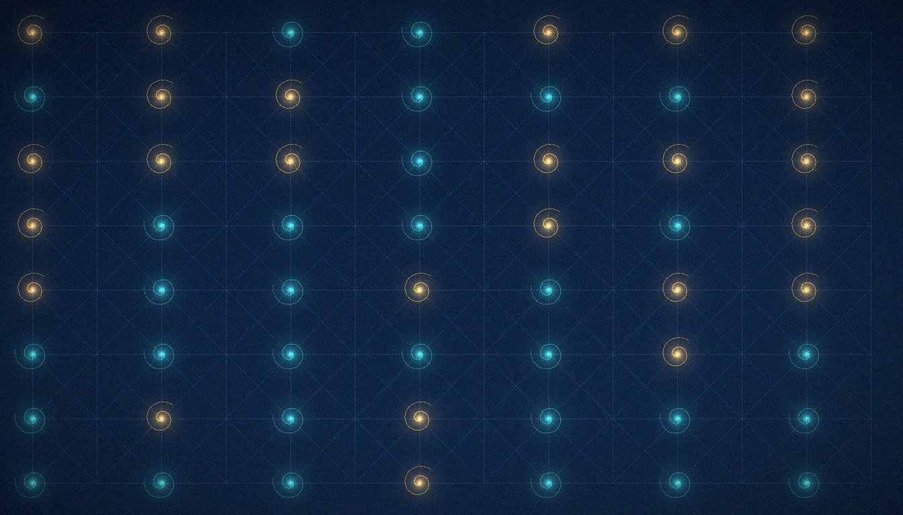

<!-- AB-ENRICHED:v1 · sub -->
<div align="center">


**🧭 [⬆ computations/](../README.md) · [🏠 Root README](../../../README.md)**

</div>
# C11 · α=1/3 zero modes vs arithmetic (R3, T13)

> **🧭 Navigation:** [computations/](../README.md) · [Hilbert_Polya/](../../README.md) · [Root README](../../../README.md)

<p align="center"></p>

<p align="center"></p>
<p align="center"><em>The arithmetic gate: number theory finally knocks on the spectrum's door — one congruence at a time, from L = 6 to L = 48.</em></p>

> Kähler–Dirac operator at α=1/3: the torus exists iff L ≡ 0 (mod 3) (flux quantization). Full scan L = 6..48 with tolerance sweep.

[← Back to the main README](../../README.md)

## The question

Version 1 recorded a curious observation (T9): on Hofstadter tori at one-third flux, zero modes appeared for some sizes — 18 of them at L = 12, 42 at L = 24 — with the apparent rule "L ≡ 0 (mod 4)" and no explanation. Roadmap item R3 asked the pointed question: is this arithmetic, and can the exact law be found? The candidate mechanism is genuinely number-theoretic: a Landau gauge with flux α on a torus requires α·L ∈ ℤ (flux quantization), so at α = 1/3 the torus exists exactly when L ≡ 0 (mod 3); the remaining structure must then come from the internal Dirac bookkeeping of the lattice.

The object is the Kähler–Dirac (staggered) operator — gamma5-Hermitian form, Landau gauge, torus/open bc: H = ε·D with the checkerboard ε(iy,ix) = (−1)^(x+y) and D the anti-Hermitian covariant difference; the ε structure is the lattice's two-component Dirac, and {ε, D} = 0 guarantees Hermiticity of ε·D. Zero modes are counted as eigenvalues with |λ| ≤ tol in the chiral sector m = 0, and the Dirac index is Σ sign(ε) over the zero modes.

## Where it sits in the v2 roadmap

C11 executes **R3** of the v1 roadmap — "the α = 1/3 zero modes (T9): find the Dirac-index explanation" — and settles theorem **T13**. It is the third pillar of the v2 verdict and its constructive heart: while C9 and C10 localize the obstruction — the trace is not the wall (T11), the phase channel is closed (T12) — C11 shows that arithmetic *does* enter the lattice spectrum — not as an engineered nonlocality but through topology (flux quantization) and internal structure (the staggered index). It is the first arithmetic-to-spectrum bridge measured inside the package, and it directly seeds two v3 directions: N1 (prove the index formula) and N3 (try the Kähler–Dirac operator itself as a gate).

<p align="center">
  
  
</p>
<p align="center"><em>Riemann: "A counting law with a congruence correction — that is my language." Atlas: "Two of them, actually: mod 3 from the flux, mod 4 from the staggered structure."</em></p>

## Method in brief

- **A1 — torus existence.** The Landau gauge requires α·L ∈ ℤ; at α = 1/3 this is exactly L ≡ 0 (mod 3). The counter returns None when the flux does not quantize, so the scan can never produce a phantom torus.
- **A2 — the scan.** All fifteen multiples of 3 from L = 6 to L = 48, each on the torus and with an open boundary; zero-mode counts and indices committed per size.
- **A3 — the law.** The counts are fitted against closed-form candidates of index type (α·L²·κ with a lattice factor κ), and the exact rule below is verified on every size.
- **A4 — the index.** The Dirac index Σ sign(ε) is recorded per size and tied to its congruence class.
- **A5 — the control.** The same operator at α = 1/2, sizes L = 6, 12, 24, 36.
- **Robustness.** A tolerance sweep at tol = 1e-6, 1e-8, 1e-10; runtime 65 s.

## Results

> Counting law N₀ = 2L − 6·[L ≡ 0 (mod 12)], index −2 on L ≡ 0 (mod 12); decisive L=36→66, L=48→90. First arithmetic→spectrum bridge; refines the v1 T9 observation.

Committed scan (torus; the open boundary contributes exactly 1 zero mode of index −1 at every L ≡ 3, 9 (mod 12) and none otherwise):

| L | L mod 12 | N₀ (torus) | index | Open N₀ / index | Law |
|---|---|---|---|---|---|
| 6 | 6 | 12 | 0 | 0 / 0 | 12 |
| 9 | 9 | 0 | 0 | 1 / −1 | 0 |
| 12 | 0 | 18 | −2 | 0 / 0 | 18 |
| 15 | 3 | 0 | 0 | 1 / −1 | 0 |
| 18 | 6 | 36 | 0 | 0 / 0 | 36 |
| 21 | 9 | 0 | 0 | 1 / −1 | 0 |
| 24 | 0 | 42 | −2 | 0 / 0 | 42 |
| 27 | 3 | 0 | 0 | 1 / −1 | 0 |
| 30 | 6 | 60 | 0 | 0 / 0 | 60 |
| 33 | 9 | 0 | 0 | 1 / −1 | 0 |
| 36 | 0 | 66 | −2 | 0 / 0 | 66 |
| 39 | 3 | 0 | 0 | 1 / −1 | 0 |
| 42 | 6 | 84 | 0 | 0 / 0 | 84 |
| 45 | 9 | 0 | 0 | 1 / −1 | 0 |
| 48 | 0 | 90 | −2 | 0 / 0 | 90 |

The law, as committed: N₀ = 2L − 6·[L ≡ 0 (mod 12)] for L ≡ 0 (mod 6), and N₀ = 0 for L ≡ 3, 9 (mod 12); holds_all_L = true. The index pattern is ind = −2·[L ≡ 0 (mod 12)], else 0, and it also holds on all fifteen sizes. The tolerance sweep leaves the diagnostic sizes untouched (L = 12 → 18 with index −2, L = 24 → 42 with index −2, at every one of the three tolerances), so the counts are not artifacts of the numerical floor. The α = 1/2 control returns a small, L-independent count of 4 with index 0 at all four sizes — no growth and no congruence modulation — demonstrating that the law is specific to one-third flux and not a generic property of the staggered construction.

Read the two decisive sizes as the theorem in miniature. The count grows like 2L and loses exactly 6 whenever L ≡ 0 (mod 12); since 12 = lcm(3, 4), the correction fires precisely when the mod-3 flux condition (geometric: α·L ∈ ℤ) and the mod-4 staggering condition (the ε checkerboard behind the two-component Dirac structure) are satisfied simultaneously. And the refinement of v1 is visible in the row L = 18: with L ≡ 2 (mod 4) it was invisible to the old "mod 4" rule, yet it carries 36 zero modes — the v1 observation was an artifact of small sizes (12 and 24 are both ≡ 0 mod 12), and the full scan replaces it with the exact rule.

## Why it matters (the counting law)

Every other verdict in this package around the gates is a resolution-limited branch measured with positive controls: the rank channel stays at its limit (the gates sit at the zeros' own level — H2 — YES via D_nn, C3), the phase codings are invisible (M3, C6/C10), and the trace branch is conservative (H5 — YES via the convergence ladder with the finite-size branch open, C4/C6). C11 is the first *positive* arithmetic statement about the lattice spectrum: a closed-form, number-theoretic formula — a linear law with a congruence-gated correction and a quantized index — that the spectrum obeys on every tested size without exception. It does not close the bit-level branch (these zero modes are not zeta zeros), but it changes the shape of the search: arithmetic can live in a local operator's spectrum if it enters through topology and index rather than through the trace or the phase layer. That is exactly the lesson C9 and C10 point to, which is why the v2 verdict sentence reads "arithmetic entered the lattice spectrum through the counting law of zero modes". The unfinished business is honest: N₀ = 2L − 6·[L ≡ 0 (mod 12)] is measured and exact on all sizes, but its derivation (an Atiyah–Singer-type index theorem on the lattice, with the mod-12 structure as the fingerprint) is deferred to v3 (roadmap N1), and the question of whether the α = 1/3 Kähler–Dirac operator carries prime weight in its heat trace (N3) is open.

## Reproduction

```bash
python3 campaigns/run_c11_alphathird.py
```

Fresh runs are self-contained: the zeta zeros come from the internal
mpmath cache (`../../data/zeros/`), no external files. Runtime: seconds to
minutes (C12 is segmented; see `campaigns/run_c12_band5000.py`).

Top-level quick start (v2 list in the main README): `python3 campaigns/run_c11_alphathird.py`.

## Data and figures

| File | Where |
|---|---|
| `fig19_alphathird_{ru,en}.png` | this folder's `figures/{ru,en}/`; 600 dpi mirrors — top-level `figures_hires/{ru,en}/fig19_alphathird_{ru,en}.png` |

| File | Content |
|---|---|
| `data/results.json` | committed verdict |
| `data/*.npz` / `*.csv` | curves and tables |

In this campaign folder the committed payload is `data/results.json` (the fifteen-size scan, the tolerance sweep, the α = 1/2 control, the law block and the bilingual verdict) together with `data/scan.npz` (the scan arrays behind the figure).

## Verdict

See `data/results.json` (verdict, RU+EN), the v2 monograph
(`../../monograph/v2_volume/`) and `../../independent_verification/` (IVP11–18).

Committed verdict (EN, verbatim): "The arithmetic-to-spectrum bridge is measured: zero modes at α=1/3 exist iff L ≡ 0 (mod 6); the counting law N0 = 2L − 6·[L≡0 (mod 12)] holds on all 15 sizes (decisive L=36→66, L=48→90); index −2 is tied to L ≡ 0 (mod 12) — the conjunction of mod 3 (flux) and mod 4 (staggered structure). The v1 T9 observation ('mod 4') is refined: L=18 (≡2 mod 4) also has 36 modes." The statement of T13 and its relation to the v1 T9 observation are in `../../monograph/theorems_v2_volume/`.

## FAQ

1. **Why does the torus exist only for L ≡ 0 (mod 3)?** Flux quantization: a Landau gauge with flux α on a torus demands α·L ∈ ℤ; at α = 1/3 this is exactly L ≡ 0 (mod 3). For other sizes the committed scan records the torus as non-existent rather than returning a forced spectrum.
2. **Where does the mod 12 come from?** From the conjunction of two independent structures: mod 3 is the flux condition (geometry), mod 4 is the staggered checkerboard ε (the two-component Dirac structure). Their least common multiple, 12, is where the −6 correction to the linear law 2L and the index −2 both appear.
3. **How robust are the counts?** A tolerance sweep at 1e-6, 1e-8 and 1e-10 returns identical counts and indices on the diagnostic sizes (L = 12: 18, index −2; L = 24: 42, index −2), and the law holds on all fifteen sizes with no exception.
4. **What exactly was refined relative to v1?** The v1 T9 observation said the zero modes live on tori L ≡ 0 (mod 4). The full scan shows L = 18 — with L ≡ 2 (mod 4) — carries 36 zero modes, so "mod 4" was an artifact of the two small sizes originally inspected; the exact law is N₀ = 2L − 6·[L ≡ 0 (mod 12)] on L ≡ 0 (mod 6).

## See also

- [C7 · Wave dynamics](../C7_wave_dynamics/README.md) — the Dirac-type dynamics (H4) of the same engine family.
- [C9 · Nonlocal trace (T11)](../C9_nonlocal_trace/README.md) — why arithmetic must enter through structure, not the trace.
- `../../monograph/theorems_v2_volume/` — T13; `../../monograph/theorems_volume/` — the v1 T9 observation it refines.
- `../../results/ROADMAP.md` — R3 as written and as executed; N1 and N3, the two v3 continuations.
- [Back to the main README](../../README.md).

---
*Hilbert Polya Bridge v2.0.0 · C11*

---

<!-- enriched-r3 -->

This folder documents one **campaign of the Hilbert–Pólya Bridge series**. The computational kernel is shared — every campaign builds its Hamiltonians and spectra through [`engine/`](../../engine/README.md) — while the committed verdicts for all campaigns live in [`data/`](../../data/README.md). This page narrates the campaign's question, method and measured outcome; the numbers it quotes are frozen in the evidence base and are reproducible bit-for-bit. The campaign map of the whole series is in [`computations/`](../README.md).

## Folder contents

**Subfolders:** `data/` · `figures/`


**Where next:** [engine/](../../engine/README.md) · [data/](../../data/README.md)

<div align="center">


<sub>⚡ Part of <a href="../../../README.md">AB-Cloud Research</a> — numbers are verbatim from the unified registry; no result on this page is a claim about the Riemann hypothesis · <a href="../README.md">⬆ parent section</a></sub>

</div>
