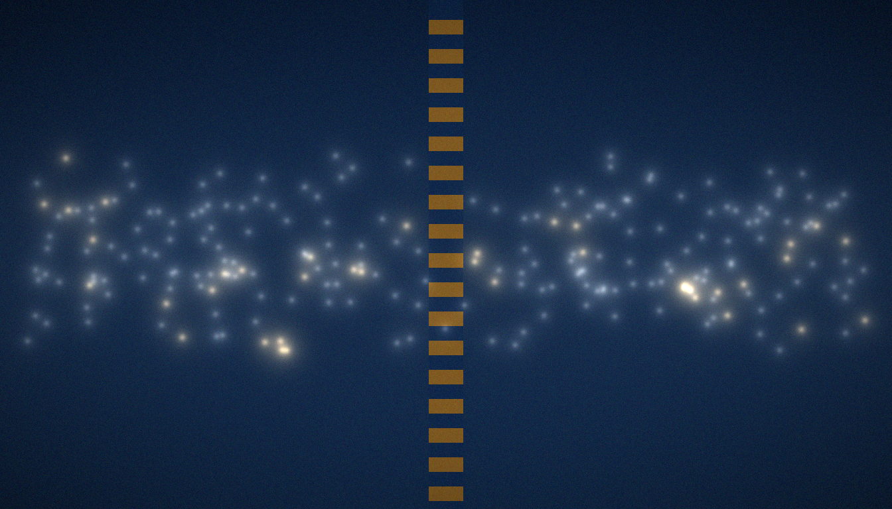

# C15 · Dirichlet L-functions pipeline (T17)

> **🧭 Navigation:** [computations/](../README.md) · [Hilbert_Polya/](../../README.md) · [Root README](../../../README.md)

<p align="center"></p>

<p align="center"></p>
*χ₅ and χ₇ re-run the v1 script — identity, counting, ladder, trace — on L-function material.*

> The C1–C4 + C6 pipeline for χ5 (even) and χ7 (odd): Z_χ reality, zero bisection + strip checks, twisted ψ_χ ladder, twisted trace formula.

[← Back to the main README](../../README.md)

## The question

All v1 identities were measured on ζ. If the rank-metric resolution limit were a peculiarity of zeta, transplanting the pipeline to a Dirichlet L-function should change the picture. C15 performs the transplant in full: the phase-calibrated Z_χ, zero location by bisection with strip checks, the ψ_χ ladder of twisted primes against the L-zeros, and the heat trace of the L-function analogue H_{ξ,χ}. It runs end to end for two primitive characters of opposite parity, χ₅ (even) and χ₇ (odd), exercising both functional-equation symmetries of the class.

## Where it sits in the v2 roadmap

This campaign settles **Theorem T17** and answers the roadmap question "is the rank-metric resolution limit universal?". C9/T11 showed the wall passes through locality, not the trace; C13/C14 showed the limit and attractor robust across designs and statistics; C15 shows the limit is a property of the whole *class* of arithmetically weighted objects, not of ζ alone. Every stage of the five-stage map is rebuilt with χ inserted — the twisted identities carry over, and the rank limit reappears at the same place.

## Method in brief

The band is T ≤ 120 (`T_band = 120.0`; runtime 50.5 s). Four stages per character:

1. **Z_χ reality** — the phase-calibrated combination on the critical line is real to machine precision: max |Im Z_χ| = 5.12e-35 (χ₅), 1.99e-35 (χ₇) — the analogue of T2.
2. **Zero bisection + strip checks** — bisection locates 68 zeros for χ₅ and 74 for χ₇ in-band, against smooth counts n̄(120) = 67.85 and 74.52; the first zeros are 6.648453, 9.831444, 11.958846, 16.033821, 17.566994 (χ₅) and 4.475738, 6.845492, 11.160185, 12.489603, 15.112882 (χ₇).
3. **Twisted ψ_χ ladder** — the χ-twisted von Mangoldt sieve against the L-zeros: correlation 0.902 (χ₅), 0.949 (χ₇) — the C6 logic with the character inserted.
4. **Twisted trace formula** — the heat trace of H_{ξ,χ} carries the weight χ(n)Λ(n)/√n; the derived constants are B_χ = −0.0782744695351616 (χ₅) and −0.1276115042664667 (χ₇), with zero-sum counterparts 0.0709158003540316 and 0.11976224385711394, the residual being the zero tail beyond the band.

## Results

|ΔK| ≤ 9.6e-6 (χ5) / 6.1e-6 (χ7) with weight χ(n)Λ(n)/√n; gates vs L-zeros: the rank branch's null zone. The rank-metric resolution limit is UNIVERSAL across L-functions.

The trace check runs on the same x-grid as T6 (x = 0.4, 0.6, 0.9, 1.3). For χ₅ the direct trace and the formula agree to 6.64e-6, 9.61e-6, 2.71e-6 and 1.20e-6 — the worst case giving the headline |ΔK| ≤ 9.6e-6. For χ₇ the residuals are 6.14e-6, 4.07e-6, 1.82e-6 and 4.45e-7, hence |ΔK| ≤ 6.1e-6. Both floors match the zeta-level accuracy of T6 (1.2e-5). The coding stage repeats the v1 rank test with L-zeros: the six gate projections stay in the rank branch's null zone, |r_H7| = 0.035–0.164 across (χ₅, χ₇) × (Nv = 8, 16, 32), the maximum at χ₇/Nv16.

<p align="center"></p>

## Why it matters

The verdict sentence is the point: *the rank-metric resolution limit is UNIVERSAL — a class property, not a zeta defect.* The weight T6 proved to live in the heat trace of H_ξ is not tied to ζ's primes; twisted by χ(n) it lives as exactly in the heat trace of H_{ξ,χ}, and the local gates' rank projection is just as blind to it. Whatever separates the lattice from the zeros in the rank metric does not care which L-function supplies them. This upgrades the result from a measurement on one function to a statement about a class.

## Reproduction

```bash
python3 campaigns/run_c15_dirichlet.py
```

Fresh runs are self-contained: the zeta zeros come from the internal
mpmath cache (`../../data/zeros/`), no external files. Runtime: seconds to
minutes (C12 is segmented; see `campaigns/run_c12_band5000.py`).
The committed run completes in 50.5 s (T ≤ 120 band).

## Data and figures

| File | Where |
|---|---|
| `fig23_dirichlet_{ru,en}.png` | this folder's `figures/{ru,en}/`; 600 dpi mirrors — top-level `figures_hires/{ru,en}/fig23_dirichlet_{ru,en}.png` |
| `data/results.json` | committed verdict |
| `data/*.npz` / `*.csv` | curves and tables |

`data/results.json` holds the per-character blocks (reality residuals, zero lists, B_χ/C0_χ constants, trace tables, ψ_χ correlations, the Q-weight check) plus the six gate-vs-L-zeros projections; `data/zeros_chi.npz` stores the committed L-zero lists.

## Verdict

See `data/results.json` (verdict, RU+EN), the v2 monograph
(`../../monograph/v2_volume/`) and `../../independent_verification/` (IVP11–18).

The committed English verdict reads: *"The pipeline transfers to L-functions: Z_χ is real (machine precision), zeros match the smooth count, the heat trace of H_{ξ,χ} carries the twisted weight χ(n)Λ(n)/√n (T17), the ψ_χ ladder matches zeros (0.902/0.949 — the L-rungs of the convergence ladder); gates against L-zeros stay in the same null zone of the rank branch. The rank-metric resolution limit is UNIVERSAL: a class property, not a zeta defect — the twisted weight and the ladder carry over to the whole class, and the rank projection stays at its limit."*

## FAQ

**Why exactly χ₅ and χ₇?**
They are the smallest primitive characters of opposite parity. Parity controls the functional equation, so one even and one odd character exercise both symmetries the class offers.

**What is "twisted" about the trace formula?**
The weight Λ(n)/√n that T6 proved for H_ξ is multiplied by χ(n) on every prime power. The heat trace of H_{ξ,χ} sees χ-twisted primes — arithmetic entering with the sign and phase pattern the character dictates.

**Is |ΔK| ≤ 9.6e-6 comparable to the zeta result?**
Yes. T6 verified the H_ξ trace formula to 1.2e-5 on the same x-grid; the transplant reaches 9.6e-6 (χ₅) and 6.1e-6 (χ₇) with a band of only T = 120 — as exact as the untwisted identity.

**What do "gates vs L-zeros" add?**
They port the H2 rank test itself: all six (χ, Nv) projections land in the rank branch's null zone (max |r_H7| = 0.164) — the resolution limit repeats verbatim on L-function zeros, the empirical content behind UNIVERSAL.

## See also

- [C4 · Trace formula](../C4_trace_formula/README.md) — the untwisted Guinand–Weil identity for H_ξ (T6).
- [C6 · Prime flow](../C6_prime_flow/README.md) — the untwisted ψ-ladder and co-location kernel (T4).
- [C13 · Blind families](../C13_blind_families/README.md) — the null zone across designs (T15).
- `../../docs/v2/dirichlet_pipeline.md`, `../../docs/v2/overview.md`, `../../results/RESULTS.md` (row 29).

---
*Hilbert Polya Bridge v2.0.0 · C15*

---

<!-- enriched-r3 -->

This folder documents one **campaign of the Hilbert–Pólya Bridge series**. The computational kernel is shared — every campaign builds its Hamiltonians and spectra through [`engine/`](../../engine/README.md) — while the committed verdicts for all campaigns live in [`data/`](../../data/README.md). This page narrates the campaign's question, method and measured outcome; the numbers it quotes are frozen in the evidence base and are reproducible bit-for-bit. The campaign map of the whole series is in [`computations/`](../README.md).

## Folder contents

**Subfolders:** `data/` · `figures/`


**Where next:** [engine/](../../engine/README.md) · [data/](../../data/README.md)
