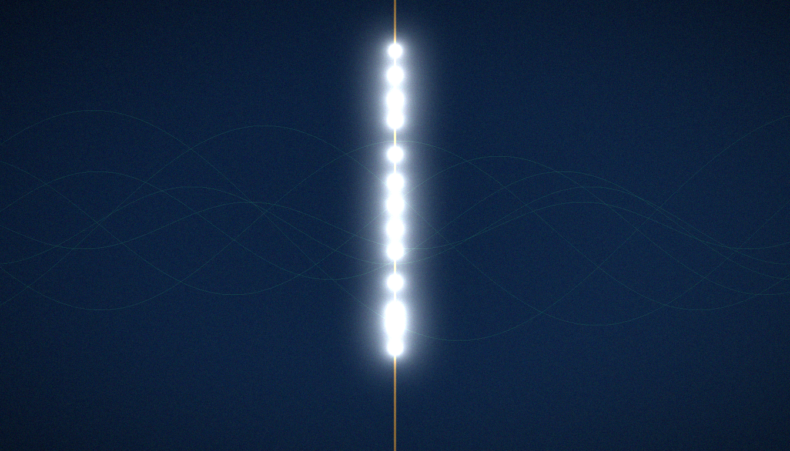
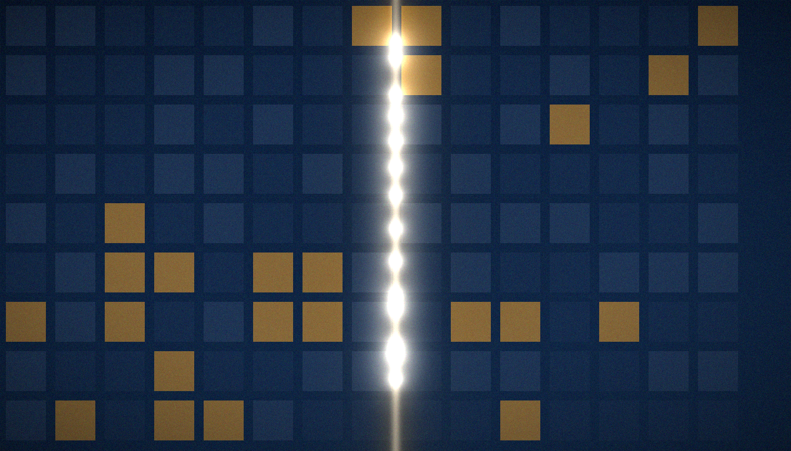

<!-- AB-ENRICHED:v1 · sub -->
<div align="center">


**🧭 [⬆ C7_wave_dynamics/](README.md) · [🏠 Root README](../../../README.md)**

</div>
# C7 · Wave-packet dynamics

  

<p align="center"></p>

<p align="center"></p>

<p align="center"><em>Five keepers of the Bridge watch one packet cross one lattice — and write down everything that happens to it.</em></p>

> **TL;DR (from the English source).** Coherent propagation, reflection and scattering on L=96; energy conserved to 1e-15; the ζ-cloud is 16× more transparent than random in the far wing — the dynamical face of the Montgomery pair correlations.

[← Back to the main README](../../README.md)

## Contents

1. [The question](#the-question)
2. [Background](#background)
3. [Method step by step](#method-step-by-step)
4. [Controls](#controls)
5. [Results](#results)
6. [How to read the numbers](#how-to-read-the-numbers)
7. [Interpretation](#interpretation)
8. [Reproduction](#reproduction)
9. [Data and figures](#data-and-figures)
10. [Verdict](#verdict)
11. [FAQ](#faq)
12. [See also](#see-also)

---

## The question

A resonator that only has eigenvalues is a catalogue; a resonator that can carry a wave is a machine. C7 hands the gate a wave and watches. If the lattice resonator is an electron on a flux lattice, the packet must move: propagate coherently, reflect from boundaries, scatter on vortices. And if the ζ-phase structure is physical, the ζ-cloud must behave differently from a random cloud of the same density. It does — in three measured effects, each with a committed number and a matched control.

This is the international quick-reference edition of C7. The deep guide lives in [README.md](README.md) (same folder); here every number is kept, the prose is trimmed, and the angle is operational: what was launched, what was measured, against what null, and what the verdict does and does not license.

## Background

**The gate as a Dirac medium.** A square lattice with a hopping phase 2πα·iy on its x-links threads α of flux through every plaquette. At the self-dual value α = ½ that flux is π per plaquette, and the tight-binding problem becomes a discretised massless Dirac equation: two sublattices form the spinor, complex hoppings replace the gamma matrices, low-energy dispersion is linear, and a narrow packet moves ballistically instead of diffusing. All C7 dynamics lives on this line; recognising the motion as Dirac-type is the criterion H4 that the campaign tests.

**The packet.** A Gaussian lump of probability — the coherent wave packet of the title — is prepared at (x, y) = (24, 48) on the 96×96 gate (9,216 sites, open boundaries), with widths σx = σy = 5.0 and mean energy E₀ ≈ −0.866 in hopping units (the negative band of the π-flux spectrum). "Coherent" here is a measurement, not a manner of speech: over the whole horizon the widths grow only from 5.0 to roughly 8, so the lump stays a lump while it travels.

**The null.** The quantitative claim of C7 is a ratio, and a ratio needs a denominator. The denominator is the random-phase gate `r256`: same size, same boundaries, same 256 vortices at the same density, phases de-ordered. This is the decui control of the series methods — the test of the proposition "the structure of the phases is not important". The clean lattice `clean` (Nv = 0) serves as the second baseline: the billiard from which scattering is defined.

<a href="../../assets/illustrations/ill_hero_shutters.png"></a>

## Method step by step

1. Build the sparse Hermitian Hamiltonian of the 96×96 gate, open boundary conditions, α = ½ (`engine/hamiltonian.py` is the single source of the construction).
2. Prepare the packet by the D10 convention: Gaussian at (24, 48), σx = σy = 5.
3. Propagate with step dt = 0.1 to the horizon T = 40 — 101 snapshots per trajectory.
4. At every snapshot record ⟨x⟩, ⟨y⟩, σx, σy, the energy ratio E(t)/E(0), and the probability in two strips: the source-side (left) strip and the far wing x ≥ 90.
5. Run five trajectories: `clean` (Nv = 0), `z16`, `z64`, `z256` (ζ-phases at three densities) and `r256` (random phases at Nv = 256).
6. Read out: reflection R (final left-strip weight), transport P(x ≥ 90) (final far-wing weight), transverse drift (final ⟨y⟩ − 48), coherence (shape of the ⟨x⟩ curve).

The original method statement, preserved: *a sparse 96×96 Hamiltonian (open bc), step dt = 0.1, horizon T = 40, the packet by the D10 convention. All the dynamics lives on the self-dual line α = ½, where the π flux turns the lattice into a discretised massless Dirac equation — criterion H4.*

## Controls

- **Energy conservation — 1e-15 on every trajectory.** The committed E(t)/E(0) series never leaves 1 beyond the fifteenth digit (worst excursion below 1e-14, over 400 steps and five runs). Braking and transport are small-probability effects; this control guarantees they are produced by the Hamiltonian and not by the stepper.
- **Billiard sanity.** On the clean lattice the packet must leave x = 24, turn near the left boundary and come back — the reflection at t ≈ 14.5 in the results table is exactly that, and it validates packet, propagator and boundaries at once.
- **Density-matched pair.** `z256` versus `r256` differ only in phase ordering; the ×16 transport ratio is computed inside this pair.
- **Pinned randomness.** Series seed 96; vortex and disorder RNG streams fixed in `engine/hamiltonian.py` (`default_rng(96+3500)`, `default_rng(96+3501)`); every trajectory reproduces bit-for-bit.

<p align="center"></p>

<p align="center"><em>Pólya's instinct — treat the zeros as a spectrum — here acquires a kinetic corollary: a spectrum you can also surf on.</em></p>

## Results

| Quantity | Value | Status |
|---|---|---|
| Energy conservation | 1e-15 on every trajectory | honest dynamics |
| Coherence (clean lattice) | ⟨x⟩: 24 → 4.3 (reflection, t≈14.5) → 44 | billiard trajectory |
| Vortex scattering | Nv=16: nearly transparent; Nv=64: R=0.39; Nv=256: R=0.47 | a monotone braking effect |
| Transverse drift (ζ Nv=256) | ⟨y⟩: 48 → 38; random: none | the phases steer |
| Transport P(x ≥ 90) | ζ-cloud 0.0032 vs random 0.0002 (×16) | the D10 effect reproduced |

**Energy (row 1).** Five trajectories, 101 snapshots each, all at the 1e-15 level of E/E₀ − 1: the dynamics is honest, meaning every effect below is dynamics, not numerics.

**Coherence (row 2).** The clean-lattice packet performs a full billiard leg: out to the left wall, back across the centre, ending at ⟨x⟩ ≈ 44 with the lump intact. Ballistic speed along the way is about 1.7 sites per unit time, read off the committed ⟨x⟩ curve.

**Vortex scattering (row 3).** Braking grows monotonically with vortex count: at Nv = 16 the gate is nearly transparent (reflected weight R ≈ 0.035), at Nv = 64 it holds R = 0.39, at Nv = 256 it holds R = 0.47 — half the packet stranded on the source side. No threshold, no saturation over the measured range.

**Transverse drift (row 4).** Only on the ζ-gate at Nv = 256 does the packet leave its lane: ⟨y⟩ slides 48 → 38. The random twin shows no drift (48.0 → 47.8); the lower-density ζ-runs drift by at most half a row. Random scatterers brake; ζ-scatterers brake *and steer*.

**Transport (row 5).** The far wing x ≥ 90 is reached with probability 0.0032 by the ζ-cloud and 0.0002 by the random cloud — ×16, the D10 effect reproduced. The committed full-precision tails: 0.003221 (`z256`) and 0.000216 (`r256`). The honest ordering across regimes is clean 0.0073 > ζ 0.0032 > random 0.0002: vortices brake transport overall, but ζ-ordering brakes it sixteen times less than randomness. Same density, different arithmetic, different doorway.

## How to read the numbers

- **R and P(x ≥ 90) are final-time probabilities** — the wavefunction weight in two strips at T = 40 — so only ratios of them carry information; the ×16 is the ratio 0.0032/0.0002.
- **The ×16 has a matched denominator.** Density, geometry, disorder and packet are identical on both sides of the ratio; the only free variable is the phase structure. Nothing else can absorb the effect.
- **Braking is monotone in Nv, transport is not.** Braking is bulk back-scattering; far-wing transport is a tail effect governed by phase correlations. The two columns answer different questions about the same medium.
- **Units.** Time in hopping units (t = 1), lengths in lattice spacings, energy relative to E₀ ≈ −0.866; dt = 0.1 and T = 40 give 400 steps of horizon.
- **"1e-15" is a pipeline certificate.** It quotes the excursion of E(t)/E(0) from unity — an apparatus check that must read zero for the physics rows to mean anything.

## Interpretation

**H4 — YES (honest dynamics).** The gate carries a coherent, ballistic, energy-conserving Dirac-type wave, and its ζ-phases produce transport that a random-phase medium of the same density does not. The resonator is a physical object, not just a matrix.

> The identification of the self-dual line α = ½ with Re(s) = ½ is a conjectural bridge: statistical support exists (D7/D10), the zeros' level — yes (H2, v2.0.7), the bit-level branch open.
> The electron motion is confirmed in the dynamical sense; it is not a statement about the spectrum (see C3–C5).

What H4 does **not** give you:

- **No spectral identity.** The level-to-zero matching question is H2, measured NO three times in this package (C3, C4, C5; surrogate-null-level rank metric, about half an order by relative residual in the thermal metric). C7 is a dynamics verdict and stays one.
- **No proof of the critical line.** Calling α = ½ "Re(s) = ½" is the package's conjecture; the ×16 transport is part of its statistical support (D7/D10), not its demonstration.
- **No arithmetic witness.** A transport ratio cannot certify that the phases *are* zeta phases; it certifies that they are *structured* where the random null is not. Universality-adjacent claims belong to C8, and even there they stop at symmetry.

The Montgomery connection is the right way to hold the result: the same phase structure that produces GUE level statistics on these gates (C8) also produces the directed far-wing transport here. Pair correlations are the statistical face; the ×16 is the dynamical face. One arithmetic, two projections, two campaigns.

<p align="center"></p>

<p align="center"><em>Agent Lyra tracked every snapshot of the packet — and insists the energy column be read before the transport column.</em></p>

## Reproduction

```bash
# verdict tour (~seconds, no zeros file needed)
python3 campaigns/run_c7_dynamics.py
```

The series seed is 96; the RNG streams are fixed in `engine/hamiltonian.py`. All dependencies are in `requirements.txt`. The runner re-reads the committed verdict `data/c7_dynamics_verdict.json` and prints the five trajectory tags (`clean`, `z16`, `z64`, `z256`, `r256`) — seconds, no zeros file. Independent protocol checks of this campaign are collected in `independent_verification/` (IVP).

## Data and figures

| File | Content |
|---|---|
| `data/results.json` | the committed verdict of the campaign |
| `data/` (npz/csv) | curves and tables |
| `../data/c7_*.json` | duplicate of the verdict in the shared registry |

Each tag in `data/results.json` carries `t` (101 frames, 0 → 40 step 0.4), `mx`, `my`, `sx`, `sy`, the strip probabilities `pl` (source side) and `pr` (far wing x ≥ 90), the energy ratio `ee`, and the scalars `R`, `T`, `E0`. The shared-registry copy is `../data/c7_dynamics_verdict.json`.

| File | Where |
|---|---|
| `fig13_dynamics_en.png` | 600 dpi — top-level `figures_hires/en/fig13_dynamics_en.png`; screen — `figures/en/` |
| `fig13_dynamics_ru.png` | 600 dpi — top-level `figures_hires/ru/fig13_dynamics_ru.png`; screen — `figures/ru/` |

The motion is also shipped as `anim_wavepacket.mp4` / `anim_wavepacket.gif` in this folder, with a still at `data/wavepacket_dynamics.png`.

**Monographs.** `monograph_ru.docx` · `monograph_ru.pdf` · `monograph_en.docx` · `monograph_en.pdf` — the full monograph of this computation (formulation, theorems, tables, figures, honest limitations): 7–9 pages, identical content in the two languages.

## Verdict

**H4 — YES (honest dynamics); the bridge to Re(s)=½ is a conjecture** — details: `data/results.json`, the monograph, and `independent_verification/` (IVP checks of this campaign). Registry entry: row 19 of `results/RESULTS.md` — *Transport P(x ≥ 90): ζ 0.0032 vs random 0.0002 (×16), C7*.

Committed verdict record (EN, verbatim): **H4 — YES (honest dynamics); the bridge to Re(s)=½ is a conjecture**.

## FAQ

### What moves on the lattice — an electron, a zero, or what?

A wave packet: a Gaussian superposition of eigenstates of the gate Hamiltonian. No individual eigenvalue is tracked and no zero of ζ is simulated. The packet is a probe, the way a test charge probes a field.

### Why should I believe the ×16 rather than shrug at it?

Because the ratio is taken inside a matched pair (`z256` vs `r256`: same density, geometry, disorder and packet) and under a 1e-15 energy certificate. The denominator is the pre-registered null "phase structure does not matter"; the numerator beats it by an order of magnitude on its own turf.

### The clean lattice transmits more than the ζ-gate — doesn't that weaken the story?

It sharpens it. The claim was never "arithmetic beats emptiness" but "arithmetic beats randomness at equal obstruction": clean 0.0073 > ζ 0.0032 > random 0.0002. Vortices brake; the ζ-ordering leaves doors open that randomness closes.

### Is the sideways drift (⟨y⟩: 48 → 38) just the vortices pushing the packet?

A random vortex field of the same strength pushes nowhere (48.0 → 47.8). A push with a preferred side requires a preferred direction in the medium — which is exactly what the ordered phases supply and the randomised phases erase.

### Where is the line between what C7 measured and what it conjectures?

Measured: coherent propagation, reflection, braking, drift, far-wing transport with energy conserved to 1e-15, on the line α = ½. Conjectured: that this line *is* the critical line Re(s) = ½. The package prints the two in different typefaces for a reason.

### I only have five minutes — what do I run?

`python3 campaigns/run_c7_dynamics.py` — it prints the committed verdict in seconds, no zeros file needed. The figures (`fig13_dynamics_en.png` at 600 dpi) and the animation (`anim_wavepacket.mp4`) do the visual explaining.

## The vortex protocol in one paragraph

The scattering centres of this campaign are not hand-drawn; they are sampled by a pinned protocol that the whole series shares, so it is worth knowing what "Nv = 256" concretely means. Vortex centres land on cell midpoints (ix + 0.5, iy + 0.5) with ix, iy drawn independently from 1 … N − 1; charges follow the **neutral** convention (for even Nv the first half get +q, the rest −q, so the total circulation of the gate is zero), and the vortex stream is fed by `default_rng(seed + 3500)` while the on-site disorder stream is offset by one more — the constants `BASE_SEED = 96`, `HARDCORE_OFFSET = 3500`, `T_HOP = 1.0` live at the top of `engine/hamiltonian.py`. The hopping amplitude t = 1 is why every time and length in this README is quoted "in hopping units". None of these choices is adjusted per campaign; C7 inherits them, which is precisely what makes its trajectories comparable with the gates of C3/C5 and the statistics of C8.

## The five trajectories at a glance

Beyond the headline rows, the committed file `data/results.json` fixes the initialisation of each run. The mean energies E₀ below are the packet's launch energies in hopping units; the drift column is final ⟨y⟩ minus the launch value 48; the last column is the largest excursion of the committed energy ratio from unity — the per-trajectory reading of the 1e-15 certificate.

| Tag | Nv | Phases | E₀ | Δ⟨y⟩ (final − 48) | max \|E/E₀ − 1\| |
|---|---|---|---|---|---|
| `clean` | 0 | — | −0.865592 | −0.01 | 9.3e-15 |
| `z16` | 16 | ζ | −0.866296 | −0.36 | 1.6e-15 |
| `z64` | 64 | ζ | −0.865042 | −0.51 | 3.3e-15 |
| `z256` | 256 | ζ | −0.859608 | −9.70 | 6.0e-15 |
| `r256` | 256 | random | −0.866360 | −0.24 | 7.4e-15 |

Three things to notice. The launch energy is essentially constant across all five runs (−0.866 ± 0.003; the ζ-256 gate shifts the band slightly, −0.8596), so differences in transport are not differences in where the packet starts. The drift column isolates the steering effect in one glance: −9.70 rows for the ζ-cloud at Nv = 256 against at most half a row everywhere else. And the energy column confirms that the certificate is per-trajectory, not an average over runs — each of the five readings stays in the 1e-15–1e-14 band that the results table summarises as "1e-15 on every trajectory".

## Where C7 sits on the scorecard

The main README's Hilbert–Pólya scorecard has five rows, and this campaign owns one of them:

| Item | Verdict | Basis |
|---|---|---|
| H4 — Dirac-type dynamics | **YES** | coherent packet, reflection, scattering; energy 1e-15 (C7) |

Its neighbours are supplied by other stations: H1 (self-adjointness) is architectural and confirmed by the real spectrum of every gate; H3 (GUE class) is C8, the statistical twin of this campaign; H2 (spectral identity) is the repeated NO of C3–C5. Read as a row of one table, the division of labour is exact — C7 certifies that the resonator *moves*, C8 certifies how its levels *correlate*, and neither row is allowed to speak for the other. That separation is the quiet discipline behind the package's honesty labels.

## See also

- [C8 · Statistics ladder and spin structures](../C8_stats_ladder/) — the statistical twin of this campaign: the same phases, judged by their spacings instead of their transport.
- [C3 · Gate family](../C3_gate_family/) — where the 52 protocol gates and their ζ-phase conventions come from.
- [Methods](../../docs/methods.md) — seeds, streams, the decui null, and the shared pipeline contract.
- [Deep guide](README.md) — the definitive edition of this campaign in the same folder.
- [Main README](../../README.md) — the Bridge overview and the H1–H5 scorecard.

---
*Hilbert Polya Bridge v1.0.0 · C7 · Wave-packet dynamics*

<div align="center">


<sub>⚡ Part of <a href="../../../README.md">AB-Cloud Research</a> — numbers are verbatim from the unified registry; no result on this page is a claim about the Riemann hypothesis · <a href="README.md">⬆ parent section</a></sub>

</div>
