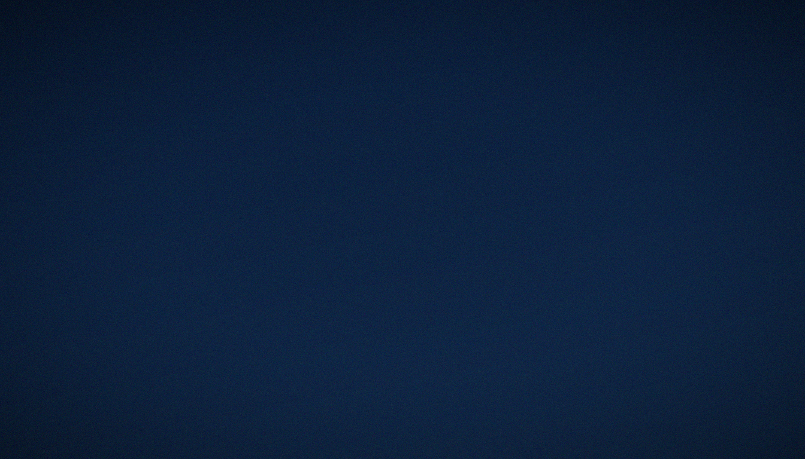
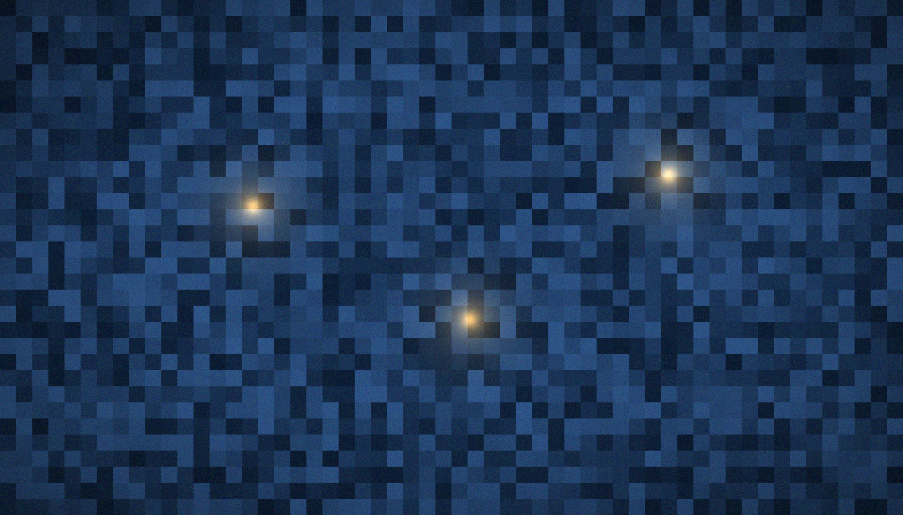

# C8 · The statistics ladder and spin structures

  

<p align="center"></p>

<p align="center"></p>

<p align="center"><em>The full company assembles for the classification trial: sixty-four candidates enter, four Hamiltonians leave.</em></p>

> **TL;DR (from the English source).** Poisson/GOE/GUE governed by symmetry (T10); GSE is structurally unreachable (T²=+1); spinor64: 64 spin structures → 4 Hamiltonians (T8) with isospectrality 1.1e-14.

[← Back to the main README](../../README.md)

## Contents

1. [The question](#the-question)
2. [Background](#background)
3. [Method step by step](#method-step-by-step)
4. [Controls](#controls)
5. [Results](#results)
6. [How to read the numbers](#how-to-read-the-numbers)
7. [Interpretation](#interpretation)
8. [Reproduction](#reproduction)
9. [Data and figures](#data-and-figures)
10. [Verdict](#verdict)
11. [FAQ](#faq)
12. [See also](#see-also)

---

## The question

Which random-matrix classes does the lattice realise, and what governs them? And what do discrete phase structures encode — is there a hidden variable of arithmetic among them? The answers: **the class is set by symmetry (the Dyson triplet)**; **discrete codings are exact, but their capacity is set by phase symmetry, not by the number of structures**. One question is about the continuum of Hamiltonians the gate family can produce (the ladder, T10); the other is about a finite set of sixty-four phase choices (spinor64, T8). Both get binary answers, and both answers are symmetry answers — which is exactly why they belong in the same campaign.

This is the international quick-reference edition. The definitive treatment — full ladder table, spinor64 detail, classifier logic — is [README.md](README.md) in this folder. Here the angle is the two slogans: *symmetry sets the class*, and *symmetry caps the code*.

## Background

**Three laws of spacing.** Give up on individual eigenvalues and ask only how consecutive gaps behave. If the levels are uncorrelated, gaps are exponential and ratios of adjacent gaps average to **⟨r⟩ = 0.3863** (Poisson — the statistics of integrable and localised systems). If the Hamiltonian is real symmetric — time reversal intact — levels repel quadratically and **⟨r⟩ = 0.5307** (GOE). If the Hamiltonian is genuinely complex Hermitian — no antiunitary symmetry anywhere — repulsion is linear and **⟨r⟩ = 0.5996** (GUE), the class of the Riemann zeros' own spacings. The fourth symmetry class, GSE (**⟨r⟩ = 0.6762**, reference constant from Atas et al. 2013), requires Kramers degeneracy, T² = −1; the gate is spinless with T² = +1, so GSE is not missing from the measurements — it is *excluded by the architecture*.

**The workhorse statistic.** For consecutive spacings s_n, s_{n+1}: r_n = min(s_n, s_{n+1})/max(s_n, s_{n+1}); the campaign averages this over each channel. It is unfolding-free, robust, and its limiting means separate the three laws cleanly — which is why a channel holding **⟨r⟩ ≈ 0.60** is the signature of GUE: halfway lies nothing, 0.53 is as stiff as real matrices can get, and 0.5996 is the complex-Hermitian fixed point.

**What a spin structure is, in lattice terms.** On the genus-3 Klein quartic there are 2⁶ = **64 spin structures** — the classical theta characteristics, 36 even and 28 odd by the Arf invariant. On the lattice discretisation each is a sign vector e ∈ (Z/2)⁶, i.e. a choice of periodic/antiperiodic boundary conditions for the fermion around each cycle, rendered as a phase pattern in the Hamiltonian. Odd structures carry forced zero modes. The set is finite, exact, and completely checkable — the ideal hunting ground for a "hidden variable of arithmetic" hiding among discrete phase choices. The hunt comes up empty in the most informative way possible: the phase coding collapses 64 candidates to 4 Hamiltonians (T8), exactly as symmetry predicts.

<a href="../../assets/illustrations/ill_pixel_encoding.png"></a>

<p align="center"></p>

<p align="center"><em>Riemann's zeros fall in the GUE class; the campaign checks whether the gate's spectrum falls there too — and what else symmetry demands.</em></p>

## Method step by step

1. **Protocol lattice.** L = 24, the C3 Hamiltonian construction in `engine/hamiltonian.py`, series seed 96, pinned RNG streams.
2. **Ladder sweep.** Eleven channels over the symmetry handles: Nv (0, 16), extra real disorder w ∈ {0, 0.2, 0.5, 1, 2, 4, 8, 16, 32}, boundaries (torus/open), flux α (0.5 on the self-dual line, one channel at 0.4); n_real up to 5, n_spacings up to 1715.
3. **Classification.** For each channel: ⟨r⟩ against the constants (Poisson 0.3863, GOE 0.5307, GUE 0.5996), plus two-sample KS tests against the three reference spacing laws (D and p recorded for all three).
4. **spinor64 E1.** Enumerate the 64 spin-structure classes (64 classes / 84 edges), form orbits (28/21/7/7/1), count Arf parity (28 odd / 36 even), count forced zero modes per orbit representative (2/3/3/3/7), verify isospectrality within orbits by direct diagonalisation.
5. **spinor64 E2.** Apply the phase coding φx = π(e1+e3+e5), φy = π(e2+e4+e6) mod 2π; verify that the Hamiltonian depends on e only through the pair (φx mod 2π, φy mod 2π) — hence 2×2 = 4 distinct Hamiltonians — and confirm that ⟨r⟩ is determined by that pair alone, in the reference table and in an independent re-run.

The original method statement, preserved: *an 11-channel ladder (n_real up to 5, n_spacings up to 1715): Nv, extra disorder w, boundaries; classification by ⟨r⟩ and KS against three references. spinor64: the 64 spin-structure classes of the Klein quartic (φx = π(e1+e3+e5), φy = π(e2+e4+e6) mod 2π) — the reduction to 2×2 = 4 classes; isospectrality is checked within orbits.*

## Controls

- **Two independent classifiers.** ⟨r⟩-distance ranks; KS decides. A channel is only labelled when its ⟨r⟩-nearest reference also passes KS; crossover channels are honestly left unclassified.
- **Constants, not vibes.** The reference values 0.3863 / 0.5307 / 0.5996 / 0.6762 are committed in `data/ladder/stats_ladder.json`; the GSE constant is explicitly quarantined as reference-only (Atas et al. 2013) with no test attached to any spectrum.
- **Machine floor.** The validation registry sets 1e-14 as the floor of spectral distinguishability; orbit isospectrality (max|Δλ| = 1.02e-14) and the ⟨r⟩ reproduction against the reference (difference 1.34e-14) both sit exactly there — as exact as floating point certifies.
- **Independent re-run of E2.** The four (φx, φy) sectors were rebuilt from scratch (L = 24, α = 0.5, Nv = 16, density matched to the reference configuration, n_real = 3) and measured fresh, so the 64 → 4 statement does not lean on the reference bookkeeping.
- **Architecture, not absence.** The GSE row is a structural statement (T² = +1, spinless), immune to experimental luck; recording it keeps the "all statistics" claim scoped to what the lattice can express — the Dyson triplet.

## Results

| Quantity | Value | Status |
|---|---|---|
| Clean lattice | ⟨r⟩ = 0.324–0.386 | Poisson/clustering |
| Real disorder w = 1–4 | ⟨r⟩ = 0.520–0.538 | GOE plateau |
| Strong disorder w = 16–32 | ⟨r⟩ = 0.387 | Poisson (localization) |
| Complex vortices Nv ≥ 8 | ⟨r⟩ = 0.597–0.612 | GUE |
| GSE | T² = +1 → unreachable | architectural constraint |
| spinor64 E1 | 64 classes/84 edges; orbits 28/21/7/7/1; Arf 28/36 | bit-for-bit vs reference |
| spinor64 E2 (T8) | exactly 4 unique ⟨r⟩: 0.59348/0.59682/0.60054/0.60271 | 64 → 4 by (φx,φy) pairs |
| Orbit isospectrality | max\|Δλ\| = 1.02e-14 | machine precision |

**Poisson at both ends of the disorder axis (rows 1, 3).** The clean torus integrates: ⟨r⟩ = 0.3242 (807 spacings) in the committed channel, within the 0.324–0.386 family range. Over-disorder it and the spectrum returns there: ⟨r⟩ = 0.387 at w = 32 (0.408 at w = 16), with KS *accepting* Poisson at p = 0.829 (w = 32) — localisation kills repulsion and the exponential law is restored.

**The GOE plateau (row 2).** Real disorder at w = 1–4 pins ⟨r⟩ to 0.520–0.538 (committed 0.5239 / 0.5202 / 0.5379 against the GOE constant 0.5307), and at w = 4 the KS test formally accepts GOE (D = 0.034, p = 0.180). Time reversal intact, orthogonal class — no more, no less.

**GUE under complex phases (row 4).** Vortex channels at Nv ≥ 8 jump to ⟨r⟩ = 0.597–0.612: flagship 0.5972 (Nv = 16, torus, 1715 spacings; KS D = 0.0172 vs GUE, p = 0.684; GOE rejected at p = 2.25e-07; Poisson at p = 2.74e-112) and 0.6097 (open boundary, α = 0.4; GUE accepted at p = 0.173). This is the scorecard's row: **H3 — YES, ⟨r⟩ = 0.60 at Nv ≥ 8**.

**GSE closed by architecture (row 5).** Spinless lattice, T² = +1, no Kramers degeneracy — the symplectic class cannot occur here. Structural, not statistical.

**spinor64: inventory and reduction (rows 6–8).** E1 reproduces the reference bit-for-bit: 64 classes / 84 edges, orbits 28/21/7/7/1, Arf 28 odd / 36 even, zero modes 2/3/3/3/7 per orbit representative. E2 delivers T8: under the coding φx = π(e1+e3+e5), φy = π(e2+e4+e6) mod 2π the reference table holds exactly four unique ⟨r⟩ — 0.59348 / 0.59682 / 0.60054 / 0.60271 — one per (φx, φy) pair; sixty of the sixty-four structures are exact Hamiltonian copies. Isospectrality inside orbits: max|Δλ| = 1.02e-14, at the machine floor.

The independent four-sector re-run (fresh spectra, L = 24, α = 0.5, Nv = 16, n_real = 3) measures ⟨r⟩ = 0.5805 ± 0.0222, 0.5903 ± 0.0118, 0.6015 ± 0.0211, 0.5832 ± 0.0052 — every sector inside the ±0.03 GUE window around 0.5996. Four names, four values, both ways of counting.

## How to read the numbers

- **0.60 is a fixed point, not a direction.** Compare every channel against the committed constants 0.3863 / 0.5307 / 0.5996; a channel at 0.597 with 1715 spacings is on the GUE attractor, while 0.5379 at 1029 spacings is on the GOE plateau. The gap between the two laws is about 0.07 — resolvable here with margin.
- **A label requires two votes.** ⟨r⟩ nominates; KS confirms at the 5% level. Channels in transition (w ≈ 0.2–2, and w = 8) fail all three KS tests and carry no label — the honest outcome for a spectrum between attractors.
- **The p-values are the story's margins.** GUE is accepted at p = 0.684 while GOE is rejected at p = 2.25e-07 and Poisson at p = 2.74e-112 in the same channel: the class assignment is not a coin toss, it is a landslide.
- **1.02e-14 means "equal".** Below the 1e-14 floor the spectrum is what diagonalisation noise allows; orbit members differ by nothing the machine can see. The hero line's 1.1e-14 and the table's 1.02e-14 are the same measurement, rounded differently.
- **The reduction is bitwise, then statistical.** First sixty-four Hamiltonians collapse to four *identical matrices* (a statement about the coding); only then do the four survivors get four slightly different ⟨r⟩ values (a statement about their spectra). Do not read the four values as four variants of noise — they are four genuinely distinct Hamiltonians.

## Interpretation

**H3 — YES.** The resonator's statistics belong to the GUE class — the Montgomery–Odlyzko class of the zeta zeros — and the ladder shows the class assignment is *governed by symmetry* (T10): integrable or localised → Poisson, real disorder → GOE, complex vortex phases → GUE. T8 adds the structural punchline: the discrete phase archive of the Klein quartic carries exactly four Hamiltonians' worth of information, isospectral within orbits to machine precision.

> Universality is an attractor: it cannot witness arithmetic, because it erases everything but symmetry.
> "All statistics" is confirmed within the Dyson triplet; GSE is closed architecturally, not numerically.

What the verdict does **not** give you — **GUE class is necessary, not sufficient**:

- **The class is crowded.** Every complex-Hermitian chaotic system on earth shares ⟨r⟩ ≈ 0.60. Matching statistics earns the gate a place in the class, not the throne of the zeta operator; the level-by-level identity question (H2) is answered NO in C3–C5 — the gates sit at the surrogate-null level, indistinguishable from random.
- **Universality is a sieve, not a signature.** It retains only symmetry and washes out arithmetic. That is precisely why the package keeps the statistical verdict (H3 = YES) and the spectral-identity verdict (H2 = NO) in separate rows: the first is true *because* of universality, the second fails *for the same reason*.
- **64 → 4 closes the hidden-variable escape hatch.** If arithmetic hid in the discrete phase structures, the sixty-four structures would be its cupboard. The cupboard has four shelves. The coding is exact; its capacity is symmetry-capped.
- **GSE's unreachability bounds the architecture, not the programme.** It says what this lattice family can never express; it does not comment on other constructions.

<p align="center"></p>

<p align="center"><em>Agent Atlas walked the eleven channels in order — and marked the crossover ones "unclassified" where a weaker ledger would have guessed.</em></p>

## Reproduction

```bash
# verdict tour (~seconds, no zeros file needed)
python3 campaigns/run_c8_stats_ladder.py
```

The series seed is 96; the RNG streams are fixed in `engine/hamiltonian.py`. All dependencies are in `requirements.txt`. The runner prints the eleven-channel ladder, the spinor64 64 → 4 reduction and the GSE note from the committed files — seconds, no zeros file required. Independent protocol checks of this campaign are collected in `independent_verification/` (IVP).

## Data and figures

| File | Content |
|---|---|
| `data/results.json` | the committed verdict of the campaign |
| `data/` (npz/csv) | curves and tables |
| `../data/c8_*.json` | duplicate of the verdict in the shared registry |

The two committed artefacts behind the tables above are `data/ladder/stats_ladder.json` (constants, eleven channels with ⟨r⟩, distances, KS D/p, GSE note; runtime 2.3 s) and `data/spinor64/spinor64_check.json` (E1 inventory, E2 reduction and re-run; runtime 0.8 s).

| File | Where |
|---|---|
| `fig14_ladder_en.png` | 600 dpi — `figures_hires/en/fig14_ladder_en.png`; screen — `figures/en/` |
| `fig15_spinor_en.png` | 600 dpi — `figures_hires/en/fig15_spinor_en.png`; screen — `figures/en/` |
| `fig14_ladder.png` | 600 dpi — `figures_hires/ru/fig14_ladder.png`; screen — `figures/ru/` |
| `fig15_spinor.png` | 600 dpi — `figures_hires/ru/fig15_spinor.png`; screen — `figures/ru/` |

**Monographs.** `monograph_ru.docx` · `monograph_ru.pdf` · `monograph_en.docx` · `monograph_en.pdf` — the full monograph of this computation (formulation, theorems, tables, figures, honest limitations): 7–9 pages, identical content in the two languages.

## Verdict

**H3 — YES; T8, T10** — details: `data/results.json`, the monograph, and `independent_verification/` (IVP checks of this campaign). Registry entries: row 20 of `results/RESULTS.md` (*spinor64: reduction 64 → 4, |Δλ| ≤ 1.1e-14, C8*), main-README row 12 (*spinor64 reduction | 64 spin structures → 4 Hamiltonians, |Δλ| ≤ 1.1e-14 | C8, T8*), and the theorem list (**T8** proven, **T10** measured).

Committed verdict record, verbatim from the source (bilingual dict): **{'ru': 'Г3 — ДА; T8, T10', 'en': 'H3 — YES; T8, T10'}**.

## FAQ

#### In one sentence each — what are Poisson, GOE and GUE?

Poisson: levels ignore each other (integrable or localised systems, ⟨r⟩ = 0.3863). GOE: real symmetric matrices with time-reversal symmetry, quadratic repulsion (⟨r⟩ = 0.5307). GUE: complex Hermitian matrices with no antiunitary symmetry, linear repulsion (⟨r⟩ = 0.5996) — the zeros' class.

#### Why does ⟨r⟩ ≈ 0.60 specifically indicate GUE?

Because the ratio statistic's ensemble means are known exactly and 0.5996 is the GUE value; the gate's vortex channels hold 0.597–0.612 and their full spacing *distribution* passes KS against GUE (p = 0.684) while GOE fails at p = 2.25e-07. Mean and shape agree; there is no other law at 0.60.

#### What is a spin structure, quickly?

A choice of periodic versus antiperiodic boundary conditions for a fermion around each handle of a complex curve — for the genus-3 Klein quartic, 2⁶ = 64 such choices (theta characteristics), 36 even and 28 odd by the Arf invariant, the odd ones carrying forced zero modes.

#### Why do 64 spin structures give only 4 Hamiltonians?

The phase coding reads each structure e ∈ (Z/2)⁶ only through two parity sums, φx = π(e1+e3+e5) and φy = π(e2+e4+e6) mod 2π. Two binary fluxes, four combinations, four Hamiltonians; the other sixty are bit-identical to one of them. T8 states this; the isospectrality check (1.02e-14) and the fresh four-sector re-run confirm it.

#### Does GUE agreement prove the Hilbert–Pólya programme?

No — and the package is explicit that it does not. GUE is necessary, not sufficient: universality is an attractor that erases everything but symmetry, so it can never witness arithmetic. It explains why H3 is YES and why H2 (spectral identity) fails at the surrogate-null level at the same time.

#### What would it take to see GSE?

A different architecture: half-integer spin with Kramers degeneracy (T² = −1). On the spinless gate T² = +1 closes that door structurally — the ladder's "all statistics" is the Dyson triplet, by construction rather than by omission.

## The threefold way in one paragraph

Dyson's 1962 observation organises everything above into one sentence: a quantum system's spacing law is decided by its *antiunitary symmetries*. If a time-reversal operator T exists with T² = +1 (complex conjugation, available to any real symmetric Hamiltonian), levels repel quadratically — GOE. If no antiunitary symmetry survives at all (complex phases that cannot be conjugated or gauged away), repulsion is linear — GUE. If T exists with T² = −1 (Kramers, half-integer spin), every level is at least doubly degenerate and repulsion is quartic — GSE. The gate climbs this classification column by column: real disorder preserves conjugation (GOE plateau), vortex phases destroy every antiunitary option (GUE), and the spinless architecture fixes T² = +1, barring the symplectic row outright. The ladder is then not a collection of observations but a filled-out symmetry table — which is why T10 can be a *theorem-shaped* statement about an experimental campaign, and why no amount of parameter tuning could ever add a fourth rung to it.

## See also

- [C7 · Wave-packet dynamics](../C7_wave_dynamics/) — the same vortex phases, tested dynamically: coherent packet transport and the ×16 far-wing effect (H4).
- [C3 · Gate family](../C3_gate_family/) — the gates being classified; the ladder reuses their Hamiltonian engine and protocol.
- [Methods](../../docs/methods.md) — the shared pipeline contract: seeds, streams, unfolding, KS machinery, and the spinor64 positive control (PC1).
- [Definitive guide](README.md) — the deep edition of this campaign in the same folder.
- [Main README](../../README.md) — the Bridge overview, the H1–H5 scorecard, and the theorem list.

---
*Hilbert Polya Bridge v1.0.0 · C8 · The statistics ladder and spin structures*
