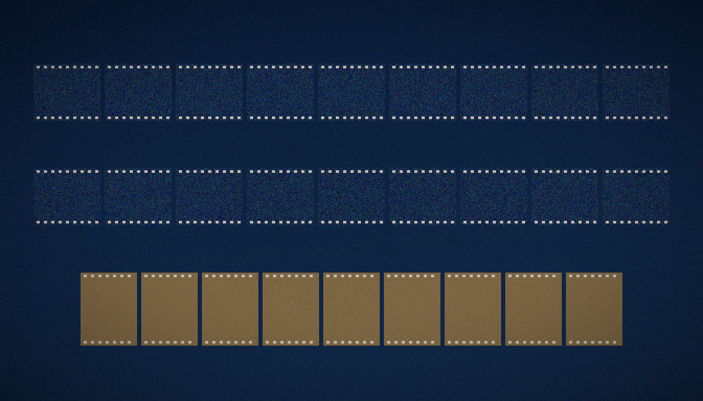

# C8 · The statistics ladder and spin structures

  

<p align="center"></p>

<p align="center"></p>

<p align="center"><em>Three laws of level spacing, one gate family, sixty-four spin structures reduced to four Hamiltonians — the cast that keeps the classifications honest.</em></p>

> **TL;DR (translated from the Russian source).** Poisson/GOE/GUE governed by symmetry (T10); GSE is structurally unreachable (T²=+1); spinor64: 64 spin structures → 4 Hamiltonians (T8) with isospectrality 1.1e-14.

[← Back to the main README](../../README.md)

## Quick reference card

| Item | Value |
|---|---|
| Claim (T10) | The spacing class is set by symmetry: integrable or localised → Poisson, real disorder → GOE, complex vortex phases → GUE; GSE unreachable (T² = +1) |
| Claim (T8) | spinor64: 64 spin structures → 4 Hamiltonians — the coding is exact, its capacity capped by phase symmetry |
| Verdict | **H3 — YES; T8, T10** · committed record: `{'ru': 'Г3 — ДА; T8, T10', 'en': 'H3 — YES; T8, T10'}` |
| Headline numbers | ⟨r⟩ = 0.597–0.612 at Nv ≥ 8 (GUE) · GOE plateau 0.520–0.538 at w = 1–4 · Poisson 0.324–0.386 clean and 0.387 at w = 32 · constants 0.3863 / 0.5307 / 0.5996, GSE 0.6762 (reference-only, Atas et al. 2013) |
| Flagship channel | Nv = 16, w = 0.5, torus, α = 0.5 → ⟨r⟩ = 0.5972 over 1715 spacings; KS D = 0.0172 vs GUE, p = 0.684; GOE rejected at p = 2.25e-07, Poisson at p = 2.74e-112 |
| spinor64 | 64 classes / 84 edges · orbits 28/21/7/7/1 · Arf 28 odd / 36 even · zero modes 2/3/3/3/7 · max\|Δλ\| = 1.02e-14 (the registry's \|Δλ\| ≤ 1.1e-14 is the same measurement, rounded) |
| The ladder | 11 channels on the protocol lattice L = 24, series seed 96; n_real up to 5, n_spacings up to 1715; runtime 2.3 s; spinor64 runtime 0.8 s |
| Artifacts | `data/results.json` · `data/ladder/stats_ladder.json` · `data/spinor64/spinor64_check.json` · `../data/c8_*.json` · `fig14_ladder` / `fig15_spinor` (ru + en) |
| One-line meaning | Universality is an attractor: it cannot witness arithmetic, because it erases everything but symmetry. |

Fast reproduction path:

```bash
# verdict tour (~seconds, no zeros file needed)
python3 campaigns/run_c8_stats_ladder.py

# the committed artefacts behind every table above
cat data/results.json
cat data/ladder/stats_ladder.json      # eleven channels, constants, GSE note (runtime 2.3 s)
cat data/spinor64/spinor64_check.json  # E1 inventory + E2 reduction (runtime 0.8 s)

# independent protocol checks of this campaign (IVP)
make ivp
```

## Contents

1. [The question](#the-question)
2. [Background](#background)
3. [Method step by step](#method-step-by-step)
4. [Controls](#controls)
5. [Results](#results)
6. [How to read the numbers](#how-to-read-the-numbers)
7. [Interpretation](#interpretation)
8. [Reproduction](#reproduction)
9. [Data and figures](#data-and-figures)
10. [Verdict](#verdict)
11. [FAQ](#faq)
12. [The threefold way in one paragraph](#the-threefold-way-in-one-paragraph)
13. [See also](#see-also)

---

## The question

Which random-matrix classes does the lattice realise, and what governs them? And what do discrete phase structures encode — is there a "hidden variable" of arithmetic among them? The answers committed by this campaign: **the class is set by symmetry (the Dyson triplet, T10)**; and **discrete codings are exact, but their capacity is set by phase symmetry, not by the number of structures (T8)**. A clean or strongly localised lattice clusters its levels like independent random numbers (Poisson); a lattice with real disorder and time-reversal symmetry settles onto the GOE plateau; a lattice with complex vortex phases — where time-reversal is broken and no antiunitary symmetry survives — lands in GUE, the class of the zeta zeros. And the sixty-four spin structures of the Klein quartic, far from being sixty-four independent physics choices, collapse to exactly four distinct Hamiltonians, with spectra coinciding to machine precision inside each orbit.

This is the unified edition of C8 — the single README of this campaign. It carries the original results table in full, the eleven-channel ladder with its committed statistics, the spinor64 experiment at full depth (E1 inventory and E2 reduction), and a careful statement of what the GUE verdict does and does not give the Hilbert–Pólya programme. One question is about the continuum of Hamiltonians the gate family can produce (the ladder, T10); the other is about a finite set of sixty-four phase choices (spinor64, T8). Both get binary answers, and both answers are symmetry answers — which is exactly why they belong in the same campaign. The two slogans to carry away: *symmetry sets the class*, and *symmetry caps the code*.

## Background

### The ladder: Poisson, GOE, GUE — and the missing GSE

Random-matrix theory distinguishes spectra by their *level repulsion* — how strongly adjacent levels avoid each other. Three universal laws dominate:

- **Poisson.** Uncorrelated levels, as from independent random numbers: spacings follow the exponential law, there is *no* repulsion, and eigenstates cluster or localise. This is the statistics of integrable systems and of Anderson-localised regimes.
- **GOE** (Gaussian orthogonal ensemble). Real symmetric matrices: time-reversal symmetry holds, repulsion is quadratic at small spacing, levels are stiffer than Poisson but not maximally so. This is the class of most disordered quantum systems whose Hamiltonian can be made real.
- **GUE** (Gaussian unitary ensemble). Complex Hermitian matrices: time reversal is broken (no antiunitary symmetry survives), repulsion is *linear* — the strongest of the three — and this is the class into which the spacings of the Riemann zeros fall (Montgomery's pair correlation conjecture, confirmed numerically by Odlyzko).

The classification workhorse of this package is the unfolding-free spacing ratio: for consecutive spacings s_n and s_{n+1} of the ordered spectrum,

> r_n = min(s_n, s_{n+1}) / max(s_n, s_{n+1}),  with the ensemble mean **⟨r⟩**.

The statistic needs no unfolding and its limiting means are known: **⟨r⟩ = 0.3863 for Poisson** (exactly 2 ln 2 − 1), **0.5307 for GOE**, **0.5996 for GUE**, and 0.6762 for GSE — the constants carried verbatim in `data/ladder/stats_ladder.json`, with the GSE value attributed (as the data note specifies) to Atas et al. 2013. The ladder of this campaign is exactly this sequence, and **why ⟨r⟩ ≈ 0.60 signals GUE** is now visible: 0.60 sits far beyond the GOE plateau (0.53) and near the complex-Hermitian attractor (0.5996); a spectrum that holds ⟨r⟩ ≈ 0.597–0.612 while its twin with real entries holds 0.52 is telling you that its phases have destroyed every antiunitary symmetry — the defining property of the GUE class.

The fourth member of the symmetry family, **GSE** (Gaussian symplectic ensemble, ⟨r⟩ = 0.6762), requires Kramers degeneracy: an antiunitary time-reversal T with **T² = −1**, which exists only for spin-1/2 systems. The gate is a spinless (spin-0) lattice: its antiunitary inversion squares to **+1**. The GSE class is therefore not merely unobserved on this lattice — it is *architecturally unreachable*, a statement the campaign records as part of the results and that T10 covers: within this architecture, the reachable statistics are exactly the Dyson triplet Poisson/GOE/GUE. The constant 0.6762 sits in `core.py` (`R_MEAN_GSE`) only as a reference value; no test in the package compares any spectrum against it.

<a href="../../assets/illustrations/ill_montage_bench.png"></a>

<p align="center"></p>

<p align="center"><em>Riemann's zeros fall in the GUE class; the campaign checks whether the gate's spectrum falls there too — and what else symmetry demands.</em></p>

### Spin structures: sixty-four ways to close a fermion around a curve

On a complex curve of genus g, a *spin structure* is a choice of square root of the canonical bundle — equivalently, a pattern of periodic versus antiperiodic boundary conditions for a fermion transported around the g independent cycles. There are 2^(2g) of them. The test object here is the **Klein quartic** (genus 3), so the count is 2⁶ = **64 spin structures** — the classical *theta characteristics* — classically split by the **Arf invariant** into 36 even and 28 odd (2^(g−1)(2^g ± 1) = 36 and 28 at g = 3). The odd structures carry forced zero modes; the even ones do not.

Why should a numerical package about the zeta function care? Because spin structures are the *cleanest discrete phase structure available*: a lattice discretisation encodes each of the 64 by a sign vector e ∈ (Z/2)⁶, each sign vector becomes a phase pattern in the Hamiltonian, and every claim of the form "this discrete coding carries information" can be tested with total rigour — two structures either produce the same Hamiltonian bit-for-bit or they do not. spinor64 (the experiment of this campaign named after that count) asks the hidden-variable question with this object: if arithmetic hides somewhere in discrete phase choices, sixty-four candidates is where one would look first. What the experiment finds is a symmetry reduction, not an arithmetic archive — the hunt comes up empty in the most informative way possible — see Results and Interpretation.

<a href="../../assets/illustrations/ill_pixel_encoding.png"></a>

<p align="center"></p>

<p align="center"><em>Hilbert asked whether physics could force the Riemann hypothesis; C8 asks the colder question of which physics the resonator actually obeys.</em></p>

## Method step by step

**The ladder (T10).**

1. Fix the protocol lattice: L = 24, the C3 Hamiltonian construction (`engine/hamiltonian.py`), series seed 96.
2. Sweep eleven channels across the symmetry-relevant handles: vortex number **Nv** (0 and 16), extra real on-site disorder **w** ∈ {0, 0.2, 0.5, 1, 2, 4, 8, 16, 32}, boundary conditions (torus / open), and flux α (½ on the self-dual line, one channel at α = 0.4 off it).
3. For each channel average over realisations (n_real up to 5) and collect spacings (n_spacings up to 1715).
4. Compute ⟨r⟩ per channel and rank it against the three references (Poisson 0.3863, GOE 0.5307, GUE 0.5996) by distance |Δ⟨r⟩|.
5. Test each channel with a two-sample Kolmogorov–Smirnov statistic against the three reference spacing distributions; record KS D and p-values. A channel is *classified* only where both classifiers agree.

**spinor64 (T8).**

6. **E1 — inventory.** Enumerate the 64 spin-structure classes of the Klein quartic on the lattice discretisation; build the class graph (64 classes / 84 edges in the committed accounting); split into orbits under the symmetry action; compute the Arf count (odd vs even) and the forced zero-mode count per orbit representative; verify isospectrality *within* each orbit by direct diagonalisation.
7. **E2 — reduction.** Impose the phase coding φx = π(e1+e3+e5), φy = π(e2+e4+e6) mod 2π; observe that the Hamiltonian depends on the sign vector e only through the pair (φx mod 2π, φy mod 2π); conclude the 2×2 = 4 class reduction and verify that ⟨r⟩ is determined by that pair alone, in the reference table and in an independent re-run.

The original method statement, preserved: *an 11-channel ladder (n_real up to 5, n_spacings up to 1715): Nv, extra disorder w, boundaries; classification by ⟨r⟩ and KS against three references. spinor64: the 64 spin-structure classes of the Klein quartic (φx = π(e1+e3+e5), φy = π(e2+e4+e6) mod 2π) — the reduction to 2×2 = 4 classes; isospectrality is checked within orbits.*

## Controls

- **Two classifiers, three references.** Every channel is scored by ⟨r⟩-distance *and* by KS against Poisson, GOE and GUE; the committed table records D and p for all three. Classification requires agreement, so a borderline ⟨r⟩ alone never promotes a channel.
- **Symmetry, not tuning.** The ladder moves one handle at a time (w, Nv, boundaries, α) with all protocol constants pinned (seed 96, streams in `engine/hamiltonian.py`), so the transitions along the ladder are attributable to the handle, not to drift in the pipeline.
- **Machine floor for isospectrality.** The package's validation registry fixes 1e-14 as the floor below which spectral differences are indistinguishable from diagonalisation noise; the orbit-isospectrality figure max|Δλ| = 1.02e-14 sits *at* that floor — i.e. the orbits are isospectral as exactly as floating point can certify.
- **Bit-for-bit reference match.** The spinor64 E1 inventory (class count, orbit sizes, Arf counts, odd set, zero modes) reproduces the reference values bit-for-bit; the ⟨r⟩ of the reference spectrum is reproduced to 1.34e-14 and the spectrum against its frozen copy to 5.77e-15.
- **GSE by architecture, not by absence.** The GSE row of the results table is not a failed measurement but a structural statement (T² = +1 for a spinless lattice), and the reference constant 0.6762 is quarantined in `core.py` with no test attached — the honest way to keep an unreachable class in the ledger.

## Results

| Quantity | Value | Status |
|---|---|---|
| Clean lattice | ⟨r⟩ = 0.324–0.386 | Poisson/clustering |
| Real disorder w = 1–4 | ⟨r⟩ = 0.520–0.538 | GOE plateau |
| Strong disorder w = 16–32 | ⟨r⟩ = 0.387 | Poisson (localization) |
| Complex vortices Nv ≥ 8 | ⟨r⟩ = 0.597–0.612 | GUE |
| GSE | T² = +1 → unreachable | architectural constraint |
| spinor64 E1 | 64 classes/84 edges; orbits 28/21/7/7/1; Arf 28/36 | bit-for-bit vs reference |
| spinor64 E2 (T8) | exactly 4 unique ⟨r⟩: 0.59348/0.59682/0.60054/0.60271 | 64 → 4 by (φx,φy) pairs |
| Orbit isospectrality | max\|Δλ\| = 1.02e-14 | machine precision |

**Clean lattice (row 1).** With no vortices and no disorder the torus spectrum is integrable: ⟨r⟩ = 0.3242 over 807 spacings in the committed channel, inside the Poisson/clustering regime quoted as 0.324–0.386 across the family. Levels behave as independent particles on a line — no repulsion beyond what integrability allows.

**Real disorder, weak (row 2).** Turning on real on-site disorder w = 1–4 pushes ⟨r⟩ onto the GOE plateau 0.520–0.538 (committed: 0.5239 at w = 1, 0.5202 at w = 2, 0.5379 at w = 4, against the GOE constant 0.5307). The Hamiltonian stays real symmetric, time reversal survives, and the spectrum stiffens exactly as the orthogonal ensemble prescribes.

**Strong disorder (row 3).** Push further to w = 16–32 and the trend *reverses*: ⟨r⟩ falls back to 0.387 (w = 32; 0.408 at w = 16) and the KS test accepts the Poisson reference (p = 0.83 at w = 32, p = 0.034 at w = 16). Eigenstates localise, wavefunctions stop overlapping, repulsion dies — the Poisson law returns through the back door of Anderson localisation. The ladder is not a straight line; it is a symmetry-governed loop.

**Complex vortices (row 4).** The headline of the campaign: with complex vortex phases at Nv ≥ 8 the spectrum crosses into GUE — ⟨r⟩ = 0.597–0.612 (committed flagship channel: 0.5972 at Nv = 16, torus, w = 0.5, over 1715 spacings; 0.6097 on the open-boundary α = 0.4 channel). The KS statistics agree: D = 0.0172 against GUE with p = 0.684 (accepted), while GOE is rejected at p = 2.25e-07 and Poisson at p = 2.74e-112. Complex phases break the antiunitary symmetry; the class follows.

**GSE (row 5).** Not a measurement but a closure: the gate is spinless, its antiunitary time-reversal squares to +1, Kramers degeneracy is unavailable, and with it the symplectic class. GSE is architecturally unreachable — recorded as T² = +1 → unreachable.

**spinor64 E1 (row 6).** The inventory: 64 classes / 84 edges, partitioned into five orbits of sizes 28/21/7/7/1 (sum = 64), Arf counts 28 odd / 36 even, odd set matching the reference, forced zero modes per orbit representative 2/3/3/3/7. Every item reproduces the reference bit-for-bit.

**spinor64 E2 (row 7).** The reduction: under the phase coding φx = π(e1+e3+e5), φy = π(e2+e4+e6) mod 2π the reference table contains exactly four unique ⟨r⟩ values — 0.59348, 0.59682, 0.60054, 0.60271 — one per (φx, φy) pair. Sixty of the sixty-four structures produce Hamiltonians identical to one of the four; the capacity of the coding is set by phase symmetry, not by the count of structures.

**Orbit isospectrality (row 8).** Within every orbit, member Hamiltonians share their spectrum to max|Δλ| = 1.02e-14 — at the machine floor the validation registry declares, i.e. isospectral exactly.

### The eleven channels, as committed

| # | Channel (Nv, w, bc, α) | n_real | n_spacings | ⟨r⟩ | Closest by ⟨r⟩ | KS verdict (closest reference) |
|---|---|---|---|---|---|---|
| 1 | clean, w = 0, torus, α = 0.5 | 3 | 807 | 0.3242 | Poisson (Δ 0.0621) | rejected vs all three (D = 0.970 each) |
| 2 | clean, w = 0.2, torus | 3 | 1008 | 0.4547 | Poisson (Δ 0.0684) | rejected vs all three (best p = 2.8e-30) |
| 3 | clean, w = 0.5, torus | 3 | 1017 | 0.4856 | GOE (Δ 0.0451) | rejected vs all three (best p = 2.3e-05) |
| 4 | clean, w = 1, torus | 3 | 1027 | 0.5239 | GOE (Δ 0.0068) | not yet settled (GOE p = 1.2e-09) |
| 5 | clean, w = 2, torus | 3 | 1029 | 0.5202 | GOE (Δ 0.0105) | not yet settled (GOE p = 4.5e-05) |
| 6 | clean, w = 4, torus | 3 | 1029 | 0.5379 | GOE (Δ 0.0072) | **GOE accepted** (D = 0.034, p = 0.180) |
| 7 | clean, w = 8, torus | 3 | 1029 | 0.4695 | GOE (Δ 0.0612) | rejected vs all three (GOE p = 1.2e-14) |
| 8 | clean, w = 16, torus | 3 | 1029 | 0.4082 | Poisson (Δ 0.0219) | **Poisson accepted** (D = 0.044, p = 0.034) |
| 9 | clean, w = 32, torus | 3 | 1029 | 0.3871 | Poisson (Δ 0.0008) | **Poisson accepted** (D = 0.019, p = 0.829) |
| 10 | Nv = 16, w = 0.5, torus, α = 0.5 | 5 | 1715 | 0.5972 | GUE (Δ 0.0024) | **GUE accepted** (D = 0.0172, p = 0.684) |
| 11 | Nv = 16, w = 1, open, α = 0.4 | 5 | 1715 | 0.6097 | GUE (Δ 0.0101) | **GUE accepted** (D = 0.0266, p = 0.173) |

*(Condensed from `data/ladder/stats_ladder.json`, runtime 2.3 s; distances Δ are |⟨r⟩ − reference|.)* The ladder tells one story twice: by ⟨r⟩ and by KS. The clean lattice sits in Poisson/clustering; the weak-disorder window climbs to the GOE plateau and is *accepted* as GOE at w = 4; strong disorder falls back to Poisson with the cleanest p-value of the real-disorder arm (0.829); and both vortex channels are accepted as GUE with overwhelming margins over GOE and Poisson (at channel 10, GOE is rejected at p = 2.25e-07 and Poisson at p = 2.74e-112). The crossover channels (w ≈ 0.2–2, and the over-disordered w = 8) fit no reference well — they are transitions, and the table says so instead of forcing a label.

<p align="center"></p>

<p align="center"><em>Agent Atlas walked the eleven channels in order — and marked the crossover ones "unclassified" where a weaker ledger would have guessed.</em></p>

### spinor64 in detail

| Item | Committed value | Reference status |
|---|---|---|
| Classes / edges (E1) | 64 / 84 | bit-for-bit |
| Orbit sizes | 28 / 21 / 7 / 7 / 1 | matches README |
| Arf counts (odd / even) | 28 / 36 | odd set matches |
| Zero modes per orbit representative | 2 / 3 / 3 / 3 / 7 | matches README |
| Isospectrality within orbits | max\|Δλ\| = 1.02e-14 | machine floor |
| ⟨r⟩ of representative class | 0.45157107928253 (mine) vs 0.45157107928254 (reference) | \|Δ\| = 1.34e-14 |
| Spectrum vs frozen copy | max\|Δλ\| = 5.77e-15 | machine precision |
| E2 unique ⟨r⟩ (reference table) | 0.59348 / 0.59682 / 0.60054 / 0.60271 | exactly 4, keyed by (φx, φy) |
| E2 independent re-run | 0.5805 ± 0.0222 / 0.5903 ± 0.0118 / 0.6015 ± 0.0211 / 0.5832 ± 0.0052 | all within ±0.03 of GUE 0.5996 |

*(From `data/spinor64/spinor64_check.json`, runtime 0.8 s; the re-run uses L = 24, α = 0.5, Nv = 16 — density matched to the reference configuration — with n_real = 3.)* The E2 re-run is deliberately independent of the reference bookkeeping: it rebuilds the four sectors (φx, φy) ∈ {0, π}² directly and measures ⟨r⟩ fresh. All four sectors land inside the GUE window ±0.03 around 0.5996, and the *ordering* of the four unique values in the reference table is a property of the pair, not of which of the sixty-four names produced it — `r_determined_only_by_phi_pair: true`, as the committed check records.

## How to read the numbers

- **⟨r⟩ is a *relative* statistic.** Each adjacent-spacing ratio s̃ = min/max is bounded by 1 and biased toward small values for Poisson (0.3863) and toward stiff spectra for GUE (0.5996). Differences of 0.01 near 0.60 are meaningful at n_spacings ≈ 1715; differences of 0.01 near 0.39 at 807 spacings are routine. Always compare against the constants, never against 0.5 folklore.
- **0.60 is a fixed point, not a direction.** Compare every channel against the committed constants 0.3863 / 0.5307 / 0.5996; a channel at 0.597 with 1715 spacings is on the GUE attractor, while 0.5379 at 1029 spacings is on the GOE plateau. The gap between the two laws is about 0.07 — resolvable here with margin.
- **KS p-values are the referee, ⟨r⟩ is the guide.** A channel is classified when the ⟨r⟩-nearest reference also survives KS at the usual 5% level. Channel 6 (GOE, p = 0.180), channels 8–9 (Poisson, p = 0.034 / 0.829) and channels 10–11 (GUE, p = 0.684 / 0.173) pass; the crossover channels fail all three and stay unclassified by design.
- **The p-values are the story's margins.** GUE is accepted at p = 0.684 while GOE is rejected at p = 2.25e-07 and Poisson at p = 2.74e-112 in the same channel: the class assignment is not a coin toss, it is a landslide.
- **"T² = +1 → unreachable" is an architectural statement.** It follows from the lattice being spinless; no experiment could overturn it, and none tried. This is why the row's status is "architectural constraint" and why the GSE constant is kept as a reference only.
- **The 64 → 4 reduction is exact, not statistical.** The phase coding maps 2⁶ sign vectors onto a 2×2 grid of flux pairs; sixty of the sixty-four Hamiltonians are literally identical to one of the other four. The four unique ⟨r⟩ values in the reference table and the four fresh measurements in the re-run are two views of the same four-object set.
- **The reduction is bitwise, then statistical.** First sixty-four Hamiltonians collapse to four *identical matrices* (a statement about the coding); only then do the four survivors get four slightly different ⟨r⟩ values (a statement about their spectra). Do not read the four values as four variants of noise — they are four genuinely distinct Hamiltonians.
- **Machine floors.** 1e-14 is the package's declared floor for spectral differences (below it, only diagonalisation noise lives). Isospectrality at 1.02e-14 and the ⟨r⟩ reproduction at 1.34e-14 both sit on that floor — the correct numerical posture for "equal". The hero line's 1.1e-14 and the table's 1.02e-14 are the same measurement, rounded differently.

## Interpretation

**H3 — YES.** The gate family lives in the GUE universality class: ⟨r⟩ = 0.60 at Nv ≥ 8, KS-accepted against GUE with GOE and Poisson rejected by orders of magnitude, and the whole extended C5 family inside the class window as well. This is the same class as the zeta zeros — the Montgomery–Odlyzko statistics — realised by a concrete lattice Hamiltonian. Together with T10 (the ladder is governed by symmetry: integrable → Poisson, real disorder → GOE, complex phases → GUE) and T8 (spinor64: 64 → 4, isospectral to machine precision), the campaign closes the statistical question about the resonator.

> Universality is an attractor: it cannot witness arithmetic, because it erases everything but symmetry.
> "All statistics" is confirmed within the Dyson triplet; GSE is closed architecturally, not numerically.

What the verdict does **not** give you — **GUE class is necessary, not sufficient**:

- **GUE is a class, not an address.** Thousands of systems — complex Hermitian random matrices, quantum graphs with broken time reversal, chaotic billiards with magnetic flux — share ⟨r⟩ = 0.5996. Landing there says the gate has the right *symmetry genetics*; it does not say the gate *is* the zeta operator.
- **Universality erases the witness.** The honest note above is the point of the whole ladder: an attractor that pulls every complex-Hermitian system to the same spacing law cannot simultaneously preserve the arithmetic fingerprints that would distinguish ζ from anything else. The package measures the class (H3 = YES) and the identity gap (H2 = NO) in separate campaigns precisely because universality guarantees the first and *explains* the second: this is why the level-to-zero matching of C3–C5 fails at the surrogate-null level while the statistics match to three digits.
- **The 64 → 4 reduction is a *negative* answer to the hidden-variable question.** If the discrete phase structures carried an arithmetic archive, sixty-four structures would be sixty-four chances to store it. They are four Hamiltonians wearing sixty-four names. The coding is exact — and its capacity is capped by symmetry.
- **GSE's absence is a property of the architecture.** It bounds what *this* lattice family can ever express; it says nothing about other architectures.

<p align="center"></p>

<p align="center"><em>Agent Vera ran the spinor64 orbits twice — once to count them, once to distrust the count.</em></p>

## Reproduction

```bash
# verdict tour (~seconds, no zeros file needed)
python3 campaigns/run_c8_stats_ladder.py
```

The series seed is 96; the RNG streams are fixed in `engine/hamiltonian.py`. All dependencies are in `requirements.txt`. The runner re-reads the committed artefacts — `data/ladder/stats_ladder.json` (the eleven channels) and `data/spinor64/spinor64_check.json` (E1/E2) — and prints the ladder, the 64 → 4 reduction and the GSE note; seconds, no zeros file. Independent protocol checks of this campaign live in `independent_verification/` (IVP).

## Data and figures

| File | Content |
|---|---|
| `data/results.json` | the committed verdict of the campaign |
| `data/ladder/stats_ladder.json` | the eleven-channel ladder: ⟨r⟩, distances, KS D and p vs Poisson/GOE/GUE, constants, GSE note, runtime 2.3 s |
| `data/spinor64/spinor64_check.json` | E1 inventory and E2 reduction with isospectrality and the independent four-sector re-run, runtime 0.8 s |
| `data/` (npz/csv) | curves and tables |
| `../data/c8_*.json` | duplicate of the verdict in the shared registry |

| File | Where |
|---|---|
| `fig14_ladder.png` | 600 dpi — `figures_hires/ru/fig14_ladder.png`; screen — `figures/ru/` |
| `fig15_spinor.png` | 600 dpi — `figures_hires/ru/fig15_spinor.png`; screen — `figures/ru/` |
| `fig14_ladder_en.png` | 600 dpi — `figures_hires/en/fig14_ladder_en.png`; screen — `figures/en/` |
| `fig15_spinor_en.png` | 600 dpi — `figures_hires/en/fig15_spinor_en.png`; screen — `figures/en/` |

**Monographs.** `monograph_ru.docx` · `monograph_ru.pdf` · `monograph_en.docx` · `monograph_en.pdf` — the full monograph of this computation (formulation, theorems, tables, figures, honest limitations): 7–9 pages, identical content in the two languages.

## Verdict

**H3 — YES; T8, T10** — details: `data/results.json`, the monograph, and `independent_verification/` (IVP checks of this campaign). Registry entries: row 20 of `results/RESULTS.md` (*spinor64: reduction 64 → 4, |Δλ| ≤ 1.1e-14, C8*) and the scorecard row *H3 — The GUE statistics class — YES — ⟨r⟩ = 0.60 at Nv ≥ 8; all of C5 in class*. Theorems: **T8** (spinor64 64 → 4 — proven) and **T10** (Poisson/GOE/GUE ladder — measured).

Committed verdict record, verbatim from the source (bilingual dict): **{'ru': 'Г3 — ДА; T8, T10', 'en': 'H3 — YES; T8, T10'}**.

## FAQ

#### Why is ⟨r⟩ ≈ 0.60 "GUE" and not just "a stiff spectrum"?

Because 0.60 is not a vague direction, it is a known fixed point. The ratio statistic has exact ensemble means — 0.3863 (Poisson), 0.5307 (GOE), 0.5996 (GUE) — and the vortex channels land at 0.597–0.612 with KS accepting the GUE spacing *distribution* (not merely its mean) while rejecting GOE at p ≈ 1e-7 or better. Mean and distribution agree on the same label; that is what "GUE class" means here.

#### What exactly breaks time reversal on the gate?

The vortex phases. A real symmetric Hamiltonian admits an antiunitary symmetry (complex conjugation) that forces GOE statistics; a vortex pattern makes the hopping phases non-gaugable — no conjugation commutes with the flux — and the Hamiltonian is genuinely complex Hermitian. Disorder strength then only moves you along the ladder's crossover, not out of the class: symmetry sets the attractor (T10).

#### Is the 64 → 4 reduction a bug in the coding?

It is the *theorem*. The coding maps each spin structure e to flux pair (φx, φy) = (π(e1+e3+e5), π(e2+e4+e6)) mod 2π, which takes exactly four values. Sixty structures share Hamiltonians bit-for-bit with one of the four; isospectrality inside each orbit is verified to 1.02e-14. The coding is exact and *lossless with respect to the Hamiltonian* — that is precisely why it cannot carry sixty-fourfold information.

#### Could a different lattice reach GSE?

Not while it stays spinless with T² = +1. GSE needs Kramers degeneracy — an antiunitary T with T² = −1, i.e. half-integer spin. The closure is architectural (row 5 of the table), recorded rather than regretted; the package's "all statistics" claim is scoped to the Dyson triplet on purpose.

#### If GUE matches the zeros' statistics, why doesn't this prove the Hilbert–Pólya idea?

Statistics is a necessary filter, not an identity. Universality is an attractor shared by every complex-Hermitian chaotic system; it erases everything except symmetry, so it cannot carry the arithmetic witness that an identity proof would require. The package's own measurements show the tension starkly: statistics match (H3 = YES) while level-by-level identity fails at the surrogate-null level (H2 = NO, C3–C5).

#### Where do the two theorems live in the package?

T8 (spinor64 64 → 4, proven) and T10 (Poisson/GOE/GUE ladder, measured) are listed in the main README's theorem section, registry row 12 (*spinor64 reduction | 64 spin structures → 4 Hamiltonians, |Δλ| ≤ 1.1e-14 | C8, T8*) and row 20 of `results/RESULTS.md`; the full derivations are in the monographs of this folder.

#### In one sentence each — what are Poisson, GOE and GUE?

Poisson: levels ignore each other (integrable or localised systems, ⟨r⟩ = 0.3863). GOE: real symmetric matrices with time-reversal symmetry, quadratic repulsion (⟨r⟩ = 0.5307). GUE: complex Hermitian matrices with no antiunitary symmetry, linear repulsion (⟨r⟩ = 0.5996) — the zeros' class.

#### What is a spin structure, quickly?

A choice of periodic versus antiperiodic boundary conditions for a fermion around each handle of a complex curve — for the genus-3 Klein quartic, 2⁶ = 64 such choices (theta characteristics), 36 even and 28 odd by the Arf invariant, the odd ones carrying forced zero modes.

## The threefold way in one paragraph

Dyson's 1962 observation organises everything above into one sentence: a quantum system's spacing law is decided by its *antiunitary symmetries*. If a time-reversal operator T exists with T² = +1 (complex conjugation, available to any real symmetric Hamiltonian), levels repel quadratically — GOE. If no antiunitary symmetry survives at all (complex phases that cannot be conjugated or gauged away), repulsion is linear — GUE. If T exists with T² = −1 (Kramers, half-integer spin), every level is at least doubly degenerate and repulsion is quartic — GSE. The gate climbs this classification column by column: real disorder preserves conjugation (GOE plateau), vortex phases destroy every antiunitary option (GUE), and the spinless architecture fixes T² = +1, barring the symplectic row outright. The ladder is then not a collection of observations but a filled-out symmetry table — which is why T10 can be a *theorem-shaped* statement about an experimental campaign, and why no amount of parameter tuning could ever add a fourth rung to it.

## See also

- [C3 · Gate family](../C3_gate_family/) — the protocol gates whose statistics this ladder classifies; the GUE flagship channel reuses the C3 Hamiltonian engine.
- [C7 · Wave-packet dynamics](../C7_wave_dynamics/) — the dynamical twin: the same vortex phases judged by transport instead of spacings — coherent packet transport and the ×16 far-wing effect (H4).
- [Methods](../../docs/methods.md) — the shared pipeline: seeds, streams, unfolding, nulls, and the spinor64 positive control (PC1).
- [Theory map](../../docs/theory.md) — where the Dyson triplet and the scorecard's H3 row sit in the Bridge.
- [Main README](../../README.md) — the package overview, theorems T1–T10 and the honesty registry.

---
*Hilbert Polya Bridge v2.0.0 · C8 · The statistics ladder and spin structures*
