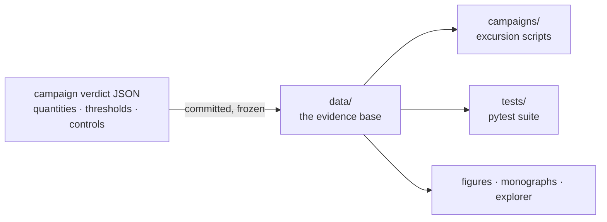

<!-- AB-ENRICHED:v1 · sub -->

**🧭 [⬆ Hilbert_Polya/](../README.md) · [🏠 Root README](../../README.md)**

# data/ — the committed campaign verdicts

> **🧭 Navigation:** [Hilbert_Polya/](../README.md · [Root README](../../README.md)

*Everything downstream replays committed files — nothing depends on a recomputation.*

*The evidence layer of the Hilbert–Pólya Bridge: every number that any
figure, theorem, monograph or campaign script quotes is committed here,
frozen at the moment of measurement, and reproducible bit-for-bit.*

[← Back to the main README](../README.md)

## What this folder is

This is the **immutable evidence base** of the study. The package follows a
strict discipline: a campaign is finished only when its verdict — the JSON
document with all measured quantities, thresholds and controls — is
committed. Everything downstream (the excursion scripts in `campaigns/`,
the pytest suite in `tests/`, the figures, the monographs, the explorer)
replays these committed files; nothing in the narrative depends on a
recomputation having been run on your machine.

The verdicts cover the v1 campaigns C1–C7 directly; the C8 verdict lives
with its campaign under `computations/C8_stats_ladder/data/`; the v2
campaigns C9–C16 likewise commit under their own `computations/<ID>/data/`
folders and are self-sufficient. The zero cache that replaced all external
data in v2 also lives here, under `zeros/`.

## Contents

| File | Campaign | Contents |
|------|----------|------------|
| c1_identity_verdict.json | C1 | K1–K7: ladder, reality, zeros, Gram |
| c2_argument_verdict.json | C2 | anchors 0/3/10/29/79/649, S(T), gaps, bridge |
| c3_gates_verdict.json + c3_gates_table.csv | C3 | 52 gates, zeros, PC1/PC2 |
| c4_trace_verdict.json | C4 | M0/M1/M2, PC0, trace-metric gap |
| c5_gates_ext_verdict.json + c5_gates_ext_table.csv | C5 | 35+2 extended gates |
| c6_primes_verdict.json | C6 | co-location, kernel δ(d), ψ-ladder, codings |
| c7_dynamics_verdict.json | C7 | trajectories ⟨x⟩(t), transport |
| (C8 — see computations/C8_stats_ladder/data/) | C8 | ladder of 11 channels, spinor64 |
| zeros/zeros_mpmath_n800.npz | v2 | internal cache of ζ zeros (mpmath 1.3, dps=25, bit-for-bit reproducible) — the only zero source of v2; the external Odlyzko file is not used |

The `zeros/` subfolder also holds smaller sibling caches of the same
mpmath provenance — `zeros/zeros_mpmath_n30.npz`, `zeros/zeros_mpmath_n60.npz`
and `zeros/zeros_mpmath_n100.npz`; the v2
protocol itself is bound to the n800 cache named above.

### Anatomy of a verdict

Each verdict JSON is a self-describing document. Its `meta` block records
the task, the date, the working precision, the named ingredients that were
assembled, and how many free parameters the construction used (for C1:
`dps 30`, `free_parameters: 0`). Its `criteria` block stores one section
per acceptance criterion with the raw measured residuals — for example
`K1_gamma_ladder` carries `max_rel_dev_edge1 = 2.5896027595341725e-39`,
the kind of number that the threshold registry in `docs/validation.md`
adjudicates. The gate-family verdicts additionally embed the full per-gate
`family` table: for every gate the handles (`Nv`, `q`, `W`, `alpha`) and
the measured statistics (`mean_spacing`, `r_H7`, `D_nn`, `KS_sp`, the
p-values, `r_GUE_z`), with the window protocol in `meta` (`L = 24`,
`K = 200`, `poly_deg = 6`, `zero_window_gamma0 = 500.309084942`,
`null_shifts = 64`, `null_gue = 40`). The two CSV files are the flat,
human-readable exports of the same gate tables.

## The rules

1. Verdicts are committed; fresh recomputations are optional.
2. The ζ zero file (2 001 052 heights, Odlyzko) is NOT committed; its path
   is `ZFILE`.
3. A repeat run of the IVP must reproduce all verdicts bit-for-bit
   (seed determinism: `engine/hamiltonian.py`).
4. The JSONs are read by the campaigns `campaigns/run_c*.py` — the
   excursion without recomputation.

## The v2 rules

**5.** The package depends on no external data file whatsoever: the zeros are
   the internal cache; campaigns C9–C16 are self-sufficient.

Rule 5 is the quiet revolution of v2. In v1 the only third-party artifact
was the Odlyzko zero list, used optionally by fresh recomputations; in v2
even that is gone — the eight hundred zero heights that every v2 metric
needs are generated from the internal mpmath cache at a fixed working
precision, so the whole package is reproducible from source alone.

## How to use it

- **Read a verdict directly.** The JSONs are plain and self-describing;
  start with `c1_identity_verdict.json` for the algebra stage, then walk
  the campaigns in order.
- **Replay the excursions.** `python3 campaigns/run_c1_identity.py` (and
  its siblings, or `make tour` for all eight) prints the verdict from
  exactly these files — the excursion without recomputation.
- **Run the test suite.** `python3 -m pytest tests/ -q` checks the
  committed verdicts themselves; if a verdict JSON were corrupted or a
  pipeline drifted, the suite would catch it.
- **Replay the verification (optional).** The independent verification
  protocol, `hpbridge.validate.run_all`, replays the blind checks against
  the committed verdicts and must reproduce them bit-for-bit (rule 3).
- **Feed the explorer.** The v2 explorer replays committed data through
  its three tabs; its live gate works against the internal zero cache of
  this folder.

## Conventions

- Verdict filenames are pinned to campaign IDs: `c<N>_<slug>_verdict.json`
  mirrors `computations/C<N>_<slug>/`; the gate tables ship as companion
  CSVs (`c3_gates_table.csv`, `c5_gates_ext_table.csv`).
- Numbers in the verdicts are full-precision floats, never rounded for
  presentation; rounding happens only in prose and figures.
- Nothing in this folder is hand-edited: files are produced by the campaign
  pipelines and committed as-is.
- The committed evidence is bilingual upstream (the campaign READMEs in
  `computations/*/` present it in RU and EN), but the JSON/CSV payloads
  themselves are language-neutral.

## Common workflows

**Verify one quoted number.** Every claim in the monographs and READMEs
resolves to a JSON field here. Example: the statement that the Γ-ladder
closes with residuals near 1e-39 is `K1_gamma_ladder` inside
`c1_identity_verdict.json`, which carries `max_rel_dev_edge1 =
2.5896027595341725e-39` and `max_rel_dev_edge0 = 2.5680114024923632e-39`
against the 1e-30 threshold of `docs/validation.md`.

**Replay a verdict without recomputation.** Run the matching excursion —
`python3 campaigns/run_c1_identity.py` — and compare its printed verdict
with the JSON it reads from this folder; they must agree line for line.

**Replay the verification protocol.** `python3 -c "from hpbridge.validate import run_all; [print(r) for r in run_all()]"`
runs the IVP; by rule 3 it must reproduce every committed verdict
bit-for-bit, including the seeded vortex streams behind the gate tables.

**Trace the provenance chain.** Seeds (`BASE_SEED = 96`, vortex stream
`seed + HARDCORE_OFFSET` with `HARDCORE_OFFSET = 3500`, in
`engine/hamiltonian.py`) → campaign script → verdict JSON committed here →
consumers: the excursion scripts, the pytest suite, the explorer, and
every figure in `figures_hires/`.

## FAQ

**Do I need the Odlyzko zero file?**
Not for anything committed: the excursion scripts, the pytest suite and
the explorer all run from this folder as-is. Only a fresh recomputation
of the v1 campaigns needs it, via `ZFILE`. In v2 it is never used — the
internal cache `zeros/zeros_mpmath_n800.npz` is the only zero source.

**Where is the C8 verdict?**
With its campaign: `computations/C8_stats_ladder/data/` (the ladder of 11
channels, spinor64). The v2 verdicts C9–C16 likewise live in their own
`computations/<ID>/data/` folders and are self-sufficient.

**Why do only C3 and C5 have CSV companions?**
Those are the two gate-family campaigns (52 gates; 35+2 extended gates).
The JSON stores the full per-gate family with the window metadata; the
CSV is the flat human-readable projection of the same rows.

**A rerun gives me a different number — now what?**
Then the harness is broken, not the physics: rule 3 demands bit-for-bit
reproduction. Check that the engine and its seeds are untouched, that
`ZFILE` (if used) points to the intended file, and compare against the
committed JSON before drawing any conclusion.

**Which file should a newcomer open first?**
`c1_identity_verdict.json` — the algebra stage, the foundation of the
five-stage map — then walk C2 (counting), C3–C5 (operator), C4 (trace),
C6 (primes), C7 (dynamics), C8 (statistics).

## Glossary

- **K1–K7** — the C1 acceptance criteria: the Γ-ladder closures, the
  reality of Z_id, the zero list, the Gram points.
- **anchors 0/3/10/29/79/649** — the six anchor points of the C2
  argument-principle verdict; 649 = 649 is the headline zero count of the
  strip (T ≤ 1000, residuals ≤ 8.3e-25).
- **S(T)** — the argument-principle error term committed by C2; required
  |S| ≤ 1.8, measured 1.7994.
- **PC0, PC1, PC2** — positive controls: PC0 for the heat trace (C4,
  r = +0.9998, resid 2.1%), PC1/PC2 for the rank metric (C3,
  r = 1.000000000).
- **M0/M1/M2** — the three C4 measurements: M0 the identity Q(a)
  (|ΔQ| ≤ 1.7e-12), M1 the trace formula (|ΔK| ≤ 1.2e-5 absolute), M2 the
  trace-metric gap of the gates.
- **r_H7** — Pearson correlation of rank-fluctuations between a gate
  window and the zero window; the rank projection of the H2 question.
- **D_nn** — the nearest-neighbour spacing statistic after an optimal
  global shift; floor 1e-14 for isospectral twins (below it, only
  diagonalization noise).
- **⟨r⟩, GUE class** — the statistics class of a spectrum; GUE means
  ⟨r⟩ ≈ 0.6 (C5 v2.0.5 measured 0.569–0.633, mean 0.601, against the
  canonical GUE band 0.5996±0.03).
- **spinor64** — the C8 reduction: 64 spin structures collapse to 4
  Hamiltonians with |Δλ| ≤ 1.1e-14.
- **ZFILE** — the path variable for the external Odlyzko zero file
  (2 001 052 heights); optional in v1, unused in v2.
- **IVP** — the independent verification protocol (IVP01–IVP10 in v1,
  IVP01–18 in v2), implemented in `hpbridge/validate.py`.
- **N̄(γ), Λ(n)** — the Riemann–von Mangoldt smooth count used to unfold
  the zero side, and the von Mangoldt weight of the prime side (C6).

## See also

- [../README.md](../README.md) — the main README and the headline results table
- [../campaigns/README.md](../campaigns/README.md) — the scripts that print these verdicts
- [../engine/README.md](../engine/README.md) — the seeded kernel that makes the verdicts reproducible
- [../docs/validation.md](../docs/validation.md) — the thresholds each verdict is judged against
- [../computations/](../computations/) — per-campaign folders with data, figures and monographs

⚡ Part of <a href="../../README.md">AB-Cloud Research</a> — numbers are verbatim from the unified registry; no result on this page is a claim about the Riemann hypothesis · <a href="../README.md">⬆ parent section</a>

