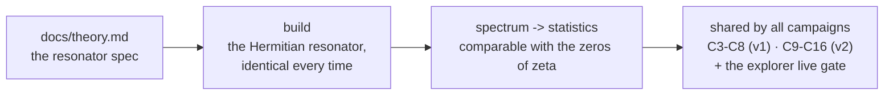

<!-- AB-ENRICHED:v1 · sub -->
<div align="center">


**🧭 [⬆ Hilbert_Polya/](../README.md) · [🏠 Root README](../../README.md)**

</div>
# engine/ — the core of the resonator

> **🧭 Navigation:** [Hilbert_Polya/](../README.md · [Root README](../../README.md)



*Two modules, one contract — every consumer passes through the same pipeline.*

<p align="center"></p>

<p align="center"></p>

*Two modules, one contract: build the Hermitian resonator exactly the same
way every time, and turn its spectrum into statistics comparable with the
zeros of ζ.*

[← Back to the main README](../README.md)

## What this folder is

This is the **computational kernel** of the whole package — the single
source of the resonator. Every campaign of every stage that touches the
operator (C3–C8 in v1; C9–C16 in v2) builds its Hamiltonians and spectra
through these two modules, and the honesty discipline of the series rests
on that singularity: one construction, one seed discipline, one spectral
pipeline, shared by all campaigns and by the explorer's live gate.

The engine implements the resonator of `docs/theory.md`: an L×L lattice
with hopping −t·e^{iφ}, Landau-type flux φ_x = 2πα·iy on the x-links,
vortex phases on the y-links, on-site disorder W, open or toroidal
boundaries. The self-dual line α = ½ — the line where the lattice becomes
a discretized massless Dirac equation — is the line the entire series
lives on.

## Contents

| Module | Contents |
|--------|----------|
| `hamiltonian.py` | construction of the Hermitian Hamiltonian: flux 2πα·iy, vortex phases (RAW angle difference — the exact C3 protocol), disorder W; the C5 handles: twists, anisotropy, δα, mass, profile, signs, boundaries; the sweep |
| `solver.py` | the spectral pipeline of the gates, the GUE null, the ζ zeros, N̄, the Λ sieve |

### `hamiltonian.py` — the construction

- **Protocol constants**, uniform for the whole series: `BASE_SEED = 96`
  (the master seed), `HARDCORE_OFFSET = 3500` (the vortex RNG stream is
  seeded `seed + HARDCORE_OFFSET`), `T_HOP = 1.0`, `CENTER_FRACTION = 0.6`
  (the fraction of the central band), `MIN_DIST = 3.0`.
- **Vortex configuration.** `random_vortex_configuration` places Nv
  vortices at cell centers `(ix+0.5, iy+0.5)`, `ix, iy` integers from
  `1..N−1`, sampled independently — the exact C3 protocol, with the
  interleaved x/y stream order preserved bit-for-bit. Charges (the C5
  handle *signs*) come in three modes: `'neutral'` (the protocol: for
  even Nv the first half +q, the rest −q — zero total circulation; for
  odd Nv, (Nv+1)/2 pluses), `'all_plus'`, `'random'`.
- **The assembly.** `build_hamiltonian` lays the flux 2πα·iy on the
  x-links and the vortex phases `q/2·(θ_j−θ_i)` on the y-links, taking
  the RAW angle difference — the branch discontinuity is deliberately not
  unwrapped, because that is what the C3 protocol did; `disorder W` is
  added on-site, and the boundary condition (open or toroidal) closes the
  construction.
- **The C5 handles.** Twists (φx, φy), anisotropy t_x/t_y, the flux shift
  δα, a staggered mass m, the vortex profile (site/midpoint), the charge
  signs, and the boundary choice — the six new dimensions that campaign
  C5 swept to test the stability of the measured gap.
- **The sweep** (unfolding): `central_band` (fld-arithmetic, 344 levels),
  `unfold_poly` (degree 6 → 3, with a monotone-interpolation fallback),
  and `window_u` (exactly 200 levels with an offset of 10).

### `solver.py` — the measurement

- `load_zeros` — ζ zero heights (γ > 0) in the Odlyzko one-column format.
- `rvm_count` — the smooth Riemann–von Mangoldt count
  N̄(γ) = γ/2π·ln(γ/2πe) + 5/8, which puts both sides of every comparison
  into the one-density-per-unit coordinate system.
- `gue_spectrum(n=576, seed=0)` — the GUE null: (X+X†)/2 for complex
  Gaussian X, the reference statistics class of the whole series.
- `sieve_lambda(nmax)` — the von Mangoldt function Λ(n) by a
  smallest-prime-factor sieve, feeding the ψ-ladder of C6.
- The gate driver assembles the pipeline: configuration → spectrum →
  sweep → window, ready to be compared against the zero window.

Equivalence control: all 52 gates of C3 reproduce the `mean_spacing` CSV
bit-for-bit (52/52 at |Δ| < 1e-10).

## How to use it

```bash
# everything downstream imports the kernel, never re-implements it:
#   campaigns/run_c3_gates.py, tests/, explorer/streamlit_app.py
python3 -c "from engine.solver import gue_spectrum, rvm_count, sieve_lambda; \
print(gue_spectrum(8).shape, rvm_count(100.0), sieve_lambda(10))"
```

- To reproduce any campaign number: import the engine, set the same
  handles, and rely on the seeds — the IVP must reproduce all committed
  verdicts bit-for-bit (`data/`, rule 3).
- The bit-exact base control is `Nv = 0, W = 0.5, α = 0.5`: it reproduces
  the C3 `mean_spacing` CSV with |Δ| = 1.45e-16 — this port is equivalent
  to the C3 protocol.
- The explorer's live gate calls the same `eigvalsh` rebuild of the
  576×576 resonator; if you change the engine, you change every campaign
  and the explorer at once — which is exactly why the engine is small.

## Conventions

- The engine is the *only* place where a Hamiltonian is built: no campaign
  constructs matrices by hand.
- Protocol fidelity outranks elegance: the RAW angle difference and the
  interleaved RNG stream order are kept precisely because C3 was measured
  that way.
- Self-sufficiency: numpy/scipy only — the kernel has no other dependency.
- Any new handle enters here first, is committed with its seed discipline,
  and only then appears in a campaign (the C5 and v2 pattern).

## See also

- [../README.md](../README.md) — the main README: the resonator in one page
- [../docs/theory.md](../docs/theory.md) — the construction in mathematical language
- [../docs/methods.md](../docs/methods.md) — the spectral pipeline this engine implements
- [../campaigns/README.md](../campaigns/README.md) — the campaigns that consume the kernel
- [../data/README.md](../data/README.md) — the verdicts whose reproducibility the seeds guarantee

<div align="center">


<sub>⚡ Part of <a href="../../README.md">AB-Cloud Research</a> — numbers are verbatim from the unified registry; no result on this page is a claim about the Riemann hypothesis · <a href="../README.md">⬆ parent section</a></sub>

</div>
