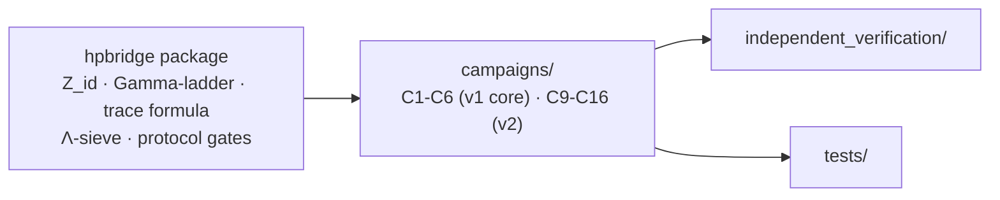

<!-- AB-ENRICHED:v1 · sub -->
<div align="center">


**🧭 [⬆ Hilbert_Polya/](../README.md) · [🏠 Root README](../../README.md)**

</div>
# hpbridge/ — the Python package of the series

> **🧭 Navigation:** [Hilbert_Polya/](../README.md · [Root README](../../README.md)



*The common vocabulary: everything imports from here.*

<p align="center"></p>

<p align="center"></p>
<p align="center"><em>The full cast of the series: the two geometers who posed the question, and the agents who carry its arithmetic.</em></p>

[← Back to the main README](../README.md)

## What this folder is

`hpbridge/` is the single importable Python package of the Hilbert–Pólya Bridge
series. Every campaign script in `campaigns/`, every independent check in
`independent_verification/`, and every test in `tests/` imports its machinery
from here, so the package defines the common vocabulary of the whole study:
the identity function `Z_id`, the Γ-ladder, the trace formula, the Λ-sieve,
and the lattice of protocol gates ("затворы" in the Russian sources — shutters
that close off ranges of the critical line).

The package is deliberately split into two generations. The six core modules
below implement the v1.0.0 protocol (campaigns C1–C6, theorems T1–T10); the
v2 modules extend the same style to campaigns C9–C16. Nothing here reads a
zeros file at import time: high-precision zeros are used only by fresh
campaign runs, and then only optionally.

## Contents

| Module | Contents |
|--------|------------|
| `constants.py` | protocol constants (seed 96, window 200, Hadamard B) |
| `identity.py` | Z_id, Γ-ladder, zero bisection, Gram points (campaign C1) |
| `traceformula.py` | Q(a) identity, trace formula, r_EF metric, zeros (C4, T6) |
| `primes.py` | Λ-sieve, comb P(u), ψ-ladder, flow Φ_p (C6) |
| `gates.py` | family declarations C3/C5 |
| `validate.py` | checks IVP01–IVP10 |

The v2 generation adds, in the same directory:

| Module | Role in the series |
|--------|--------------------|
| `__init__.py` | package marker; keeps `hpbridge` importable from the repo root |
| `nonlocaltrace.py` | nonlocal trace primitive behind campaign C9 (theorem T11) |
| `phasecoding.py` | phase-coded gate families for the hard co-location campaign C10 (T12) |
| `alphathird.py` | α/3 counting-law scan for campaign C11 (T13) |
| `blindfamilies.py` | blind gate-family sampling for campaign C13 (T15) |
| `dirichlet.py` | Dirichlet-side machinery for campaign C15 (T17) |
| `qinfo.py` | quantum-information locality echo for campaign C16 (T18) |
| `metrics_v2.py` | the v2 rank and thermal metrics used to score v2 campaigns |
| `zeros_mp.py` | high-precision zero grid helpers (mpmath), used by fresh campaign runs |

## How to use it

Dependencies: numpy, scipy, mpmath. A zeros file is not needed (it is used
only by fresh campaigns, optionally).

Re-run the ten independent checks of the protocol directly from the package:

```bash
python3 -c "from hpbridge.validate import run_all; [print(r) for r in run_all()]"
```

Campaign drivers in `campaigns/` (for example `run_c1_identity.py`,
`run_c4_trace_formula.py`) each import the relevant module above and write
their verdicts to `data/`. The pytest suite in `tests/` imports the same
modules, so anything you change here is immediately re-checked against the
committed verdicts.

## Conventions

- Protocol constants (seed 96, window 200, Hadamard B) live in exactly one
  place, `constants.py`; campaigns must import them, never restate them.
- Campaign identifiers are written `C1`–`C16`, theorem identifiers `T1`–`T18`;
  module docstrings cite both.
- The r_EF metric and the positive control PC0 (the case where the method
  sees the identity exactly) originate in `traceformula.py` and are reused
  by every v2 scorecard.
- Blind protocols (C3/C5 families, C13) draw their families through
  `gates.py` declarations so that the sampling rules are committed, not
  improvised.

## See also

- [../campaigns/README.md](../campaigns/README.md) — the campaign drivers that consume this package
- [../independent_verification/README.md](../independent_verification/README.md) — the IVP01–IVP10 protocol built on `validate.py`
- [../tests/README.md](../tests/README.md) — the pytest suite over committed verdicts
- [../docs/methods.md](../docs/methods.md) — the methods chapter describing the mathematics

<div align="center">


<sub>⚡ Part of <a href="../../README.md">AB-Cloud Research</a> — numbers are verbatim from the unified registry; no result on this page is a claim about the Riemann hypothesis · <a href="../README.md">⬆ parent section</a></sub>

</div>
