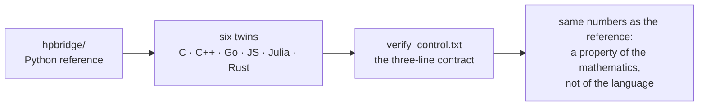

# multilang/ — multilingual twins of the kernel

> **🧭 Navigation:** [Hilbert_Polya/](../README.md · [Root README](../../README.md)



*Six tongues, one sentence — the cross-checking loop.*

<p align="center"></p>

<p align="center"></p>
<p align="center"><em>Six tongues, one sentence: each twin re-states the same two invariants in a different language and must end with the same numbers.</em></p>

[← Back to the main README](../README.md)

## What this folder is

Six ports of one and the same computational kernel — the pair of invariants
shorthand-named "Γ-closure + Λ-sieve" — written for cross-checking the
arithmetic of the series on different languages and runtimes. The Python
reference implementation lives in `hpbridge/`; the twins here exist to show
that the numbers of the reference are a property of the mathematics, not of
Python, `mpmath`, or any particular standard library.

Every port computes the same two quantities and writes the same control
block, `verify_control.txt`, whose three lines are the contract between the
twins and the verification protocol:

```
gamma_closure_max_res = 5.855e-15   # max |  |Γ(½+iu)| − √(π/cosh πu) | / ref, u ∈ {0.5, 1, 2, 3}
lambda_sum_check    = 1.4989125716  # Σ Λ(n)/n^{3/2}, n ≤ 1e5
n_sieve             = 100000
```

- `gamma_closure_max_res` — the maximal relative deviation of the modulus
  |Γ(½+iu)| from its exact closed form √(π/cosh πu), sampled at
  u ∈ {0.5, 1, 2, 3};
- `lambda_sum_check` — the von Mangoldt sum Σ Λ(n)/n^{3/2} truncated at
  n ≤ 1e5, computed by an honest sieve, not by a library call;
- `n_sieve` — the sieve bound itself, 100000.

## Contents

| Path | Language | Line count | Role |
|------|----------|-----------:|------|
| `c/verify_core.c` | C11 | 93 | the reference twin; its control block is committed |
| `c/verify_control.txt` | — | 3 | the committed control block consumed by IVP10 |
| `cpp/verify_core.cpp` | C++17 | 47 | the C++ twin, same Lanczos constants |
| `javascript/verify_core.js` | JavaScript (Node ≥ 18) | 39 | the Node twin, stdlib only (`fs`, `Math`) |
| `go/verify_core.go` | Go ≥ 1.21 | 76 | the Go twin, stdlib only (`math`, `fmt`, `os`) |
| `rust/verify_core.rs` | Rust ≥ 1.70 | 60 | the Rust twin, no external crates |
| `julia/verify_core.jl` | Julia ≥ 1.9 | 63 | the Julia twin, `Float64` throughout |

## Port status (honestly stated)

| Port | Language | Status | Control block |
|------|----------|--------|---------------|
| `c/verify_core.c` | C11 | **verified in this environment** | `c/verify_control.txt` (committed) |
| `cpp/verify_core.cpp` | C++17 | **verified in this environment** | see the build log below |
| `javascript/verify_core.js` | Node ≥ 18 | **verified in this environment** | see the build log |
| `go/verify_core.go` | Go ≥ 1.21 | portable source | toolchain unavailable in the build environment |
| `rust/verify_core.rs` | Rust ≥ 1.70 | portable source | toolchain unavailable in the build environment |
| `julia/verify_core.jl` | Julia ≥ 1.9 | portable source | toolchain unavailable in the build environment |

Three of the six twins were compiled and executed in the environment where
the series was assembled; the other three are portable sources whose
toolchains were unavailable there. This is stated without embellishment on
purpose: a twin that has not run is not a verification, only an invitation.

Reference values (Python, same algorithm): gamma_closure_max_res =
5.9e-15 (half of double precision), lambda_sum_check = 1.4989125716.
The Λ-sum discrepancy between C and Python: 4.6e-11.

## Build and run

```bash
# C
cc -O2 multilang/c/verify_core.c -lm -o /tmp/hpb_c && /tmp/hpb_c multilang/c/verify_control.txt
# C++
g++ -O2 -o /tmp/hpb_cpp multilang/cpp/verify_core.cpp && /tmp/hpb_cpp /tmp/ctl_cpp.txt
# JavaScript
node multilang/javascript/verify_core.js /tmp/ctl_js.txt
# Go (where a toolchain is available)
go build -o /tmp/hpb_go multilang/go/verify_core.go && /tmp/hpb_go /tmp/ctl_go.txt
# Rust (where a toolchain is available)
rustc -O -o /tmp/hpb_rs multilang/rust/verify_core.rs && /tmp/hpb_rs /tmp/ctl_rs.txt
# Julia (where a toolchain is available)
julia multilang/julia/verify_core.jl /tmp/ctl_jl.txt
```

Each invocation either checks the block passed as the argument or writes a
fresh one; a fresh block should agree with the values printed above to the
digits shown.

## What the kernel actually computes

Both invariants are chosen to be cheap, deterministic, and sensitive to real
arithmetic errors:

1. **Γ-closure.** The exact identity |Γ(½+iu)|² = π/cosh(πu) is evaluated two
   ways: once through the closed form, once through a complex Lanczos
   implementation of Γ(re + iu). All six twins share the same Lanczos setup —
   g = 7 with the nine classical coefficients (0.99999999999980993,
   676.5203681218851, −1259.1392167224028, 771.32342877765313,
   −176.61502916214059, 12.507343278686905, −0.13857109526572012,
   9.9843695780195716e-6, 1.5056327351493116e-7), byte-identical in every
   port — so any residual disagreement is a disagreement of runtimes, not of
   formulas.
2. **Λ-sieve.** The summatory Σ Λ(n)/n^{3/2} is accumulated from a sieve of
   von Mangoldt values up to n_sieve = 100000, exercising integer arithmetic,
   loops, and floating-point accumulation in a pattern quite different from
   the transcendental part.

The residual reported in the control block is the maximum over the four
sample points u ∈ {0.5, 1, 2, 3} of the relative deviation of |Γ(½+iu)| from
√(π/cosh πu). For double precision the honest expectation is a few units in
the last place — hence the Python reference value 5.9e-15, about half of
machine epsilon, and the C twin's committed 5.855e-15.

## How IVP10 consumes this folder

IVP10 (in `independent_verification/`) reconciles the committed C control
block with a fresh Python recount: the threshold is γ ≤ 1e-12 on the
Γ-residual and an exact match on the Λ-sum and the sieve bound at the digits
of the block. Ports marked "portable source" are verified by the same
procedure on machines that have their toolchains: build, run, compare the
three lines. The one-liner used by the protocol is:

```bash
python3 -c "from hpbridge.validate import run_all; [print(r) for r in run_all()]"
```

## Worked example: adopting a new twin verdict

Suppose you run the Go twin on a machine with a Go toolchain:

1. build and run exactly as in the block above:
   `go build -o /tmp/hpb_go multilang/go/verify_core.go && /tmp/hpb_go /tmp/ctl_go.txt`;
2. compare `/tmp/ctl_go.txt` with the committed `multilang/c/verify_control.txt`:
   the Λ-sum must agree to all eleven significant digits (1.4989125716), the
   sieve bound must be identical (100000), and the Γ-residual must stay below
   the IVP10 threshold γ ≤ 1e-12;
3. record the outcome in the port-status table above, upgrading
   `go/verify_core.go` from *portable source* to *verified* and stating the
   environment; commit the fresh control block next to the port if it differs
   in the last digit, together with a one-line note on the toolchain version.

The same three steps apply, mutatis mutandis, to the Rust and Julia twins;
their build lines are already in the "Build and run" section.

## Conventions

- One port, one file, standard library only: no port may pull in third-party
  packages, wrappers, or build systems beyond the single compile/run line
  shown above.
- The Lanczos constants and the sample points u ∈ {0.5, 1, 2, 3} are frozen;
  changing them means changing all six ports and the Python reference in the
  same commit.
- The control block format is fixed: three lines, `key = value` with the
  exact key names `gamma_closure_max_res`, `lambda_sum_check`, `n_sieve`,
  and comments allowed only in the committed C block.
- Statuses in the port table are upgraded only by an executed run in a named
  environment; "portable source" is never silently promoted.

## Glossary

- **Twin** — a single-file reimplementation of the kernel in another
  language, held to the same output contract as the Python reference.
- **Γ-closure** — the residual of the exact modulus identity
  |Γ(½+iu)| = √(π/cosh πu) over the sample points.
- **Λ-sieve** — the sieved computation of Σ Λ(n)/n^{3/2} up to n_sieve.
- **Control block** — the three-line `verify_control.txt` contract shared by
  all ports and consumed by IVP10.
- **Portable source** — a twin whose toolchain was unavailable in the build
  environment, so its correctness has not yet been witnessed there.

## FAQ

**Why six languages for two numbers?**
Because the point is not the two numbers but the demonstration that the
series' arithmetic survives a change of runtime. Two invariants are enough
to catch transcription bugs, library quirks, and silent precision losses,
and each additional language raises the bar for a coincidence.

**Why is the C twin privileged?**
It is the smallest compiled twin, it builds with a bare `cc -O2 … -lm`, and
its control block is the one committed to the repository, which lets IVP10
run in any environment without a rebuild.

**What if a port disagrees?**
A disagreement beyond the last-digit level is a release stopper for the
series, exactly like any other IVP failure: the offending runtime is
investigated, the discrepancy is documented in the port table, and the
affected verdicts are re-checked.

**Does this replace the pytest suite?**
No. `tests/` checks the Python implementation against committed verdicts;
`multilang/` checks the mathematics against other runtimes. The two layers
meet in IVP10.

**Where does the threshold γ ≤ 1e-12 come from?**
It is fixed in `independent_verification/PROTOCOL.md` before the run, well
above the expected double-precision residual (≈ 5.9e-15) yet far below
anything a transcription or precision bug would produce.

## Per-port reading notes

Each port is short enough to read in one sitting; these notes say what to
compare against the Python reference while reading.

- **`c/verify_core.c` (C11).** The anchor twin. The header comment states the
  contract in three lines: recompute (1) the Γ-ladder closure
  |Γ(½+iu)|² = π/cosh(πu) via the Lanczos implementation and (2) the Λ-sum
  Σ Λ(n)/n^{3/2} up to 1e5 by sieve, then print `verify_control.txt` for
  IVP10. The Lanczos block (g = 7, nine coefficients) is declared `static`
  at the top; the complex |Γ(re+iu)| is assembled from log-modulus and
  argument by hand, which makes the file the clearest specification of what
  "the same algorithm" means for all other ports.
- **`cpp/verify_core.cpp` (C++17).** A near-line-by-line translation of the
  C twin; the interest is that `std::cosh`, `std::exp` and integer sieve
  arithmetic must land on the same IEEE-754 doubles as C. Any drift here
  would implicate the C++ standard library, not the formula.
- **`javascript/verify_core.js` (Node ≥ 18).** The smallest port (39 lines).
  It uses only `fs` and `Math`, which makes it a clean probe of whether a
  purely interpreted runtime without SIMD or long double still closes the
  Γ-identity to the same residual.
- **`go/verify_core.go` (Go ≥ 1.21).** The verbosest port (76 lines), mostly
  because the sieve and the output formatting are written out explicitly
  with `strconv`. The header documents the zero-toolchain path:
  `go run verify_core.go [out]` works as well as the compiled binary.
- **`rust/verify_core.rs` (Rust ≥ 1.70).** The constants are declared as
  `const` items, so any transcription slip is a compile-time error rather
  than a runtime surprise; `std::f64::consts::PI` stands in for π.
- **`julia/verify_core.jl` (Julia ≥ 1.9).** The only port that annotates the
  return type (`::Float64`) of the modulus function; deliberately kept in
  double precision throughout so the comparison with the others is fair.

## Reading the committed block critically

The committed `c/verify_control.txt` is worth reading against its own
thresholds. Its Γ-residual 5.855e-15 sits just below the Python reference
5.9e-15 — both about half of double machine epsilon, exactly what an honest
Lanczos evaluation of |Γ(½+iu)| should produce at u ∈ {0.5, 1, 2, 3}. Its
Λ-sum 1.4989125716 agrees with the Python reference to all eleven printed
digits; the quoted C-vs-Python discrepancy 4.6e-11 lives in digits beyond
the block's own precision, which is why the IVP10 criterion is a digit match
on the block plus the γ ≤ 1e-12 threshold on a fresh recount rather than a
bit comparison between runtimes. The sieve bound 100000 rounds out the
contract: large enough for eleven stable digits of the sum, small enough
that every port finishes in well under a second.

## Reproduction checklist

A minimal, toolchain-by-toolchain checklist for a fresh machine, in the order
that minimizes surprises:

1. **Python reference.** Confirm the package reproduces the reference values
   before compiling anything: the Γ-residual must be ≈ 5.9e-15 and the Λ-sum
   exactly 1.4989125716 at the block's digits.
2. **C twin.** Build with the one documented line (`cc -O2 … -lm`), run it
   against the committed `multilang/c/verify_control.txt`; this is the same
   step the IVP10 cross-language check performs when `cc` is present.
3. **C++ and JavaScript twins.** Same compile-and-run pattern; both were
   verified in the assembly environment, so a fresh disagreement points at
   the local toolchain first.
4. **Go, Rust, Julia twins.** These are portable sources here; run them with
   the lines from "Build and run", compare all three control-block keys, and
   record the outcome in the port-status table — a first verified run in a
   named environment is exactly what upgrades a "portable source" status.
5. **Close the loop.** Re-run the protocol one-liner from
   `independent_verification/` so IVP10 re-checks the committed C block
   against a fresh Python recount after any toolchain change.

If every step lands, the two invariants of the kernel are now witnessed on
your machine independently of Python — which is the entire reason this
folder exists.

## See also

- [../independent_verification/README.md](../independent_verification/README.md) — the protocol that consumes the control blocks
- [../hpbridge/README.md](../hpbridge/README.md) — the Python reference implementation of the kernel
- [../data/README.md](../data/README.md) — where committed verdicts and hashes live
- [../tests/README.md](../tests/README.md) — the pytest layer over the same arithmetic
