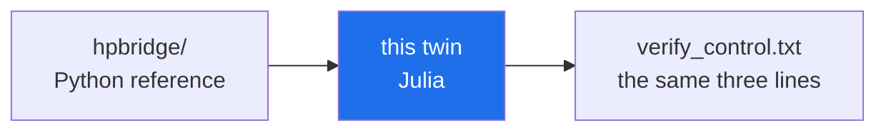

# 🗣️ multilang — julia twin

> **One of the six cross-language twins of the Γ-closure + Λ-sieve kernel.**

The Julia twin (Base + standard libraries), re-stating the same two invariants as every other twin and writing the same three-line control block `verify_control.txt`. The contract: run the file, read the control block, compare it to the reference values in the [multilang README](../README.md) — identical numbers across all six runtimes is the whole point (the mathematics, not the language, decides the result). Implementation details and the exact expected block are documented one level up.

## 📁 Contents

| Item | Kind | Size | What it is |
|---|---|---|---|
| [`verify_core.jl`](verify_core.jl) | Julia | 1.9 KB | — |

## 🧭 Navigation

<!-- enriched-r3 -->

This folder is one of the **six language twins** of the computational kernel. The Python reference lives in `hpbridge/`; each twin re-states the same two invariants (shorthand-named Γ-closure + Λ-sieve) in another language and runtime, and must finish with the same numbers. The contract between the twins and the verification protocol is the three-line control block `verify_control.txt`. If the twins agree, the agreement is a property of the mathematics rather than of Python, `mpmath`, or any particular standard library. This twin is the **Julia** member of the six-port family; its control block is checked by the series' tests.

*One sentence, six tongues — the twin must end with the reference numbers.*

**Where next:** [hpbridge/](../../hpbridge/README.md)

[⬅ multilang/](../README.md) · [🏠 Repo root](../../../README.md)

---

*Part of the [AB-Cloud Research](../../../README.md) repository · DOI [10.5281/zenodo.21825394](https://doi.org/10.5281/zenodo.21825394) · © 2026 Isaev Iskhak Khamzatovich — personal proprietary use, see the [license terms](../../../LICENSE).*

