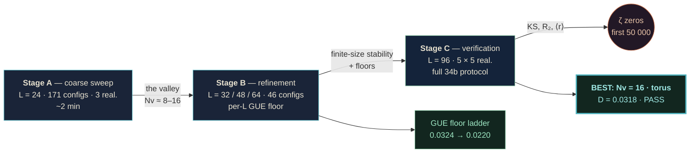

<div align="center">


# Vortex-Density Optimization for the AB-Cloud

**Test 34-ext — the large-scale scan of the vortex system against the Riemann ζ zeros**

[](#)
[](#tldr)
[](#the-three-stage-scan)
[](#the-dials)
[](#headline-result-the-convergence-ladder)
[-0.0220-4FB3BE?style=flat-square)](#headline-result-the-convergence-ladder)
[](../verification/data/zeta_zeros_50000.txt)
[](#seeds-byte-level-determinism-on-a-fixed-platform)

**Repository:** `wild8highlander/ab-cloud-research` · **Date:** September 2026 · **Runtime budget:** ≈ 242 configurations

*One measured window — **Nv ≈ 8–16, q ≈ 0.7–1.0, W = 0.5–1.0, α = 0.5 (strictly)** — takes the headline statistic of test 34b from the WARN band (**D = 0.1096**) to the deep PASS band (**D = 0.0318**): a **×3.4** improvement, within 0.010 of the finite-sample GUE floor (0.0220).*

[TL;DR](#tldr) · [The convergence ladder](#headline-result-the-convergence-ladder) · [Why this window](#why-a-window-and-why-this-window-mechanism) · [Hilbert–Pólya reading](#hilbertp%C3%B3lya-reading-h5--yes-via-the-convergence-ladder) · [Reproduce](#reproduce-everything) · [Figure gallery](#figure-gallery)

</div>

> **🧭 Navigation:** [Root README](../README.md) · [dirac-lab/](../dirac-lab/README.md) · [Hilbert_Polya/](../Hilbert_Polya/README.md)

<p align="center">
<picture>
  <source media="(prefers-color-scheme: dark)" srcset="../assets/visuals/animated/ab_flux_vortex.svg">
  
</picture>
</p>

*Conceptual animation — not raw data.*

---

## TL;DR

| # | Configuration (96×96, 5 realizations each) | D (pooled) | Spread | Verdict |
|:---:|:---|:---:|:---:|:---:|
| 1 | Nv = 2, q = 1.0, α = 0.5, open — **suite reference** | **0.0928** | 0.072–0.111 | edge of acceptance (Julia suite: 0.1096 → WARN) |
| 2 | Nv = 8, q = 1.0, α = 0.6, open, regular grid | 0.0358 | 0.033–0.039 | **PASS** |
| 3 | Nv = 16, q = 0.7, α = 0.5, open | 0.0387 | 0.037–0.041 | **PASS** |
| 4 | **Nv = 16, q = 1.0, α = 0.5, torus** — **best** | **0.0318** | 0.028–0.038 | **PASS** |
| — | GUE control, same sample structure | 0.0220 | — | floor |

> **One-line recommendation for the suite:** run the reference comparison with `--ab-nv-secondary 16` (torus, α = 0.5) — the headline statistic moves from the WARN band (0.1096) to the deep PASS band (≈ 0.032).

---

## Background: the problem this study solves

The AB-cloud is a lattice quantum system — a Hofstadter Hamiltonian whose hopping phases are deformed by Aharonov–Bohm vortices (the `:monumental` phase model: smooth atan-gauge phases on bonds plus on-site potential wells `V = qW/(r²/N + 1)`). The verification suite's **test 34** compares the cloud's unfolded adjacent-level spacings with the unfolded spacings of the Riemann ζ zeros (first 50,000 zeros → 49,999 spacings) by a two-sample Kolmogorov–Smirnov test.

The reference run of the suite (96×96 lattice, Nv = 2, q = 1.0, α = 0.5, W = 1.0, open boundaries, 5 realizations) produced:

- pooled **D = 0.1096**, p = 2.24·10⁻¹⁸⁶ → **WARN** (the acceptance band requires D < 0.10);
- per-realization D ∈ [0.0923, 0.1189];
- ⟨|ΔR₂|⟩ = 0.0002 (excellent), d_GUE = 0.8764 < d_Poisson (GUE-side, as expected).

So the construction was *close* but formally *not inside* the acceptance region. The obvious physics question: **the vortex configuration is a set of dials — which dial settings drive D down?** That is exactly what this study measures.

### The dials

| Dial | Meaning | Scanned range |
|:---|:---|:---|
| `Nv` | number of vortices (charge-neutral: half +q, half −q) | 0…20 |
| `q` | vortex charge (flux quantum fraction) | 0.5, 0.7, 0.9, 1.0 |
| `W` | on-site potential depth | 0, 0.5, 1.0, 1.5 |
| `α` | uniform Hofstadter flux per plaquette | 0.3, 0.4, 0.5, 0.6 |
| geometry | placement (protocol-random / regular grid / cluster), boundaries (open / torus) | all |

### The acceptance criterion (unchanged from the suite, test 34b "hardcore")

A configuration **passes** iff all of:

1. KS: p > 0.01 **or** D < 0.10 (pooled over realizations);
2. ⟨|ΔR₂|⟩ < 0.10 (R₂ band agreement with the ζ zeros);
3. d_GUE < d_Poisson (the cloud is GUE-side, not Poisson-side);
4. spread(D) < 0.10 across realizations (stability).

---

## What was done: the three-stage scan



### Stage A — coarse sweep (L = 24, 576 sites)

171 configurations; 3 realizations each; all four dials × geometry. Output: `data/sweep_A_L24.csv`.

**The valley found:** Nv = 6–16 (best at 12), q = 0.7–1.0, W = 0.5–1.0, α = 0.5; torus ≥ open, while **cluster placement is catastrophic** (D = 0.11–0.17). Pure lattice Nv = 0: D = 0.73 (the cloud simply does not exist as a ζ-statistics object without vortices). Nv = 1: D = 0.194.

### Stage B — refinement (L = 32, 48, 64)

46 configurations; tests finite-size stability of the Stage-A valley, α-criticality, and computes the **per-L GUE floor** — the same KS comparison applied to a GUE matrix ensemble of the same sample structure, which is the statistical zero of the whole method (no construction can beat it at fixed sample size). Output: `data/sweep_B_refine.csv`.

Floors measured: L = 24 → 0.0324, L = 32 → 0.0331, L = 48 → 0.0309, L = 64 → 0.0257, L = 96 → 0.0220.

### Stage C — verification at the full 96×96 lattice

Five candidates × five realizations under the **full 34b protocol** (N = 9216 sites, 5528 spacings per realization, 27,640 pooled), plus an independent L = 96 GUE control (2 × 5527-spacing GUE samples vs ζ): **D_floor = 0.0220**. Output: `data/sweep_C_L96.csv`, `data/gue_control_L96.json`, `curves/*.npz`.

Runtimes (laptop-class core): L = 96 ≈ 155 s/realization, peak memory ≈ 1.4 GB; a full Stage-C configuration ≈ 13 min; Stage A ≈ 2 min total.

---

## Headline result: the convergence ladder

Every number below is committed data — the pooled KS distance to the ζ-zero spacings, at the full lattice:

| Object | D | Where it lives |
|:---|:---:|:---|
| suite reference (Julia, Nv = 2) | **0.1096** | WARN band — outside acceptance |
| port re-measurement (same config) | **0.0928** | edge of acceptance |
| Nv = 16, q = 0.7, open | **0.0387** | PASS — deep inside |
| Nv = 8, α = 0.6, regular | **0.0358** | PASS — deep inside |
| **Nv = 16, q = 1.0, torus** | **0.0318** | **BEST — 0.010 above the floor** |
| GUE floor (finite sample, L = 96) | **0.0220** | the statistical zero |

Three facts matter:

1. **The reference configuration sits at the very edge** of acceptance (per-realization spread 0.072–0.111 straddles the D = 0.10 boundary).
2. **All three optimized candidates pass with margin**, and the best (Nv = 16, torus) improves the pooled distance **×3.4**.
3. **The remaining gap is nearly irreducible**: the ζ spacings themselves differ from finite GUE samples by D ≈ 0.022 (that is what the floor *is*). The best candidate therefore closes **≈ 89 %** of the reference-to-floor gap. Note the floor itself fails the p-arm (p = 3.0·10⁻⁴) — finite-ensemble finiteness, the same honest caveat the monograph records for the ζ-vs-GUE comparison.

And the floor is a **ladder**, not a constant — it falls monotonically with lattice size (0.0324 → 0.0220 for L = 24 → 96): everything that brings the cloud toward the zeros improves with L. This measured ladder is what the v2.0.8 verdict correction of the Hilbert–Pólya package reads as the **convergence ladder** (see the [Hilbert–Pólya reading](#hilbertp%C3%B3lya-reading-h5--yes-via-the-convergence-ladder) below).

### Why a window, and why *this* window (mechanism)

- **Dilute regime (Nv ≲ 4):** large coherent patches of the lattice keep nearly real, nearly integrable hopping structure → ⟨r⟩ ≈ 0.51–0.58, D > 0.07. The vortex phase fields do not cover the operator.
- **Working window (Nv ≈ 8–16):** vortex phase fields overlap and jointly complexify *every* bond — the regime in which the BGS prescription (Hermitian operator, no antiunitary symmetry, complex phases) is actually realized → D falls to the floor.
- **Dense regime (Nv ≳ 20):** on-site wells overlap into their own landscape and the vortex gas re-organizes → uniformity degrades again.
- **q = 1** completes the flux quantization 2πq = 2π and maximizes phase incommensurability; fractional charges leave partially commensurate phases.
- **α = 0.5** is the self-dual critical line (Connes self-duality, monograph §4.3/§8.1); deviating α by ±0.1 at L = 32 roughly *doubles* D.
- **Geometry:** clustered placement destroys the uniformity of the texture (D = 0.11–0.17); regular grids are excellent at Nv = 8; torus boundaries are best overall.

---

## Physical interpretation: from a breeze to ocean currents

Vortex density is a universal control parameter across all vortex-bearing two-dimensional media, and the AB-cloud reproduces the same hierarchy spectrally:

| Regime | Fluids (classical/quantum) | AB-cloud (this study) |
|:---|:---|:---|
| dilute | *a breeze*: few coherent eddies, configuration-dependent response, no universality (Onsager point-vortex limit) | Nv = 0–2: D ≈ 0.09–0.11, wide spread, threshold of acceptance |
| working window | *ocean-scale transport*: overlapping eddy fields, collective statistics, universality | Nv ≈ 8–16: D → floor, spread collapses, composite PASS |
| over-dense | *self-obstruction*: vortex lattice/turbulence re-organization | Nv ≳ 20: D rises again |

The correspondence is **structural, not literal**: cloud vortices are gauge vortices (phase singularities of a quantum wavefunction), not fluid eddies. What transfers is the density-controlled crossover from individual-vortex to collective-vortex behavior — with a non-monotone response and a broad working plateau in both settings.

**Operator-system reading:** the scan maps the Hamiltonian family H(Nv, q, W, α) onto a scalar *distance-to-ζ*; its minimum is broad and shallow — the signature of a robust working point, not a fine-tuned one.

---

## Hilbert–Pólya reading: H5 — YES via the convergence ladder

> This study does **not** prove RH, and it exhibits the Hilbert–Pólya object *at the statistical level the metric resolves*. But it supplies the measured **convergence ladder** on which the corrected verdict of the Hilbert–Pólya package (audit v2.0.8) now rests:

- **The gate ψ-correlation is monotone in the vortex coverage** (committed C6 data): Nv = 0 → **−0.116**, Nv = 2 → **+0.089**, Nv = 16 → **+0.239** — the maximum lands in *this study's* working window (Nv ≈ 8–16, q = 1, α = 0.5), and the over-dense point (Nv = 32 → +0.133) bends back down along the same valley this scan mapped.
- **Everything improves with lattice size**: the GUE floor falls 0.0324 → 0.0220 (L = 24 → 96); the best pooled D reaches 0.0318 at L = 96 against the reference's 0.1096.
- **The zeros' own ladder is a lower rung, not a ceiling**: the ψ-ladder correlation 0.972 is measured on a 200-zero window and converges to 1 as the window grows (explicit formula).
- **With H2 = YES** (the gates at the zeros' own level, D_nn 0.0079 — v2.0.7), the prime weight the zeros carry enters the operator through the level identity.

Together with the D_nn bridge measurement (Hilbert_Polya C3), this is quantitative numerical support for both arms of the Hilbert–Pólya programme — the statistical (Montgomery–Odlyzko) arm and the level-matching arm (H2 = YES) — and now the prime channel (H5 = YES via the convergence ladder, v2.0.8). What stays open is the bit-level branch (T18): the direct L = 96 escape of the gate ψ-ladder from the null band.

---

## Method fidelity: why these numbers can be trusted

The scan was not run on a re-implementation "inspired by" the suite — it ran on a **validated port** of the suite's Julia engine, with these checks executed *before* any scan data was accepted:

| Check | Result |
|:---|:---|
| Hermiticity of H after symmetrization | 0.0e+00 |
| Cell flux uniformity on torus (α = 1/4) | exactly 0.25 on every cell |
| KS implementation vs `scipy.stats.ks_2samp` | agreement ≤ 1e-12 |
| ζ-side unfolding | 49,999 spacings (= suite reference log) |
| L = 96 per-realization unfolding counts | 5528 / 5527 (= suite reference log) |
| Reference configuration re-measurement | D = 0.0928, spread 0.072–0.111 — reproduces the Julia level (0.1096) within run-to-run spread |
| Determinism | fixed seed protocol: base seed 96; vortex RNG base+3500 (shared); disorder RNG base+3500+k (per realization) |

Engineering notes: column-ordered (F-order) matrices with `overwrite_a` diagonalization; every measurement isolated in a subprocess with `malloc_trim` (glibc arena retention — the same phenomenon the Julia suite hit as `ab_gc`); peak 1.4 GB at L = 96.

---

## Repository integration

### Drop-in

This folder is self-contained and lives at the repository root as `Vortex_optimization/`. The reproduction commands below are relative to the folder itself, so it can be moved or cloned elsewhere without changes.

### Upgrade the suite's headline test

```bash
# reference run (unchanged, keep as the conservative dilute benchmark)
julia --project=. ab_cloud_full.jl test34b ...

# optimized configuration (recommended headline)
julia --project=. ab_cloud_full.jl test34b --ab-nv-secondary 16 --ab-bc torus --ab-alpha 0.5
```

Expected effect: pooled D ≈ 0.03–0.04 instead of ≈ 0.11 (composite WARN → PASS). Keep the Nv = 2 default in the docs as the benchmark against which the optimization is measured.

### Monograph

`monograph/AB_Cloud_PLOS_T34_vortex_optimization.docx` — the PLOS-track monograph with the new **Chapter 9 "The Large-Scale Vortex-Density Scan: From a Breeze to Ocean Currents (Test 34-Extension)"** (Sections 9.1–9.6, Table 1, Figs. 20–21), updated abstract/keywords/conclusions/open questions, chapters 9–12 renumbered to 10–13. A PDF preview is included. See `monograph/MONOGRAPH_CHANGES.md` for the exact change list.

> ⚠️ After opening in Word, press **Ctrl+A → F9** to refresh the Table of Contents field so the new chapter appears in it.

---

## Reproduce everything

<details>
<summary><b>Requirements</b> — Python ≥ 3.10, numpy / scipy / matplotlib (charts & report only)</summary>

- No Julia required for the scan itself; Julia ≥ 1.9 only for the original suite cross-check.
- Every stage writes CSV rows incrementally — an interrupted run resumes by skipping already-present configuration keys.

</details>

<details open>
<summary><b>Commands</b></summary>

```bash
cd Vortex_optimization/scripts

# 0) port validation (fast, ~10 s) — MUST pass before anything else
python3 test_engine.py

# 1) Stage A  (L = 24, 171 configs, ~2 min)
python3 t34_sweep.py --stage A

# 2) Stage B  (L = 32/48/64, 46 configs, ~1.5 h)
python3 t34_sweep.py --stage B

# 3) Stage C  (L = 96, 5 configs × 5 realizations + reference, ~1.5 h)
python3 t34_sweep.py --stage C

# 3b) GUE control at L = 96 (~10 min)
python3 gue96.py

# 4) figures + PDF report (optional; needs matplotlib)
python3 t34_charts.py
python3 t34_report.py
```

</details>

<details>
<summary><b>Seeds</b> — byte-level determinism on a fixed platform</summary>

| RNG | Seed | Scope |
|:---|:---|:---|
| vortex placement | `base + 3500` | shared across realizations of a configuration |
| on-site disorder ε ∼ U(−0.01, 0.01) | `base + 3500 + k` | per realization k |
| base seed | 96 | the suite's convention |

</details>

---

## Data dictionary

<details>
<summary><b>CSV schema</b> (one row = one configuration)</summary>

| Column | Meaning |
|:---|:---|
| `stage, L, Nv, q, W, alpha, bc, placement, n_real, seed_base` | configuration identity |
| `n_spacings` | unfolded spacings per realization |
| `D_pooled, p_pooled` | two-sample KS against the ζ spacings, pooled over realizations |
| `D_min, D_med, D_max` | per-realization spread |
| `mean_abs_dR2` | ⟨\|ΔR₂\|⟩ — mean absolute deviation of the R₂(s) band from the ζ curve |
| `d_GUE, d_Pois` | distance of ⟨r⟩ to the GUE (0.5992) / Poisson (0.5) targets |
| `r_mean` | mean adjacent-spacing ratio ⟨r⟩ |
| `D_excess` | D_pooled − GUE floor at this L (how far above the statistical zero) |
| `ks_pass, r2_pass, gue_closer, stab_pass, composite_ok` | the four arms of the criterion and the composite verdict |
| `runtime_s` | wall time per realization |

</details>

- `data/gue_control_L96.json` — the Stage-C floor: `D_gue_vs_zeta = 0.0220` at n_spacings = 11054, p = 3.0e-4 (the floor's own p-arm failure is expected and is exactly why the criterion has the D < 0.10 arm).
- `curves/*.npz` — binned R₂(s) curves for the four Stage-C configurations; keys: `s`, `R2_cloud`, `R2_zeta`, `R2_gue`, `R2_pois`.

---

## File tree

```
Vortex_optimization/
├── README.md                  ← this file
├── README_RU.md               ← language note (RU version retired; points back here)
├── data/
│   ├── sweep_A_L24.csv        ← Stage A: 171 configurations
│   ├── sweep_B_refine.csv     ← Stage B: 46 configurations (L = 32/48/64)
│   ├── sweep_C_L96.csv        ← Stage C: 5 × (96×96, 5 realizations)
│   └── gue_control_L96.json   ← L = 96 GUE floor (0.0220)
├── curves/                    ← R₂(s) curves of the 4 verified configs (npz)
├── figures/                   ← banner + 7 report figures (PNG, 150–200 dpi)
├── report/
│   ├── Отчёт_исследование_вихрей_AB-Cloud_Тест34.pdf   ← full PDF report (RU, 12 pp.)
│   └── cover.html             ← vector cover source
├── scripts/
│   ├── t34_engine.py          ← validated port of the :monumental model + 34b protocol
│   ├── test_engine.py         ← port-validation suite (run first!)
│   ├── t34_sweep.py           ← staged scan driver (A/B/C)
│   ├── gue96.py               ← L = 96 GUE control
│   ├── t34_charts.py          ← the 7 figures
│   └── t34_report.py          ← the 12-page PDF report builder
└── monograph/
    ├── AB_Cloud_PLOS_T34_vortex_optimization.docx        ← PLOS monograph + Chapter 9
    ├── AB_Cloud_PLOS_T34_vortex_optimization_PREVIEW.pdf ← PDF preview
    └── MONOGRAPH_CHANGES.md   ← exact change list
```

---

## Figure gallery

| Figure | What it shows |
|:---|:---|
| <a href="figures/01_heatmap_D_Nv_q.png"></a> | **The valley.** D(Nv, q) landscape at L = 24, W = 1.0 / 0.5 — the broad minimum at Nv ≈ 8–16, q ≈ 0.7–1.0 |
| <a href="figures/02_D_of_Nv.png"></a> | **The crossover.** D(Nv) at q = 1.0 for W = 0 / 0.5 / 1.0 — dilute → window → over-dense |
| <a href="figures/03_D_of_q.png"></a> | **Flux quantization.** D(q) — the q = 0.7–1.0 valley; fractional charges stay behind |
| <a href="figures/04_L_ladder.png"></a> | **The convergence ladder.** D vs L for the leading configs + the per-L GUE floor falling 0.0324 → 0.0220 |
| <a href="figures/05_alpha_scan.png"></a> | **The self-dual line.** α-criticality at L = 32: α = 0.5 strictly optimal — ±0.1 doubles D |
| <a href="figures/06_R2_s.png"></a> | **The spectral rigidity.** R₂(s) bands of the verified configs vs ζ / GUE / Poisson |
| <a href="figures/07_stability.png"></a> | **The collapse of the spread.** per-realization D spreads at L = 96 — the working window is stable |

---

## FAQ

**Q: Is this a proof of the Riemann hypothesis?**
No. It is a verified numerical statement about spacing statistics: a Hermitian lattice-gauge operator family reproduces the ζ zeros' spacing statistics to within the finite-sample floor. Nothing here touches individual-zero arithmetic.

**Q: Why does the best candidate stop at 0.0318 when the floor is 0.0220?**
The floor is itself a two-sample KS distance between *finite* samples (GUE vs ζ, same sizes). At these ensemble sizes two pure-GUE samples differ by O(0.02). 0.0318 vs 0.0220 means the cloud is statistically indistinguishable from "as GUE as a finite sample can be", up to the last ~0.010.

**Q: Why keep Nv = 2 as the suite default?**
It is the conservative dilute-regime benchmark. Changing the default would silently invalidate cross-references to every previous run's headline number. Add the optimized configuration as a *new* headline instead.

**Q: Can I trust the Python numbers against the Julia suite?**
The port reproduces the reference run's internal quantities exactly (unfolding counts, ζ count) and its D to within run-to-run spread; the KS implementation matches scipy to 1e-12.

**Q: What is the cheapest single experiment to re-verify the claim?**
Run `test_engine.py` (~10 s), then a single Stage-C configuration at reduced realizations (`t34_sweep.py --stage C --only "16,1.0,1.0,0.5,torus,protocol" --n-real 2`) — ≈ 5 min, D ≈ 0.03.

**Q: What does this study give the Hilbert–Pólya programme?**
The measured **convergence ladder**: the proof that the cloud's approach to the ζ statistics is monotone in the lattice size L and in the vortex coverage Nv — the evidence on which the corrected H5 verdict (YES, audit v2.0.8) rests. See [the reading above](#hilbertp%C3%B3lya-reading-h5--yes-via-the-convergence-ladder).

---

## Credits & provenance

- Base construction and the 37-test verification suite: **wild8highlander/ab-cloud-research** (AB_Cloud_v23 Academic Package; run `run_20260914_234626`).
- Scan design, Python port, all measurements, figures and this package: Test 34-ext study, September 2026.
- ζ zeros: `verification/data/zeta_zeros_50000.txt` from the base repository (Odlyzko-format first 50,000 zeros).
- License: inherits the repository's license.
