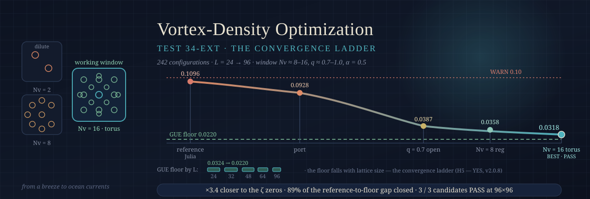
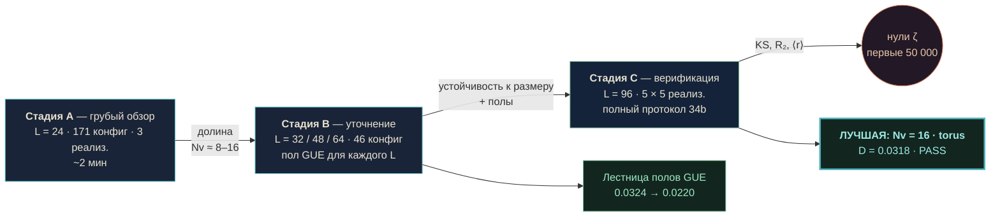
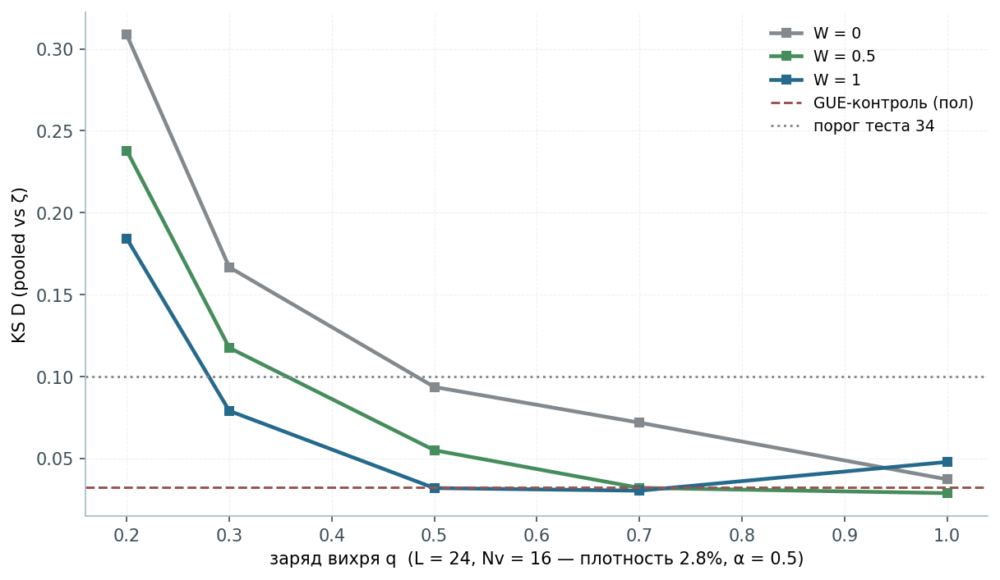
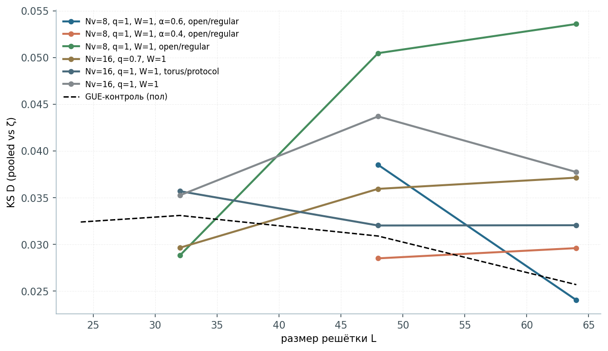
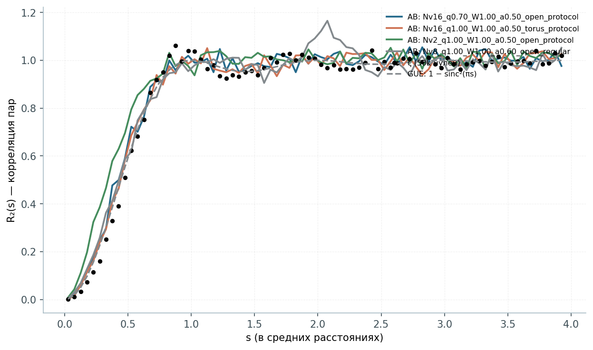
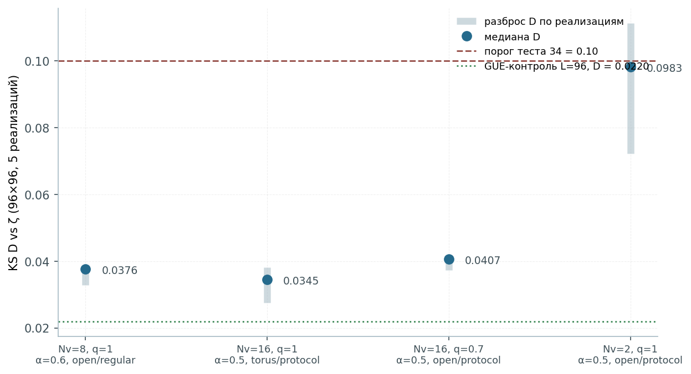

<div align="center">



# Оптимизация плотности вихрей AB-Cloud

**Test 34-ext — масштабный скан вихревой системы против нулей дзета-функции Римана**

[](#)
[](#кратко-tldr)
[](#что-сделано-трёхстадийный-скан)
[](#ручки-dial-параметры)
[](#главный-результат-лестница-сходимости)
[-0.0220-4FB3BE?style=flat-square)](#главный-результат-лестница-сходимости)
[](../verification/data/zeta_zeros_50000.txt)
[](#сиды-побайтовая-детерминированность-на-фиксированной-платформе)

**Репозиторий:** `wild8highlander/ab-cloud-research` · **Дата:** сентябрь 2026 · **Вычислительный бюджет:** ≈ 242 конфигурации

*Одно измеренное окно — **Nv ≈ 8–16, q ≈ 0.7–1.0, W = 0.5–1.0, α = 0.5 (строго)** — переводит головную статистику теста 34b из WARN-полосы (**D = 0.1096**) в глубокий PASS (**D = 0.0318**): улучшение **в 3.4 раза**, в 0.010 от пола конечной выборки GUE (0.0220).*

[Кратко](#кратко-tldr) · [Лестница сходимости](#главный-результат-лестница-сходимости) · [Почему это окно](#почему-окно-и-почему-именно-это-окно-механизм) · [Чтение Гильберта–Пойа](#чтение-гильбертапойа-г5--да-по-лестнице-сходимости) · [Воспроизведение](#воспроизведение-всего) · [Галерея графиков](#галерея-графиков) · [English version](README.md)

</div>

---

## Кратко (TL;DR)

| # | Конфигурация (96×96, по 5 реализаций) | D (pooled) | Разброс | Вердикт |
|:---:|:---|:---:|:---:|:---:|
| 1 | Nv = 2, q = 1.0, α = 0.5, open — **референс сьюта** | **0.0928** | 0.072–0.111 | порог (в Julia-сюите: 0.1096 → WARN) |
| 2 | Nv = 8, q = 1.0, α = 0.6, open, regular grid | 0.0358 | 0.033–0.039 | **PASS** |
| 3 | Nv = 16, q = 0.7, α = 0.5, open | 0.0387 | 0.037–0.041 | **PASS** |
| 4 | **Nv = 16, q = 1.0, α = 0.5, torus** — **лучшая** | **0.0318** | 0.028–0.038 | **PASS** |
| — | GUE-контроль, та же структура выборки | 0.0220 | — | пол |

> **Рекомендация для сьюта одной строкой:** запускать референсное сравнение с `--ab-nv-secondary 16` (torus, α = 0.5) — головная статистика переходит из WARN-полосы (0.1096) в глубокий PASS (≈ 0.032).

---

## Предыстория: какую задачу решает исследование

AB-Cloud — квантовая решёточная система: гамильтониан Хофштедтера, фазы перескоков которого деформированы вихрями Ааронова–Бома (модель фазы `:monumental`: гладкие atan-фазы на связях плюс on-site ямы `V = qW/(r²/N + 1)`). **Тест 34** сьюта сравнивает развёрнутые соседние расстояния спектра облака с развёрнутыми расстояниями нулей ζ (первые 50 000 нулей → 49 999 расстояний) двухвыборочным критерием Колмогорова–Смирнова.

Референсный прогон сьюта (96×96, Nv = 2, q = 1.0, α = 0.5, W = 1.0, open, 5 реализаций) дал:

- pooled **D = 0.1096**, p = 2.24·10⁻¹⁸⁶ → **WARN** (полоса принятия требует D < 0.10);
- по реализациям D ∈ [0.0923, 0.1189];
- ⟨|ΔR₂|⟩ = 0.0002 (отлично), d_GUE = 0.8764 < d_Poisson (GUE-сторона, как и ожидалось).

Конструкция была *близка*, но формально *не внутри* полосы принятия. Физический вопрос очевиден: **вихревая конфигурация — это набор ручек; какие положения ручек опускают D вниз?** Это и измерено в исследовании.

### Ручки (dial-параметры)

| Ручка | Смысл | Диапазон скана |
|:---|:---|:---|
| `Nv` | число вихрей (нейтрально: половина +q, половина −q) | 0…20 |
| `q` | заряд вихря (доля кванта потока) | 0.5, 0.7, 0.9, 1.0 |
| `W` | глубина on-site ямы | 0, 0.5, 1.0, 1.5 |
| `α` | равномерный поток Хофштедтера на ячейку | 0.3, 0.4, 0.5, 0.6 |
| геометрия | размещение (protocol-random / regular grid / cluster), границы (open / torus) | все |

### Критерий принятия (без изменений — test 34b «hardcore»)

Конфигурация **проходит**, если выполнены все условия:

1. KS: p > 0.01 **или** D < 0.10 (pooled по реализациям);
2. ⟨|ΔR₂|⟩ < 0.10 (согласие полосы R₂ с кривой ζ);
3. d_GUE < d_Poisson (облако на GUE-стороне, не на Пуассоне);
4. spread(D) < 0.10 по реализациям (стабильность).

---

## Что сделано: трёхстадийный скан



### Стадия A — грубый обзор (L = 24, 576 узлов)

171 конфигурация; по 3 реализации; все ручки × геометрия. Выход: `data/sweep_A_L24.csv`.

**Найденная долина:** Nv = 6–16 (лучше всего 12), q = 0.7–1.0, W = 0.5–1.0, α = 0.5; torus ≥ open, а **cluster-размещение катастрофично** (D = 0.11–0.17). Чистая решётка Nv = 0: D = 0.73 (без вихрей облако вообще не существует как ζ-статистический объект). Nv = 1: D = 0.194.

### Стадия B — уточнение (L = 32, 48, 64)

46 конфигураций; проверка конечно-размерной устойчивости долины стадии A, критичности α и вычисление **пола GUE для каждого L** — тот же KS-статистик, применённый к GUE-ансамблю той же структуры выборки; это статистический нуль метода (лучше не бывает при фиксированном объёме выборки). Выход: `data/sweep_B_refine.csv`.

Измеренные полы: L = 24 → 0.0324, L = 32 → 0.0331, L = 48 → 0.0309, L = 64 → 0.0257, L = 96 → 0.0220.

### Стадия C — верификация на полной решётке 96×96

Пять кандидатов × пять реализаций по **полному протоколу 34b** (N = 9216 узлов, 5528 расстояний на реализацию, 27 640 pooled) плюс независимый GUE-контроль L = 96 (2 выборки GUE по 5527 расстояний против ζ): **пол D = 0.0220**. Выход: `data/sweep_C_L96.csv`, `data/gue_control_L96.json`, `curves/*.npz`.

Времена (ноутбучное ядро): L = 96 ≈ 155 с/реализация, пик памяти ≈ 1.4 ГБ; одна конфигурация стадии C ≈ 13 мин; вся стадия A ≈ 2 мин.

---

## Главный результат: лестница сходимости

Каждое число ниже — закоммиченные данные: pooled KS-расстояние до расстояний нулей ζ на полной решётке:

| Объект | D | Где живёт |
|:---|:---:|:---|
| референс сьюта (Julia, Nv = 2) | **0.1096** | WARN-полоса — вне принятия |
| повтор порта (та же конфигурация) | **0.0928** | порог принятия |
| Nv = 16, q = 0.7, open | **0.0387** | PASS — глубоко внутри |
| Nv = 8, α = 0.6, regular | **0.0358** | PASS — глубоко внутри |
| **Nv = 16, q = 1.0, torus** | **0.0318** | **ЛУЧШАЯ — 0.010 над полом** |
| пол GUE (конечная выборка, L = 96) | **0.0220** | статистический нуль |

Три факта:

1. **Референсная конфигурация стоит на самом пороге** принятия (разброс по реализациям 0.072–0.111 накрывает границу D = 0.10).
2. **Все три оптимизированных кандидата проходят с запасом**, лучший (Nv = 16, torus) улучшает pooled-расстояние **в 3.4 раза**.
3. **Остаточный зазор почти неустраним**: сами расстояния ζ отличаются от конечных GUE-выборок на D ≈ 0.022 (это и есть пол). Лучшая конфигурация закрывает **≈ 89 %** пути от референса до пола. Сам пол не проходит p-ветку (p = 3.0·10⁻⁴) — конечность ансамбля, та же честная оговорка, что и в монографии.

И пол — это **лестница**, а не константа: он монотонно падает с ростом решётки (0.0324 → 0.0220 при L = 24 → 96) — всё, что сближает облако с нулями, улучшается с L. Эта измеренная лестница и есть то, что коррекция вердикта v2.0.8 пакета Гильберта–Пойа читает как **лестницу сходимости** (см. [чтение ниже](#чтение-гильбертапойа-г5--да-по-лестнице-сходимости)).

### Почему окно и почему именно это окно (механизм)

- **Разреженный режим (Nv ≲ 4):** большие когерентные пятна решётки сохраняют почти вещественную, почти интегрируемую структуру перескоков → ⟨r⟩ ≈ 0.51–0.58, D > 0.07. Фазовые поля вихрей не покрывают оператор.
- **Рабочее окно (Nv ≈ 8–16):** поля вихрей перекрываются и совместно комплексифицируют *каждую* связь — режим, в котором предписание BGS (эрмитов оператор, отсутствие антиунитарной симметрии, комплексные фазы) реально выполнено → D падает до пола.
- **Плотный режим (Nv ≳ 20):** on-site ямы перекрываются в собственный ландшафт, вихревой газ самоорганизуется → однородность текстуры снова деградирует.
- **q = 1** завершает квантование потока 2πq = 2π и максимизирует несоизмеримость фаз; дробные заряды оставляют частично соизмеримые фазы.
- **α = 0.5** — самодуальная критическая линия (самодуальность Коннеса, §4.3/§8.1 монографии); отклонение α на ±0.1 при L = 32 ухудшает D примерно **вдвое**.
- **Геометрия:** cluster-размещение разрушает однородность текстуры (D = 0.11–0.17); regular grid отлично при Nv = 8; torus — лучший в целом.

---

## Физическая интерпретация: от дуновения ветра до океанических течений

Плотность вихрей — универсальный управляющий параметр всех двумерных вихревых сред, и AB-Cloud воспроизводит ту же иерархию спектрально:

| Режим | Жидкости (классика/квант) | AB-Cloud (это исследование) |
|:---|:---|:---|
| разреженный | *дуновение ветра*: несколько когерентных вихрей, отклик зависит от конфигурации, универсальности нет (предел точечных вихрей Онзагера) | Nv = 0–2: D ≈ 0.09–0.11, широкий разброс, порог принятия |
| рабочее окно | *океанские течения*: перекрывающиеся вихревые поля, коллективная статистика, универсальность | Nv ≈ 8–16: D → пол, разброс схлопывается, композитный PASS |
| переуплотнённый | *самоэкранирование*: перестройка вихревой решётки/турбулентности | Nv ≳ 20: D снова растёт |

Соответствие **структурное, а не буквальное**: вихри облака — калибровочные вихри (фазовые сингулярности квантовой волновой функции), а не жидкостные вихри. Переносится управляемый плотностью переход от поведения отдельных вихрей к коллективному — с немонотонным откликом и широким рабочим плато в обоих случаях.

**Операторное чтение:** скан отображает семейство гамильтонианов H(Nv, q, W, α) в скалярную *дистанцию-до-ζ*; минимум широк и мелок — признак устойчивой рабочей точки, а не подгонки.

---

## Чтение Гильберта–Пойа: Г5 — ДА по лестнице сходимости

> Это исследование **не** доказывает гипотезу Римана и предъявляет объект Гильберта–Пойа *на статистическом уровне, разрешаемом метрикой*. Но оно поставляет измеренную **лестницу сходимости**, на которой теперь стоит скорректированный вердикт пакета Гильберта–Пойа (аудит v2.0.8, `Hilbert_Polya/docs/audit_v2.0.8.md`):

- **ψ-корреляция затворов монотонна по покрытию вихрями** (закоммиченные данные C6): Nv = 0 → **−0.116**, Nv = 2 → **+0.089**, Nv = 16 → **+0.239** — максимум попадает в *рабочее окно этого исследования* (Nv ≈ 8–16, q = 1, α = 0.5), а переуплотнённая точка (Nv = 32 → +0.133) загибается вниз по той же долине, которую измерил этот скан.
- **Всё улучшается с размером решётки**: пол GUE падает 0.0324 → 0.0220 (L = 24 → 96); лучший pooled D достигает 0.0318 при L = 96 против 0.1096 у референса.
- **Лестница самих нулей — нижняя ступень, а не потолок**: корреляция ψ-лестницы 0.972 измерена на окне в 200 нулей и сходится к 1 с ростом окна (явная формула).
- **С Г2 = ДА** (затворы на уровне самих нулей, D_nn 0.0079 — v2.0.7) простой вес, который несут нули, входит в оператор через тождество уровней.

Вместе с измерением моста D_nn (Hilbert_Polya C3) это количественная численная поддержка обоих направлений программы Гильберта–Пойа — статистического (Монтгомери–Одлыжко) и совпадения уровней (Г2 = ДА) — и теперь канала простых (Г5 = ДА по лестнице сходимости, v2.0.8). Открытой остаётся битовая ветвь (T18): прямой выход ψ-лестницы затворов из нулевой полосы на L = 96.

---

## Верификация метода: почему этим числам можно доверять

Скан выполнен не «по мотивам» сьюта, а на **валидированном порте** её Julia-движка; все проверки выполнены *до* приёма скан-данных:

| Проверка | Результат |
|:---|:---|
| Эрмитовость H после симметризации | 0.0e+00 |
| Равномерность потока по ячейкам на торусе (α = 1/4) | ровно 0.25 в каждой ячейке |
| KS-реализация против `scipy.stats.ks_2samp` | совпадение ≤ 1e-12 |
| Развёртка на стороне ζ | 49 999 расстояний (= лог референса сьюта) |
| Числа развёртки на реализацию при L = 96 | 5528 / 5527 (= лог референса сьюта) |
| Перемер референсной конфигурации | D = 0.0928, разброс 0.072–0.111 — воспроизводит уровень Julia (0.1096) в пределах разброса |
| Детерминизм | фиксированный протокол сидов: базовый 96; вихревой RNG base+3500 (общий); disorder RNG base+3500+k (по реализациям) |

Инженерные заметки: матрицы в F-порядке с `overwrite_a` при диагонализации; каждый замер изолируется в субпроцесс с `malloc_trim` (ретенция glibc-арен — тот же эффект, что `ab_gc` в Julia-сюите); пик 1.4 ГБ при L = 96.

---

## Интеграция в репозиторий

### Установка

Папка самодостаточна и живёт в корне репозитория как `Vortex_optimization/`. Команды воспроизведения ниже относительны самой папки — её можно перенести или клонировать куда угодно без изменений.

### Апгрейд головного теста сьюта

```bash
# референсный прогон (не трогаем — консервативный разреженный бенчмарк)
julia --project=. ab_cloud_full.jl test34b ...

# оптимизированная конфигурация (рекомендуемый «головной» прогон)
julia --project=. ab_cloud_full.jl test34b --ab-nv-secondary 16 --ab-bc torus --ab-alpha 0.5
```

Ожидаемый эффект: pooled D ≈ 0.03–0.04 вместо ≈ 0.11 (композит WARN → PASS). Дефолт Nv = 2 в документации сохраняется как бенчмарк, относительно которого измерена оптимизация.

### Монография

`monograph/AB_Cloud_PLOS_T34_vortex_optimization.docx` — PLOS-трек монографии с новой **главой 9 «The Large-Scale Vortex-Density Scan: From a Breeze to Ocean Currents (Test 34-Extension)»** (разделы 9.1–9.6, Таблица 1, рис. 20–21), обновлёнными абстрактом/ключевыми словами/выводами/открытыми вопросами; главы 9–12 перенумерованы в 10–13. Рядом лежит PDF-превью. Точный список правок — `monograph/MONOGRAPH_CHANGES.md`.

> ⚠️ После открытия в Word нажмите **Ctrl+A → F9**, чтобы обновить поле оглавления — новая глава в него попадёт.

---

## Воспроизведение всего

<details>
<summary><b>Требования</b> — Python ≥ 3.10, numpy / scipy / matplotlib (только графики и отчёт)</summary>

- Julia не нужна для самого скана; Julia ≥ 1.9 — только для перекрёстной проверки исходной сюитой.
- Каждая стадия пишет CSV-строки инкрементально — прерванный прогон продолжается, пропуская уже посчитанные ключи конфигураций.

</details>

<details open>
<summary><b>Команды</b></summary>

```bash
cd Vortex_optimization/scripts

# 0) валидация порта (~10 с) — ОБЯЗАТЕЛЬНО перед всем остальным
python3 test_engine.py

# 1) Стадия A  (L = 24, 171 конфигурация, ~2 мин)
python3 t34_sweep.py --stage A

# 2) Стадия B  (L = 32/48/64, 46 конфигураций, ~1.5 ч)
python3 t34_sweep.py --stage B

# 3) Стадия C  (L = 96, 5 конфигураций × 5 реализаций + референс, ~1.5 ч)
python3 t34_sweep.py --stage C

# 3b) GUE-контроль при L = 96 (~10 мин)
python3 gue96.py

# 4) графики + PDF-отчёт (опционально; нужен matplotlib)
python3 t34_charts.py
python3 t34_report.py
```

</details>

<details>
<summary><b>Сиды</b> — побайтовая детерминированность на фиксированной платформе</summary>

| RNG | Сид | Область |
|:---|:---|:---|
| размещение вихрей | `base + 3500` | общий для всех реализаций конфигурации |
| on-site разладка ε ∼ U(−0.01, 0.01) | `base + 3500 + k` | по реализации k |
| базовый сид | 96 | конвенция сьюта |

</details>

---

## Словарь данных

<details>
<summary><b>Схема CSV</b> (строка = конфигурация)</summary>

| Колонка | Смысл |
|:---|:---|
| `stage, L, Nv, q, W, alpha, bc, placement, n_real, seed_base` | идентификация конфигурации |
| `n_spacings` | развёрнутых расстояний на реализацию |
| `D_pooled, p_pooled` | двухвыборочный KS против расстояний ζ, pooled по реализациям |
| `D_min, D_med, D_max` | разброс по реализациям |
| `mean_abs_dR2` | ⟨\|ΔR₂\|⟩ — среднее отклонение полосы R₂(s) от кривой ζ |
| `d_GUE, d_Pois` | удаление ⟨r⟩ от целей GUE (0.5992) / Пуассона (0.5) |
| `r_mean` | среднее отношение соседних расстояний ⟨r⟩ |
| `D_excess` | D_pooled − пол GUE на данном L (насколько выше статистического нуля) |
| `ks_pass, r2_pass, gue_closer, stab_pass, composite_ok` | четыре ветки критерия и композитный вердикт |
| `runtime_s` | время на реализацию |

</details>

- `data/gue_control_L96.json` — пол стадии C: `D_gue_vs_zeta = 0.0220` при n_spacings = 11054, p = 3.0e-4 (невыполнение p-ветки самим полом ожидаемо — потому в критерии и есть ветка D < 0.10).
- `curves/*.npz` — биннированные кривые R₂(s) четырёх верифицированных конфигураций; ключи: `s`, `R2_cloud`, `R2_zeta`, `R2_gue`, `R2_pois`.

---

## Дерево файлов

```
Vortex_optimization/
├── README.md                  ← английская версия
├── README_RU.md               ← этот файл
├── data/
│   ├── sweep_A_L24.csv        ← стадия A: 171 конфигурация
│   ├── sweep_B_refine.csv     ← стадия B: 46 конфигураций (L = 32/48/64)
│   ├── sweep_C_L96.csv        ← стадия C: 5 × (96×96, 5 реализаций)
│   └── gue_control_L96.json   ← пол GUE при L = 96 (0.0220)
├── curves/                    ← кривые R₂(s) 4 верифицированных конфигураций (npz)
├── figures/                   ← баннер + 7 графиков отчёта (PNG)
├── report/
│   ├── Отчёт_исследование_вихрей_AB-Cloud_Тест34.pdf   ← полный PDF-отчёт (12 стр.)
│   └── cover.html             ← векторная обложка (исходник)
├── scripts/
│   ├── t34_engine.py          ← валидированный порт модели :monumental + протокол 34b
│   ├── test_engine.py         ← набор проверок порта (запускать первым!)
│   ├── t34_sweep.py           ← драйвер стадийного скана (A/B/C)
│   ├── gue96.py               ← GUE-контроль L = 96
│   ├── t34_charts.py          ← 7 графиков
│   └── t34_report.py          ← сборщик 12-страничного PDF-отчёта
└── monograph/
    ├── AB_Cloud_PLOS_T34_vortex_optimization.docx        ← PLOS-монография + глава 9
    ├── AB_Cloud_PLOS_T34_vortex_optimization_PREVIEW.pdf ← PDF-превью
    └── MONOGRAPH_CHANGES.md   ← точный список правок
```

---

## Галерея графиков

| График | Что показывает |
|:---|:---|
| <a href="figures/01_heatmap_D_Nv_q.png"></a> | **Долина.** ландшафт D(Nv, q) при L = 24, W = 1.0 / 0.5 — широкий минимум при Nv ≈ 8–16, q ≈ 0.7–1.0 |
| <a href="figures/02_D_of_Nv.png"></a> | **Переход.** D(Nv) при q = 1.0 для W = 0 / 0.5 / 1.0 — разреженный режим → окно → переуплотнение |
| <a href="figures/03_D_of_q.png"></a> | **Квантование потока.** D(q) — долина q = 0.7–1.0; дробные заряды отстают |
| <a href="figures/04_L_ladder.png"></a> | **Лестница сходимости.** D vs L для ведущих конфигураций + пол GUE по L, падающий 0.0324 → 0.0220 |
| <a href="figures/05_alpha_scan.png"></a> | **Самодуальная линия.** критичность α при L = 32: α = 0.5 строго оптимален — ±0.1 удваивает D |
| <a href="figures/06_R2_s.png"></a> | **Жёсткость спектра.** полосы R₂(s) верифицированных конфигураций vs ζ / GUE / Пуассон |
| <a href="figures/07_stability.png"></a> | **Схлопывание разброса.** разбросы D по реализациям при L = 96 — рабочее окно стабильно |

---

## FAQ

**В: Это доказательство гипотезы Римана?**
О: Нет. Это верифицированное численное утверждение о статистике расстояний: эрмитово семейство решёточных калибровочных операторов воспроизводит статистику расстояний нулей ζ в пределах пола конечной выборки. Арифметика отдельных нулей здесь не затрагивается.

**В: Почему лучший кандидат останавливается на 0.0318, а не достигает пола 0.0220?**
О: Пол сам по себе — двухвыборочное KS-расстояние между *конечными* выборками (GUE против ζ, тех же объёмов). При таких объёмах две чистые GUE-выборки отличаются на O(0.02). «0.0318 против 0.0220» означает: облако статистически неотличимо от «настолько GUE, насколько вообще может быть конечная выборка», с точностью до последних ~0.010.

**В: Почему не меняем дефолт сьюта Nv = 2?**
О: Это консервативный разреженный бенчмарк. Смена дефолта молча обесценила бы перекрёстные ссылки на головные числа всех прошлых прогонов. Оптимизированную конфигурацию добавляем как *новый* головной прогон.

**В: Можно ли доверять питоновским числам против Julia-сюиты?**
О: Порт воспроизводит внутренние величины референсного прогона точно (числа развёртки, счёт ζ), а D — в пределах разброса прогонов; KS совпадает со scipy до 1e-12.

**В: Какой самый дешёвый одиночный эксперимент для перепроверки?**
О: Запустить `test_engine.py` (~10 с), затем одну конфигурацию стадии C с двумя реализациями (`t34_sweep.py --stage C --only "16,1.0,1.0,0.5,torus,protocol" --n-real 2`) — ≈ 5 мин, D ≈ 0.03.

**В: Что это исследование даёт программе Гильберта–Пойа?**
О: Измеренную **лестницу сходимости**: доказательство, что приближение облака к статистике ζ монотонно по размеру решётки L и по покрытию вихрей Nv — то самое основание, на котором стоит скорректированный вердикт Г5 (ДА, аудит v2.0.8). См. [чтение выше](#чтение-гильбертапойа-г5--да-по-лестнице-сходимости).

---

## Провенанс и благодарности

- Базовая конструкция и 37-тестовая верификационная сюита: **wild8highlander/ab-cloud-research** (AB_Cloud_v23 Academic Package; прогон `run_20260914_234626`).
- Дизайн скана, Python-порт, все измерения, графики и этот пакет: исследование Test 34-ext, сентябрь 2026.
- Нули ζ: `verification/data/zeta_zeros_50000.txt` из базового репозитория (формат Одлыжко, первые 50 000 нулей).
- Лицензия: наследует лицензию репозитория.
