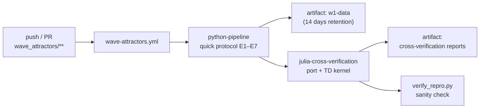

<!-- AB-ENRICHED:v2 · wave-deep-dive · .github infrastructure -->

**🧭 [⬆ Wave_attractors/](../README.md) · [🏠 Root README](../../README.md)**

# 🏗 Wave_attractors/.github

> **Repository infrastructure for study W1** — the configuration shelf that keeps the
> hyperbolic wave-attractor study honest: automated checks, pipelines and validation
> that run without human attention. This folder is operational plumbing rather than
> research content; the scientific claims live in the [section README](../README.md),
> the docs and the committed verdicts.

> **🧭 Navigation:** [⬆ Wave_attractors/](../README.md) · [🏠 Root README](../../README.md)

---

## 🗂 What lives here

| Item | What it controls |
|---|---|
| [`workflows/wave-attractors.yml`](workflows/wave-attractors.yml) | the W1 study workflow — quick ray/wave/AB protocol + Julia cross-verification, triggered on every push or PR touching `wave_attractors/**` |

Everything else in the study (experiments, figures, monographs) is invoked *by* this
configuration, never the other way around. Editing files here changes what is checked
and when — it never changes a single number of the study itself. The pipeline that the
workflow drives is documented one level up, in the
[package README](../wave_attractors/README.md).

<strong>⚙️ How a push becomes a verdict (click)</strong>

The full job-by-job breakdown, with every step and its time budget, is described in the
[workflows README](workflows/README.md).

<strong>🧪 What this CI actually protects (click)</strong>

* **Regression safety** — the quick protocol (E1/E2/E3/E5 + E4 + E6 + E7 in fast mode)
  re-runs on every push, so a change that breaks the ray core, the Helmholtz solver or
  the ADE-FDTD time-domain kernel is caught before it can contaminate committed data.
* **Cross-language identity** — the Julia port must keep reproducing the Python
  trajectories: the reference dump is rebuilt, replayed in Julia and compared, guarding
  the *3.45·10⁻¹⁵* short-horizon parity claim of the study.
* **Artifact provenance** — every run uploads the regenerated data and the
  cross-verification reports as downloadable artifacts, so any CI verdict can be
  inspected post-mortem.

## 🧭 Where to go next

[📦 Package & results](../wave_attractors/README.md) · [⚙️ Workflow details](workflows/README.md) ·
[📚 Docs shelf](../docs/README.md) · [🎨 Assets shelf](../assets/README.md)

---

🌀 <strong>Hyperbolic Wave Attractors — study W1</strong> · part of
<a href="../../README.md">AB-Cloud Research</a> ·
DOI <a href="https://doi.org/10.5281/zenodo.21825394">10.5281/zenodo.21825394</a> ·
<a href="../../README.md">⬆ section</a>

