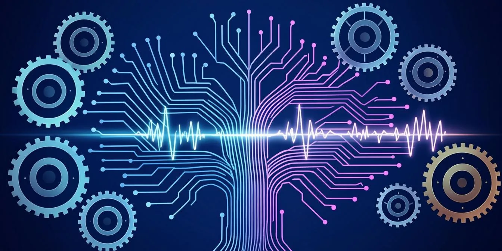
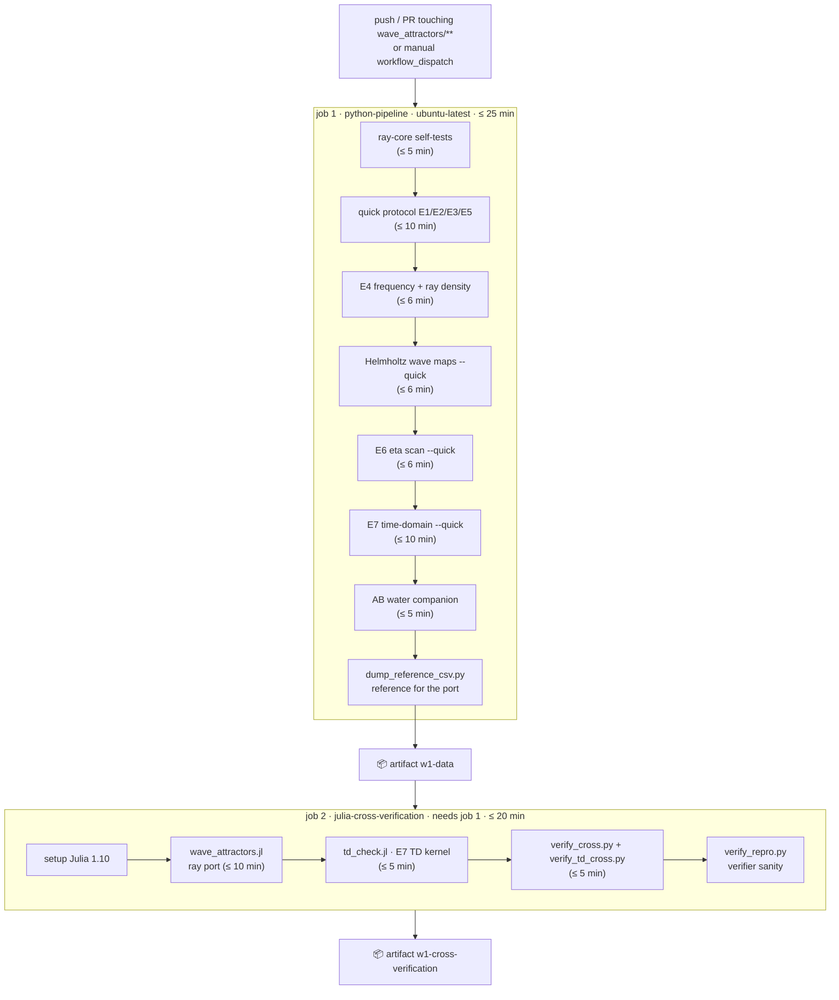

<!-- AB-ENRICHED:v2 · wave-deep-dive · CI workflows -->

**🧭 [⬆ .github/](../README.md) · [⬆⬆ Wave_attractors/](../../README.md) · [🏠 Root README](../../../README.md)**

# 🔁 `.github/workflows` — the W1 study workflow

> **One YAML file, two jobs, one verdict.** [`wave-attractors.yml`](wave-attractors.yml)
> is the automated conscience of the hyperbolic wave-attractor study: it replays the
> quick experimental protocol on every push, then makes the Julia port prove that it
> still agrees with Python to machine precision.

> **🧭 Navigation:** [⬆ .github/](../README.md) · [⬆⬆ Wave_attractors/](../../README.md) · [🏠 Root README](../../../README.md)

---

## 🗺 Job graph

## ⏱ Step budgets at a glance

| Job | Step | Command (condensed) | Timeout |
|---|---|---|---:|
| python-pipeline | Ray-core self-tests | `ray_billiard.py` | 5 min |
| | Quick protocol | `run_experiments.py --quick` | 10 min |
| | E4 | `e4_frequency.py` | 6 min |
| | Wave maps | `wave_directional.py --quick` | 6 min |
| | E6 η-scan | `e6_eta_scan.py --quick` | 6 min |
| | E7 time-domain | `e7_time_domain.py --quick` | 10 min |
| | AB companion | `ab_water.py` | 5 min |
| | Reference dump | `dump_reference_csv.py` | — |
| julia-cross-verification | Julia ray port | `julia wave_attractors.jl wave_attractors` | 10 min |
| | Julia TD kernel | `julia td_check.jl …/julia_td` | 5 min |
| | Cross-verification | `verify_cross.py` · `verify_td_cross.py` | 5 min |
| | Reproducibility sanity | `verify_repro.py --reference … --candidate …` | 5 min |

<strong>📦 Artifacts & permissions (click)</strong>

| Artifact | Contents | Retention |
|---|---|---|
| `w1-data` | the regenerated `wave_attractors/data/` tree | 14 days |
| `w1-cross-verification` | `cross_verification.json` + `td_cross_verification.json` | 14 days |

The workflow declares `permissions: contents: read` — it can read the repository and
nothing else. Both jobs upload their artifacts `if: always()`, so even a red run
leaves an inspectable trail.

<strong>🔬 Why the two-job split (click)</strong>

The split mirrors the study's own reproducibility doctrine: **job 1 produces**, **job 2
disproves**. The Python pipeline is allowed to be fast and approximate (`--quick`
protocol); the Julia job then re-derives the same physics from the frozen reference
dump with an independent implementation. If the two ever disagree beyond floating-point
noise — the study's measured identity is *3.45·10⁻¹⁵* over 1200 bounce points for rays
and *2.4·10⁻¹⁵* over 400 steps for the TD kernel — the run goes red, and no number on
this folder's READMEs is trusted until it is green again.

## 🧭 Where to go next

[🏗 .github shelf](../README.md) · [📦 Package README](../../wave_attractors/README.md) ·
[⚙️ Julia port](../../wave_attractors/scripts/julia/README.md)

---

🌀 <strong>Hyperbolic Wave Attractors — study W1</strong> · part of
<a href="../../../README.md">AB-Cloud Research</a> ·
DOI <a href="https://doi.org/10.5281/zenodo.21825394">10.5281/zenodo.21825394</a> ·
<a href="../README.md">⬆ parent</a>

