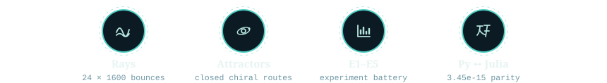
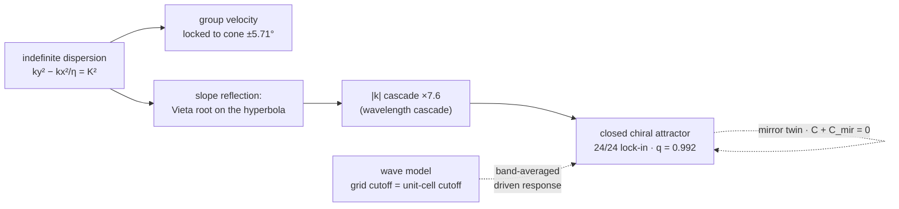

<div align="center">



# 🌀 Hyperbolic Wave Attractors

**Self-organization of waves into closed, chiral, broadband trajectories in an anisotropic
(hyperbolic) cavity — a numerical reproduction of "Hyperbolic wave attractors"
(Nature Physics, 2026, CUNY ASRC), packaged as study W1 of the AB-Cloud Research repository.**

[](#-what-is-reproduced)
[](#-key-results-full-protocol)
[](#-physics-in-one-paragraph)
[](#-key-results-full-protocol)
[](#-key-results-full-protocol)
[](#-reproducibility-notes)
[](https://doi.org/10.1038/s41567-026-03453-7)
[](https://github.com/wild8highlander/ab-cloud-research/actions/workflows/wave-attractors.yml)

[What is reproduced](#-what-is-reproduced) · [Key results](#-key-results-full-protocol) · [Physics](#-physics-in-one-paragraph) · [Layout](#-repository-layout) · [Quick start](#-quick-start) · [Reproducibility](#-reproducibility-notes) · [Citation](#-citation)

</div>

---

> Author of all codes and research: **Isaev, Iskhak Khamzatovich** ·
> ORCID [0009-0003-7299-0701](https://orcid.org/0009-0003-7299-0701) ·
> part of [`ab-cloud-research`](https://github.com/wild8highlander/ab-cloud-research)

## 🗂 Table of contents

<details open>
<summary><strong>Expand / collapse</strong></summary>

1. [🎯 What is reproduced](#-what-is-reproduced)
2. [🏆 Key results (full protocol, 24 rays × 1600 bounces, η = 100)](#-key-results-full-protocol-24-rays--1600-bounces--100)
3. [🧠 Physics in one paragraph](#-physics-in-one-paragraph)
4. [🗺 Repository layout](#-repository-layout)
5. [🚀 Quick start](#-quick-start)
6. [🛡 Reproducibility notes](#-reproducibility-notes)
7. [📖 Citation](#-citation)
8. [🔗 Related layers of the project](#-related-layers-of-the-project)

</details>

---

## 🎯 What is reproduced

In the reference experiment, elastodynamic waves launched into an odd-shaped cavity made of a
hyperbolic metamaterial skip chaotic scattering and self-organize into **robust, chiral,
broadband, scale-invariant closed routes** — *hyperbolic wave attractors*. This study rebuilds
the phenomenon from first principles, at two description levels:

| Level | Model | Physics |
|-------|-------|---------|
| Rays | `ray_billiard.py` — exact k-vector billiard in a polygon | indefinite dispersion `ky² − kx²/η = K²`, group-velocity cone `±arctan(1/√η)`, non-specular Vieta-root reflection |
| Waves | `wave_directional.py` — frequency-domain anisotropic Helmholtz (sparse LU) | same dispersion, PEC walls, band-averaged driven response |
| Companion | `ab_water.py` — Aharonov–Bohm water-wave scattering (Berry 1980; OIST 2026) | vortex-induced geometric phase, rotating nodal patterns |

<div align="center">



</div>

> A popular account of the reference experiment (in Russian) is available at
> [Naked Science, 30.09.2026](https://naked-science.ru/article/physics/volny-samoorganizovalis-vstrukturu).

---

## 🏆 Key results (full protocol, 24 rays × 1600 bounces, η = 100)

| Observable | Value | Experiment |
|---|---|:---:|
| Attractor lock-in, hyperbolic vs isotropic | **24/24 (1.00)** vs **0/24 (0.00)** | E2 |
| Wavelength cascade at slope reflections | mean \|k\| growth **×7.6** (transient), max ×65 | E1 |
| Geometric convergence to the route | q = 0.992 (median) | E1 |
| Chirality: mirror pair C + C_mir | **0.0 (machine precision)**, Hausdorff 0.0 | E3 |
| Coexisting circulation senses | C = ±0.4683, ±0.0317, 0 (spontaneous selection) | E3 |
| Frequency independence (K = 1 vs K = 7) | max deviation **0.0** (exact) | E4a |
| Ray-density corridor contrast | **×5.47** on the route | E4c |
| Python ↔ Julia short-horizon identity | max deviation **3.45·10⁻¹⁵** over 1200 bounce points | cross-verification |
| AB water waves: phase winding | W(−α) = −W(α) exactly; mirror correlation **1.0** | companion |

The **attractor phase diagram** (E5) maps the lock-in fraction over the
(slope length s × vertical-wall extent y_v) plane: a robust attractor phase at small slopes
and a regular (non-attracting) phase at steep slopes — the numerical analogue of the
"attractor phase transitions" reported in the reference study.

---

## 🧠 Physics in one paragraph

The hyperbolic dispersion confines the group velocity to a narrow cone around the optical axis
(half-angle arctan(1/√η); 5.71° at η = 100), while reflection off an inclined wall is governed
by tangential phase matching on the *open* iso-frequency hyperbola: the reflected state is the
second intersection of the line k_t = const with the hyperbola (Vieta root), not a mirror
image. Each slope reflection therefore jumps the wave vector along the hyperbola — \|k\| grows
geometrically (the **wavelength cascade** of the reference paper) and the propagation angle
saturates at the dispersion asymptote. In a chamber that combines vertical walls (specular for
this dispersion: kx → −kx) with shallow slopes (s < 1/√η), the cascade funnels every launched
ray onto one and the same closed route; the route is chiral, frequency-independent, and
coexists with its mirror sibling. The unbounded \|k\| cascade is regularised in the wave model
by the grid cutoff — the numerical analogue of the metamaterial unit-cell cutoff in the
experiment.



---

## 🗺 Repository layout

```
Wave_attractors/
├── README.md                  ← this file
├── docs/
│   └── wave-attractors.md     ← the mkDocs article page of study W1
├── assets/                    ← banner + avatar art
└── wave_attractors/           ← the study package
    ├── REPRODUCING.md         ← rebuild-from-source guide (three tiers)
    ├── requirements.txt       ← Python dependencies
    ├── scripts/
    │   ├── ray_billiard.py    ← ray core + self-tests (python3 ray_billiard.py)
    │   ├── run_experiments.py ← E1/E2/E3/E5 + cross-reference dump
    │   ├── e4_frequency.py    ← E4a invariance + E4c ray density
    │   ├── wave_helmholtz.py  ← isotropic-drive wave response
    │   ├── wave_directional.py ← directional-drive band-averaged wave maps
    │   ├── ab_water.py        ← companion: AB effect with water waves
    │   ├── dump_reference_csv.py ← launch states for the Julia port
    │   ├── verify_cross.py    ← Python ↔ Julia cross-verification
    │   ├── make_figures.py    ← all figures (300 dpi)
    │   └── julia/
    │       └── wave_attractors.jl ← Julia port (stdlib only, Julia ≥ 1.10)
    ├── data/                  ← CSV/JSON/NPZ outputs (regenerable)
    ├── figures/               ← PNG figures (300 dpi)
    ├── monograph/             ← W1 monographs (EN/RU, DOCX + PDF, with figures)
    └── report/                ← scientific report (PDF, Russian)
```

---

## 🚀 Quick start

```bash
# 1. ray-level experiments + cross-reference dump (≈ 1 min)
python3 wave_attractors/scripts/run_experiments.py

# 2. frequency independence + ray-density map (≈ 30 s)
python3 wave_attractors/scripts/e4_frequency.py

# 3. wave-level simulation (needs scipy; ≈ 1 min)
python3 wave_attractors/scripts/wave_directional.py

# 4. companion AB study (≈ 10 s)
python3 wave_attractors/scripts/ab_water.py

# 5. Julia cross-verification (needs julia >= 1.10; ≈ 1 min)
python3 wave_attractors/scripts/dump_reference_csv.py
julia wave_attractors/scripts/julia/wave_attractors.jl wave_attractors
python3 wave_attractors/scripts/verify_cross.py

# 6. figures
python3 wave_attractors/scripts/make_figures.py
```

Or simply: `make wave-attractors` (full) / `make wave-attractors-quick` (CI protocol) —
see the top-level `Makefile`.

---

## 🛡 Reproducibility notes

* All launch states are seeded (`numpy.random.default_rng`); the corner handling is
  deterministic (bisector reflection — a rounded-corner defect model), so the Python and
  Julia trajectories are bitwise-comparable up to floating-point operation order (measured
  max deviation 3.45·10⁻¹⁵ over 1200 bounce points, `data/cross_verification.json`).
* Individual long-horizon (1600-bounce) trajectories are chaotic during the cascade phase:
  round-off differences amplify exponentially. Cross-language agreement is therefore verified
  on (i) short-horizon trajectories and (ii) statistical attractor observables (lock fraction,
  period set, cascade scale) — both pass.
* The wave model uses a moderate anisotropy (η = 9) where the whole cascade is
  grid-resolvable; the ray level covers the strongly hyperbolic regime (η = 100). The grid
  cutoff plays the role of the metamaterial unit-cell cutoff that terminates the cascade in
  the experiment.
* CI: `.github/workflows/wave-attractors.yml` runs the quick protocol and the Julia
  cross-verification on every push.

---

## 📖 Citation

If you use this study, please cite both the reference experiment and this repository
(see the root `CITATION.cff`):

* Hyperbolic wave attractors, *Nature Physics* (2026),
  DOI: [10.1038/s41567-026-03453-7](https://doi.org/10.1038/s41567-026-03453-7)
  (CUNY Advanced Science Research Center).
* Isaev I. K., AB-Cloud Research — study W1: Hyperbolic wave attractors (numerical
  reproduction), 2026. Zenodo DOI: [10.5281/zenodo.21825394](https://doi.org/10.5281/zenodo.21825394).

License: see the root [LICENSE](../LICENSE) — Strictly Personal · Custom Research License.

---

## 🔗 Related layers of the project

| Layer | What it adds |
|---|---|
| [`Hilbert_Polya/`](../Hilbert_Polya/README.md) | the v2 research programme: campaigns C1–C17, theorems T1–T18, the D_nn bridge (verdict v2.0.7) |
| [`meridian-spectral-observatory/`](../meridian-spectral-observatory/README.md) | the standalone observatory: 13 self-contained benches, gates H1–H7 |
| [`Vortex_optimization/`](../Vortex_optimization/README.md) | the 242-configuration dial scan (D: 0.1096 → 0.0318) |
| [`apps/`](../apps/README.md) | the browser layer: dashboard + WebGL 3-D laboratory |

---

<p align="center">
  <sub><em>Chaotic cavity in — one chiral route out. The route is the physics.</em></sub>
</p>
