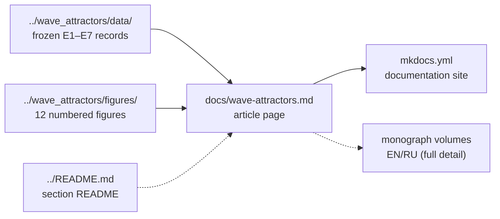

<!-- AB-ENRICHED:v2 · wave-deep-dive · documentation shelf -->

**🧭 [⬆ Wave_attractors/](../README.md) · [🏠 Root README](../../README.md)**

# 📚 `docs/` — the article shelf

> **Where study W1 explains itself in prose.** The READMEs of this folder are maps and
> inventories; the documents here are the *narrative* — theory, method and protocol
> written out for a reader who wants the reasoning, not just the numbers. The documents
> are committed sources: rendered versions, where they exist, are generated from these files.

> **🧭 Navigation:** [⬆ Wave_attractors/](../README.md) · [🏠 Root README](../../README.md)

---

## 🗂 What lives here

| File | Size | What it is |
|---|---|---|
| [`wave-attractors.md`](wave-attractors.md) | 4.8 KB | the mkDocs article page of study W1 — the condensed write-up behind the README |

Alongside the documents, the folder-level [`mkdocs.yml`](../mkdocs.yml) at
`Wave_attractors/` wires this article into the documentation site, so the study is
readable as a proper article page and not only as a repository walk.

<strong>🔬 What the article covers beyond the README (click)</strong>

The article compresses the same physics into a linear read: the indefinite dispersion
`ky² − kx²/η = K²` and the group-velocity cone, the Vieta-root reflection law on the open
iso-frequency hyperbola, the wavelength cascade, and the experiment battery E1–E7 with
its controls. It is deliberately shorter than the monographs in
[`../wave_attractors/monograph/`](../wave_attractors/monograph/) — think of it as the
*journal-page* layer between the README tables and the full volumes.

<strong>🗺️ Document lineage (click)</strong>

The arrow direction matters: the article cites the frozen data and the canonical
figures — never the other way around. Regenerate figures or data, and the article's
claims must still hold verbatim; edit the article, and nothing downstream changes.

## 🧭 Where to go next

[🌀 Section README](../README.md) · [📕 Monograph volumes](../wave_attractors/monograph/README.md) ·
[🗃 Frozen data](../wave_attractors/data/README.md)

---

🌀 <strong>Hyperbolic Wave Attractors — study W1</strong> · part of
<a href="../../README.md">AB-Cloud Research</a> ·
DOI <a href="https://doi.org/10.5281/zenodo.21825394">10.5281/zenodo.21825394</a> ·
<a href="../README.md">⬆ section</a>

