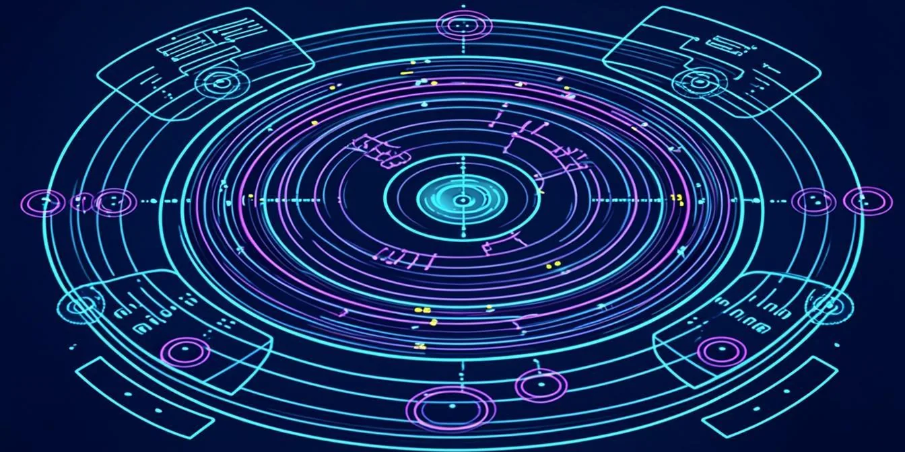
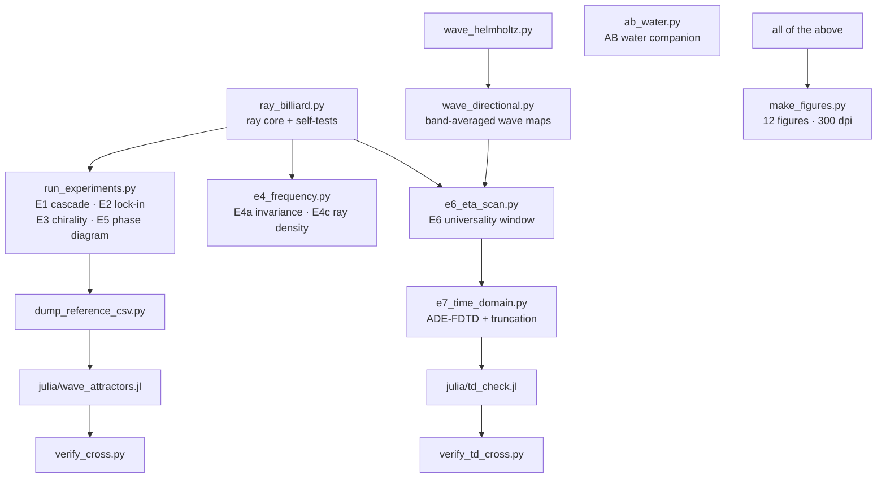
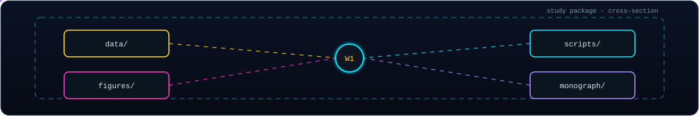

<!-- AB-ENRICHED:v2 · wave-deep-dive · study package W1 -->
<div align="center">


**🧭 [⬆ Wave_attractors/](../README.md) · [🏠 Root README](../../README.md)**

</div>

<div align="center">




</div>

# 📦 `wave_attractors/` — the study package

**Hyperbolic Wave Attractors: Numerical Reproduction Study.**

**Self-organization of waves into closed, chiral, broadband trajectories in
an anisotropic (hyperbolic) cavity — a numerical reproduction of
"Hyperbolic wave attractors" (Nature Physics, 2026, CUNY ASRC), packaged as
study W1 of the AB-Cloud Research repository.**

A popular account of the reference experiment (in Russian) is available at
[Naked Science, 30.09.2026](https://naked-science.ru/article/physics/volny-samoorganizovalis-vstrukturu).

> **🧭 Navigation:** [⬆ Wave_attractors/](../README.md) · [🏠 Root README](../../README.md)

---

## What is reproduced

In the reference experiment, elastodynamic waves launched into an
odd-shaped cavity made of a hyperbolic metamaterial skip chaotic
scattering and self-organize into **robust, chiral, broadband, scale-invariant
closed routes** — *hyperbolic wave attractors*. This study rebuilds the
phenomenon from first principles, at two description levels:

| Level | Model | Physics |
|-------|-------|---------|
| Rays  | `ray_billiard.py` — exact k-vector billiard in a polygon | indefinite dispersion `ky² − kx²/η = K²`, group-velocity cone `±arctan(1/√η)`, non-specular Vieta-root reflection |
| Waves | `wave_directional.py` — frequency-domain anisotropic Helmholtz (sparse LU) | same dispersion, PEC walls, band-averaged driven response |
| Companion | `ab_water.py` — Aharonov–Bohm water-wave scattering (Berry 1980; OIST 2026) | vortex-induced geometric phase, rotating nodal patterns |

## Key results (full protocol, 24 rays × 1600 bounces, η = 100)

| Observable | Value | Experiment |
|---|---|---|
| Attractor lock-in, hyperbolic vs isotropic | **24/24 (1.00)** vs **0/24 (0.00)** | E2 |
| Wavelength cascade at slope reflections | mean \|k\| growth **×7.6** (transient), max ×65 | E1 |
| Geometric convergence to the route | q = 0.992 (median) | E1 |
| Chirality: mirror pair C + C_mir | **0.0 (machine precision)**, Hausdorff 0.0 | E3 |
| Coexisting circulation senses | C = ±0.4683, ±0.0317, 0 (spontaneous selection) | E3 |
| Frequency independence (K = 1 vs K = 7) | max deviation **0.0** (exact) | E4a |
| Ray-density corridor contrast | **×5.47** on the route | E4c |
| Python ↔ Julia short-horizon identity | max deviation **3.45·10⁻¹⁵** over 1200 bounce points | cross-verification |
| AB water waves: phase winding | W(−α) = −W(α) exactly; mirror correlation **1.0** | companion |
| Attractor window in u = s·√η (E6, η = 9…400) | universal **u₁ = 0.176 ± 0.041**, **u₂ = 0.490 ± 0.084** | E6a |
| Wave channeling anisotropy H(η) | 0.78 → 0.87 (isotropic baseline 0.5) | E6b |
| TD corridor capture, hyperbolic vs isotropic pulse | **1.43×** (η_eff = 100, N = 128 cells) | E7a |
| TD cascade front locked on the IFC; pile-up below ω_p/c | \|kₓ\|₉₉: 156 → 169 (fold 402) | E7a |
| Truncation scan: peak capture vs unit cells | **×10 growth** from 32 to 192 cells (η_eff fixed) | E7b |
| Naive (nondispersive) TD model | exponential blow-up, γ = 74.6 ≈ 2/(Δx√η) | E7c |
| Python ↔ Julia TD-kernel identity | max deviation **2.4·10⁻¹⁵** over 400 steps | TD cross-verification |

The **attractor phase diagram** (E5) maps the lock-in fraction over the
(slope length s × vertical-wall extent y_v) plane: a robust attractor phase
at small slopes and a regular (non-attracting) phase at steep slopes — the
numerical analogue of the "attractor phase transitions" reported in the
reference study.

**E6 (η-scan)** extends E5 across two decades of anisotropy (η = 9…400):
the attractor phase is a WINDOW whose BOTH boundaries are universal in the
variable u = s·√η (u₁ = 0.176 ± 0.041, u₂ = 0.490 ± 0.084); the naive
resonance scale s\* = 1/√η (u = 1) OVERESTIMATES the window — in practice
the slopes must be noticeably shallower than the cone-asymptote resonance.
The wave-level counterpart shows the channeling anisotropy of
the band-averaged intensity rising from the isotropic baseline and
saturating at H ≈ 0.85.

**E7 (time domain + unit-cell truncation)** promotes the grid cutoff to a
physical ingredient: the medium is a Drude (wire-mesh) metamaterial with
μ_y(ω) = 1 − ω_p²/ω², ω_p = πc/a set by the cell size. The TD problem —
ill-posed for the naive nondispersive indefinite tensor (exponential
blow-up, E7c) — becomes unconditionally well-posed; at ω₀ = ω_p/√(η+1) the
medium is EXACTLY the η = 100 hyperbolic medium of the ray model. A pulsed
drive shows the funneling in real time (corridor capture 1.43× the
isotropic control) with the k-space cascade locked on the IFC hyperbola
and piling up below the unit-cell fold |kₓ| ≈ ω_p/c; the truncation scan
(32…192 cells) shows the homogenisation convergence of the attractor.

<details>
<summary><strong>🧪 The experiment battery as a graph (click)</strong></summary>



Every driver writes its summary pair into [`data/`](data/README.md); the figure builder
reads those frozen records, never the live state of the simulators.

</details>

<div align="center">


</div>

## Physics in one paragraph

The hyperbolic dispersion confines the group velocity to a narrow cone
around the optical axis (half-angle arctan(1/√η); 5.71° at η = 100), while
reflection off an inclined wall is governed by tangential phase matching on
the *open* iso-frequency hyperbola: the reflected state is the second
intersection of the line k_t = const with the hyperbola (Vieta root), not a
mirror image. Each slope reflection therefore jumps the wave vector along
the hyperbola — |k| grows geometrically (the **wavelength cascade** of the
reference paper) and the propagation angle saturates at the dispersion
asymptote. In a chamber that combines vertical walls (specular for this
dispersion: kx → −kx) with shallow slopes (s < 1/√η), the cascade funnels
every launched ray onto one and the same closed route; the route is chiral,
frequency-independent, and coexists with its mirror sibling. The unbounded
|k| cascade is regularised in the wave model by the grid cutoff — the
numerical analogue of the metamaterial unit-cell cutoff in the experiment.

## Repository layout

<div align="center">



</div>

```
wave_attractors/
├── README.md                  ← this file (English)
├── REPRODUCING.md             ← rebuild-from-source guide (three tiers)
├── requirements.txt           ← Python dependencies
├── scripts/
│   ├── ray_billiard.py        ← ray core + self-tests (python3 ray_billiard.py)
│   ├── run_experiments.py     ← E1/E2/E3/E5 + cross-reference dump
│   ├── e4_frequency.py        ← E4a invariance + E4c ray density
│   ├── wave_helmholtz.py      ← isotropic-drive wave response
│   ├── wave_directional.py    ← directional-drive band-averaged wave maps
│   ├── e6_eta_scan.py         ← E6: anisotropy scan (ray universality + waves)
│   ├── e7_time_domain.py      ← E7: ADE-FDTD time domain + unit-cell truncation
│   ├── ab_water.py            ← companion: AB effect with water waves
│   ├── dump_reference_csv.py  ← launch states for the Julia port
│   ├── verify_cross.py        ← Python ↔ Julia cross-verification (rays)
│   ├── verify_td_cross.py     ← Python ↔ Julia cross-verification (TD kernel)
│   ├── make_figures.py        ← all figures (300 dpi, --lang en|ru)
│   └── julia/
│       ├── wave_attractors.jl ← Julia port (stdlib only, Julia ≥ 1.10)
│       └── td_check.jl        ← Julia E7 TD kernel for cross-verification
├── data/                      ← CSV/JSON/NPZ outputs (regenerable)
├── figures/                   ← PNG figures (300 dpi)
├── monograph/                 ← W1 monographs (EN/RU, DOCX + PDF, with figures)
└── report/                    ← scientific report (PDF, Russian)
```

## Quick start

```bash
# 1. ray-level experiments + cross-reference dump (≈ 1 min)
python3 wave_attractors/scripts/run_experiments.py

# 2. frequency independence + ray-density map (≈ 30 s)
python3 wave_attractors/scripts/e4_frequency.py

# 3. wave-level simulation (needs scipy; ≈ 1 min)
python3 wave_attractors/scripts/wave_directional.py

# 4. companion AB study (≈ 10 s)
python3 wave_attractors/scripts/ab_water.py

# 5. Julia cross-verification (needs julia >= 1.10; ≈ 1 min)
python3 wave_attractors/scripts/dump_reference_csv.py
julia wave_attractors/scripts/julia/wave_attractors.jl wave_attractors
python3 wave_attractors/scripts/verify_cross.py

# 6. figures
python3 wave_attractors/scripts/make_figures.py
```

Or simply: `make wave-attractors` (full) / `make wave-attractors-quick`
(CI protocol) — see the top-level `Makefile`.

## Reproducibility notes

* All launch states are seeded (`numpy.random.default_rng`); the corner
  handling is deterministic (bisector reflection — a rounded-corner defect
  model), so the Python and Julia trajectories are bitwise-comparable up to
  floating-point operation order (measured max deviation 3.45·10⁻¹⁵ over
  1200 bounce points, `data/cross_verification.json`).
* Individual long-horizon (1600-bounce) trajectories are chaotic during the
  cascade phase: round-off differences amplify exponentially. Cross-language
  agreement is therefore verified on (i) short-horizon trajectories and
  (ii) statistical attractor observables (lock fraction, period set,
  cascade scale) — both pass.
* The wave model uses a moderate anisotropy (η = 9) where the whole cascade
  is grid-resolvable; the ray level covers the strongly hyperbolic regime
  (η = 100). The grid cutoff plays the role of the metamaterial unit-cell
  cutoff that terminates the cascade in the experiment.
* CI: [`.github/workflows/wave-attractors.yml`](../.github/workflows/wave-attractors.yml)
  runs the quick protocol and the Julia cross-verification on every push.

## Reproducibility

The study is **fully self-contained**: every number, figure and document in
`wave_attractors/` regenerates from the committed sources alone — the
original news/paper that motivated the study is not needed (the physics,
all parameters and all observables are stated in the README and the
monographs, and every constant is encoded in the code).

A blind cold-start audit (2026-10-01: all derived artifacts deleted, full
pipeline re-run from the Makefile only) reproduced:

* **31/31** data files (22 bitwise identical, 9 exact within tolerance);
* **12/12** figures bitwise identical (sha256);
* report PDF: 14 pages, extracted text identical;
* monograph DOCX (RU/EN): `word/document.xml` bitwise identical.

See [REPRODUCING.md](REPRODUCING.md) for the tiered protocol, the verifier
(`make wave-attractors-verify`) and the certificate
(`data/REPRODUCIBILITY.json`).

## Citation

If you use this study, please cite both the reference experiment and this
repository (see the root `CITATION.cff`):

* Hyperbolic wave attractors, *Nature Physics* (2026),
  DOI: 10.1038/s41567-026-03453-7 (CUNY Advanced Science Research Center).
* Isaev I. K., AB-Cloud Research — study W1: Hyperbolic wave attractors
  (numerical reproduction), 2026. Zenodo DOI: 10.5281/zenodo.21825394.

## License

See the root [LICENSE](../../LICENSE) — Strictly Personal · Custom Research
License.

## 🗂 Folder contents

| Item | What it is |
|---|---|
| [`REPRODUCING.md`](REPRODUCING.md) | rebuild-from-source guide (three tiers) |
| [`requirements.txt`](requirements.txt) | Python dependencies |
| [`data/`](data/README.md) | frozen experiment records E1–E7 (CSV/JSON/NPZ) |
| [`figures/`](figures/README.md) | the 12 numbered publication figures |
| [`monograph/`](monograph/README.md) | W1 monograph volumes (EN/RU, DOCX + PDF) |
| [`report/`](report/README.md) | the Russian-language working report (PDF) |
| [`scripts/`](scripts/README.md) | the executable layer: simulators, drivers, verifiers |

---

<div align="center">



<a href="../README.md"></a>

<sub>🌀 <strong>Hyperbolic Wave Attractors — study W1</strong> · part of
<a href="../../README.md">AB-Cloud Research</a> ·
DOI <a href="https://doi.org/10.5281/zenodo.21825394">10.5281/zenodo.21825394</a> ·
<a href="../README.md">⬆ section</a></sub>

</div>
