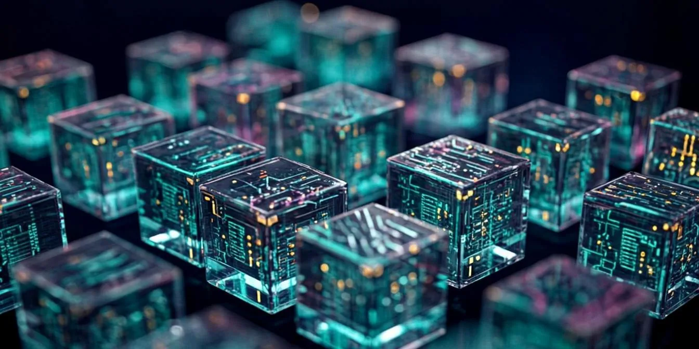
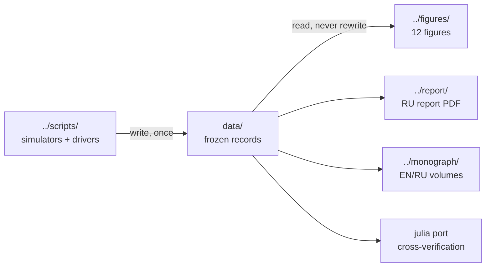

<!-- AB-ENRICHED:v2 · wave-deep-dive · frozen data shelf -->

**🧭 [⬆ wave_attractors/](../README.md) · [🏠 Root README](../../../README.md)**

# 🗃️ `data/` — the frozen record of study W1

> **Experiment summaries E1–E7 of the W-1 study: convergence tracks, controls and the water-metrics bundle.**

The numeric record of the hyperbolic wave-attractor study: per-experiment summary files (`E1…E7` as CSV + JSON pairs) covering the cascade-slope hits, convergence, the attractor-vs-control comparison, and the parameter scans, plus [`AB_water_metrics.json`](AB_water_metrics.json) — the consolidated metrics bundle the report quotes from. Upper layers of the package cite these files; the files cite nothing but the runs that produced them.

> **🧭 Navigation:** [⬅ wave_attractors/](../README.md) · [→ figures](../figures/README.md) · [→ scripts](../scripts/README.md) · [🏠 Repo root](../../../README.md)

## 📁 Contents

| Item | Kind | Size | What it is |
|---|---|---|---|
| [`AB_water_metrics.json`](AB_water_metrics.json) | JSON | 1.0 KB | — |
| [`cross_verification.json`](cross_verification.json) | JSON | 1.1 KB | — |
| [`E1_cascade_slope_hits.csv`](E1_cascade_slope_hits.csv) | CSV | 23.4 KB | — |
| [`E1_convergence.csv`](E1_convergence.csv) | CSV | 1.6 KB | — |
| [`E1_summary.json`](E1_summary.json) | JSON | 281 B | — |
| [`E2_control.csv`](E2_control.csv) | CSV | 922 B | — |
| [`E2_summary.json`](E2_summary.json) | JSON | 189 B | — |
| [`E3_chirality.csv`](E3_chirality.csv) | CSV | 1.6 KB | — |
| [`E3_summary.json`](E3_summary.json) | JSON | 299 B | — |
| [`E4_frequency_invariance.json`](E4_frequency_invariance.json) | JSON | 316 B | — |
| [`E4_ray_density.npz`](E4_ray_density.npz) | NumPy | 2.3 MB | — |
| [`E4_summary.json`](E4_summary.json) | JSON | 457 B | — |
| [`E4_wave_maps.npz`](E4_wave_maps.npz) | NumPy | 3.1 MB | — |
| [`E5_phase_diagram.csv`](E5_phase_diagram.csv) | CSV | 459 B | — |
| [`E5_summary.json`](E5_summary.json) | JSON | 179 B | — |
| [`E6_eta_scan.csv`](E6_eta_scan.csv) | CSV | 2.8 KB | — |
| [`E6_summary.json`](E6_summary.json) | JSON | 3.7 KB | — |
| [`E6_wave_scan.npz`](E6_wave_scan.npz) | NumPy | 1.8 MB | — |
| [`E7_kspectra.npz`](E7_kspectra.npz) | NumPy | 2.8 MB | — |
| [`E7_route_fraction.csv`](E7_route_fraction.csv) | CSV | 299.6 KB | — |
| [`E7_summary.json`](E7_summary.json) | JSON | 3.7 KB | — |
| [`E7_td_snapshots.npz`](E7_td_snapshots.npz) | NumPy | 6.0 MB | — |
| [`E7_truncation_scan.csv`](E7_truncation_scan.csv) | CSV | 1.0 KB | — |
| [`julia_td_td_snapshots.csv`](julia_td_td_snapshots.csv) | CSV | 534.2 KB | — |
| … | — | +8 more | remaining entries are same-type artifacts |

<strong>🧪 Which files belong to which experiment (click)</strong>

| Experiment | Files here | Feeds figure(s) |
|---|---|---|
| **E1** — cascade & convergence | `E1_cascade_slope_hits.csv`, `E1_convergence.csv`, `E1_summary.json` | 02, 09 |
| **E2** — attractor vs control | `E2_control.csv`, `E2_summary.json` | 03 |
| **E3** — chirality | `E3_chirality.csv`, `E3_summary.json` | 05 |
| **E4** — frequency invariance & ray density | `E4_frequency_invariance.json`, `E4_ray_density.npz`, `E4_wave_maps.npz`, `E4_summary.json` | 06, 07 |
| **E5** — phase diagram | `E5_phase_diagram.csv`, `E5_summary.json` | 04 |
| **E6** — η-scan | `E6_eta_scan.csv`, `E6_wave_scan.npz`, `E6_summary.json` | 10 |
| **E7** — time domain & truncation | `E7_kspectra.npz`, `E7_route_fraction.csv`, `E7_td_snapshots.npz`, `E7_truncation_scan.csv`, `E7_summary.json` | 11, 12 |
| **cross-verification** | `cross_verification.json`, `julia_td_td_snapshots.csv` (+ TD twin) | 09 |
| **companion** | `AB_water_metrics.json` | 08 |

<strong>🧊 The frozen-data discipline (click)</strong>

This folder holds **frozen, committed data**: the byte-identical inputs that the verification pipeline reads. The discipline of the repository is that nothing downstream depends on a recomputation — every figure, test and document replays these committed files, so editing or regenerating them in place is forbidden by convention. Where a file also exists in another module's canon, the copies are byte-identical by design. The blind cold-start audit of 2026-10-01 re-derived this folder from scratch and reproduced **31/31 files** (22 bitwise identical, 9 exact within tolerance) — see the [package README](../README.md#reproducibility).

## 🧭 Navigation

[⬅ wave_attractors/](../README.md) · [→ figures](../figures/README.md) · [→ scripts](../scripts/README.md) · [🏠 Repo root](../../../README.md)

---

🌀 <strong>Hyperbolic Wave Attractors — study W1</strong> · part of the
<a href="../../../README.md">AB-Cloud Research</a> repository ·
DOI <a href="https://doi.org/10.5281/zenodo.21825394">10.5281/zenodo.21825394</a> ·
© 2026 Isaev Iskhak Khamzatovich — personal proprietary use, see the
<a href="../../../LICENSE">license terms</a>

