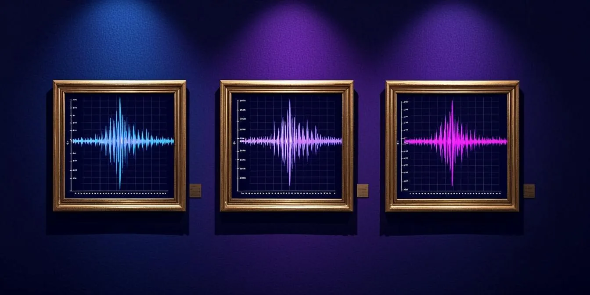

<!-- AB-ENRICHED:v2 · wave-deep-dive · figure gallery -->

**🧭 [⬆ wave_attractors/](../README.md) · [🏠 Root README](../../../README.md)**

# 🖼️ `figures/` — the numbered figure set

> **The numbered figure set of the W-1 study, from chambers to wave maps.**

Figures `01…12` of the wave-attractor study — chambers and the cone, the cascade, attractor vs control, the phase diagram, chirality, wave maps, ray density, the AB water companion, cross-verification, the η-scan, the time domain and the truncation scan. Rendered by the scripts in [`../scripts/`](../scripts/README.md) from [`../data/`](../data/README.md); regenerate rather than edit.

> **🧭 Navigation:** [⬅ wave_attractors/](../README.md) · [→ data](../data/README.md) · [🏠 Repo root](../../../README.md)

## 📁 Contents — every figure mapped to its experiment

| Figure | Kind | Size | What it shows | Built from |
|---|---|---|---|---|
| [`01_chambers_and_cone.png`](01_chambers_and_cone.png) | PNG | 262.5 KB | the two chambers and the group-velocity cone | chamber geometry |
| [`02_cascade.png`](02_cascade.png) | PNG | 288.3 KB | the wavelength cascade at slope reflections | E1 |
| [`03_attractor_vs_control.png`](03_attractor_vs_control.png) | PNG | 3.9 MB | hyperbolic lock-in vs isotropic control routes | E2 |
| [`04_phase_diagram.png`](04_phase_diagram.png) | PNG | 160.7 KB | the attractor phase diagram over (s, y_v) | E5 |
| [`05_chirality.png`](05_chirality.png) | PNG | 352.6 KB | the chiral mirror pair C / C_mir | E3 |
| [`06_wave_maps.png`](06_wave_maps.png) | PNG | 4.3 MB | band-averaged wave intensity maps | E4 |
| [`07_ray_density.png`](07_ray_density.png) | PNG | 310.0 KB | ray-density corridor on the route | E4c |
| [`08_ab_water.png`](08_ab_water.png) | PNG | 2.1 MB | AB water-wave companion: rotating nodal patterns | companion |
| [`09_cross_verification.png`](09_cross_verification.png) | PNG | 122.9 KB | Python ↔ Julia trajectory identity | cross-verification |
| [`10_eta_scan.png`](10_eta_scan.png) | PNG | 305.5 KB | the universal η-scan window (u₁, u₂) | E6 |
| [`11_time_domain.png`](11_time_domain.png) | PNG | 1.2 MB | pulsed TD funneling, k-space cascade | E7a |
| [`12_truncation.png`](12_truncation.png) | PNG | 183.0 KB | homogenisation convergence vs unit cells | E7b |

<strong>🛠 How the figures are produced (click)</strong>

All twelve come from a single builder — [`../scripts/make_figures.py`](../scripts/make_figures.py)
(`300 dpi`, `--lang en|ru`) — reading **only** the frozen records in
[`../data/`](../data/README.md). The committed copies are the canonical versions that
the report and the monographs embed; the blind cold-start audit reproduced all
**12/12 bitwise identical (sha256)**. Treat them as outputs, not sources of truth:
the truth is the data and the code.

## 🧭 Navigation

[⬅ wave_attractors/](../README.md) · [→ data](../data/README.md) · [🏠 Repo root](../../../README.md)

---

🌀 <strong>Hyperbolic Wave Attractors — study W1</strong> · part of the
<a href="../../../README.md">AB-Cloud Research</a> repository ·
DOI <a href="https://doi.org/10.5281/zenodo.21825394">10.5281/zenodo.21825394</a> ·
© 2026 Isaev Iskhak Khamzatovich — personal proprietary use, see the
<a href="../../../LICENSE">license terms</a>

